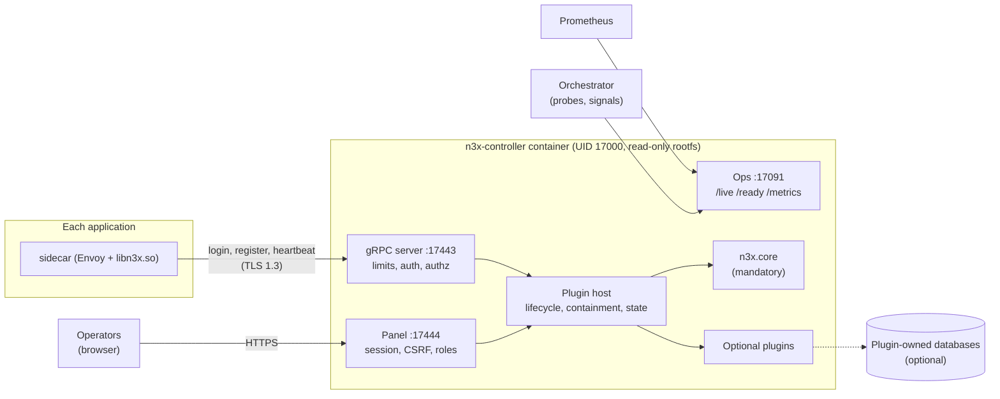
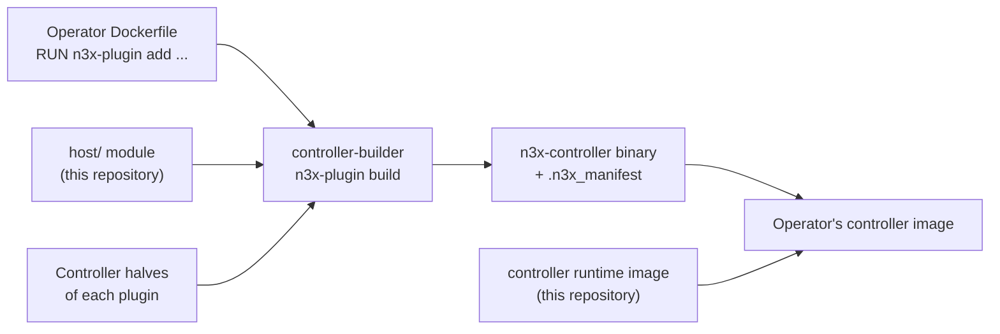
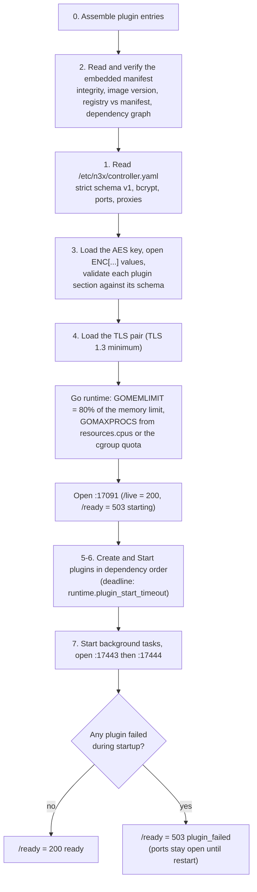
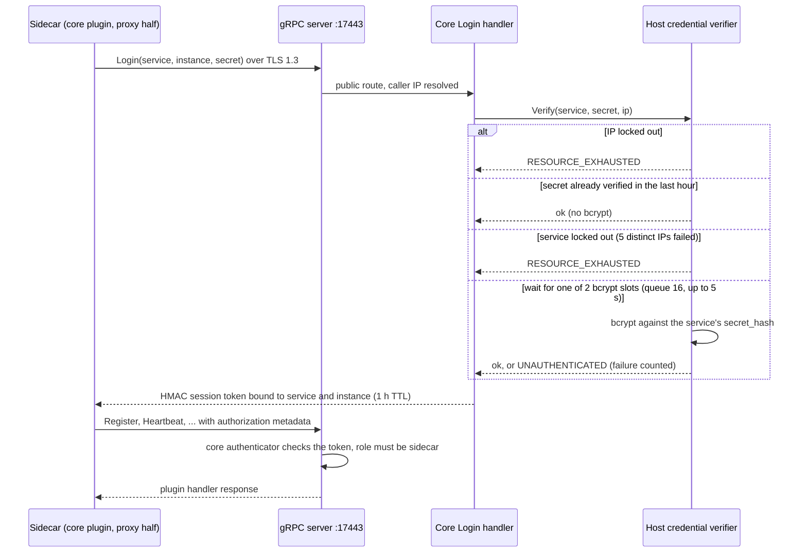
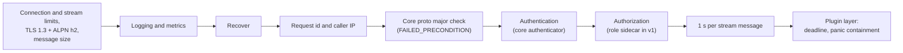
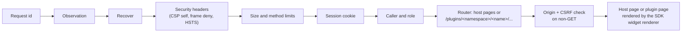
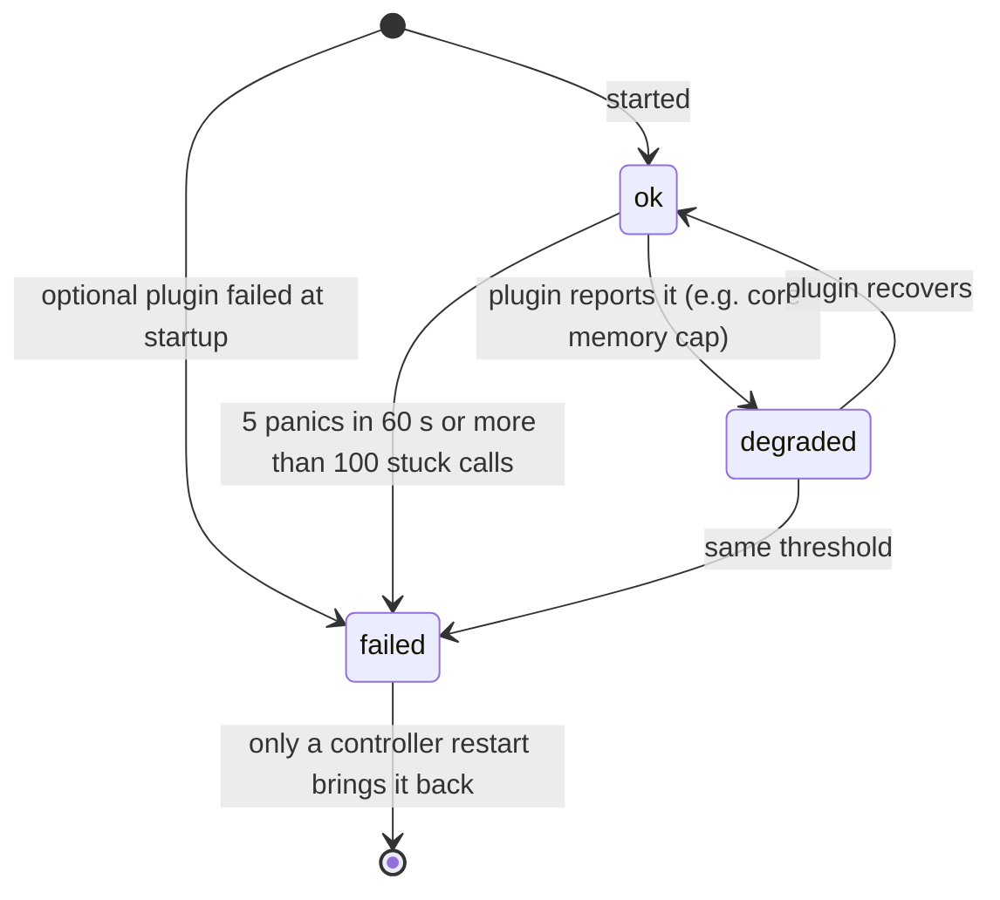

# n3x-controller

The central controller of N3X: a storage-less plugin host that gives every sidecar one authenticated gRPC endpoint and gives operators a read-only web panel with the inventory, effective configs and drift of every instance.

> **Status: pre-implementation (v1 design).** This repository currently holds the approved design: PRD, HLD, ADRs and FDDs under [`docs/`](docs/). Everything below describes the v1 target behavior. Image tags in the examples are illustrative. Performance budgets are hypotheses until the nightly load test measures them.

## Contents

- [What is N3X](#what-is-n3x)
- [What n3x-controller does](#what-n3x-controller-does)
- [How it works](#how-it-works)
- [Images and versioning](#images-and-versioning)
- [Quick start](#quick-start)
- [Configuration (`n3x.yaml`)](#configuration-n3xyaml)
- [Usage by environment](#usage-by-environment)
- [Command reference](#command-reference)
- [Errors and exit codes](#errors-and-exit-codes)
- [Security model](#security-model)
- [Observability](#observability)
- [Capacity and sizing](#capacity-and-sizing)
- [Testing and CI](#testing-and-ci)
- [Repository layout and documentation](#repository-layout-and-documentation)
- [Development](#development)
- [License](#license)

## What is N3X

N3X (Network Navigation Node eXtensible, pronounced "Nex") is an extensible network middleware. It works as an override layer over an Envoy proxy in the sidecar model:

- Every application gets a sidecar next to it, and the sidecar becomes the application's only entry point (HTTP/1.1, HTTP/2 and gRPC).
- Every sidecar connects to a central **controller** that only observes. A read-only web panel shows the inventory, the effective config of each instance and drift between instances. A gRPC server's services grow as plugins are added.
- Network behaviors that each product used to reimplement become **plugins**. All plugins are compiled into a single Go dynamic module loaded inside Envoy, and their controller halves are compiled into the controller binary.
- Each service keeps its own configuration in an `n3x.yaml` file, plugins included. Changing a behavior means editing that file and redeploying, with zero changes to application code.
- N3X is agnostic of language and orchestrator. It runs on Kubernetes, Amazon ECS or docker compose. Istio is a compatibility requirement, not a runtime requirement.

### The problem N3X solves

- Network behaviors (rate limiting, observability, forwarding, redirects and others) are rebuilt from scratch in every service and on every platform. Every new product hits them and ships later.
- Network logic is coupled to each application's code and language. Every language needs its own implementation.
- The usual alternatives fall short. Per-service libraries mean rework per language. A service mesh such as Istio is heavy and requires Kubernetes. API gateways are hard to extend with custom logic or only cover the edge.

| Goal | Metric | v1 target |
| --- | --- | --- |
| Ship new products faster | Time to put a new service behind N3X, registered and visible in the panel | Up to 30 minutes, no application code change |
| Change behavior without touching the app | Application code lines changed to enable, disable or reconfigure a plugin | Zero: edit `n3x.yaml` and redeploy |
| Keep infrastructure light | What it takes to run controller, sidecar and application | A single docker compose, no Kubernetes, in up to 5 minutes |
| Stay language agnostic | Result of the same plugin in services written in different languages | Same behavior over HTTP and gRPC in at least 2 languages |

### The N3X repositories

| Repository | Role |
| --- | --- |
| `n3x-sdk` | Plugin contracts (proxy and controller halves), panel widgets, test kit, plugin generator, example plugin and the reference deployment topologies (`deploy/`) |
| `n3x-sidecar` | Sidecar runtime image (Envoy 1.40 or Istio proxyv2 1.31), Go supervisor entrypoint and the `core/` of the `.so` |
| **`n3x-controller`** | **Controller host (`host/` Go module), runtime image, gRPC server, web panel and operator CLI (this repository)** |
| `n3x-builder` | Build images and the `n3x-plugin` CLI that compile the `.so` and the controller binary |
| `n3x-plugin-core` | Mandatory plugin, always included: sidecar login and session tokens, registration, heartbeat, effective configs, events, inventory and the core panel screens |

## What n3x-controller does

The controller is a single Go process per environment. It hosts the controller halves of the plugins and gives them three things:

| Port | Protocol | Audience | What it serves |
| --- | --- | --- | --- |
| `17443` | gRPC over TLS 1.3 | Sidecars | One server for every plugin service, with one TLS setup, one authentication and one authorization layer |
| `17444` | HTTPS (TLS 1.3) | Operators (root and read-only users) | The web panel: overview cards, plugin screens, login and session |
| `17091` | HTTP (internal) | Orchestrator and Prometheus | `/live`, `/ready` and `/metrics` |

Things the controller deliberately does **not** do:

- It never changes a sidecar's configuration. Configs change only through each service's `n3x.yaml` and a redeploy.
- It is never on the request path. If the controller is down, application traffic and plugins keep working, and sidecars reappear in the panel when it comes back.
- It has no database. Whatever must persist belongs to a plugin, which brings its own storage. In v1 the core plugin keeps inventory, configs and events in memory and rebuilds them from the sidecars after a restart.

Everything the controller serves comes from plugins, the core included. The core plugin is mandatory: without it the controller does not start.

### Problems it solves

| Without the controller host | What the host does |
| --- | --- |
| Every plugin would need its own port, TLS setup and authentication | One gRPC server; each plugin registers services under `n3x.plugins.<namespace>.<name>.v<major>` and receives the caller identity in the request context |
| A buggy or malicious plugin could expose an unauthenticated route or read another plugin's data | Authentication and authorization run in the host before any plugin handler; namespaces for services and routes are checked at startup; privileged capabilities exist only for the core |
| A panic or a hung handler in one plugin could take the whole controller down | Recover on every entry point, a deadline on every plugin call, and a per-plugin state (`ok`, `degraded`, `failed`) shown as a banner |
| 500 sidecars logging in after a restart could saturate the CPU with bcrypt | A bounded bcrypt queue, a one-hour cache of verified credentials per service, and lockouts per IP and per service |
| A panel with server-side storage would need a database and migrations | Sessions live in memory; the root user always comes from the config file and can log in even when the core is unhealthy |
| A wrong binary or config would only fail in production | Strict config (unknown fields are errors), manifest integrity and version checks, and a `validate` command for CI |

## How it works



### Everything is a plugin, compiled in

Go cannot load plugins at runtime, so every controller half must be compiled into the same binary. This repository therefore ships a **library and a runtime image, never a binary** (ADR-001):

- The `host/` Go module, whose only stable API is the `host` package (`host.Run`, `host.Core`, `host.Plugin`).
- The base image `ghcr.io/giustech/n3x/controller:<semver>`, with no binary inside.

The binary always comes from `n3x-plugin build` in the `controller-builder` image (repository `n3x-builder`). The builder generates a `main` that calls `host.Run(host.Core(...), host.Plugin(...)...)` with the plugins listed in the operator's Dockerfile, and embeds a manifest in an ELF section that the host verifies at startup.



Use the same plugin list in the sidecar and controller Dockerfiles. If they differ, the build still passes and the panel flags the drift through the manifests the sidecars announce.

### Startup and shutdown

The host fails fast before opening any service port, and reports every problem of a stage at once (up to 100).



- A mandatory plugin that fails to start stops the controller (exit 5). An optional plugin that fails stays `failed`, without services or screens, and the controller keeps running.
- A plugin that registers a service or route outside its namespace, or claims a privileged capability, aborts startup even if it is optional.
- On `SIGTERM` or `SIGINT`: `/ready` turns 503 `stopping`; gRPC streams are closed with `UNAVAILABLE` and in-flight unary calls and panel requests get up to `runtime.shutdown_timeout` (20 s); background tasks get 2 s; plugins stop in reverse order, 5 s each; `:17091` closes last. A second signal exits with 7 within 1 s. `SIGHUP` is ignored (there is no hot reload in v1).

### Sidecar login and gRPC calls

The login method `n3x.plugins.n3x.core.v1.Login/Login` belongs to the core plugin and is the only gRPC route that accepts calls without a session. The host verifies the service secret on the core's behalf:



Every other call goes through a fixed chain. Limits act at the transport level before any interceptor:



- The `authorization` metadata is consumed by the host and removed from the context. No plugin ever sees a token.
- gRPC reflection and the gRPC health service are disabled on `17443`. Health lives only on `17091`.
- Unary calls get `min(client deadline, runtime.plugin_call_timeout)`; stream handlers get 1 s per received message.

### Panel requests

The panel is server-rendered with Echo v5, templ and htmx. There is no SPA and no external JavaScript.



| Route | Owner | Minimum role |
| --- | --- | --- |
| `/login`, `/logout` | Host | Public / session |
| `/` (overview: plugin cards and state banners) | Host | Read-only |
| `/plugins/n3x/core/sidecars`, `/configs`, `/fluxo` | Core plugin | Read-only |
| `/plugins/n3x/core/usuarios` (read-only user list) | Core plugin | Root |
| `/plugins/<namespace>/<name>/...` | Each plugin | Declared by the route (read-only by default, root for non-GET) |
| `/assets/...` (htmx and the SDK stylesheet, embedded) | Host | Public |

- Plugins never write HTML. They register pages, actions and overview cards as SDK widget trees, and the SDK renderer draws them with the panel's look and accessibility (WCAG 2.1 AA).
- Live blocks refresh by htmx polling every `panel.refresh_interval` (5 s). Polling does not extend the session's idle time, and the overview has a "Pause" link.
- If the core plugin is not `ok`, only root can log in, and open read-only sessions are cut on the transition.

### Plugin states and failure containment



- A `failed` plugin leaves the menu and the overview; its gRPC services answer `UNAVAILABLE` and its pages answer 503.
- A plugin failing at runtime, the core included, never kills the process and never changes `/ready`. Its state shows in the panel banner and in `n3x_controller_plugin_state`.
- A fatal Go runtime error inside a plugin does kill the process. The orchestrator restarts it and sidecars come back within 30 s.

## Images and versioning

| Image | Published by | Contents |
| --- | --- | --- |
| `ghcr.io/giustech/n3x/controller:<semver>` | This repository | Runtime base: `gcr.io/distroless/static-debian12` pinned by digest, `/usr/share/n3x/image.json`, empty `/etc/n3x` and `/run/n3x`, `USER 17000:17000`, `ENTRYPOINT ["/usr/local/bin/n3x-controller"]`, `CMD ["run"]`. No binary, no shell |
| `ghcr.io/giustech/n3x/controller-builder:<semver>` | `n3x-builder` | Compiles the controller binary with the chosen plugins |

- Both are OCI indexes for `linux/amd64` and `linux/arm64`. Pin them by digest.
- The runtime image accepts a binary whose `host/` has the same major version and a minor version lower than or equal to the image's. Otherwise the controller exits with code 4 and prints which image or builder to use:

```text
erro: n3x-controller feito com host 1.1.0; esta imagem (controller 1.0.2) aceita host >=1.0 <=1.0
erro: use ghcr.io/giustech/n3x/controller >= 1.1.0, ou recompile com uma controller-builder de host >=1.0 <=1.0
```

- The `host` package follows semver. Everything under `host/internal/` is private.
- The config schema, error codes, metrics and protos evolve only by addition within a major version.
- CLI and log messages are in Brazilian Portuguese. Codes, rules, fields, metrics and commands are in English.

## Quick start

Build the controller image with the same plugin list as your sidecars:

```dockerfile
# syntax=docker/dockerfile:1
FROM --platform=$BUILDPLATFORM ghcr.io/giustech/n3x/controller-builder:1.0.0 AS build
RUN --mount=type=cache,target=/go/pkg/mod \
    n3x-plugin add github.com/giustech/n3x-plugin-ratelimit@v1.0.0
ARG TARGETARCH
RUN --mount=type=cache,target=/go/pkg/mod --mount=type=cache,target=/root/.cache \
    n3x-plugin build

FROM ghcr.io/giustech/n3x/controller:1.0.0
COPY --from=build /out/n3x-controller /usr/local/bin/n3x-controller
```

The core plugin is always included and never declared. Generate the secrets with the image itself. Secrets are read only from stdin, and a terminal stdin is refused so the value never shows on screen:

```sh
IMG=registry.acme/n3x-controller:2026.10

# AES key that opens the ENC[...] values of plugin sections
docker run --rm "$IMG" keygen > aes.key && chmod 0440 aes.key

# Root password hash (bcrypt, cost 12 by default)
read -rs ROOTPW; printf '%s' "$ROOTPW" | docker run --rm -i "$IMG" hash

# Credential for the service "orders": prints secret_hash for this file and
# secret (already ENC[...] with the sidecar's key) for the sidecar's n3x.yaml
docker run --rm -v "$PWD/orders-sidecar-aes.key:/k:ro" "$IMG" credential new orders --key /k

# HMAC key of the core plugin, so session tokens survive restarts (recommended)
docker run --rm "$IMG" keygen | docker run --rm -i -v "$PWD/aes.key:/k:ro" "$IMG" encrypt --key /k --plugin n3x.core
```

Write a minimal `controller.yaml`:

```yaml
version: 1
tls:
  cert_file: /run/n3x/tls.crt
  key_file: /run/n3x/tls.key
keys:
  aes_file: /run/n3x/aes.key
root:
  user: admin
  password_hash: "$2a$12$..."          # output of: hash
services:
  orders:
    secret_hash: "$2a$12$..."          # output of: credential new orders
plugins:
  n3x.core:
    session:
      hmac_key: "ENC[v1:...]"          # output of: keygen | encrypt --plugin n3x.core
    users:                             # read-only panel users
      - name: ana
        password_hash: "$2a$12$..."
```

Validate it in CI before deploying:

```sh
docker run --rm \
  -v "$PWD/controller.yaml:/etc/n3x/controller.yaml:ro" \
  -v "$PWD/aes.key:/run/n3x/aes.key:ro" \
  "$IMG" validate --skip files
```

```text
ok: n3x.yaml do controller válido, parcial (host 1.0.0; 2 plugins: n3x.core, giustech.ratelimit; 1 serviço; 1 segredo cifrado); pulado: files
```

Then deploy it with one of the [environment recipes](#usage-by-environment) and open `https://<controller>:17444`. For a complete local setup (controller, sidecar and a test app in one compose file, with keys generated into named volumes), use `deploy/config/bootstrap.sh` and `deploy/compose/` in [`n3x-sdk`](https://github.com/giustech/n3x-sdk).

## Configuration (`n3x.yaml`)

The controller reads one file, `/etc/n3x/controller.yaml` by default or the path given by `--config`, only at startup. No field comes from environment variables. Unknown fields are errors. Durations use Go syntax (`200ms`, `1m30s`) and sizes accept `Ki` to `Ti` or `KiB` to `TiB`. Relative paths are resolved from the file's directory.

| Field | Default | Rule |
| --- | --- | --- |
| `version` | (required) | Only `1` |
| `listen.grpc` / `listen.panel` / `listen.ops` | `17443` / `17444` / `17091` | Distinct ports |
| `tls.cert_file`, `tls.key_file` | (required) | PEM, leaf first, up to 1 MiB each |
| `keys.aes_file` | (none) | Required when a plugin section has `ENC[...]`; mode above `0440` only warns |
| `root.user`, `root.password_hash` | (required) | bcrypt `$2a$`, `$2b$` or `$2y$`, cost 12 to 16. No root, no startup |
| `services.<name>.secret_hash` | `{}` | One bcrypt hash per service (ADR-005), up to 1,024 services |
| `grpc.limits.max_connections` | `1000` | 1 to 100,000 |
| `grpc.limits.max_streams_per_connection` | `16` | 1 to 1,024, unary calls included |
| `grpc.limits.max_message` | `4Mi` | 64Ki to 64Mi |
| `grpc.login.max_failures` / `lockout` | `5` / `15m` | Per IP; a service locks after this many distinct failing IPs |
| `grpc.login.bcrypt_concurrency` / `bcrypt_queue` / `bcrypt_wait` | `2` / `16` / `5s` | Sidecar login slots, waiting places (0 = no waiting) and max wait |
| `grpc.login.verified_cache_ttl` | `1h` | Cache of verified credentials per service |
| `grpc.trusted_proxies` | `[]` | CIDRs of L7 proxies allowed to set `x-forwarded-for`; up to 64, no `/0` |
| `panel.session.idle_timeout` / `absolute_timeout` | `30m` / `12h` | In-memory panel sessions |
| `panel.login.max_failures` / `lockout` | `5` / `15m` | Per user and IP |
| `panel.trusted_proxies` | `[]` | CIDRs of reverse proxies in front of the panel |
| `panel.refresh_interval` | `5s` | 1s to 60s |
| `runtime.log_level` | `info` | `debug`, `info`, `warn` or `error` |
| `runtime.shutdown_timeout` | `20s` | 1s to 10m |
| `runtime.plugin_start_timeout` | `30s` | 1s to 10m |
| `runtime.plugin_call_timeout` | `10s` | 100ms to 5m; per unary call, page, action and card |
| `runtime.plugin_limits.<id>` | memory `64MiB`, `max_tasks` 8, `max_conns` 16 | `memory.max_bytes`, `background.max_tasks`, `dial.max_conns` |
| `resources.cpus` / `resources.memory` | cgroup values | `GOMAXPROCS = ceil(cpus)`; `GOMEMLIMIT` = 80% of memory |
| `plugins.<id>` | `{}` | Validated by the plugin's own schema. `ENC[...]` values are bound to the plugin with AAD `n3x:v1:controller:<id>` |

The `n3x.core` section is defined by [`n3x-plugin-core`](https://github.com/giustech/n3x-plugin-core). It holds, among others, `session.hmac_key` (recommended in production), `users` (read-only panel users), `inventory_retention` and `memory_limit`.

Changing anything (root password, users, credentials, proxies, certificate) means editing the file and restarting the controller. A restart also clears panel sessions, lockouts and the credential cache.

## Usage by environment

What every environment has in common:

- **One replica.** The controller is a single instance per environment and scales only vertically. Panel sessions live in memory, so replicas would not share them.
- **Files, not variables.** Mount `controller.yaml` at `/etc/n3x/controller.yaml`. Mount everything secret or certificate-related under `/run/n3x/` (`aes.key`, `tls.crt`, `tls.key`, mode `0440`, owner `17000:17000`). `controller.yaml` contains bcrypt hashes, so treat it as a secret. Never pass `GOMEMLIMIT`, `GOMAXPROCS` or `N3X_*` variables: the host computes the runtime settings from the container limits.
- **Hardening.** The image runs as UID 17000 with a read-only root filesystem, all capabilities dropped and no `tmpfs` (the host never writes to disk).
- **Probes.** Use `/live` for liveness and startup and `/ready` for readiness, on port `17091`. `17091` opens before plugins start, so a slow plugin start never trips liveness. The image has no shell; for command health checks use `n3x-controller probe live|ready`.
- **Stop grace period.** Give the orchestrator at least `shutdown_timeout + 2 s + 5 s × N + 1 s`, where N is the number of plugins with a controller half. That is 40 s with the defaults and 2 plugins. The usual 30 s default is not enough.
- **Fixed address.** The reference topologies use `n3x-controller.n3x.svc.cluster.local:17443` as the controller address in every sidecar `n3x.yaml`, so the same file works everywhere. The certificate must carry that name in its SAN.
- **Client IPs.** Lockouts work per source IP. Reach `17443` through a path that preserves the sidecar's IP (L4), or list your L7 proxy in `grpc.trusted_proxies`.

| Environment | How the controller runs | Health check | Validated in v1 |
| --- | --- | --- | --- |
| docker compose | One service, panel published on `127.0.0.1:17444` | `probe ready` | CI |
| Kubernetes without Istio | `Deployment` with `replicas: 1`, `Recreate` | HTTP probes on `17091` | CI (kind) |
| Kubernetes with Istio | Same as above, outside the mesh | HTTP probes on `17091` | CI (kind with Istio) |
| Amazon ECS | Service with `desiredCount: 1`, discovered through Cloud Map | `probe live` | Guided manual test |

The canonical, CI-tested manifests live in [`n3x-sdk/deploy/`](https://github.com/giustech/n3x-sdk). The snippets below show only the controller.

### docker compose

```yaml
services:
  n3x-files:                      # one-shot: fixes owner and mode of the key volume
    image: docker.io/library/busybox:1.37.0
    user: "0:0"
    restart: "no"
    read_only: true
    cap_drop: [ALL]
    cap_add: [CHOWN, FOWNER]
    volumes:
      - n3x-controller-run:/k/controller
    command: ["sh", "-c", "chown -R 17000:17000 /k/controller && chmod 0550 /k/controller && chmod 0440 /k/controller/* && test -s /k/controller/aes.key && test -s /k/controller/tls.key"]

  n3x-controller:
    image: registry.acme/n3x-controller:2026.10
    depends_on:
      n3x-files: { condition: service_completed_successfully }
    read_only: true
    cap_drop: [ALL]
    security_opt: ["no-new-privileges:true"]
    ulimits: { core: 0 }
    mem_limit: 512m
    memswap_limit: 512m
    cpus: 1
    stop_grace_period: 40s
    ports: ["127.0.0.1:17444:17444"]           # panel only; 17443 and 17091 stay on the project network
    networks:
      default:
        aliases: ["n3x-controller.n3x.svc.cluster.local"]
    volumes:
      - ./.n3x/controller.yaml:/etc/n3x/controller.yaml:ro
      - n3x-controller-run:/run/n3x:ro          # aes.key, tls.crt, tls.key
    healthcheck:
      test: ["CMD", "/usr/local/bin/n3x-controller", "probe", "ready"]
      interval: 5s
      timeout: 3s
      retries: 3
      start_period: 60s

volumes:
  n3x-controller-run: {}
```

- The keys go into a named volume, not into a host folder, so ownership works the same on Linux, macOS and Windows (WSL2). Read a value back with `docker run --rm -v <volume>:/k busybox cat /k/<file>`.
- `n3x-controller dev-cert` produces a self-signed certificate valid for 30 days (90 at most). Its SANs include `localhost`, `127.0.0.1`, `::1` and `n3x-controller`, plus any `--name` (add `n3x-controller.n3x.svc.cluster.local`). The browser warns when you open `https://localhost:17444`. Use your own PKI anywhere else.
- Do not make the application depend on the controller's health. Sidecars start and serve traffic without it.

### Kubernetes without Istio

```yaml
apiVersion: apps/v1
kind: Deployment
metadata: { name: n3x-controller, namespace: n3x }
spec:
  replicas: 1
  strategy: { type: Recreate }                 # single instance
  selector: { matchLabels: { app.kubernetes.io/name: n3x-controller } }
  template:
    metadata:
      labels: { app.kubernetes.io/name: n3x-controller }
    spec:
      terminationGracePeriodSeconds: 40        # shutdown_timeout + 2 s + 5 s x 2 plugins + 1 s, rounded up
      securityContext:
        runAsNonRoot: true
        fsGroup: 17000
        seccompProfile: { type: RuntimeDefault }
      containers:
        - name: controller
          image: registry.acme/n3x-controller@sha256:<digest>
          ports:
            - { name: grpc, containerPort: 17443 }
            - { name: panel, containerPort: 17444 }
            - { name: ops, containerPort: 17091 }
          startupProbe: { httpGet: { path: /live, port: ops }, periodSeconds: 1, failureThreshold: 30 }
          livenessProbe: { httpGet: { path: /live, port: ops } }
          readinessProbe: { httpGet: { path: /ready, port: ops } }
          resources:
            requests: { cpu: "1", memory: 512Mi }
            limits: { cpu: "1", memory: 512Mi }
          securityContext:
            runAsUser: 17000
            runAsGroup: 17000
            readOnlyRootFilesystem: true
            allowPrivilegeEscalation: false
            capabilities: { drop: [ALL] }
          volumeMounts:
            - { name: config, mountPath: /etc/n3x/controller.yaml, subPath: controller.yaml, readOnly: true }
            - { name: run, mountPath: /run/n3x, readOnly: true }
      volumes:
        - name: config
          secret: { secretName: n3x-controller-config }     # a Secret, not a ConfigMap: it holds bcrypt hashes
        - name: run
          projected:
            defaultMode: 0440
            sources:
              - secret: { name: n3x-controller-aes, items: [{ key: aes.key, path: aes.key }] }
              - secret: { name: n3x-controller-tls, items: [{ key: tls.crt, path: tls.crt }, { key: tls.key, path: tls.key }] }
---
apiVersion: v1
kind: Service
metadata: { name: n3x-controller, namespace: n3x }
spec:
  type: ClusterIP                               # preserves the source pod IP
  selector: { app.kubernetes.io/name: n3x-controller }
  ports:
    - { name: grpc, port: 17443, targetPort: grpc }
    - { name: panel, port: 17444, targetPort: panel }
```

- `17091` stays out of the `Service`. Prometheus scrapes it through pod discovery.
- No `PodDisruptionBudget`: with one replica it would block node drains.
- The certificate is a `kubernetes.io/tls` Secret with SANs `n3x-controller`, `n3x-controller.n3x.svc` and `n3x-controller.n3x.svc.cluster.local` (for example, from cert-manager).
- Restrict traffic with a `NetworkPolicy`:
  - `17443` only from sidecar pods;
  - `17444` only from your ingress controller's namespace or an operator range;
  - `17091` only from the monitoring namespace.
- Expose `17443` outside the cluster only through L4 that keeps the client IP (`type: LoadBalancer` with `externalTrafficPolicy: Local`, or an NLB with client IP preservation), never through an L7 Ingress without `grpc.trusted_proxies`.
- Expose the panel through an Ingress with an HTTPS backend. Do not rewrite `Host` or `Origin`, and set `panel.trusted_proxies` to the ingress controller's range.
- If an optional plugin failed at startup, `/ready` stays 503 and the pod leaves the `Service`. Reach the panel with `kubectl port-forward` to see the banner, then fix or remove the plugin.

### Kubernetes with Istio

Run the controller exactly as in [Kubernetes without Istio](#kubernetes-without-istio), but **outside the mesh**:

- Put it in a namespace without sidecar injection (recommended).
- Alternatively, keep injection but exclude the gRPC port from capture with the annotation `traffic.sidecar.istio.io/excludeInboundPorts: "17443"`.

Why: the sidecars' `.so` connects to the controller directly with N3X's own TLS 1.3, because Istio does not intercept the proxy's own traffic. With mTLS `STRICT` on `17443`, the controller's Istio proxy would refuse that connection, and sidecars would report connection failures. If you cannot avoid it, apply a `PeerAuthentication` with mode `PERMISSIVE` on port `17443` as a contingency.

The sidecars inside the mesh use the `istio-1.31` image and a static `EnvoyFilter`, documented in `n3x-sidecar` and `n3x-sdk/deploy/istio/`. Istio support is not official and is tested per Istio patch.

### Amazon ECS

ECS only delivers secrets as environment variables, which N3X forbids for keys. The task therefore starts with a short-lived `n3x-files` container that reads the files from AWS Secrets Manager and writes them into an ephemeral volume:

```json
{
  "family": "n3x-controller",
  "networkMode": "awsvpc",
  "requiresCompatibilities": ["FARGATE"],
  "cpu": "1024", "memory": "2048",
  "taskRoleArn": "arn:aws:iam::<account>:role/n3x-controller-n3x-files",
  "volumes": [{ "name": "n3x-run" }],
  "containerDefinitions": [
    {
      "name": "n3x-files", "essential": false, "memory": 256,
      "image": "public.ecr.aws/aws-cli/aws-cli:<version>@sha256:<digest>",
      "entryPoint": ["sh", "-c"],
      "command": ["set -eu; umask 0227; aws secretsmanager get-secret-value --secret-id n3x/controller/aes-key --query SecretString --output text > /run/n3x/aes.key; ... controller.yaml, tls.crt, tls.key ...; chown 17000:17000 /run/n3x/*; chmod 0440 /run/n3x/*"],
      "mountPoints": [{ "sourceVolume": "n3x-run", "containerPath": "/run/n3x" }]
    },
    {
      "name": "n3x-controller", "essential": true,
      "image": "<registry>/n3x-controller@sha256:<digest>",
      "command": ["run", "--config", "/run/n3x/controller.yaml"],
      "user": "17000:17000", "readonlyRootFilesystem": true,
      "memory": 512, "cpu": 1024, "stopTimeout": 40,
      "linuxParameters": { "capabilities": { "drop": ["ALL"] } },
      "portMappings": [{ "containerPort": 17443 }, { "containerPort": 17444 }, { "containerPort": 17091 }],
      "dependsOn": [{ "containerName": "n3x-files", "condition": "SUCCESS" }],
      "healthCheck": { "command": ["CMD", "/usr/local/bin/n3x-controller", "probe", "live"], "interval": 10, "timeout": 3, "retries": 3 },
      "mountPoints": [{ "sourceVolume": "n3x-run", "containerPath": "/run/n3x", "readOnly": true }],
      "logConfiguration": { "logDriver": "awslogs", "options": { "awslogs-group": "/n3x/controller", "awslogs-region": "<region>", "awslogs-stream-prefix": "n3x" } }
    }
  ]
}
```

- **Config path.** `controller.yaml` is read from `/run/n3x/` with `--config`, because ECS cannot mount a single file and a volume on `/etc/n3x` would hide the image's mount point. It contains bcrypt hashes, so it lives in Secrets Manager.
- **Single instance.** Run the service with `desiredCount: 1`, `maximumPercent: 100` and `minimumHealthyPercent: 0`.
- **Discovery.** Use AWS Cloud Map with a private namespace named `n3x.svc.cluster.local` and a service `n3x-controller` (A record). Cloud Map returns the task IP, so `17443` sees the sidecar's real source IP. Never put ECS Service Connect in front of `17443`: its proxy replaces the source IP, and lockouts would hit the proxy.
- **Security groups.** Allow `17443` only from the security groups of tasks that run sidecars, `17444` only from the operator range or the panel's load balancer, and `17091` only from the metrics collector.
- **Least privilege.** Grant the task role only `secretsmanager:GetSecretValue` on the four controller secrets (plus `kms:Decrypt` if they use a custom key).
- **Known residual risk.** The task role is visible to every container of the task. The controller task holds only `n3x-files` and the controller, and `n3x-files` is not essential, so it exits after writing the files.

### Behind a reverse proxy or load balancer

| Port | Recommended | If you must use an L7 proxy |
| --- | --- | --- |
| `17443` (gRPC) | L4 pass-through that preserves the client IP | The proxy must speak gRPC over HTTP/2 with TLS 1.3 and ALPN `h2` to the controller, accept long-lived streams, and its CIDR goes in `grpc.trusted_proxies`. Without that, every sidecar behind it shares one IP for lockouts |
| `17444` (panel) | HTTPS reverse proxy that re-encrypts to the controller (the port only speaks TLS) | Keep the original `Host` and `Origin`, or logins and actions fail with 403. Put its CIDR in `panel.trusted_proxies`, or one user's failed logins lock that user out for everyone |
| `17091` (ops) | Never exposed publicly | No authentication by design |

`x-forwarded-for` is read right to left, and only from trusted peers. `Forwarded` and `X-Real-IP` are ignored.

## Command reference

The binary is `/usr/local/bin/n3x-controller`. With no argument, or when the first argument starts with `-`, it runs `run`. Every subcommand accepts `--help`.

| Command | What it does |
| --- | --- |
| `run [--config <file>]` | Starts the controller (default). JSON logs on stderr, nothing on stdout |
| `validate [--config] [--key <file>] [--skip key,files,image] [--log-format text\|json]` | Runs startup stages 0 to 4 without opening ports or creating plugins. `--skip key` checks `ENC[...]` format only; `files` skips the TLS pair; `image` skips the image version check. The binary's own manifest and the plugin schema checks are never skipped. Exit 0 to 4 |
| `hash [--cost 12..16]` | bcrypt of a password read from stdin (max 72 bytes), for `root.password_hash` or core users |
| `credential new <service> [--key <file>] [--cost 12..16]` | Random 32-byte service secret. Prints `secret_hash` for this file and `secret` for the sidecar, encrypted with the sidecar's key when `--key` is given |
| `encrypt --key <file> --plugin <id>` | Encrypts a value read from stdin into `ENC[v1:...]`, bound to that plugin's section (for example a plugin's database password or the core's `session.hmac_key`) |
| `keygen` | 32 random bytes in base64: the AES key or the core's `session.hmac_key` |
| `dev-cert [--out <dir>] [--name <dns or ip>]... [--days 1..90] [--force]` | Self-signed ECDSA P-256 certificate for development only. The same `tls.crt` is the sidecar's `controller.ca_file` |
| `probe [live\|ready] [--port <port>] [--timeout <duration>]` | `GET http://127.0.0.1:17091/<live\|ready>`; exit 0 only on 200. For health checks in an image without a shell |
| `version` | Host, SDK, Go, architecture, image version, `plugins_hash` and one line per compiled plugin |
| `help [<command>]` | Usage |

Secrets are never accepted as arguments. A terminal stdin is refused: pipe the value, for example `read -rs S; printf '%s' "$S" | n3x-controller hash`.

## Errors and exit codes

Every failure has a stable code, a "how to fix" line and a link to `docs/erros.md` (generated from the code table). Startup stages 0 to 4 report all problems at once and exit with the code of the highest-precedence category (`C002`, then `C004`, then `C003`).

| Code | Exit | Category | How to fix |
| --- | --- | --- | --- |
| (none) | 0 | Success, clean shutdown, or startup interrupted by a signal | |
| `N3X-C001` | 1 | Usage: bad subcommand or flag, terminal or oversized stdin, `probe` without 200 | `n3x-controller help <command>` |
| `N3X-C002` | 2 | Invalid `n3x.yaml`: syntax, schema, root, services, bcrypt, TLS, limits, plugin section | Fix the reported fields |
| `N3X-C003` | 3 | Key or secret: unreadable `keys.aes_file`, `ENC[...]` that does not open, `ENC[...]` in a non-secret field | Check the key and re-encrypt with `encrypt --plugin <id>` |
| `N3X-C004` | 4 | Binary manifest, image or registry: missing section, integrity, incompatible host version, plugin mismatch, dependencies, privileged capability | Rebuild with a compatible `controller-builder`, or use the image the message names |
| `N3X-C005` | 5 | Plugin startup aborted: a mandatory plugin failed, or any plugin had a registration or privilege refusal | See `startup_failed` and the plugin's log; fix its config or remove it |
| `N3X-C006` | 6 | Port: bind of `17091`, `17443` or `17444` failed, or a server stopped by itself | Free the port or change `listen.*` |
| `N3X-C007` | 7 | Forced shutdown: deadline exceeded or second signal | Raise `runtime.shutdown_timeout` or the orchestrator's grace period |
| `N3X-C008` | 8 | Internal host error | Open a bug with the `internal_error` log |

```text
erro N3X-C002: n3x.yaml do controller inválido (1 problema)
  root.password_hash: custo do bcrypt fora de 12 a 16 [bcrypt_cost]
  como resolver: corrija os campos indicados; referência em docs/n3x-yaml.md
  doc: https://github.com/giustech/n3x-controller/blob/main/docs/erros.md#n3x-c002
```

gRPC status codes returned by the host:

| Situation | Code |
| --- | --- |
| No session, invalid or expired session, wrong credential | `UNAUTHENTICATED` |
| Role not allowed for the method | `PERMISSION_DENIED` |
| Login lockout, busy bcrypt queue, connection or stream limit | `RESOURCE_EXHAUSTED` |
| Unknown method | `UNIMPLEMENTED` |
| Core proto major not supported by this controller | `FAILED_PRECONDITION` |
| Panic in a handler | `INTERNAL` (generic message) |
| Plugin `failed` or controller stopping | `UNAVAILABLE` |
| Call or stream-message deadline exceeded | `DEADLINE_EXCEEDED` |

## Security model

- **Transport.** TLS 1.3 only on `17443` and `17444`, with the certificate from files. There are no client certificates for sidecars in v1. `17091` is plain HTTP and must stay internal.
- **Sidecar identity.**
  - Each service has one credential (`service` plus secret). The controller stores only its bcrypt hash (cost 12 or more); the sidecar stores the secret as `ENC[...]`.
  - The secret travels only at login. The core plugin then issues an HMAC-SHA256 session token per instance, with a 1-hour TTL.
  - Rotation: run `credential new`, replace the hash, restart the controller and redeploy the service. That service's sidecars vanish from the panel until the redeploy; traffic is not affected.
- **Authorization before plugins.**
  - Roles are `root`, `read-only` and `sidecar`, plus `plugin` for calls between plugins.
  - In v1 every gRPC method requires `sidecar`. Panel routes declare a minimum role, enforced again on the server (403).
  - Only the core gets the privileged capabilities: public login route, session authenticator, user directory and credential verifier.
- **Brute force and CPU exhaustion.**
  - Lockouts after 5 failures: per IP and per service (5 distinct IPs) for sidecar logins, per user and IP for the panel. Each locks for a fixed 15-minute window.
  - At most 5 bcrypt run at once in the process: 2 for sidecars, 2 for read-only users, 1 for root.
  - The cache of verified credentials stores only an HMAC of the secret, keyed by a random per-process key. Failures never enter it.
- **Panel.**
  - The `n3x_session` cookie is `HttpOnly`, `Secure` and `SameSite=Strict`. Its 32-byte random ID is stored only as a hash, and a new ID is issued at every login.
  - Masked CSRF tokens protect every non-GET request, together with `Origin` and `Sec-Fetch-Site` checks.
  - Login answers with one generic message and never reveals whether the user exists.
  - Headers: CSP `default-src 'self'` with no inline script, `frame-ancestors 'none'`, `X-Frame-Options: DENY`, HSTS, `Referrer-Policy: same-origin`, `Cache-Control: no-store`.
  - htmx and the stylesheet are embedded in the binary. No external JavaScript, fonts or calls.
- **Secrets never leak.**
  - No secret, hash, token, cookie, key, PEM or request body goes to logs, metrics, error messages or HTML. Tests plant canary values and scan every output.
  - Keys come only from mounted files, never from environment variables.
- **Personal data (LGPD).** The host stores no personal data. Usernames and IPs of panel and sidecar logins appear only in the operational JSON log, with your log collector's retention. Formal audit trails are planned for v2.
- **Supply chain.** The image is distroless, static, has no cgo and is pinned by digest. `gosec` and `govulncheck` run in CI.

## Observability

**Logs.** JSON on stderr, one object per line: `ts` (RFC 3339, UTC), `level`, `component` (`host`, `grpc`, `panel`, `credential` or `plugin`), `msg` (snake_case event name), `plugin_id`, `caller` and `request_id`. Successful gRPC calls are logged only at `debug`, because of the volume with 500 sidecars. Failures are sampled. Panic stacks are limited to one per second per plugin. Panel logins, logouts and lockouts are logged with user, IP and result.

**Correlation.** The `x-request-id` sent by sidecars, or the id generated by the panel, appears in every log line. There is no distributed tracing in v1.

**Metrics** on `17091/metrics`, prefixed `n3x_controller_`:

| Area | Metrics |
| --- | --- |
| Process | `build_info{version,plugins_hash}`, `ready`, `startup_duration_seconds`, `go_memory_limit_bytes`, `tls_not_after_timestamp_seconds`, plus `go_*` and `process_*` |
| gRPC | `grpc_calls_total{method,code}`, `grpc_duration_seconds{method}` (unary), `grpc_connections`, `grpc_streams`, `grpc_limit_rejections_total{limit}`, `grpc_handshake_failures_total{reason}`, `grpc_stream_message_seconds`, `auth_total{result}` |
| Sidecar login | `logins_total{result,service}`, `login_blocked_total{kind}`, `bcrypt_inflight`, `bcrypt_waiting`, `bcrypt_duration_seconds`, `credential_cache_hits_total`, `login_lockouts_active{scope}`, `login_tracked_ips` |
| Panel | `panel_requests_total{route,method,status}`, `panel_duration_seconds{route}`, `panel_sessions`, `panel_logins_total{result,target}`, `panel_csrf_rejected_total{kind}`, `panel_render_failures_total{plugin,reason}` |
| Plugins | `plugin_state{plugin,state}`, `plugin_panics_total{plugin,kind}`, `plugin_inflight`, `plugin_zombies`, `plugin_start_seconds`, `card_duration_seconds`, and `n3x_plugin_*` (memory, background tasks, dials) |

The `route` label always uses the route pattern, never the real path. Business metrics (sidecars by state, drift, identity conflicts) come from the core plugin under `n3x_n3x_core_*`.

Suggested alerts:

- `histogram_quantile(0.95, sum by (le) (rate(n3x_controller_panel_duration_seconds_bucket[5m]))) > 0.3`
- `n3x_controller_plugin_state{state="failed"} == 1` (critical for `plugin="n3x.core"`)
- `n3x_controller_plugin_state{state="degraded"} == 1` for 5 minutes
- `rate(n3x_controller_plugin_panics_total[5m]) > 0`
- `rate(n3x_controller_login_blocked_total[5m]) > 0`
- `n3x_controller_ready == 0` for more than 1 minute
- TLS certificate expiring in less than 7 days (`tls_not_after_timestamp_seconds`)

Reference Prometheus rules and Grafana dashboards ship with `n3x-sdk/deploy/`.

## Capacity and sizing

The v1 target is **500 connected sidecars on 1 vCPU and 512 MiB**, with the panel at p95 below 300 ms. The budget below is a hypothesis until the nightly load test confirms it:

| Share | Memory | CPU at steady state |
| --- | --- | --- |
| Host and Go runtime | 60 MiB | 0.05 vCPU |
| 500 gRPC connections and heartbeat streams | 100 MiB | 0.15 vCPU |
| Core plugin and in-memory data | 150 MiB | 0.15 vCPU |
| Headroom (login bursts, panel, GC) | 200 MiB | 0.65 vCPU |
| **Total** | **512 MiB** | **1 vCPU** |

After a controller restart, sidecars are back in the panel within 30 s:

- **With `session.hmac_key` configured in the core** (recommended in production): tokens survive the restart. Sidecars only re-register, in about 10 s.
- **Without it:** every sidecar logs in again. The per-service credential cache limits the cost to about one bcrypt per service (about 250 ms of CPU each). The 30 s target holds for **about 100 services per vCPU**. Beyond that, add vCPUs together with `grpc.login.bcrypt_concurrency`, or configure the HMAC key.

Other limits: 1,000 gRPC connections, 16 streams per connection, 4 MiB messages, 1,024 panel sessions (16 per user), and 99.5% monthly availability through orchestrator restarts.

## Testing and CI

- **Unit and contract tests** run with `go test -race` and `testify`. They use table tests per validation rule, error code and contract line, in-memory gRPC (`bufconn`), `httptest`, fake clocks, golden files for `/metrics` and the panel layout, `goleak`, and canary scans for leaked secrets.
- **Conformance** runs the SDK's `hostconformance` suites (79 cases) against the real host through the `pluginstest` harness, with the real core plugin.
- **Fuzzing** covers the config loader, bcrypt parsing, trusted proxies, service names, CLI arguments and redirect targets.
- **Accessibility** runs Playwright, Chromium and axe over every panel page in light and dark themes. It requires zero WCAG 2.1 AA violations, zero CSP violations and keyboard navigation.
- **Gates on every PR:**
  - `go vet`, `gosec` and `govulncheck`;
  - `templ generate` with no diff;
  - dependency rules checked with `go list -deps`;
  - allocation benchmarks;
  - line coverage of at least 85% overall and 90% in the critical packages (`config`, `preflight`, `credential`, `plugins`, `grpcsrv`, `clientip`, `session` and `panel`).
- **Load** runs on GitHub Actions with the `n3x-load` simulator in `test/load/`: 500 lightweight clients speaking the real core protocol, plus panel users polling with 10 tabs.
  - `smoke`: on PRs that touch the hot packages.
  - `nightly`: on a dedicated machine (`n3x-perf`), covering steady state, restarts with and without the HMAC key, the store cap and reconnections.
  - `prerelease`: adds soak, capacity and memory-limit sweeps, and blocks the tag.
  - The milestone needs 3 green nights in a row and one green `prerelease` on the same commit.

## Repository layout and documentation

```text
n3x-controller/
├── host/                       Go module: the only stable API is package host
│   ├── run.go, dev.go          host.Run, host.Core, host.Plugin; host.RunDev (tag n3x_dev)
│   └── internal/
│       ├── config/             n3x.yaml schema v1, validation, ENC[...] opening
│       ├── preflight/          embedded manifest, image version, registry, dependency order
│       ├── boot/, ops/, cli/   assembly, :17091, subcommands
│       ├── credential/         sidecar credential verifier (bcrypt, cache, lockouts)
│       ├── plugins/            plugin host, containment, state (pluginstest harness)
│       ├── grpcsrv/, clientip/ gRPC server :17443 and caller IP resolution
│       ├── session/            panel sessions, root, login, CSRF
│       └── panel/              Echo v5 + templ + htmx, layout, slots, overview
├── cmd/n3x-controller-dev/     development main (host + core plugin)
├── dev/                        development n3x.yaml
├── images/                     runtime image Dockerfile and imagemeta tool
├── ci/a11y/                    Playwright + axe accessibility job
├── test/load/                  n3x-load simulator (nested module, not published)
├── docs/                       PRD, HLD, ADRs and FDDs
└── specs/                      Spec Kit specifications, one per FDD
```

| Document | Content |
| --- | --- |
| [`docs/prd/PRD-N3X.md`](docs/prd/PRD-N3X.md) | Platform requirements (FR-005, FR-008, FR-009 and FR-011 are the controller's) |
| [`docs/HLD.md`](docs/HLD.md) | Controller architecture |
| [`docs/adr/`](docs/adr/) | ADR-001 to ADR-009 (host as a library, no storage, credential verifier, in-memory sessions, polling and cards, CLI) |
| [`docs/fdd/`](docs/fdd/) | FDD-CTL-01 to FDD-CTL-07: host foundation, credential verifier, plugin host, gRPC server, panel session and login, panel layout and slots, 500-sidecar simulator |
| [`specs/README.md`](specs/README.md) | Implementation order of the specs |

The FDDs are the source of truth for behavior. When an FDD diverges from the HLD, an ADR or the PRD, the FDD wins and the other document is updated.

## Development

Work with the controller, the core plugin and the SDK side by side through a Go workspace (Linux, macOS or WSL2):

```sh
go work init ./n3x-controller ./n3x-plugin-core ./n3x-sdk      # in the folder that holds the repositories
cd n3x-controller
go run -tags n3x_dev ./cmd/n3x-controller-dev dev-cert --out dev/tls
templ generate --watch &
go run -tags n3x_dev ./cmd/n3x-controller-dev --config dev/n3x.yaml
```

- The panel opens at `https://localhost:17444`. Log in as `admin` (root) or `ana` (read-only), both with password `dev`. The host warns that the root password is weak.
- The development `main` exists only with the `n3x_dev` build tag. It builds a synthetic manifest without integrity checks and logs `dev_manifest`. The builder never uses that tag, so production binaries cannot run in this mode.
- The core plugin imports only the SDK, never `host/`, so there is no dependency cycle.
- Architecture: hexagonal. Rules live in the core of each component, ports are Go interfaces, and adapters wrap the clock, randomness, bcrypt, listeners, files, cgroups and the manifest reader.
- Flow: PRD → HLD → FDD → Spec Kit. Each feature uses an `NNN-slug` branch and a PR to `main`, with CI as the gate and Conventional Commits. Every merge is done by a human.
- Specs, plans and tasks are written in Brazilian Portuguese. Identifiers stay in English.

Run the load test locally (Linux with cgroup v2 and Docker 24 or newer):

```sh
cd test/load
go run ./cmd/n3x-load setup --image <controller-load-image> --out "$WORK" --services 50 --readers 2
go run ./cmd/n3x-load run --suite smoke --work "$WORK" --out out
```

## License

Apache License 2.0. See [LICENSE](LICENSE).
