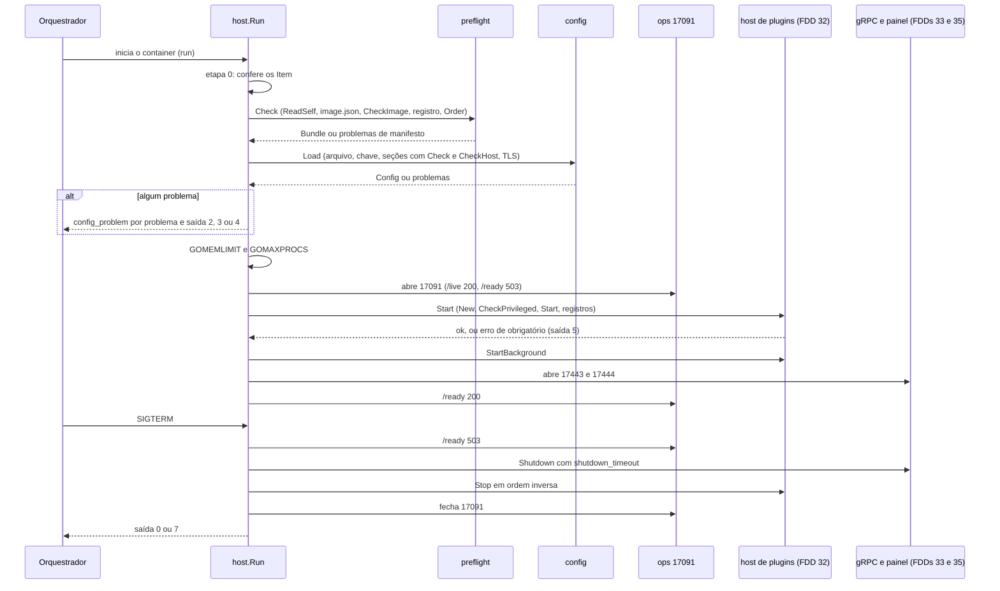
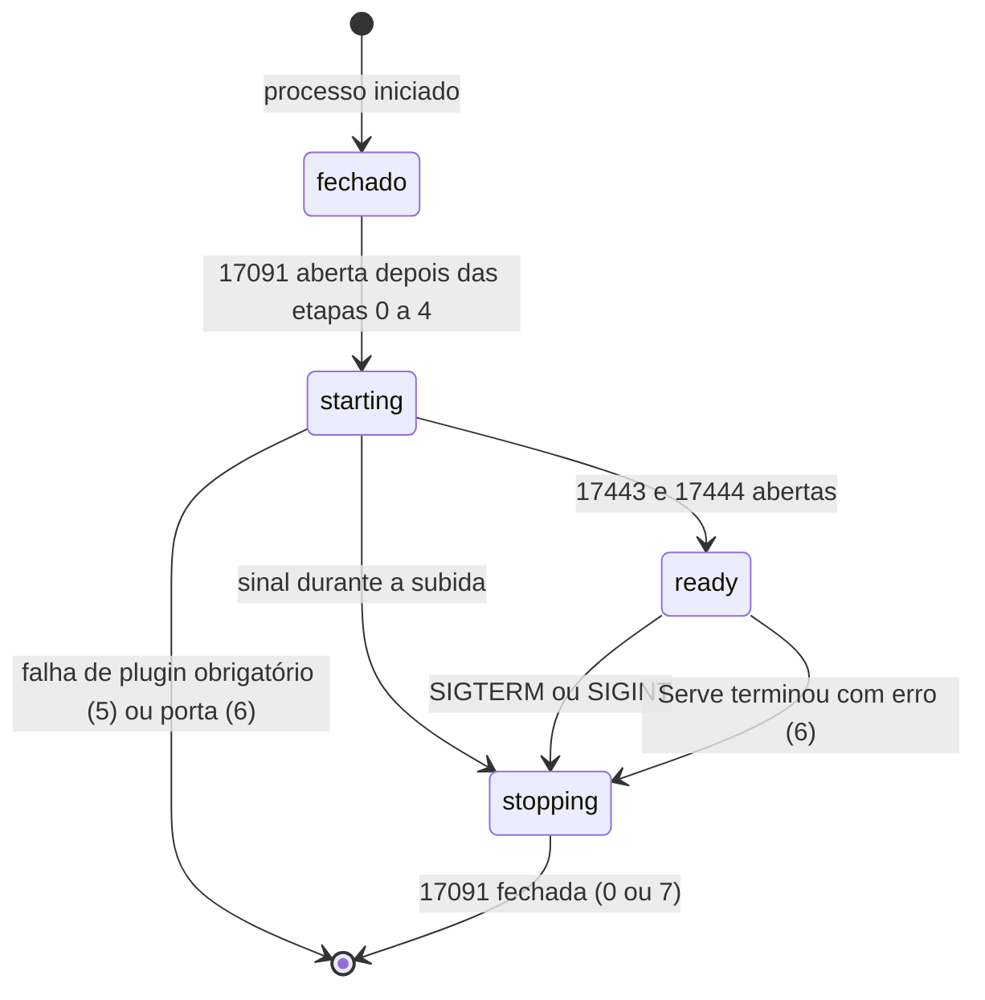
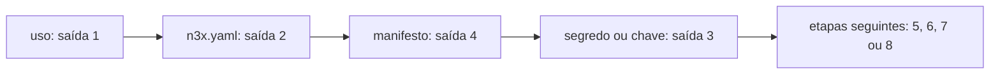

### FDD: Fundação do host do controller: `n3x.yaml`, `host.Run`, CLI e operação (CTL-01)

Versão: 1.0
Data: 2026-10-21
Responsável: Guilherme Giusti

---

### 1. Contexto e motivação técnica

**Problema técnico.** O controller não é um binário publicado: o repositório `n3x-controller` entrega o módulo Go `host/` e uma imagem base sem binário, e o `n3x-plugin build` gera um `main` que chama o host com as metades de controller escolhidas (ADR-001 do `n3x-controller`). O HLD descreve a subida em 7 passos, o desligamento em 4, os subcomandos e um exemplo do `n3x.yaml`, mas não fixa o comportamento verificável:

- a assinatura exata que o `main` gerado chama (a FDD 21 propôs `host.Run(host.Core(...), host.Plugin(...)...) int`, sem panic na montagem)
- tipo, obrigatoriedade, padrão e faixa de cada campo do `n3x.yaml` do controller, e como cada seção de `plugins` é validada pelo plugin compilado
- como o host confere o manifesto embutido no próprio binário (leitor da FDD 22) e de onde vem a versão da imagem, se a imagem base não tem binário
- como a AAD do `ENC[...]` se aplica às seções de plugin (L-05, decidida na FDD 03) e o que `encrypt` e `credential new` recebem
- quais prefixos bcrypt são aceitos (L-39), o que `/ready` responde com plugin opcional `failed` (L-40) e como o `cmd/n3x-controller-dev` sobe sem a seção `.n3x_manifest` (L-35)
- códigos de saída, formato das mensagens, sinais, prazos e o que vai para stderr, stdout e log JSON
- imagem base, usuário, diretórios e `GOMEMLIMIT` (L-24)

As FDDs 31 a 35 (verificador de credencial, host de plugins, servidor gRPC, sessão do painel e layout do painel) se encaixam neste esqueleto. Sem um contrato fechado de estrutura de config, ciclo de vida do processo, CLI, sinais e saída, cada uma reinventaria um pedaço, e uma falha de config poderia aparecer só depois que o painel já está no ar.

**Encaixe no HLD.** Esta FDD especifica três linhas de "Componentes e responsabilidades" do HLD do `n3x-controller` e as seções "Sequência de subida", "Desligamento", "Subcomandos", "Desenvolvimento local", "Schema do `n3x.yaml` do controller v1", "Regras de validação" e "Operação":

- **CLI e `host.Run`:** subcomandos, exit codes e mensagens sem segredos; sequência de subida e desligamento
- **Config (`host/config`):** schema v1 do `n3x.yaml`; decifra `ENC[...]`; valida a seção de cada plugin pelo schema dele
- **Operação (`host/ops`):** `17091` com `/metrics`, `/live` e `/ready`

Consumidores:

- FDD 21 (BLD-03): o `main` gerado chama `host.Run`, `host.Core` e `host.Plugin` (contrato 1)
- FDD 31 (CTL-02): lê `services` e `grpc.login` de `config.Config` (contrato 4)
- FDD 32 (CTL-03): recebe o `preflight.Bundle` (plugins na ordem de subida, obrigatoriedade, módulo, manifesto bruto) e as seções cruas com o `Opener` de cada plugin; implementa `boot.PluginHost` (contrato 11)
- FDD 33 (CTL-04): lê `listen.grpc`, `grpc.limits`, `grpc.trusted_proxies`, `runtime.plugin_call_timeout` e o `tls.Config`; implementa `boot.Server`
- FDD 34 (CTL-05): lê `root`, `panel.session` e `panel.login`
- FDD 35 (CTL-06): lê `listen.panel`, `panel.refresh_interval` e o `tls.Config`; implementa `boot.Server`
- FDDs 36 a 45 (plugin core): a seção `plugins["n3x.core"]` é validada pelo `CheckHost` do core; `CoreEnv.ControllerManifest()` recebe os bytes do manifesto lidos aqui
- FDDs 46, 47 e 51: imagem base, guia do operador e orçamento do `GOMEMLIMIT`

**Atores.** Operador (escreve o `n3x.yaml`, gera hashes, credenciais, chave e valores `ENC[...]` e roda o `validate` na CI), orquestrador (monta arquivos, envia sinais, consulta `/live` e `/ready`), builder (gera o `main` e embute o manifesto), autor de plugin (o schema da metade de controller valida a seção), FDDs 31 a 35 (componentes que o `host.Run` monta e desliga) e mantenedor do controller.

**Limites.**
- O host lê só arquivos locais: o `n3x.yaml`, a chave AES, o par TLS, o próprio executável (manifesto) e `/usr/share/n3x/image.json`. Nenhum campo vem de variável de ambiente (HLD)
- O host não tem armazenamento (ADR-002): nada é escrito em disco, o sistema de arquivos raiz pode ser somente leitura
- Esta FDD só chama as etapas 5 e 6 da subida (`New`, `Start` e registros dos plugins); o comportamento delas é da FDD 32
- `validate`, `hash`, `credential new`, `encrypt`, `keygen`, `dev-cert`, `version` e `probe` nunca abrem as portas do controller

**Suposições**
- Go 1.26 ou superior, sem cgo, binário estático (HLD); produção em `linux/amd64` e `linux/arm64`; desenvolvimento em Linux, macOS ou WSL2 (Windows nativo fica fora, porque o host usa sinais POSIX, `/proc` e cgroup) (hipótese)
- O `n3x.yaml` do controller cabe em 1 MiB (teto prático do ConfigMap do Kubernetes), como no sidecar
- Instância única por ambiente, escala só vertical (ADR-001 do `n3x-sdk`)
- O plugin core mínimo `v0.1.0` da FDD 36 (passa no `CheckPrivileged` e recusa todo login) existe antes da implementação desta FDD, para o `cmd/n3x-controller-dev` subir com um core real

**Restrições**
- Root e cada `secret_hash` em bcrypt com custo de no mínimo 12; sem root, o controller não sobe; um único `secret_hash` por serviço (FR-009, ADR-005)
- A chave HMAC dos tokens é do core (`session.hmac_key`); `keys.hmac_file` não existe (ADR-004 do `n3x-plugin-core`)
- `ENC[...]` usa o pacote `secret/` do `n3x-sdk` (ADR-014 do `n3x-sdk`, FDD 03), com a AAD `n3x:v1:controller:<plugin_id>` por seção
- Versão do `host/`: mesma major e minor da imagem igual ou maior (ADR-001 do `n3x-builder`, regra `CheckVersion` da FDD 22)
- Prazos: `runtime.plugin_start_timeout` 30 s, `runtime.shutdown_timeout` 20 s e 5 s de `Stop` por plugin (HLD)
- Nenhum valor do arquivo, segredo, token, hash, envelope ou chave aparece em mensagem, aviso ou log; só caminhos, regras, limites e listas do schema
- Documentação e mensagens em pt-BR; identificadores, campos e comandos em inglês

**Rastreabilidade**
- PRD 1.5: FR-005 (porta `17443` e TLS vindos do `n3x.yaml`), FR-009 (root e hash bcrypt no arquivo, `n3x-controller hash`, controller não sobe sem root), FR-011 (subida e parada dos plugins, só a ordem do `host.Run`), FR-015 (imagem `controller:<semver>`, versão do `host/` com mensagem do que usar); requisitos não funcionais de segurança (bcrypt custo 12, AES-256-GCM com chave em arquivo, nenhum segredo em log), observabilidade (health e readiness) e disponibilidade; critérios de aceite "root e usuários só do `n3x.yaml` com bcrypt custo 12 e recusa de subida" e "`n3x.yaml` inválido impede a subida com mensagem que aponta o campo e sem segredo no log"
- HLD do `n3x-controller`: "Arquitetura geral" (entregas, estrutura, subida, desligamento, subcomandos, desenvolvimento local), "Modelo de dados" (schema v1 e regras), "Interfaces públicas" (operação e CLI), "Considerações de escalabilidade" (`GOMEMLIMIT`), "Segurança" (endurecimento) e "Observabilidade"
- ADRs do `n3x-controller`: ADR-001, ADR-002, ADR-005 e ADR-009; do `n3x-sdk`: ADR-001, ADR-006 (portas) e ADR-014; do `n3x-builder`: ADR-001 e ADR-003; do `n3x-plugin-core`: ADR-004
- FDDs aplicadas: 01 (`ParseID`, `FieldError`, `yamlconv`, notação L-34), 02 (`DecodeConfig`, `Schema.Walk`, `PrefixErrors`, `PathKey`, `ParseSize`, `ParseDuration`), 03 (`secret/`, `ControllerScope`, `ServiceScope`, `LoadKey`, `Opener`, `FormatChecker`, `IsEnvelope`, `KeyGen`, `Wipe`), 04 e 06 (`runtime.plugin_limits`), 08 (`Check`, `CheckHost`, prazos, ordem), 09 (`PrivilegesOf`, `HostFacts`, `grpc.trusted_proxies`, `ControllerManifest`), 11 (`panel.refresh_interval`), 12 (`hostrules.Order`), 15 (gramática e códigos), 21 (`main` gerado), 22 (`artifact`, contrato 8), 36 (seção do core vale `{}`)
- Lacunas do README:
  - **L-05 aplicada:** cada valor de `plugins["<id>"]` usa `secret.ControllerScope(id)`; `n3x-controller encrypt --key <arquivo> --plugin <id>`, as duas flags obrigatórias (decisão da FDD 03)
  - **L-24 fechada:** imagem base distroless static fixada por digest, UID 17000; `GOMEMLIMIT` em 80% do limite de memória lido do cgroup, ou de `resources.memory` quando declarado (H-21, H-22)
  - **L-34 aplicada:** caminhos como `plugins["n3x.core"].users[0].password_hash` e `services["pedidos-api"].secret_hash`
  - **L-35 fechada (controller):** o binário de desenvolvimento só existe com a tag `n3x_dev` (`host.RunDev`), com manifesto sintético em memória; o binário gerado pelo builder sem seção recusa a subida com `manifest_missing` (H-20)
  - **L-39 fechada:** aceitos `$2a$`, `$2b$` e `$2y$`, custo de 12 a 16; `n3x-controller hash` emite `$2a$` (H-06)
  - **L-40 fechada:** `/ready` responde 200 com plugin opcional `failed` e com o core `degraded`; `/ready` diz se o processo terminou a subida e não está parando (H-13)
  - **L-46 aplicada:** o `n3x.yaml` inteiro passa por `yamlconv.ToJSON`
  - **L-51 aplicada:** `runtime.plugin_limits` com os códigos e faixas das FDDs 04 e 06, padrão de memória de 64 MiB no controller
- Pontos em aberto de FDDs anteriores fechados aqui: P-03 da FDD 01 (parte do controller), P-03 da FDD 03 (parte do controller: `keys` opcional sem `ENC[...]`), P-04 da FDD 03 (`credential new --key`), P-03 da FDD 22 (`Image.Version` do controller e binário de desenvolvimento)
- Pedidos atendidos: FDD 02 (`yamlconv`, opener, `PrefixErrors`, `ParseSize`, `ParseDuration`), FDD 03 (`--plugin`, `ControllerScope` por seção, sem aviso genérico de valor em claro, `secret_unexpected`, decisão sobre `credential new --key`), FDDs 04 e 06 (`runtime.plugin_limits` com `unknown_plugin`, `half_missing`, `size_format` e `range`; contrato de limites), FDD 08 (faixas dos prazos, `validate` chama `Check`, nome do evento `config_problem`), FDD 09 (`grpc.trusted_proxies` e `CheckHost` no `validate`), FDD 11 (`panel.refresh_interval` de 1 s a 60 s), FDD 15 (mesma gramática das chaves de `services` e mesmos códigos em `runtime.plugin_limits`), FDD 21 (`host.Core`, `host.Plugin`, `host.Run(...) int` sem panic na montagem; golden do `main` na CI), FDD 22 (`ReadSelf` com reserva `os.Executable()`, `Image.Version`, `plugins_hash` por `PluginsHash()`, `depends_on` com `p.DecodeManifest()`, binário sem seção) e FDD 36 (seção ausente do core vale `{}`; `encrypt --plugin n3x.core`)

---

### 2. Objetivos técnicos

- **Um veredito só para o mesmo arquivo.** Invariante: para o mesmo `n3x.yaml`, a mesma chave, o mesmo binário e o mesmo `image.json`, `n3x-controller validate` e o `run` devolvem os mesmos problemas (`Path` e `Rule`, na mesma ordem) e o mesmo código de saída. Medida: corpus de pelo menos 120 arquivos rodado como `validate` e como `run` (até a etapa 4), com 0 divergência.
- **Toda falha de config aparece antes de qualquer porta de serviço.** Invariante: nenhum `New` de plugin roda e nenhuma das portas `17443` e `17444` abre se houver problema nas etapas 1 a 4. Medida: teste com um problema de cada regra do contrato 3 e um plugin espião que registra chamadas: 0 chamadas a `New` e 0 portas abertas.
- **Todos os problemas numa passada.** Medida: até 100 problemas por execução, em ordem determinística (ordem do schema v1, depois manifesto, depois segredos), cada um com caminho, regra e texto; nenhum problema derivado; acima de 100, um item `truncated`.
- **Nenhum valor em mensagem.** Medida: teste de canário em que todo valor escalar do arquivo, todo texto aberto de `ENC[...]`, a chave, os hashes, as senhas do `hash` e os segredos do `credential new` viram marcadores `n3x-canary-`; 0 ocorrência em stderr, stdout (fora a saída pedida de cada subcomando), log JSON, `Error()` e corpo das rotas da `17091`, conferido com `secrettest.Leaks` (FDD 03).
- **Montagem sem panic.** Invariante: `host.Core`, `host.Plugin` e `host.Run` nunca dão panic por entrada do `main` gerado; ID inválido, módulo vazio, plugin nulo ou core repetido viram problemas da categoria manifesto e saída 4.
- **Modo de desenvolvimento impossível no binário gerado.** Invariante: sem a tag `n3x_dev`, o símbolo `host.RunDev` não existe; o binário do builder sem seção `.n3x_manifest` sai com 4 e `manifest_missing`. Medida: `go build` sem a tag mais `go tool nm` sem `RunDev`; teste com binário sem seção.
- **Prontidão honesta e desligamento dentro do prazo.** Medida: `/ready` responde 503 desde a abertura da `17091` até as duas portas de serviço abrirem, 200 depois, e 503 em até 100 ms depois do SIGTERM; o processo termina em até `runtime.shutdown_timeout` mais 2 s mais 5 s por plugin mais 1 s; um segundo sinal encerra em até 1 s com saída 7.
- **Custo desprezível na subida.** Medida: `config.Load` do arquivo de referência (10 serviços, 2 plugins, 8 KiB) em até 5 ms no p99, sem contar o `Check` dos plugins; `preflight.Check` com integridade sobre um binário de 64 MiB em até 500 ms no runner da CI (hipótese das metas).
- **Parse seguro contra entrada hostil.** Medida: fuzzing de `config.Load` (com `Options.Data`), do conferidor de bcrypt, do parser de CIDR, do nome de serviço e do despacho de argumentos por 5 minutos cada na CI noturna, sem panic (hipótese de duração, igual às FDDs 01 a 03 e 15).

---

### 3. Escopo e exclusões

**Incluído**
- API pública do pacote `host`: `Item`, `Core`, `Plugin`, `Run`, `RunWith`, `Options` e constantes de saída; `RunDev` só com a tag `n3x_dev` (contrato 1)
- Schema v1 completo do `n3x.yaml` do controller: cada campo com tipo, obrigatoriedade, padrão e faixa, inclusive `grpc.trusted_proxies` (FDD 09), `runtime.plugin_limits` (FDDs 04 e 06) e o bloco novo `resources` (contrato 2)
- Regras de validação próprias, ordem dos problemas e categorias (contrato 3)
- Pacote `host/internal/config`: leitura com `yamlconv`, decodificação estrita do topo, regras próprias, chave AES, `ENC[...]` por seção com `ControllerScope`, `secret_unexpected`, fase de config dos plugins (`PrivilegesOf`, `Check` e `CheckHost`) e carga do par TLS (contrato 4)
- Pacote `host/internal/preflight`: leitura do manifesto embutido (`artifact.ReadSelf` com integridade e reserva `os.Executable()`), conferência da imagem por `image.json`, conferência do registro compilado contra o manifesto, grafo de dependências por `hostrules.Order` e o `Bundle` entregue às FDDs seguintes (contrato 5)
- Sequência de subida (etapas 0 a 7), desligamento (4 etapas), sinais e prazos; pontos de encaixe internos das FDDs 31 a 35 (contrato 11)
- Despacho do binário e os subcomandos `run`, `validate`, `hash`, `credential new`, `encrypt`, `keygen`, `dev-cert`, `version`, `probe` e `help` (contratos 6 a 8)
- Códigos de saída `0` a `8` e códigos `N3X-C001` a `N3X-C008` (contrato 9)
- Pacote `host/internal/ops`: servidor `17091` com `/metrics`, `/live` e `/ready` (contrato 10)
- Runtime Go: `GOMEMLIMIT` e `GOMAXPROCS` calculados na subida (contrato 4, `Report.Runtime`)
- Ambiente de desenvolvimento: `cmd/n3x-controller-dev`, `dev/n3x.yaml`, `go.work` e a tag `n3x_dev` (contrato 12)
- Imagem base `ghcr.io/giustech/n3x/controller:<semver>`: Dockerfile, conteúdo, `image.json`, usuário, diretórios e rótulos (contrato 13)
- Logs JSON da subida, da CLI e do desligamento, e as métricas próprias do host

**Excluído**
- Verificador de credencial, cache, fila de bcrypt e bloqueio do login de sidecar: FDD 31 (CTL-02); aqui só a validação de `services` e de `grpc.login`
- Fase de instâncias dos plugins (`New`, `CheckPrivileged`, `Start`, registros, `Stop`), estado `failed` em runtime (L-36), contenção de panic, transporte em processo e exportação das métricas de plugin: FDD 32 (CTL-03)
- Servidor gRPC `17443`, interceptors, keepalive e resolução do IP por `grpc.trusted_proxies`: FDD 33 (CTL-04); aqui só a validação da lista
- Sessão do painel, login, CSRF e bloqueio: FDD 34 (CTL-05); layout, menu e cartões: FDD 35 (CTL-06)
- Formato do manifesto, leitor `artifact`, hash de integridade e regra `CheckVersion`: FDD 22 (BLD-04); geração do `main` e compilação: FDD 21 (BLD-03)
- Formato `ENC[...]` e pacote `secret/`: FDD 03 (SDK-03); regras da seção `plugins["n3x.core"]` (usuários, `hmac_key`): FDDs 36, 39 e 40
- Publicação da imagem no GHCR, tags flutuantes e matriz de CI: FDD 46 (BLD-07); topologias e guias: FDD 47 (SDK-15); orçamento com 500 sidecars e ajuste do `GOMEMLIMIT`: FDD 51 (CTL-07)
- Recarga do `n3x.yaml` sem restart, rotação com duas chaves, mTLS e várias réplicas: fora da v1

---

### 4. Fluxos detalhados e diagramas

**Fluxo de despacho (`host.Run` e `host.RunWith`)**
1. `Run` chama `RunWith(context.Background(), Options{Args: os.Args[1:], Stdin: os.Stdin, Stdout: os.Stdout, Stderr: os.Stderr}, core, plugins...)` e devolve o código de saída; o `main` gerado faz `os.Exit` (FDD 21).
2. `RunWith` instala um `recover` de topo: panic no próprio host (bug) vira o log `internal_error` com stack e a saída 8. Panic de plugin é contido pela FDD 32.
3. O primeiro argumento escolhe o subcomando (`run`, `validate`, `hash`, `credential`, `encrypt`, `keygen`, `dev-cert`, `version`, `probe`, `help`). Sem argumento, ou com o primeiro argumento começando com `-`, vale `run`. Palavra desconhecida ou flag inválida: saída 1 com o uso (contrato 6).
4. Subcomandos que não dependem do binário (`hash`, `keygen`, `dev-cert`, `probe`, `help`) não leem o manifesto nem os itens. `encrypt` e `version` leem o manifesto só para informar. `run` e `validate` seguem o fluxo abaixo.

**Fluxo principal: `run`** (etapas numeradas como no HLD; a etapa 0 é nova)
- **Etapa 0, montagem.** O host converte os `Item` em `preflight.Entry`. Erros guardados por `host.Core` e `host.Plugin` (ID inválido, módulo vazio, plugin nulo, `n3x.core` passado por `Plugin`, ID repetido, core ausente) viram problemas `registry_*` da categoria manifesto. Logger JSON em stderr com `component=host` e nível `info` até o arquivo ser lido.
- **Etapa 2, manifesto do próprio binário** (`preflight.Check`, roda antes da etapa 1 porque não depende do arquivo; a ordem dos problemas na saída não muda):
   - `artifact.ReadSelf(artifact.WithIntegrity())`; só com `ErrSelfNotFound`, `artifact.ReadFile(os.Executable(), artifact.WithIntegrity())`. A origem vai para o log (`path_source` `self_maps` ou `executable`). `ErrNoManifest` vira `manifest_missing`; os demais erros do leitor viram `manifest_read` com a regra do `artifact` no detalhe, na precedência do contrato 8 da FDD 22
   - lê `/usr/share/n3x/image.json` (contrato 13): ausente é `image_info_missing`; inválido é `image_info_invalid`
   - `m.CheckImage(artifact.Image{Kind: controller, Name: "ghcr.io/giustech/n3x/controller", Module, Version do image.json, Arch: runtime.GOARCH})`; erro com `*artifact.VersionError` gera as duas linhas do HLD com o prefixo `erro:`
   - para cada `plugins[k]` do manifesto: `p.DecodeManifest()`; erros prefixados com `plugins[k].manifest`
   - registro contra manifesto: todo plugin com metade de controller precisa ter um `Entry` e vice-versa (`registry_missing`, `registry_unexpected`); módulo do `Entry` igual a `plugins[k].module` (`registry_module`); `ConfigSchema().MarshalJSON()` igual, byte a byte, a `plugins[k].schemas.controller` (`schema_mismatch`); o core vem por `host.Core` e `plugin.IsCoreOrigin(id, module)` é verdadeiro
   - grafo: `hostrules.Order` sobre os plugins com metade de controller, com `DependsOn` de `p.DecodeManifest()` (`depends_missing`, `depends_cycle`, `core_depends`, `duplicate`)
   - `Bundle` com o arquivo lido, os plugins na ordem de subida e `PluginsHash()`; log `manifest_loaded` ou `manifest_rejected`
- **Etapa 1, arquivo e topo** (`config.Load`, primeira parte):
   - lê `--config` (padrão `/etc/n3x/controller.yaml`): arquivo regular até 1 MiB (`file_read`, `size`)
   - `yamlconv.ToJSON`; erro de sintaxe só com linha e coluna; JSON até 4 MiB; raiz objeto; aninhamento até 64
   - lê `version` de forma tolerante: ausente é `required`; diferente de `1` é `version_unsupported` e para
   - separa `plugins` (cada seção como bytes crus, `ENC[...]` intacto) e `runtime.plugin_limits`
   - `plugin.DecodeConfig[config.File]` sem opener sobre o restante: campo desconhecido, tipo, `null`, obrigatórios, `enum`, `min`, `max`, durações por `plugin.ParseDuration` e tamanhos por `plugin.ParseSize`, com os padrões aplicados
   - regras próprias do topo (contrato 3): gramáticas de `root.user` e das chaves de `services`, bcrypt de `root.password_hash` e de cada `secret_hash`, portas distintas, `grpc.trusted_proxies`, relações entre prazos, caminhos de arquivo
   - `Schema.Walk` do topo: texto que é envelope (`secret.IsEnvelope`) em qualquer campo do topo dá `secret_unexpected`, porque nenhum campo do host é segredo
- **Etapa 3, chave e seções de plugin** (`config.Load`, segunda parte, só com `Bundle`):
   - chave: de `--key` no `validate`, senão de `keys.aes_file`; `secret.LoadKey` uma vez; `TooOpen` vira o aviso `key_too_open`; com algum `ENC[...]` em `plugins` e sem caminho de chave, `required` em `keys.aes_file`
   - chaves de `plugins`: ID válido (`id_*`), presente no manifesto (`unknown_plugin`), com metade de controller (`half_missing`); seção que não é objeto nem `null` é `type`
   - para cada plugin do `Bundle`, em ordem de ID: seção do arquivo ou `{}` quando falta (pedido da FDD 36); `ctrl.PrivilegesOf(p, nil)`: `HostValidator` fora do core é `privileged_capability`; opener = `key.Opener(secret.ControllerScope(id))` (ou `secret.FormatChecker()` com `--skip key`; sem chave e sem envelopes, um opener que devolve o texto igual); `Schema.Walk` com o schema da metade de controller para `secret_unexpected`; depois `p.CheckHost(secao, ctrl.HostFacts{RootUser: root.user}, plugin.WithSecretOpener(opener))` no core e `p.Check(secao, plugin.WithSecretOpener(opener))` nos demais (FDDs 08 e 09). Erros prefixados com `plugin.PrefixErrors(err, plugin.PathKey("plugins", id.String()))`
   - `runtime.plugin_limits`: chave com ID válido, no manifesto (`unknown_plugin`), com metade de controller (`half_missing`); `memory.max_bytes` (`size_format`, `range`), `background.max_tasks` e `dial.max_conns` (`type`, `range`), campo desconhecido (`unknown_field`); resolve os limites efetivos de todo plugin do `Bundle`
- **Etapa 4, TLS** (`config.Load`, terceira parte; pulada com `--skip files` no `validate`): lê `tls.cert_file` e `tls.key_file` (até 1 MiB cada), `tls.X509KeyPair` (`tls_pair`), confere a validade do certificado folha (`tls_expired` é erro; `tls_expiring` em até 14 dias, `tls_not_yet_valid`, `tls_no_san` e `tls_dev_cert` são avisos) e monta o `tls.Config` (TLS 1.3 mínimo) que as FDDs 33 e 35 usam.
- **Fim das etapas 0 a 4:** o host ordena e corta os problemas (100 mais `truncated`), loga um `config_problem` por problema e um `config_rejected` (ou `manifest_rejected`), e sai com o código da categoria de maior precedência (contrato 9). Sem problemas, loga os avisos (`config_warning`) e `config_loaded`, e passa o nível de log para `runtime.log_level`.
- **Runtime Go** (entre as etapas 4 e 5): calcula `GOMEMLIMIT` (80% de `resources.memory`, senão do limite do cgroup v2 `memory.max`, senão do v1 `memory.limit_in_bytes`) e `GOMAXPROCS` (`ceil(resources.cpus)` quando declarado; senão o padrão do Go 1.26, que já respeita a cota de CPU do cgroup); aplica com `debug.SetMemoryLimit` e `runtime.GOMAXPROCS`; loga `go_runtime` e `limits_effective`. Sem limite nenhum: sem `GOMEMLIMIT` e aviso `memory_unlimited`. Soma das cotas de memória dos plugins acima de 50% do `GOMEMLIMIT`: aviso `plugin_quota_high` (mesma regra pedida pela FDD 04 ao sidecar).
- **Operação** (entre as etapas 4 e 5): abre a `17091` (hipótese: antes das etapas 5 e 6, para `/live` responder durante `Start` longos); `/ready` em `starting`. Falha de bind: saída 6.
- **Etapas 5 e 6, `New` e `Start` dos plugins:** o host monta, nesta ordem, o verificador de credencial (FDD 31), o repositório de sessões (FDD 34) e o host de plugins (FDD 32, que recebe os dois para o `CoreEnv`), e chama `PluginHost.Start(ctx)`. Erro de plugin obrigatório (efeito `EffectAbort` de `hostrules.OnFailure`) vira `startup_failed` com `stage` e saída 5; a FDD 32 já chamou `Stop` dos que subiram. Opcional que falha fica `failed` e a subida segue.
- **Etapa 7, portas de serviço:** `PluginHost.StartBackground()` (tarefas de fundo antes das portas, FDD 08); monta os servidores gRPC (FDD 33) e do painel (FDD 35) com o que foi registrado; abre `17443` e depois `17444` (falha de bind: desliga o que subiu e sai com 6); `/ready` passa a `ready` (200); log `startup_complete` com a duração e o estado de cada plugin na ordem de subida.
- **Em serviço:** o host espera um sinal ou o fim inesperado de um `Serve` (log `listener_failed` e desligamento com saída 6).

**Fluxo de desligamento** (SIGTERM ou SIGINT)
1. Log `shutdown_started` com o sinal; `/ready` passa a `stopping` (503).
2. `Shutdown(ctx)` do gRPC (equivale ao `GracefulStop` da FDD 33) e do painel, em paralelo, com prazo `runtime.shutdown_timeout`; quem estoura recebe `Close()` (parada forçada) e o log `shutdown_forced` com `step`.
3. `PluginHost.Stop(ctx)`: cancela as tarefas de fundo com `ShutdownGrace` de 2 s e chama `Stop` dos plugins na ordem inversa, 5 s cada (FDD 32).
4. Fecha a `17091` por último (as métricas e o `/live` ficam disponíveis durante o desligamento), loga `shutdown_complete` e sai com 0, ou com 7 se alguma etapa foi forçada.
- **Vigia do processo:** um prazo total de `shutdown_timeout + 2 s + 5 s x (plugins com Start bem-sucedido) + 1 s` (hipótese); estourado, o host loga `shutdown_forced` com `step: watchdog` e sai com 7.
- **Segundo sinal** durante o desligamento: log `shutdown_forced` com `reason: second_signal` e saída 7 em até 1 s.
- **Sinal durante a subida:** cancela o `ctx` da subida; o `Start` em curso recebe o cancelamento; a FDD 32 chama `Stop` dos que já subiram; saída 0 (hipótese: parada pedida não é falha).
- **SIGHUP:** ignorado, com o log `signal_ignored` (não há recarga na v1).

**Fluxo do `validate`**
1. Lê as flags (contrato 6): `--config`, `--key`, `--skip key,files,image`, `--log-format text|json`.
2. Roda as etapas 0 a 4 com as mesmas funções do `run`, sem `Runtime Go`, sem abrir portas e sem nenhum `New`. Com `--skip image`, `CheckImage` e a leitura do `image.json` são puladas; com `--skip key`, o opener é `secret.FormatChecker()`; com `--skip files`, o par TLS não é lido.
3. Escreve os problemas e avisos em stderr (texto ou JSON), o resumo em stdout e sai com o código da categoria de maior precedência. Com qualquer `--skip`, o resumo diz "parcial" e lista o que foi pulado.

**Fluxo do `hash`**
1. Flags `--cost` (padrão 12, de 12 a 16). Recusa stdin que é terminal (saída 1, dica de usar pipe).
2. Lê o stdin até 73 bytes; remove uma única quebra de linha final (`\n` ou `\r\n`); vazio ou acima de 72 bytes (limite do bcrypt): saída 1. Menos de 12 bytes: aviso `password_short` em stderr, sem recusar (o `dev/n3x.yaml` usa a senha `dev`).
3. `bcrypt.GenerateFromPassword` (prefixo `$2a$`), escreve o hash e `\n` em stdout, zera o buffer com `secret.Wipe`.

**Fluxo do `credential new <serviço>`**
1. Confere o serviço com a gramática das chaves de `services` (`name_format`); inválido: saída 1. Flags `--key` (opcional) e `--cost` (padrão 12).
2. Com `--key`: `secret.LoadKey` antes de gerar (erro: saída 3; `TooOpen`: aviso em stderr).
3. Gera 32 bytes de `crypto/rand` e os codifica em base64url sem padding (43 caracteres); calcula o bcrypt desse texto.
4. Escreve em stdout duas linhas: `secret_hash: "<bcrypt>"` e `secret: "<segredo>"`, ou, com `--key`, `secret: "ENC[v1:...]"` cifrado com `secret.ServiceScope(serviço)`, pronto para o `controller.secret` do sidecar; o segredo em claro não aparece. Em stderr, a orientação de onde cada linha vai. Zera os buffers.

**Fluxo do `encrypt`**
1. `--key` e `--plugin` obrigatórios (FDD 03); `--plugin` passa por `plugin.ParseID` (inválido: saída 1).
2. `secret.LoadKey` antes de ler o stdin (erro: saída 3; `TooOpen`: aviso em stderr).
3. Se o manifesto do próprio binário puder ser lido e o ID não estiver entre os plugins com metade de controller, aviso `plugin_not_in_binary` em stderr (não recusa: o operador pode cifrar para outro binário).
4. Recusa stdin terminal; lê até 64 KiB mais 1 byte; remove uma quebra final; vazio ou grande demais: saída 1.
5. `key.Encrypt(secret.ControllerScope(id), segredo)`, escreve o envelope e `\n` em stdout, zera o buffer.

**Fluxo do `keygen`, do `dev-cert`, do `probe` e do `version`**
- `keygen`: sem argumentos; escreve `secret.KeyGen()` (45 bytes) em stdout. Serve para a chave AES e para a `session.hmac_key` do core, que depois é cifrada com `encrypt --plugin n3x.core`.
- `dev-cert`: gera par ECDSA P-256 autoassinado, válido por `--days` (padrão 30, máximo 90), com SANs `localhost`, `127.0.0.1`, `::1`, `n3x-controller` e cada `--name`; grava `tls.crt` (0644) e `tls.key` (0600) em `--out` (padrão `.`), sem sobrescrever arquivo existente a menos que `--force`; avisa em stderr que é só para desenvolvimento. O mesmo `tls.crt` serve de `controller.ca_file` no sidecar.
- `probe [live|ready]`: `GET http://127.0.0.1:<--port>/<live|ready>` (porta padrão 17091, prazo `--timeout` de 2 s); saída 0 com 200 e 1 em qualquer outro caso; para healthcheck do docker compose e do ECS numa imagem sem shell.
- `version`: lê o manifesto sem integridade e o `image.json`; imprime host, SDK, Go, arquitetura, `plugins_hash`, plugins e versão da imagem; saída 0, ou 4 se o manifesto não puder ser lido (imprime o que tiver).

**Fluxo de desenvolvimento** (`go run -tags n3x_dev ./cmd/n3x-controller-dev --config dev/n3x.yaml`)
1. O `main` de desenvolvimento chama `host.RunDev(host.Core(...), ...)`, que só existe com a tag `n3x_dev`.
2. `RunDev` monta um manifesto sintético em memória a partir dos itens (contrato 12), sem integridade e sem `CheckImage`, e loga `dev_manifest` em `warn`.
3. O resto do fluxo é o do `run`, com o mesmo `n3x.yaml` validado pelas mesmas regras.

**Fluxos alternativos e exceções**
- **Binário gerado sem seção** (`ErrNoManifest`): `manifest_missing`, saída 4, com a dica "gere com `n3x-plugin build`; para desenvolvimento use `go run -tags n3x_dev ./cmd/n3x-controller-dev`"
- **`ReadSelf` não acha o próprio arquivo** (sem `/proc`, ` (deleted)`): reserva `os.Executable()`; `manifest_loaded` com `path_source: executable`
- **Imagem e binário incompatíveis** (`runtime_too_new`, `runtime_major`, `runtime_unstable`): saída 4 com as duas linhas do `VersionError` (o que a imagem aceita e o que usar)
- **`image.json` ausente** (binário fora da imagem oficial): `image_info_missing`, saída 4; no `validate`, pulável com `--skip image`
- **Seção ausente de um plugin, inclusive do core:** vale `{}` e recebe os padrões (FDD 36); o core sem seção sobe sem usuários de leitura e com chave HMAC aleatória
- **Seção de plugin sem metade de controller** (só de proxy): `half_missing`
- **`ENC[...]` com a chave errada ou cifrado para outra seção:** `secret_decrypt` com o caminho e o escopo esperado (`n3x:v1:controller:<id>`), saída 3
- **`ENC[...]` em campo do topo** (por exemplo em `root.password_hash`) ou em campo que não é segredo de uma seção: `secret_unexpected`, saída 3; o bcrypt do mesmo campo não é conferido (sem problema derivado)
- **Valor em claro num campo segredo de plugin:** aceito, sem aviso genérico (FDD 03, L-64); o `password_hash` bcrypt em claro é o caso normal
- **Arquivo sem nenhum `ENC[...]` e sem `keys`:** aceito sem ler chave; com `keys.aes_file` declarado, a chave é lida e validada mesmo sem envelopes
- **Chave com permissão acima de `0440`:** aviso `key_too_open`, nunca recusa (igual ao sidecar)
- **Plugin opcional que falha no `New` ou no `Start`:** `failed`; a subida segue e `/ready` chega a 200 (L-40)
- **Porta ocupada:** `listener_failed` com a porta e `errno`, saída 6; nada do que já subiu fica pendurado (desligamento parcial)
- **Certificado vencido:** `tls_expired`, saída 2; vencendo em até 14 dias: aviso
- **Arquivo de outra versão** (`version: 2`): só `version_unsupported`, saída 2
- **Entrada hostil** (YAML enorme, âncoras em cadeia, aninhamento profundo, UTF-8 inválido): `size` ou `syntax`, sem panic

**Diagramas**

Sequência do `run`:



Estados do `/ready`:



Precedência das categorias na saída:



---

### 5. Contratos públicos (assinaturas, endpoints, headers, exemplos)

**Contrato 1: API Go do pacote `host` (consumida pelo `main` gerado, FDD 21)**
- Tipo: sdk (API Go do módulo `github.com/giustech/n3x-controller/host`)
- Assinatura/Rota:
  ```go
  package host // github.com/giustech/n3x-controller/host

  // Item é uma entrada do registro gerado pelo builder. Opaco; o valor zero é inválido.
  type Item struct{ /* id, módulo, ctrl.Plugin, marca de core e erro guardado */ }

  // Core registra o plugin core; o ID é sempre n3x.core. Nunca dá panic: entrada
  // inválida fica guardada no Item e o Run recusa a subida.
  func Core(module string, p ctrl.Plugin) Item

  // Plugin registra um plugin com metade de controller; id e module são literais gravados pelo builder.
  func Plugin(id, module string, p ctrl.Plugin) Item

  // Run lê os.Args, os.Stdin, os.Stdout e os.Stderr, trata SIGTERM, SIGINT e SIGHUP
  // e devolve o código de saída. Nunca chama os.Exit.
  func Run(core Item, plugins ...Item) int

  // RunWith é o Run com entradas explícitas, para testes de integração no próprio repositório.
  func RunWith(ctx context.Context, o Options, core Item, plugins ...Item) int

  type Options struct {
      Args    []string                                   // sem o nome do programa
      Stdin   io.Reader
      Stdout  io.Writer
      Stderr  io.Writer
      Signals <-chan os.Signal                           // nil = signal.Notify de SIGTERM, SIGINT e SIGHUP
      Listen  func(network, addr string) (net.Listener, error) // nil = net.Listen
  }

  const (
      ExitOK       = 0 // sucesso; desligamento limpo
      ExitUsage    = 1 // N3X-C001
      ExitConfig   = 2 // N3X-C002
      ExitSecret   = 3 // N3X-C003
      ExitManifest = 4 // N3X-C004
      ExitPlugin   = 5 // N3X-C005
      ExitListen   = 6 // N3X-C006
      ExitShutdown = 7 // N3X-C007
      ExitInternal = 8 // N3X-C008
  )

  // Só com a tag n3x_dev (host/dev.go, //go:build n3x_dev); o builder nunca passa a tag (FDD 21).
  func RunDev(core Item, plugins ...Item) int
  ```
- Método: n/a (chamada local no `main`)
- Semântica:
  - **Forma do `main` gerado** (FDD 21, contrato 2): `func main() { os.Exit(host.Run(host.Core(mod, p), host.Plugin(id, mod, p)...)) }`, core primeiro e os demais em ordem de ID
  - **Sem panic na montagem:** `Core` e `Plugin` guardam o primeiro erro no `Item`. Regras (categoria manifesto, saída 4, caminho `registry["<id>"]` ou `registry[<i>]` quando o ID é inválido): `registry_core_missing` (core com valor zero), `registry_nil` (plugin nulo), `registry_id` (ID inválido por `plugin.ParseID`), `registry_core_id` (`n3x.core` passado por `Plugin`), `registry_module` (módulo vazio, ou diferente de `plugins[].module` do manifesto), `duplicate` (ID repetido)
  - **Escopo do pacote:** só `host` é API estável do módulo (semver do módulo `host/`). Os subpacotes desta FDD e das FDDs 31 a 35 ficam em `host/internal/...` (hipótese; a árvore do HLD muda só de caminho)
  - **`RunWith`:** mesmos subcomandos e mesmo comportamento do `Run`; `Signals` e `Listen` existem para testes (portas efêmeras, sinais simulados). Não existe opção que pule conferências
  - **Compatibilidade:** a assinatura de `Core`, `Plugin` e `Run` é congelada na major 1; o golden `controller_core_ratelimit.go.golden` da FDD 21 fica copiado em `host/testdata/` e é compilado na CI do `n3x-controller` com módulos falsos (critério 9)

**Exemplo de requisição** (`main` com erro de montagem: o core passado também por `host.Plugin`)
```go
func main() {
	os.Exit(host.Run(
		host.Core("github.com/giustech/n3x-plugin-core", n3x_core.Plugin()),
		host.Plugin("giustech.ratelimit", "github.com/giustech/n3x-plugin-ratelimit", giustech_ratelimit.Plugin()),
		host.Plugin("n3x.core", "github.com/giustech/n3x-plugin-core", n3x_core.Plugin()),
	))
}
```

**Exemplo de resposta** (stderr do binário acima; código de saída 4)
```json
{"ts":"2026-10-21T14:00:00Z","level":"error","component":"host","msg":"config_problem","code":"N3X-C004","path":"registry[\"n3x.core\"]","rule":"registry_core_id","detail":"o plugin core entra só por host.Core; gere o main de novo com o n3x-plugin build"}
{"ts":"2026-10-21T14:00:00Z","level":"error","component":"host","msg":"manifest_rejected","code":"N3X-C004","exit_code":4,"problems":1}
```

---

**Contrato 2: schema v1 do `n3x.yaml` do controller**
- Tipo: config (arquivo YAML 1.2, convertido para JSON por `yamlconv`)
- Assinatura/Rota: `/etc/n3x/controller.yaml` ou o caminho de `--config`
- Método: n/a (lido na subida e pelo `validate`)
- Semântica:
  - Durações no formato Go (`200ms`, `1m30s`) por `plugin.ParseDuration`; número sem unidade é `type`. Tamanhos com `Ki` a `Ti`, `KiB` a `TiB` ou inteiro em bytes por `plugin.ParseSize` (FDD 02): `128Mi` e `128MiB` valem o mesmo
  - Campo ausente recebe o padrão; `null` fora de `plugins` é `type`; campo desconhecido é `unknown_field`
  - Caminho de arquivo relativo é resolvido a partir do diretório do próprio `n3x.yaml` (hipótese, para o `dev/n3x.yaml` funcionar em qualquer máquina); caminho vazio ou com byte NUL é `file_path`
  - Evolução só por adição de campo opcional dentro da v1; esta FDD é dona do schema, e as FDDs 31 a 35 pedem campos novos pelo registro de decisões
  - Faixas e padrões marcados (hipótese) estão na tabela H-08 do checkpoint

Parte 1: topo, `listen`, `tls`, `keys`, `root` e `services`

| Campo | Tipo | Obrigatório | Padrão | Faixa ou regra | Consumidor |
| --- | --- | --- | --- | --- | --- |
| `version` | inteiro | sim | (nenhum) | só `1` | esta FDD |
| `listen.grpc` | inteiro | não | `17443` | 1 a 65535; diferente das outras duas | FDD 33 |
| `listen.panel` | inteiro | não | `17444` | 1 a 65535; diferente das outras duas | FDD 35 |
| `listen.ops` | inteiro | não | `17091` | 1 a 65535; diferente das outras duas | esta FDD |
| `tls.cert_file` | texto | sim | | caminho; PEM com a cadeia, folha primeiro, até 1 MiB | FDDs 33 e 35 |
| `tls.key_file` | texto | sim | | caminho; PEM da chave privada do certificado, até 1 MiB | FDDs 33 e 35 |
| `keys` | objeto | não; obrigatório se houver `ENC[...]` em `plugins` | ausente = nenhuma chave | | esta FDD |
| `keys.aes_file` | texto | sim, no bloco | | caminho; chave da FDD 03 (44 caracteres base64); permissão acima de `0440` só avisa | esta FDD |
| `root.user` | texto | sim | | `^[A-Za-z0-9][A-Za-z0-9._@-]{0,63}$` (1 a 64 caracteres) (hipótese) | FDD 34; `HostFacts.RootUser` |
| `root.password_hash` | texto | sim | | bcrypt `$2a$`, `$2b$` ou `$2y$`, custo de 12 a 16, 60 caracteres (L-39) | FDD 34 |
| `services` | map de nome para objeto | não | `{}` (aviso `no_services`) | até 1.024 chaves; chave com a gramática do `service` do sidecar: `^[a-z0-9]([a-z0-9_-]{0,61}[a-z0-9])?$` | FDD 31 |
| `services.<nome>.secret_hash` | texto | sim, no item | | bcrypt, mesmas regras do root | FDD 31 |

Parte 2: `grpc`, `panel`, `runtime` e `resources`

| Campo | Tipo | Obrigatório | Padrão | Faixa ou regra | Consumidor |
| --- | --- | --- | --- | --- | --- |
| `grpc.limits.max_connections` | inteiro | não | `1000` | 1 a 100000 | FDD 33 |
| `grpc.limits.max_streams_per_connection` | inteiro | não | `16` | 1 a 1024 (conta as unárias, FDD 38) | FDD 33 |
| `grpc.limits.max_message` | tamanho | não | `4Mi` | 64Ki a 64Mi | FDD 33 |
| `grpc.login.max_failures` | inteiro | não | `5` | 1 a 100, por IP e por serviço | FDD 31 |
| `grpc.login.lockout` | duração | não | `15m` | 1m a 24h | FDD 31 |
| `grpc.login.bcrypt_concurrency` | inteiro | não | `2` | 1 a 16 | FDD 31 |
| `grpc.login.verified_cache_ttl` | duração | não | `1h` | 1m a 24h | FDD 31 |
| `grpc.trusted_proxies` | lista de texto | não | `[]` | até 64; prefixo CIDR IPv4 ou IPv6 em forma canônica (`10.0.0.0/24`), sem repetição, sem `/0` (hipótese) | FDD 33 (regra da FDD 09) |
| `panel.session.idle_timeout` | duração | não | `30m` | 1m a 24h | FDD 34 |
| `panel.session.absolute_timeout` | duração | não | `12h` | 5m a 168h; maior ou igual a `idle_timeout` | FDD 34 |
| `panel.login.max_failures` | inteiro | não | `5` | 1 a 100, por usuário e IP | FDD 34 |
| `panel.login.lockout` | duração | não | `15m` | 1m a 24h | FDD 34 |
| `panel.refresh_interval` | duração | não | `5s` | 1s a 60s (pedido da FDD 11) | FDDs 11 e 35 |
| `runtime.log_level` | texto | não | `info` | `debug`, `info`, `warn` ou `error` | todos |
| `runtime.shutdown_timeout` | duração | não | `20s` | 1s a 10m | esta FDD |
| `runtime.plugin_start_timeout` | duração | não | `30s` (`ctrl.DefaultStartTimeout`) | 1s a 10m | FDD 32 |
| `runtime.plugin_call_timeout` | duração | não | `10s` (`ctrl.DefaultCallTimeout`) | 100ms a 5m | FDDs 32, 33 e 35 |
| `runtime.plugin_limits` | map de ID para objeto | não | `{}` | parte 3 | FDD 32 |
| `resources.cpus` | número | não | padrão do Go (cota do cgroup) | 0.01 a 1024; vira `GOMAXPROCS = ceil(cpus)` | esta FDD |
| `resources.memory` | tamanho | não | limite do cgroup | 64Mi a 1Ti; base do `GOMEMLIMIT` (80%) | esta FDD |
| `plugins` | map de ID para objeto | não | `{}`; cada plugin sem seção vale `{}` | parte 3 | FDD 32 e os plugins |

Parte 3: `runtime.plugin_limits` e `plugins` (regras das FDDs 04, 06 e 08)

| Campo | Tipo | Padrão | Regra |
| --- | --- | --- | --- |
| chave de `runtime.plugin_limits` | ID de plugin | | `plugin.ParseID`; no manifesto (`unknown_plugin`); com metade de controller (`half_missing`); `n3x.core` aceito |
| `<id>.memory.max_bytes` | tamanho | `memory.DefaultControllerMaxBytes` (64 MiB) | `memory.MinMaxBytes` a `memory.MaxMaxBytes` (1 MiB a 1 GiB); mal escrito é `size_format`, fora da faixa é `range` |
| `<id>.background.max_tasks` | inteiro | `ctrl.DefaultMaxTasks` (8) | 1 a 64; fora da faixa é `range` |
| `<id>.dial.max_conns` | inteiro | `ctrl.DefaultMaxConns` (16) | 1 a 256; fora da faixa é `range` |
| outro campo | | | `unknown_field` |
| chave de `plugins` | ID de plugin | | `plugin.ParseID`; no manifesto (`unknown_plugin`); com metade de controller (`half_missing`) |
| `plugins["<id>"]` | objeto ou `null` | `{}` | schema da metade de controller do plugin, pelo `Check` (ou `CheckHost` no core) com o opener do escopo `n3x:v1:controller:<id>` |

**Exemplo de requisição** (`/etc/n3x/controller.yaml` de referência)
```yaml
version: 1

tls:
  cert_file: /etc/n3x/tls.crt
  key_file: /etc/n3x/tls.key

keys:
  aes_file: /run/n3x/aes.key

root:
  user: admin
  password_hash: "$2a$12$R9h/cIPz0gi.URNNX3kh2OPST9/PgBkqquzi.Ss7KIUgO2t0jWMUW"

services:
  pedidos:
    secret_hash: "$2y$12$R9h/cIPz0gi.URNNX3kh2OPST9/PgBkqquzi.Ss7KIUgO2t0jWMUW"
  estoque-api:
    secret_hash: "$2b$12$R9h/cIPz0gi.URNNX3kh2OPST9/PgBkqquzi.Ss7KIUgO2t0jWMUW"

grpc:
  trusted_proxies: [10.0.0.0/24]

runtime:
  plugin_limits:
    giustech.ratelimit:
      memory:
        max_bytes: 128MiB

resources:
  memory: 512Mi

plugins:
  n3x.core:
    session:
      hmac_key: ENC[v1:oKGio6SlpqeoqaqrhWoZSSClYdYDCaq3aFezuwLaMHP9mjIJ+GdC6QyJnFO/ZQ+b5cM41CaHLENkq3Jt8f0aZQ==]
    users:
      - name: ana
        password_hash: "$2a$12$R9h/cIPz0gi.URNNX3kh2OPST9/PgBkqquzi.Ss7KIUgO2t0jWMUW"
```

**Exemplo de resposta** (valores resolvidos que `config.Config` expõe, em JSON só para leitura; hashes e segredos nunca aparecem)
```json
{
  "listen": { "grpc": 17443, "panel": 17444, "ops": 17091 },
  "tls": { "cert_file": "/etc/n3x/tls.crt", "key_file": "/etc/n3x/tls.key" },
  "keys": { "aes_file": "/run/n3x/aes.key" },
  "root": { "user": "admin", "password_hash": "***" },
  "services": { "estoque-api": { "secret_hash": "***" }, "pedidos": { "secret_hash": "***" } },
  "grpc": { "limits": { "max_connections": 1000, "max_streams_per_connection": 16, "max_message": "4Mi" }, "login": { "max_failures": 5, "lockout": "15m0s", "bcrypt_concurrency": 2, "verified_cache_ttl": "1h0m0s" }, "trusted_proxies": ["10.0.0.0/24"] },
  "panel": { "session": { "idle_timeout": "30m0s", "absolute_timeout": "12h0m0s" }, "login": { "max_failures": 5, "lockout": "15m0s" }, "refresh_interval": "5s" },
  "runtime": { "log_level": "info", "shutdown_timeout": "20s", "plugin_start_timeout": "30s", "plugin_call_timeout": "10s" },
  "resources": { "memory": "512Mi" },
  "limits": { "giustech.ratelimit": { "memory_max_bytes": 134217728, "background_max_tasks": 8, "dial_max_conns": 16 }, "n3x.core": { "memory_max_bytes": 67108864, "background_max_tasks": 8, "dial_max_conns": 16 } },
  "sections": { "giustech.ratelimit": "{}", "n3x.core": "(bytes crus, ENC[...] intacto)" },
  "report": { "secrets_sealed": 1, "warnings": [], "runtime": { "gomemlimit_bytes": 429496729, "memory_limit_source": "config", "gomaxprocs": 1 } }
}
```
(`giustech.ratelimit` não tem seção, então vale `{}`; os dois plugins recebem os limites efetivos, com o padrão de 64 MiB para o core.)

---

**Contrato 3: regras de validação, ordem e categorias**
- Tipo: regra (aplicada por `preflight.Check` e `config.Load`)
- Assinatura/Rota: lista de `config.Problem` (um `plugin.FieldError` mais a categoria)
- Método: n/a
- Semântica:
  - Todos os problemas das etapas 0 a 4 numa passada, até 100, mais `truncated`
  - Ordem: primeiro os da categoria config na ordem dos campos do contrato 2 (topo, `listen`, `tls`, `keys`, `root`, `services`, `grpc`, `panel`, `runtime`, `resources`, `plugins`); em cada objeto, chaves desconhecidas em ordem de bytes antes dos campos declarados (FDD 02); maps pela chave em ordem de bytes; depois os de manifesto, na ordem da etapa 0 e da etapa 2; depois os de segredo, na ordem do caminho
  - Regra entre campos aparece no campo citado por último na tabela (a porta repetida, o `absolute_timeout`)
  - Sem problema derivado: campo com erro de presença, tipo, formato ou `secret_unexpected` não gera erro que dependa dele; manifesto ilegível desliga as regras que dependem do manifesto (chaves de `plugins` e de `runtime.plugin_limits` só têm a gramática conferida)
  - `Detail` nunca cita valor do arquivo; pode citar limites, listas do schema, o escopo da AAD, a porta conflitante por caminho ("igual a `listen.grpc`") e versões do manifesto e da imagem
  - Códigos das FDDs 01 (`id_*`), 02 (`size`, `syntax`, `duplicate`, `unknown_field`, `type`, `required`, `min`, `max`, `enum`, `format`, `truncated`), 03 (`secret_*`, `key_*`, `scope`, `secret_unexpected`), 04 (`unknown_plugin`, `half_missing`, `size_format`, `range`), 09 (`privileged_capability`), 12 (`depends_*`, `core_depends`) e 22 (regras do leitor e de `CheckImage`) mantêm o significado de origem

| # | Caminho | Regra | Condição | Categoria |
| --- | --- | --- | --- | --- |
| 1 | (raiz) | `file_read`, `size`, `syntax` | Arquivo ausente ou ilegível; YAML acima de 1 MiB ou JSON acima de 4 MiB; YAML inválido (linha e coluna), vários documentos, chave repetida, tag, âncora usada mais de 100 vezes, raiz que não é objeto, aninhamento acima de 64 | config |
| 2 | `version` | `required`, `version_unsupported` | Ausente; diferente de `1` (para a validação) | config |
| 3 | qualquer campo do topo | `unknown_field`, `type`, `required`, `enum`, `min`, `max`, `format` | Regras do decodificador da FDD 02 sobre `config.File` | config |
| 4 | `listen.panel`, `listen.ops` | `port_conflict` | Porta igual a outra porta de `listen` | config |
| 5 | `tls.*`, `keys.aes_file` | `file_path` | Caminho vazio ou com byte NUL | config |
| 6 | `tls.cert_file`, `tls.key_file` | `file_read`, `tls_pair` | Arquivo ilegível ou acima de 1 MiB; `tls.X509KeyPair` recusa (PEM inválido, chave que não confere, algoritmo não suportado) (pulado com `--skip files`) | config |
| 7 | `tls.cert_file` | `tls_expired` | `NotAfter` do certificado folha no passado | config |
| 8 | `root.user` | `name_format` | Fora de `^[A-Za-z0-9][A-Za-z0-9._@-]{0,63}$` | config |
| 9 | `root.password_hash`, `services["<nome>"].secret_hash` | `bcrypt_format` | Fora de `^\$2[aby]\$[0-9]{2}\$[./A-Za-z0-9]{53}$` ou recusado por `bcrypt.Cost` | config |
| 10 | idem | `bcrypt_cost` | Custo fora de 12 a 16 | config |
| 11 | `services["<nome>"]` | `name_format` | Chave fora da gramática do `service` do sidecar | config |
| 12 | `services` | `max` | Mais de 1.024 serviços | config |
| 13 | `grpc.trusted_proxies[i]` | `cidr_format`, `cidr_too_broad`, `duplicate` | Não é prefixo CIDR por `netip.ParsePrefix` ou não está em forma canônica; `/0`; repetido | config |
| 14 | `grpc.trusted_proxies` | `max` | Mais de 64 itens | config |
| 15 | `panel.session.absolute_timeout` | `relation` | Menor que `idle_timeout` | config |
| 16 | `runtime.plugin_limits["<id>"]` | `id_format`, `id_part_length`, `id_part_start`, `unknown_plugin`, `half_missing` | Chave que não é ID; plugin fora do manifesto; sem metade de controller | config |
| 17 | `runtime.plugin_limits["<id>"].<recurso>.<campo>` | `unknown_field`, `type`, `size_format`, `range` | Campo desconhecido; tipo errado; tamanho mal escrito; fora da faixa | config |
| 18 | `plugins["<id>"]` | `id_format`, `id_part_length`, `id_part_start`, `unknown_plugin`, `half_missing`, `type` | Chave que não é ID; fora do manifesto; sem metade de controller; seção que não é objeto nem `null` | config |
| 19 | `plugins["<id>"].<campo>` | regras da FDD 02 e da `Validate`, `ValidateHost` do plugin (`validate` e as da FDD 40, como `root_name` e `bcrypt_format`) | `Check` ou `CheckHost` com o opener da seção, prefixado por `PrefixErrors` | config |
| 20 | `keys.aes_file` | `required` | Há `ENC[...]` em `plugins` e nenhum caminho de chave | segredo |
| 21 | `keys.aes_file` | `key_read`, `key_format` | Chave ilegível ou fora do formato (FDD 03) | segredo |
| 22 | `plugins["<id>"].<campo>` | `secret_format`, `secret_version`, `secret_size`, `secret_decrypt` | Envelope inválido ou que não abre com a chave e o escopo `n3x:v1:controller:<id>` | segredo |
| 23 | qualquer campo do topo ou de seção | `secret_unexpected` | `ENC[...]` em campo que não é segredo (todo campo do topo, e campos sem `x-n3x-secret` nas seções) | segredo |
| 24 | `registry[...]` | `registry_core_missing`, `registry_nil`, `registry_id`, `registry_core_id`, `registry_module`, `duplicate` | Etapa 0 (contrato 1) | manifesto |
| 25 | (manifesto) | `manifest_missing`, `manifest_read` | Sem seção `.n3x_manifest` (`ErrNoManifest`); qualquer outro erro do leitor, com a regra do `artifact` no detalhe (`elf_read`, `integrity_mismatch`, `format_unsupported` e as demais) | manifesto |
| 26 | (imagem) | `image_info_missing`, `image_info_invalid` | `/usr/share/n3x/image.json` ausente; fora do formato do contrato 13 (pulado com `--skip image`) | manifesto |
| 27 | (imagem) | `kind_mismatch`, `runtime_module`, `arch_mismatch`, `runtime_major`, `runtime_too_new`, `runtime_unstable` | `CheckImage` da FDD 22 | manifesto |
| 28 | `plugins[k].manifest.<campo>` | regras da FDD 01 | `p.DecodeManifest()` falhou | manifesto |
| 29 | `plugins["<id>"]` (do manifesto) | `registry_missing`, `registry_unexpected`, `schema_mismatch` | Plugin com metade de controller sem `Item`; `Item` sem plugin no manifesto ou sem metade de controller; schema compilado diferente do embutido | manifesto |
| 30 | `plugins["<id>"].depends_on[i]` | `depends_missing`, `depends_cycle`, `core_depends` | `hostrules.Order` (FDD 12) | manifesto |
| 31 | `plugins["<id>"]` | `privileged_capability` | Plugin que não é o core com `HostValidator` no tipo de config (`PrivilegesOf(p, nil)`, FDD 09) | manifesto |
| 32 | (raiz) | `truncated` | Mais de 100 problemas | a do primeiro problema |

Avisos (não impedem a subida; saem no `Report`, no log `config_warning` e no `validate`):

| Código | Caminho | Condição |
| --- | --- | --- |
| `key_too_open` | `keys.aes_file` | Permissão com bit fora de `0440` (`KeyFileInfo.TooOpen`, FDD 03) |
| `no_services` | `services` | Nenhum serviço: nenhum sidecar consegue login |
| `tls_expiring` | `tls.cert_file` | `NotAfter` em até 14 dias |
| `tls_not_yet_valid` | `tls.cert_file` | `NotBefore` no futuro (relógio adiantado ou certificado novo) |
| `tls_no_san` | `tls.cert_file` | Certificado folha sem SAN de DNS nem de IP (o cliente Go não aceita só o CN) |
| `tls_dev_cert` | `tls.cert_file` | Certificado gerado pelo `dev-cert` (marca na `Subject`) |
| `memory_unlimited` | `resources.memory` | Sem `resources.memory` e sem limite no cgroup: sem `GOMEMLIMIT` |
| `plugin_quota_high` | `runtime.plugin_limits` | Soma das cotas de memória dos plugins acima de 50% do `GOMEMLIMIT` |
| `dev_manifest` | (manifesto) | Manifesto sintético do modo de desenvolvimento (só com `RunDev`) |

**Exemplo de requisição** (arquivo com erros; binário com `n3x.core` e `giustech.ratelimit`, este sem `HostValidator`)
```yaml
version: 1
listen: { panel: 17443 }
tls: { cert_file: /etc/n3x/tls.crt, key_file: /etc/n3x/tls.key }
root: { user: admin, password_hash: "$2x$10$R9h/cIPz0gi.URNNX3kh2OPST9/PgBkqquzi.Ss7KIUgO2t0jWMUW" }
services:
  Pedidos: { secret_hash: "$2a$11$R9h/cIPz0gi.URNNX3kh2OPST9/PgBkqquzi.Ss7KIUgO2t0jWMUW" }
grpc: { trusted_proxies: [10.0.0.1/24, 0.0.0.0/0] }
panel: { refresh_interval: 500ms }
runtime:
  plugin_limits:
    giustech.cors: { memory: { max_bytes: 8Mi } }
plugins:
  acme.tenant: {}
  n3x.core:
    users: [{ name: admin, password_hash: "$2a$12$R9h/cIPz0gi.URNNX3kh2OPST9/PgBkqquzi.Ss7KIUgO2t0jWMUW" }]
    session: { ttl: 30s }
```

**Exemplo de resposta** (`n3x-controller validate --skip files`, stderr, texto; `acme.tenant` está no manifesto só com metade de proxy)
```text
erro N3X-C002: n3x.yaml do controller inválido (10 problemas)
  listen.panel: porta repetida; igual a listen.grpc [port_conflict]
  root.password_hash: não é um hash bcrypt aceito; use $2a$, $2b$ ou $2y$ (n3x-controller hash) [bcrypt_format]
  services["Pedidos"]: use de 1 a 63 letras minúsculas, dígitos, "-" ou "_", começando e terminando com letra ou dígito [name_format]
  grpc.trusted_proxies[0]: prefixo CIDR fora da forma canônica; use o endereço da rede [cidr_format]
  grpc.trusted_proxies[1]: prefixo /0 confiaria em qualquer par [cidr_too_broad]
  panel.refresh_interval: menor que o mínimo de 1s [min]
  runtime.plugin_limits["giustech.cors"]: plugin não está no manifesto deste binário [unknown_plugin]
  plugins["acme.tenant"]: plugin sem metade de controller neste binário [half_missing]
  plugins["n3x.core"].users[0].name: igual ao nome do root [root_name]
  plugins["n3x.core"].session.ttl: menor que o mínimo de 5m0s [min]
  como resolver: corrija os campos indicados; referência do arquivo em docs/n3x-yaml.md
  doc: https://github.com/giustech/n3x-controller/blob/main/docs/erros.md#n3x-c002
aviso: validação parcial; pulado: files (par TLS não lido)
```
(O custo 11 de `services["Pedidos"]` não aparece: a chave já é inválida e o item não é conferido. `users[0].name` vem do `ValidateHost` do core, chamado pelo `CheckHost` com `root.user`.)

---

**Contrato 4: API interna `host/internal/config` (consumida pelas FDDs 31 a 35)**
- Tipo: sdk (API Go interna do módulo `host/`)
- Assinatura/Rota:
  ```go
  package config // github.com/giustech/n3x-controller/host/internal/config

  const (
      FileVersion       = 1
      DefaultPath       = "/etc/n3x/controller.yaml"
      MaxFileSize       = 1 << 20
      MaxJSONSize       = 4 << 20
      MaxDepth          = 64
      MaxErrors         = 100
      MaxServices       = 1024
      MaxTrustedProxies = 64
      MaxPEMFile        = 1 << 20
      MinBcryptCost     = 12
      MaxBcryptCost     = 16
      MemoryLimitRatio  = 0.8
      TLSExpiringWindow = 14 * 24 * time.Hour
  )

  type Skip struct {
      Key   bool // segredos conferidos com secret.FormatChecker
      Files bool // não lê o par TLS
      Image bool // não lê image.json nem chama CheckImage (lido pelo preflight)
  }

  type Options struct {
      Path    string            // "" = DefaultPath
      Data    []byte            // se não nil, usado no lugar de ler Path (testes e fuzzing)
      Bundle  *preflight.Bundle // nil quando a etapa 2 falhou: regras de plugin só na gramática
      Key     *secret.Key       // se não nil, usado no lugar do arquivo (testes)
      KeyPath string            // "" = keys.aes_file; só o validate --key preenche
      Skip    Skip              // só o validate preenche
      Now     func() time.Time  // nil = relógio real (validade do certificado)
  }

  func Load(opts Options) (*Config, *Report, error)

  type File struct {
      Version   int                `json:"version" n3x:"required,min=1,max=1" desc:"Versão do schema"`
      Listen    Listen             `json:"listen"`
      TLS       TLS                `json:"tls" n3x:"required"`
      Keys      *Keys              `json:"keys"`
      Root      Root               `json:"root" n3x:"required"`
      Services  map[string]Service `json:"services" n3x:"max=1024"`
      GRPC      GRPC               `json:"grpc"`
      Panel     Panel              `json:"panel"`
      Runtime   Runtime            `json:"runtime"`
      Resources *Resources         `json:"resources"`
      // plugins e runtime.plugin_limits ficam fora da struct (bytes crus e Limits)
  }

  type Listen struct {
      GRPC  int `json:"grpc" n3x:"min=1,max=65535" default:"17443" desc:"Porta gRPC dos sidecars"`
      Panel int `json:"panel" n3x:"min=1,max=65535" default:"17444" desc:"Porta HTTPS do painel"`
      Ops   int `json:"ops" n3x:"min=1,max=65535" default:"17091" desc:"Porta de métricas e health"`
  }
  type TLS struct {
      CertFile string `json:"cert_file" n3x:"required,max=4096" desc:"Certificado PEM"`
      KeyFile  string `json:"key_file" n3x:"required,max=4096" desc:"Chave privada PEM"`
  }
  type Keys struct {
      AESFile string `json:"aes_file" n3x:"required,max=4096" desc:"Chave AES dos ENC[...]"`
  }
  type Root struct {
      User         string `json:"user" n3x:"required,max=64" desc:"Usuário root do painel"`
      PasswordHash string `json:"password_hash" n3x:"required,max=60" desc:"bcrypt da senha (n3x-controller hash)"`
  }
  type Service struct {
      SecretHash string `json:"secret_hash" n3x:"required,max=60" desc:"bcrypt do segredo (n3x-controller credential new)"`
  }
  type GRPC struct {
      Limits         GRPCLimits `json:"limits"`
      Login          GRPCLogin  `json:"login"`
      TrustedProxies []string   `json:"trusted_proxies" n3x:"max=64" desc:"Prefixos CIDR de proxies confiáveis"`
  }
  type GRPCLimits struct {
      MaxConnections          int         `json:"max_connections" n3x:"min=1,max=100000" default:"1000"`
      MaxStreamsPerConnection int         `json:"max_streams_per_connection" n3x:"min=1,max=1024" default:"16"`
      MaxMessage              plugin.Size `json:"max_message" n3x:"min=64Ki,max=64Mi" default:"4Mi"`
  }
  type GRPCLogin struct {
      MaxFailures       int           `json:"max_failures" n3x:"min=1,max=100" default:"5"`
      Lockout           time.Duration `json:"lockout" n3x:"min=1m,max=24h" default:"15m"`
      BcryptConcurrency int           `json:"bcrypt_concurrency" n3x:"min=1,max=16" default:"2"`
      VerifiedCacheTTL  time.Duration `json:"verified_cache_ttl" n3x:"min=1m,max=24h" default:"1h"`
  }
  type Panel struct {
      Session         PanelSession  `json:"session"`
      Login           PanelLogin    `json:"login"`
      RefreshInterval time.Duration `json:"refresh_interval" n3x:"min=1s,max=60s" default:"5s"`
  }
  type PanelSession struct {
      IdleTimeout     time.Duration `json:"idle_timeout" n3x:"min=1m,max=24h" default:"30m"`
      AbsoluteTimeout time.Duration `json:"absolute_timeout" n3x:"min=5m,max=168h" default:"12h"`
  }
  type PanelLogin struct {
      MaxFailures int           `json:"max_failures" n3x:"min=1,max=100" default:"5"`
      Lockout     time.Duration `json:"lockout" n3x:"min=1m,max=24h" default:"15m"`
  }
  type Runtime struct {
      LogLevel           string        `json:"log_level" n3x:"enum=debug|info|warn|error" default:"info"`
      ShutdownTimeout    time.Duration `json:"shutdown_timeout" n3x:"min=1s,max=10m" default:"20s"`
      PluginStartTimeout time.Duration `json:"plugin_start_timeout" n3x:"min=1s,max=10m" default:"30s"`
      PluginCallTimeout  time.Duration `json:"plugin_call_timeout" n3x:"min=100ms,max=5m" default:"10s"`
  }
  type Resources struct {
      CPUs   *float64     `json:"cpus" n3x:"min=0.01,max=1024"`
      Memory *plugin.Size `json:"memory" n3x:"min=64Mi,max=1Ti"`
  }

  type Config struct {
      File           File
      Sections       map[plugin.ID]json.RawMessage // todo plugin com metade de controller; "{}" se ausente; ENC[...] intacto
      Limits         map[plugin.ID]PluginLimits    // efetivos, com os padrões, para todo plugin com metade de controller
      TrustedProxies []netip.Prefix                // grpc.trusted_proxies já conferido
      Dir            string                        // diretório do n3x.yaml, base dos caminhos relativos
      // não exportados: chave, certificado carregado
  }

  func (c *Config) Opener(id plugin.ID) plugin.SecretOpener // key.Opener(ControllerScope(id)); sem chave, devolve o texto igual
  func (c *Config) TLSConfig() *tls.Config                  // clone novo; MinVersion TLS 1.3; Certificates com o par lido
  func (c *Config) HostFacts() ctrl.HostFacts                // {RootUser: root.user}
  func (c *Config) Ports() []int                             // listen.grpc, listen.panel e listen.ops
  func (c *Config) LogLevel() slog.Level

  type PluginLimits struct {
      MemoryMaxBytes     int64
      BackgroundMaxTasks int
      DialMaxConns       int
  }

  type Report struct {
      Warnings      []Warning
      SecretsSealed int
      KeyFile       *secret.KeyFileInfo // nil sem chave lida de arquivo
      Cert          *CertInfo           // nil com Skip.Files
      Skipped       Skip
      Duration      time.Duration
  }
  type CertInfo struct {
      NotAfter time.Time
      DNSNames int
      IPs      int
      DevCert  bool
  }
  type Warning struct{ Path, Code, Detail string }

  type Category uint8

  const (
      CategoryConfig   Category = iota + 1 // saída 2, N3X-C002
      CategorySecret                       // saída 3, N3X-C003
      CategoryManifest                     // saída 4, N3X-C004
  )

  type Problem struct {
      plugin.FieldError
      Category Category
  }
  type Problems []Problem

  func (p Problems) Error() string // uma linha por problema, "<Path>: <Detail> [<Rule>]"

  var (
      ErrInvalidConfig = errors.New("config: n3x.yaml do controller inválido")
      ErrSecret        = errors.New("config: segredo ou chave inválidos")
      ErrManifest      = errors.New("config: manifesto, imagem ou registro inválidos")
  )

  func ExitCode(err error) int // 0, 2, 3 ou 4; precedência 2, 4, 3
  func Merge(errs ...error) error // junta problemas do preflight e do Load na ordem do contrato 3
  ```
- Método: n/a
- Semântica:
  - O erro devolvido é um embrulho com `Unwrap() []error` que leva a sentinela de cada categoria presente, `Problems` e `plugin.FieldErrors` (padrão das FDDs 01 a 03 e 15): `errors.Is(err, config.ErrSecret)` e `errors.As(err, &probs)` funcionam
  - Categoria: `CategorySecret` para regras com prefixo `secret_` ou `key_`, `scope` e o `required` de `keys.aes_file`; `CategoryManifest` para tudo que vem do preflight e para `privileged_capability`; `CategoryConfig` para as demais, inclusive os problemas devolvidos pelo `Check` dos plugins
  - `Config` é imutável depois do `Load`; `Sections[id]` aponta para bytes próprios do `Config`; `TLSConfig()` devolve um clone a cada chamada
  - **Segredos:** a chave é lida uma vez; o `Config` guarda a `*secret.Key` (o material fica dentro do AEAD, FDD 03); `Opener(id)` é a única forma de abrir um valor de seção e usa sempre o escopo do próprio plugin. O `validate` com chave usa o mesmo `Opener` do `run`, para o mesmo veredito (H-14)
  - **Sem aviso genérico de valor em claro** (FDD 03): `Report` conta só `SecretsSealed`; avisos sobre segredos em claro específicos (a `hmac_key` do core) são do plugin (FDD 39)
  - **Fase de config dos plugins:** `Load` é o único lugar que chama `Check` e `CheckHost` na subida (FDDs 08 e 09). A FDD 32 recebe `Sections` e `Opener` e chama `Instantiate`, que decodifica de novo e roda a `Validate` (FDD 08); `ValidateHost` só roda aqui
  - **Pedido da FDD 02 (`Schema.Validate` com opener):** no controller, o `Check` do plugin compilado chama `DecodeConfig` com o opener, que aplica a mesma validação do `Schema.Validate`; o host usa o schema (`ConfigSchema()`, igual ao embutido por `schema_mismatch`) só para o `Walk` do `secret_unexpected`. Não há caminho em que o controller valide uma seção sem o plugin compilado
  - `Load` não lê variável de ambiente, não abre rede e é seguro para chamadas repetidas (testes)

**Exemplo de requisição**
```go
b, perr := preflight.Check(preflight.Options{Entries: entries})
cfg, rep, err := config.Load(config.Options{Path: "/etc/n3x/controller.yaml", Bundle: b})
if err := config.Merge(perr, err); err != nil {
    return config.ExitCode(err) // 2, 3 ou 4
}
fmt.Println(cfg.File.Listen.GRPC, len(cfg.File.Services), string(cfg.Sections[plugin.CoreID()]) != "", cfg.Limits[plugin.CoreID()].MemoryMaxBytes, rep.SecretsSealed, cfg.TLSConfig().MinVersion == tls.VersionTLS13)
```

**Exemplo de resposta**
```json
{ "listen.grpc": 17443, "services": 2, "core_section": true, "core_memory_max_bytes": 67108864, "secrets_sealed": 1, "tls13": true }
```

---

**Contrato 5: pré-voo do binário (`host/internal/preflight`) e `Bundle`**
- Tipo: sdk (API Go interna)
- Assinatura/Rota:
  ```go
  package preflight // github.com/giustech/n3x-controller/host/internal/preflight

  const (
      ImageInfoPath = "/usr/share/n3x/image.json"
      ImageName     = "ghcr.io/giustech/n3x/controller"
      HostModule    = "github.com/giustech/n3x-controller/host"
  )

  type Entry struct {
      ID     plugin.ID
      Module string
      Plugin ctrl.Plugin
      Core   bool
      Err    error // erro guardado pelo host.Core ou host.Plugin
  }

  type Options struct {
      Entries   []Entry
      Skip      config.Skip // só Image vale aqui
      dev       bool        // não exportado: só host.RunDev (tag n3x_dev) liga
      imagePath string      // não exportado: testes do pacote
  }

  func Check(opts Options) (*Bundle, error)

  type Bundle struct {
      File        *artifact.File // Raw vai para CoreEnv.ControllerManifest() (FDD 32)
      Source      string         // "self_maps", "executable" ou "dev"
      Image       artifact.Image // como conferida; Version zero com Skip.Image ou no modo dev
      PluginsHash string         // m.PluginsHash(): rótulo plugins_hash
      Plugins     []Plugin       // só os com metade de controller, na ordem de hostrules.Order (core primeiro)
  }

  type Plugin struct {
      ID        plugin.ID
      Module    string
      Version   plugin.Version
      Manifest  plugin.Manifest // p.DecodeManifest()
      Required  bool            // Manifest.Controller.Required; o core é sempre obrigatório
      DependsOn []plugin.ID
      Core      bool
      Impl      ctrl.Plugin
      Schema    *plugin.Schema  // schema da metade de controller (igual ao embutido)
  }

  func (b *Bundle) Lookup(id plugin.ID) (Plugin, bool)
  func (b *Bundle) Known(id plugin.ID) (inManifest, controllerHalf bool)
  ```
- Método: n/a
- Semântica:
  - **Leitura** (contrato 8 da FDD 22): `artifact.ReadSelf(artifact.WithIntegrity())`; só com `ErrSelfNotFound`, `artifact.ReadFile(os.Executable(), artifact.WithIntegrity())`. Nenhum caminho fixo. `WithIntegrity` é obrigatório no `run` e no `validate`; o `version` e o aviso do `encrypt` leem sem integridade
  - **Imagem:** `Image{Kind: KindController, Name: ImageName, Module e Version do image.json, Arch: runtime.GOARCH}` inteiro (pedido da FDD 22); `Target` vazio
  - **Registro:** a comparação de schema usa os bytes de `Impl.ConfigSchema()` com `MarshalJSON` contra `schemas.controller`, sem reformatar (mesma regra do `VerifyRegistry` do sidecar)
  - **Grafo:** `hostrules.Order` (FDD 12) com um `Node` por plugin com metade de controller; dependência para plugin só de proxy aparece como `depends_missing`
  - **`plugins_hash`:** sempre `artifact.Manifest.PluginsHash()` (12 hex), também no modo dev (sobre o manifesto sintético)
  - **Modo dev:** `dev` só é ligado pelo `RunDev` (contrato 12); sem a tag, o campo não tem quem o ligue
  - O erro segue o padrão do contrato 4 com `CategoryManifest`; `config.Merge` junta com os do `Load`

**Exemplo de requisição**
```go
b, err := preflight.Check(preflight.Options{Entries: []preflight.Entry{
    {ID: plugin.CoreID(), Module: "github.com/giustech/n3x-plugin-core", Plugin: core, Core: true},
    {ID: plugin.MustParseID("giustech.ratelimit"), Module: "github.com/giustech/n3x-plugin-ratelimit", Plugin: rl},
}})
fmt.Println(b.Source, b.PluginsHash, ids(b.Plugins), b.Image.Version, err)
```

**Exemplo de resposta**
```json
{ "Source": "self_maps", "PluginsHash": "3f9a1c2b7d4e", "Plugins": ["n3x.core", "giustech.ratelimit"], "Image.Version": "1.0.2", "err": null }
```

**Exemplo de resposta** (imagem 1.0.2 com binário compilado com `host` 1.1.0; stderr do `run`, código de saída 4)
```text
erro: n3x-controller feito com host 1.1.0; esta imagem (controller 1.0.2) aceita host >=1.0 <=1.0
erro: use ghcr.io/giustech/n3x/controller >= 1.1.0, ou recompile com uma controller-builder de host >=1.0 <=1.0
```

---

**Contrato 6: despacho, `run` e `validate`**
- Tipo: CLI (processo, stdin, stdout e stderr)
- Assinatura/Rota:
  ```text
  n3x-controller [run] [--config <arquivo>]
  n3x-controller validate [--config <arquivo>] [--key <arquivo>]
                          [--skip key,files,image] [--log-format text|json]
  n3x-controller hash [--cost <12..16>]                          # senha só pelo stdin
  n3x-controller credential new <serviço> [--key <arquivo>] [--cost <12..16>]
  n3x-controller encrypt --key <arquivo> --plugin <id>           # valor só pelo stdin
  n3x-controller keygen
  n3x-controller dev-cert [--out <dir>] [--name <nome>]... [--days <1..90>] [--force]
  n3x-controller probe [live|ready] [--port <porta>] [--timeout <duração>]
  n3x-controller version
  n3x-controller help [<subcomando>]        # e --help ou -h em todo subcomando
  ```
- Método: processo
- Semântica:
  - **Despacho** (hipótese, igual ao do sidecar): o primeiro argumento escolhe o subcomando; sem argumento ou com o primeiro argumento começando com `-`, vale `run`; palavra desconhecida dá saída 1. Flags pelo pacote `flag` da biblioteca padrão; `--flag valor` e `--flag=valor` valem
  - **Imagem:** `ENTRYPOINT ["/usr/local/bin/n3x-controller"]` e `CMD ["run"]`, para `docker run <imagem> validate` e `docker run -i <imagem> hash` funcionarem (contrato 13)
  - **`run`:** só `--config`. Nenhuma opção de pular conferências existe no `run`. Logs JSON em stderr; stdout fica vazio
  - **`validate`:** `--key` sobrescreve `keys.aes_file` (CI com a chave em outro caminho). `--skip` é lista separada por vírgula, sem repetição: `key` confere segredos só no formato (`FormatChecker`); `files` não lê o par TLS; `image` não lê o `image.json` nem chama `CheckImage` (binário fora da imagem oficial). O manifesto do próprio binário e o `Check` dos plugins nunca são pulados. Saída em texto (padrão): problemas e avisos em stderr, agrupados por categoria na precedência do contrato 9; em sucesso, uma linha de resumo em stdout. Em JSON: um objeto por linha em stderr por problema e aviso, com os campos do log do `run`, e um objeto de resumo em stdout
  - Códigos de saída do `validate`: 0 (válido, completo ou parcial), 1, 2, 3 ou 4

**Exemplo de requisição**
```text
$ docker run --rm -v $PWD/controller.yaml:/etc/n3x/controller.yaml:ro \
    -v $PWD/aes.key:/run/n3x/aes.key:ro registry.acme/n3x-controller:2026.10 validate --skip files
```

**Exemplo de resposta** (stdout e código de saída)
```text
ok: n3x.yaml do controller válido, parcial (host 1.0.0; 2 plugins: n3x.core, giustech.ratelimit; 2 serviços; 1 segredo cifrado); pulado: files
$ echo $?
0
```

**Exemplo de requisição** (chave de outro ambiente, saída JSON)
```text
$ n3x-controller validate --key /tmp/aes-hml.key --skip files --log-format json
```

**Exemplo de resposta** (stderr e stdout; código de saída 3)
```json
{"ts":"2026-10-21T14:00:00Z","level":"error","component":"host","msg":"config_problem","code":"N3X-C003","path":"plugins[\"n3x.core\"].session.hmac_key","rule":"secret_decrypt","detail":"ENC[...] não decifrou com a chave e o escopo n3x:v1:controller:n3x.core (chave errada, valor cifrado para outra seção ou alterado)","plugin_id":"n3x.core"}
{"valid":false,"partial":true,"skipped":["files"],"exit_code":3,"codes":["N3X-C003"],"problems":1,"warnings":0,"plugins":2,"services":2}
```

---

**Contrato 7: `hash`, `credential new`, `encrypt` e `keygen`**
- Tipo: CLI (processo, stdin e stdout)
- Assinatura/Rota: ver contrato 6
- Método: processo
- Semântica:
  - **Entrada de segredos:** só pelo stdin. stdin que é terminal (`golang.org/x/term.IsTerminal`) é recusado com saída 1, para o segredo não aparecer na tela nem no histórico (mesma regra do sidecar); uso recomendado `read -rs S; printf '%s' "$S" | docker run --rm -i ...`. Remove uma única quebra de linha final (`\n` ou `\r\n`); vazio é recusado; buffers zerados com `secret.Wipe`; nada do segredo vai para stderr
  - **`hash`:** até 72 bytes (limite do bcrypt; 73 ou mais dá saída 1); custo `--cost` de 12 a 16, padrão 12; saída `$2a$<custo>$...` (60 caracteres) e `\n`; aviso `password_short` em stderr abaixo de 12 bytes. O hash vai em `root.password_hash` ou em `plugins["n3x.core"].users[i].password_hash`
  - **`credential new <serviço>`:** segredo de 32 bytes de `crypto/rand` em base64url sem padding (43 caracteres) (hipótese). stdout com exatamente duas linhas: `secret_hash: "<bcrypt>"` e `secret: "<valor>"`. Sem `--key`, o valor é o segredo em claro e stderr avisa que ele precisa ser cifrado no sidecar com `n3x encrypt --service <serviço>`. Com `--key <chave do sidecar>`, o valor é `ENC[v1:...]` com `secret.ServiceScope(serviço)`, pronto para o `controller.secret` do sidecar, e o segredo em claro nunca sai do processo (P-04 da FDD 03 fechado). Saídas: 0, 1 (serviço inválido, flag), 3 (chave)
  - **`encrypt`:** `--key` e `--plugin` obrigatórios, sem padrão; AAD `n3x:v1:controller:<id>` (L-05); até 64 KiB (`secret.MaxPlaintextSize`); saída só o envelope e `\n`; aviso `plugin_not_in_binary` quando o binário tem manifesto legível e o ID não é de plugin com metade de controller. Saídas: 0, 1 ou 3
  - **`keygen`:** sem argumentos; `secret.KeyGen()` (44 caracteres e `\n`); para a chave AES e para a `session.hmac_key`. Saídas: 0 ou 1

**Exemplo de requisição**
```text
$ read -rs S; printf '%s' "$S" | docker run --rm -i ghcr.io/acme/n3x-controller:2026.10 hash
$ docker run --rm -v $PWD/aes-pedidos.key:/k:ro ghcr.io/acme/n3x-controller:2026.10 credential new pedidos --key /k
$ docker run --rm ghcr.io/acme/n3x-controller:2026.10 keygen | docker run --rm -i -v $PWD/aes.key:/k:ro ghcr.io/acme/n3x-controller:2026.10 encrypt --key /k --plugin n3x.core
```

**Exemplo de resposta** (stdout dos três; stderr do segundo)
```text
$2a$12$R9h/cIPz0gi.URNNX3kh2OPST9/PgBkqquzi.Ss7KIUgO2t0jWMUW
secret_hash: "$2a$12$R9h/cIPz0gi.URNNX3kh2OPST9/PgBkqquzi.Ss7KIUgO2t0jWMUW"
secret: "ENC[v1:<96 caracteres base64: nonce, 43 bytes cifrados e tag; AAD n3x:v1:pedidos>]"
ENC[v1:<96 caracteres base64: nonce, 44 bytes cifrados e tag; AAD n3x:v1:controller:n3x.core>]
```
```text
aviso: secret_hash vai em services.pedidos.secret_hash do n3x.yaml do controller
aviso: secret vai em controller.secret do n3x.yaml do sidecar pedidos (cifrado com a AAD n3x:v1:pedidos; a chave precisa ser a keys.aes_file desse sidecar)
```

---

**Contrato 8: `dev-cert`, `probe`, `version` e `help`**
- Tipo: CLI
- Assinatura/Rota: ver contrato 6
- Método: processo
- Semântica:
  - **`dev-cert`:** par ECDSA P-256; `Subject` com `O=N3X dev-cert (somente desenvolvimento)` e `CN=n3x-controller`; SANs `localhost`, `127.0.0.1`, `::1`, `n3x-controller` (nome do serviço no docker compose de referência) e cada `--name` (DNS ou IP; até 16); `--days` de 1 a 90, padrão 30; `ExtKeyUsage` de servidor; grava `tls.crt` (0644) e `tls.key` (0600) em `--out` (padrão `.`), sem sobrescrever sem `--force`; stderr com o aviso de uso só em desenvolvimento e o lembrete de usar o mesmo `tls.crt` como `controller.ca_file` no sidecar. O host avisa `tls_dev_cert` se esse certificado for usado na subida. Saídas: 0 ou 1
  - **`probe`:** `live` ou `ready` (padrão `ready`); só `127.0.0.1`; porta padrão 17091; prazo padrão 2 s; saída 0 com 200, 1 nos demais casos, com uma linha em stderr (`probe: /ready respondeu 503 (starting)`). Não lê o `n3x.yaml` (hipótese: comando leve para o healthcheck)
  - **`version`:** texto em stdout com host, SDK, Go, arquitetura, imagem, `plugins_hash` e um plugin por linha; saída 0, ou 4 com manifesto ilegível
  - **`help`:** uso geral ou de um subcomando em stdout; saída 0

**Exemplo de requisição**
```text
$ n3x-controller dev-cert --out dev/tls --name pedidos.local
$ n3x-controller probe ready
$ n3x-controller version
```

**Exemplo de resposta**
```text
aviso: certificado autoassinado somente para desenvolvimento (30 dias); SANs: localhost, 127.0.0.1, ::1, n3x-controller, pedidos.local
aviso: gravados dev/tls/tls.crt e dev/tls/tls.key; use dev/tls/tls.crt como controller.ca_file no sidecar
probe: /ready respondeu 503 (starting)
n3x-controller host 1.0.0 (sdk 1.2.0, go 1.26.1, linux/arm64)
imagem: ghcr.io/giustech/n3x/controller 1.0.2
plugins: 2 (plugins_hash 3f9a1c2b7d4e)
  n3x.core 1.0.0 github.com/giustech/n3x-plugin-core
  giustech.ratelimit 1.0.0 github.com/giustech/n3x-plugin-ratelimit
```

---

**Contrato 9: códigos de saída, códigos `N3X-Cxxx` e formato das mensagens**
- Tipo: CLI e log (contrato com o operador, o orquestrador e a automação)
- Assinatura/Rota: código de saída do processo, bloco de texto em stderr e registros JSON
- Método: n/a
- Semântica:
  - Mesmo padrão do sidecar (`N3X-Sxxx`, FDD 15) e do builder (`N3X-Bxxx`): código estável, categoria com código de saída, "como resolver" e link; saída 1 reservada a uso
  - Etapas 0 a 4: um bloco por categoria presente, na precedência `N3X-C002`, `N3X-C004`, `N3X-C003` (ordem do schema, do manifesto e da chave); o código de saída é o do primeiro bloco
  - Etapas seguintes: o primeiro erro decide (5, 6, 7 ou 8); o processo sai depois de desligar o que subiu
  - Cada linha de problema: `<caminho>: <detalhe> [<regra>]`; cada aviso: `aviso: <caminho>: <detalhe> [<código>]`; erro de versão com o prefixo `erro:` nas duas linhas do `VersionError`
  - Catálogo fechado em `N3X-C001` a `N3X-C008` na v1; código novo só por adição; `docs/erros.md` do `n3x-controller` é gerado da tabela com `go generate`

| Código | Saída | Categoria | Como resolver |
| --- | --- | --- | --- |
| (nenhum) | 0 | sucesso; desligamento limpo; subida interrompida por sinal | |
| `N3X-C001` | 1 | uso: subcomando ou flag inválidos, serviço ou ID inválido na CLI, stdin terminal, vazio ou grande demais, falha de escrita do `dev-cert`, `probe` sem 200 | confira o comando com `n3x-controller help <subcomando>` |
| `N3X-C002` | 2 | `n3x.yaml` inválido: leitura, sintaxe, schema v1, root, serviços, bcrypt, TLS, limites, seção de plugin | corrija os campos indicados; referência em `docs/n3x-yaml.md` |
| `N3X-C003` | 3 | segredo ou chave: `keys.aes_file`, `ENC[...]` que não abre, `secret_unexpected` | confira `keys.aes_file` e cifre de novo com `n3x-controller encrypt --plugin <id>` e a chave certa |
| `N3X-C004` | 4 | manifesto do binário, imagem e registro: seção ausente, integridade, versão incompatível, `image.json`, registro diferente do manifesto, dependências, privilégio indevido | gere o binário de novo com o `n3x-plugin build` de uma `controller-builder` compatível com a imagem, ou use a imagem indicada |
| `N3X-C005` | 5 | plugin obrigatório falhou na subida (`New`, `CheckPrivileged`, `Start`, registro; FDD 32) | veja o log `startup_failed` e o do plugin; corrija a config ou retire o plugin |
| `N3X-C006` | 6 | porta: bind de `17091`, `17443` ou `17444` falhou, ou um servidor parou sozinho | libere a porta ou mude `listen.*` |
| `N3X-C007` | 7 | desligamento forçado: prazo estourado ou segundo sinal | aumente `runtime.shutdown_timeout` ou o prazo do orquestrador; veja `shutdown_forced` |
| `N3X-C008` | 8 | erro interno do host (panic no próprio host) | abra um bug com o log `internal_error` |

**Exemplo de requisição**
```text
$ n3x-controller validate --config controller.yaml --skip image
```

**Exemplo de resposta** (stderr; código de saída 2, porque `N3X-C002` tem precedência)
```text
erro N3X-C002: n3x.yaml do controller inválido (1 problema)
  root.password_hash: custo do bcrypt fora de 12 a 16 [bcrypt_cost]
  como resolver: corrija os campos indicados; referência em docs/n3x-yaml.md
  doc: https://github.com/giustech/n3x-controller/blob/main/docs/erros.md#n3x-c002
erro N3X-C003: segredo ou chave inválidos (1 problema)
  keys.aes_file: não foi possível ler a chave [key_read]
  como resolver: confira keys.aes_file e cifre de novo com n3x-controller encrypt --plugin <id> e a chave certa
  doc: https://github.com/giustech/n3x-controller/blob/main/docs/erros.md#n3x-c003
aviso: validação parcial; pulado: image (versão da imagem não conferida)
```

---

**Contrato 10: porta de operação `17091` (`host/internal/ops`)**
- Tipo: http_endpoint
- Assinatura/Rota: `GET` ou `HEAD` em `/live`, `/ready` e `/metrics`, HTTP/1.1 sem TLS, em todas as interfaces na porta `listen.ops`
- Método: `GET`, `HEAD`
- Semântica de status/headers:
  - `/live`: 200 `ok\n` (`text/plain; charset=utf-8`) do momento em que a porta abre até o processo sair; não testa dependências (hipótese)
  - `/ready`: 503 `starting\n` desde a abertura até `17443` e `17444` abrirem; 200 `ready\n` depois; 503 `stopping\n` a partir do sinal. Plugin opcional `failed` e core `degraded` não mudam o `/ready` (L-40): o estado de cada plugin sai em `n3x_controller_plugin_state` e no banner do painel
  - `/metrics`: formato de texto do Prometheus (ou OpenMetrics por negociação de `Accept`), via `promhttp.HandlerFor` sobre o registro do host, com `ErrorHandling: ContinueOnError`, até 4 scrapes simultâneos e prazo de 5 s; inclui os coletores `go_*` e `process_*`, as métricas do host desta FDD, as das FDDs 31 a 35 e as dos plugins (exportadas pela FDD 32)
  - Outro método: 405 com `Allow: GET, HEAD`; outro caminho: 404; `Cache-Control: no-store` em todas as respostas
  - Servidor: `ReadHeaderTimeout` 5 s, `ReadTimeout` 10 s, `WriteTimeout` 15 s, `IdleTimeout` 60 s, cabeçalhos até 8 KiB; sem autenticação (porta interna, HLD); nenhum corpo cita config, plugin, usuário ou segredo
  - API interna:
    ```go
    package ops
    type State uint8
    const (StateStarting State = iota + 1; StateReady; StateStopping)
    func New(o Options) *Server // Options{Port int; Registry *prometheus.Registry; Log *slog.Logger}
    func (s *Server) Serve(ln net.Listener) error
    func (s *Server) SetState(st State)
    func (s *Server) Shutdown(ctx context.Context) error
    ```

**Exemplo de requisição**
```text
GET /ready HTTP/1.1
Host: 10.42.3.9:17091
```

**Exemplo de resposta**
```text
HTTP/1.1 503 Service Unavailable
Content-Type: text/plain; charset=utf-8
Cache-Control: no-store

starting
```

**Exemplo de resposta** (`GET /metrics`, trecho)
```text
# TYPE n3x_controller_build_info gauge
n3x_controller_build_info{plugins_hash="3f9a1c2b7d4e",version="1.0.0"} 1
# TYPE n3x_controller_ready gauge
n3x_controller_ready 1
n3x_controller_startup_duration_seconds 2.317
n3x_controller_go_memory_limit_bytes 4.29496729e+08
n3x_controller_tls_not_after_timestamp_seconds 1.8077472e+09
```

---

**Contrato 11: ciclo de vida do processo e pontos de encaixe das FDDs 31 a 35**
- Tipo: sdk (interfaces Go internas em `host/internal/boot`, hipótese de nome)
- Assinatura/Rota:
  ```go
  package boot // github.com/giustech/n3x-controller/host/internal/boot

  // O que host.Run entrega a cada componente.
  type Deps struct {
      Config     *config.Config
      Bundle     *preflight.Bundle
      Log        *slog.Logger         // component=host; cada componente faz Log.With("component", ...)
      LogHandler slog.Handler         // o mesmo handler, para telemetry.PluginLogger (FDD 32)
      Registry   *prometheus.Registry // servido em /metrics
      Clock      func() time.Time
  }

  // FDD 33 (grpc) e FDD 35 (panel).
  type Server interface {
      Name() string                       // "grpc" ou "panel"
      Serve(ln net.Listener) error        // bloqueia; nil depois de Shutdown ou Close é fim normal
      Shutdown(ctx context.Context) error // gracioso até o prazo do ctx
      Close() error                       // forçado
  }

  // FDD 32.
  type PluginHost interface {
      Start(ctx context.Context) error    // fase de instâncias; erro de obrigatório = *StartupError
      StartBackground()                   // tarefas de fundo, antes das portas (FDD 08)
      Stop(ctx context.Context) StopReport
  }

  type StartupError struct {
      Plugin plugin.ID
      Stage  hostrules.Stage // new, privileged, start, register_panic, registration
      Err    error
  }

  type StopReport struct {
      Forced []plugin.ID // Stop que estourou os 5 s ou panicou
  }
  ```
  Ordem de montagem no `run` (cada construtor é da FDD dona; os nomes são proposta):
  ```go
  cred := credential.New(deps)                       // FDD 31: services e grpc.login
  sess := session.New(deps)                          // FDD 34: root, panel.session, panel.login
  ph   := plugins.New(deps, cred, sess)              // FDD 32: CoreEnv com Credentials e Sessions
  ph.Start(ctx); ph.StartBackground()
  grpcSrv := grpcsrv.New(deps, ph, cred)             // FDD 33: cfg.TLSConfig(), grpc.limits, trusted_proxies
  panelSrv := panel.New(deps, ph, sess)              // FDD 35: cfg.TLSConfig(), panel.refresh_interval
  // abre listen.grpc e listen.panel; ops.SetState(StateReady)
  ```
- Método: n/a
- Semântica:
  - **Config consumida por FDD:** 31 lê `File.Services` e `File.GRPC.Login`; 32 lê `Bundle.Plugins`, `Bundle.File.Raw` (para `ControllerManifest()`), `Sections`, `Opener(id)`, `Limits`, `File.Runtime` e `Ports()` (lista de destinos negados no `env.Dial`, pedido à FDD 32); 33 lê `File.Listen.GRPC`, `File.GRPC.Limits`, `TrustedProxies`, `File.Runtime.PluginCallTimeout` e `TLSConfig()`; 34 lê `File.Root` e `File.Panel.Session` e `File.Panel.Login`; 35 lê `File.Listen.Panel`, `File.Panel.RefreshInterval`, `File.Runtime.PluginCallTimeout` e `TLSConfig()`
  - **Ninguém relê o arquivo:** o `n3x.yaml`, a chave e o par TLS são lidos uma vez por `config.Load`; componentes recebem valores prontos
  - **Prazos:** `Start` com `runtime.plugin_start_timeout` por plugin (FDD 32); `Shutdown` dos servidores com `runtime.shutdown_timeout`, em paralelo; `PluginHost.Stop` com `ShutdownGrace` (2 s) mais `ctrl.StopTimeout` (5 s) por plugin; vigia total do processo (seção 4)
  - **Sinais:** só `host.Run` trata sinais; componentes nunca chamam `signal.Notify` nem `os.Exit`
  - **Saída:** erro de `PluginHost.Start` vira saída 5; erro de bind ou `Serve` vira 6; desligamento forçado vira 7
  - **Logs:** todos os componentes usam o mesmo handler JSON (`telemetry.NewLogHandler` da FDD 06, `Component` por componente: `host`, `grpc`, `panel`, `plugin`) em stderr, com o nível de `runtime.log_level`
  - **Métricas:** cada componente registra as suas em `Deps.Registry` antes de a `17443` abrir; nome repetido é erro de montagem (saída 8)
  - As interfaces são hipótese de forma; as FDDs 31 a 35 podem acrescentar métodos, mas não mudam a ordem de montagem nem quem trata sinais e saída

**Exemplo de requisição** (teste de integração com `RunWith`, portas efêmeras e core mínimo `v0.1.0`)
```go
sig := make(chan os.Signal, 1)
code := make(chan int, 1)
go func() {
    code <- host.RunWith(ctx, host.Options{Args: []string{"run", "--config", cfg}, Stderr: &logs, Signals: sig, Listen: efemera}, host.Core(coreMod, core.Plugin()))
}()
esperar(t, "http://"+opsAddr+"/ready", 200)
sig <- syscall.SIGTERM
fmt.Println(<-code, eventos(&logs))
```

**Exemplo de resposta**
```json
{ "exit_code": 0, "events": ["manifest_loaded", "config_loaded", "go_runtime", "limits_effective", "listener_opened", "listener_opened", "listener_opened", "startup_complete", "shutdown_started", "shutdown_step", "shutdown_step", "shutdown_step", "shutdown_complete"] }
```

---

**Contrato 12: ambiente de desenvolvimento (`cmd/n3x-controller-dev`, `dev/n3x.yaml`, `go.work`)**
- Tipo: sdk e config (código e arquivos do repositório)
- Assinatura/Rota:
  ```go
  //go:build n3x_dev

  // cmd/n3x-controller-dev/main.go: mesma forma do main gerado, trocando Run por RunDev.
  package main

  import (
      "os"

      "github.com/giustech/n3x-controller/host"

      n3x_core "github.com/giustech/n3x-plugin-core/controller"
  )

  func main() {
      os.Exit(host.RunDev(
          host.Core("github.com/giustech/n3x-plugin-core", n3x_core.Plugin()),
      ))
  }
  ```
  ```text
  go work init ./n3x-controller ./n3x-plugin-core ./n3x-sdk     # na pasta n3x/ (os cinco repositórios também servem)
  go run -tags n3x_dev ./cmd/n3x-controller-dev dev-cert --out dev/tls
  templ generate --watch                                       # FDD 35
  go run -tags n3x_dev ./cmd/n3x-controller-dev --config dev/n3x.yaml
  ```
- Método: n/a
- Semântica:
  - **`RunDev`** (`host/dev.go` com `//go:build n3x_dev`): monta um manifesto sintético com `format: 1`, `kind: controller`, `arch` do processo, `builder: 0.0.0-dev`, `runtime` com `HostModule` e a versão da build info (`(devel)` vira `0.0.0-dev`), `sdk` e `go` da build info; um item por `Item` com o ID, o módulo, a versão da build info, `halves: [controller]`, manifesto com `controller.required` verdadeiro só para o core e `depends_on: []`, e `schemas.controller` igual a `ConfigSchema().MarshalJSON()`; `warnings` com uma entrada `vuln_scan` (`status: failed`, `source: image`, porque não houve varredura); sem `integrity` conferida (`File.Verified` falso) e sem `CheckImage`. Loga `dev_manifest` em `warn` com os plugins. Todo o resto (config, seções, TLS, plugins, portas) é o do `run`
  - **Impossível no binário gerado:** o builder nunca passa `n3x_dev` (FDD 21, pós-condição do artefato); sem a tag, `RunDev`, o arquivo `host/dev.go` e o próprio `main` de desenvolvimento não compilam; o binário gerado sem seção sai com `manifest_missing`
  - **Core real desde o início:** o `main` de desenvolvimento usa o core mínimo `v0.1.0` da FDD 36 até as FDDs 39 a 45 completarem o core; não existe core falso fora dos testes de pacote do `host` (o `CheckPrivileged` da FDD 09 recusaria)
  - **`dev/n3x.yaml`:** root `admin` com o bcrypt da senha `dev` (custo 12), um serviço de teste `pedidos` com o bcrypt de um segredo de teste documentado no próprio arquivo, `runtime.log_level: debug`, `tls` apontando para `tls/tls.crt` e `tls/tls.key` (relativos ao arquivo), sem `keys` e sem `ENC[...]`, e a seção do core com um usuário de leitura `ana` (senha `dev`); `dev/tls/` fica no `.gitignore`. Um teste confere que os hashes do arquivo abrem com as senhas documentadas
  - **Igualdade com o `main` gerado:** teste que lê `cmd/n3x-controller-dev/main.go` e o golden `host/testdata/controller_core.go.golden` (copiado da FDD 21) com `go/ast` e exige a mesma árvore, trocando só `Run` por `RunDev` e o cabeçalho de código gerado pela build constraint

**Exemplo de requisição** (`dev/n3x.yaml`)
```yaml
version: 1
tls:
  cert_file: tls/tls.crt   # n3x-controller dev-cert --out dev/tls
  key_file: tls/tls.key
root:
  user: admin
  password_hash: "$2a$12$R9h/cIPz0gi.URNNX3kh2OPST9/PgBkqquzi.Ss7KIUgO2t0jWMUW"   # senha: dev
services:
  pedidos:
    secret_hash: "$2a$12$R9h/cIPz0gi.URNNX3kh2OPST9/PgBkqquzi.Ss7KIUgO2t0jWMUW"   # segredo de teste do arquivo
runtime:
  log_level: debug
plugins:
  n3x.core:
    users:
      - name: ana
        password_hash: "$2a$12$R9h/cIPz0gi.URNNX3kh2OPST9/PgBkqquzi.Ss7KIUgO2t0jWMUW"   # senha: dev
```

**Exemplo de resposta** (stderr da subida de desenvolvimento, trecho)
```json
{"ts":"2026-10-21T14:00:00Z","level":"warn","component":"host","msg":"config_warning","code":"dev_manifest","path":"(manifesto)","detail":"manifesto sintético do modo de desenvolvimento; sem integridade nem conferência de imagem","plugins":"n3x.core"}
{"ts":"2026-10-21T14:00:00Z","level":"warn","component":"host","msg":"config_warning","code":"tls_dev_cert","path":"tls.cert_file","detail":"certificado do dev-cert; não use em produção"}
{"ts":"2026-10-21T14:00:01Z","level":"info","component":"host","msg":"startup_complete","duration_ms":412,"plugins":"n3x.core:ok","ports":"17091,17443,17444"}
```

---

**Contrato 13: imagem base `ghcr.io/giustech/n3x/controller:<semver>`**
- Tipo: imagem OCI (consumida pelo `FROM` final do Dockerfile do operador)
- Assinatura/Rota: `ghcr.io/giustech/n3x/controller:<semver>` (índice OCI com `linux/amd64` e `linux/arm64`), fixada por digest no Dockerfile do operador; `images/Dockerfile` e `images/tools/imagemeta` no repositório
- Método: n/a
- Semântica:
  - **Base:** `gcr.io/distroless/static-debian12` fixada por digest (L-24, hipótese): sem shell, sem gerenciador de pacotes, com certificados de CA e `tzdata`
  - **Conteúdo próprio:** só `/usr/share/n3x/image.json` (0444) e os diretórios `/etc/n3x` (0755, ponto de montagem do `n3x.yaml` e do par TLS) e `/run/n3x` (0755, ponto de montagem da chave AES); nenhum binário (ADR-001)
  - **`image.json`:** `{"format":1,"kind":"controller","module":"github.com/giustech/n3x-controller/host","version":"<semver sem v>"}`, gerado pelo `imagemeta` a partir da tag do repositório; o `module` e o `version` são os do `host/` da mesma tag (H-02 da FDD 22). Fica fora de `/etc/n3x` porque o ConfigMap montado ali esconderia o arquivo
  - **Execução:** `USER 17000:17000` (mesmo UID das imagens do sidecar, hipótese), `EXPOSE 17443 17444 17091`, `STOPSIGNAL SIGTERM`, `ENTRYPOINT ["/usr/local/bin/n3x-controller"]`, `CMD ["run"]`; sem `HEALTHCHECK` na imagem (o compose usa `probe`)
  - **Endurecimento:** funciona com sistema de arquivos raiz somente leitura, `drop: ALL`, `runAsNonRoot` e sem `tmpfs` (o host não escreve em disco)
  - **Rótulos OCI:** `org.opencontainers.image.source`, `.version`, `.revision`, `.licenses` e `io.n3x.host.version` (igual ao `image.json`)
  - **Binário:** o operador copia `/out/n3x-controller` para `/usr/local/bin/n3x-controller` (exemplo da FDD 21)
  - Publicação, assinatura de tags e matriz: FDD 46

**Exemplo de requisição** (`images/Dockerfile`)
```dockerfile
# syntax=docker/dockerfile:1
FROM --platform=$BUILDPLATFORM golang:1.26.1@sha256:<digest> AS meta
ARG VERSION
WORKDIR /src
COPY images/tools/imagemeta ./imagemeta
RUN go run ./imagemeta -version "$VERSION" -out /out

FROM gcr.io/distroless/static-debian12@sha256:<digest>
COPY --from=meta --chmod=0444 /out/usr/share/n3x/image.json /usr/share/n3x/image.json
COPY --from=meta --chmod=0755 /out/etc/n3x /etc/n3x
COPY --from=meta --chmod=0755 /out/run/n3x /run/n3x
ARG VERSION
LABEL org.opencontainers.image.version="$VERSION" io.n3x.host.version="$VERSION"
USER 17000:17000
EXPOSE 17443 17444 17091
STOPSIGNAL SIGTERM
ENTRYPOINT ["/usr/local/bin/n3x-controller"]
CMD ["run"]
```

**Exemplo de resposta** (inspeção da imagem publicada)
```json
{
  "config": { "User": "17000:17000", "Entrypoint": ["/usr/local/bin/n3x-controller"], "Cmd": ["run"], "ExposedPorts": { "17091/tcp": {}, "17443/tcp": {}, "17444/tcp": {} }, "StopSignal": "SIGTERM" },
  "/usr/share/n3x/image.json": { "format": 1, "kind": "controller", "module": "github.com/giustech/n3x-controller/host", "version": "1.0.2" },
  "platforms": ["linux/amd64", "linux/arm64"]
}
```

---

### 6. Erros, exceções e fallback

**Matriz de erros previstos e tratamentos**

| Condição | Tratamento | Observações |
| --- | --- | --- |
| Subcomando ou flag inválida | Saída 1 com o uso | `N3X-C001` |
| `Item` inválido no `main` gerado | `registry_*`; saída 4 | Nunca panic (pedido da FDD 21) |
| Binário sem seção `.n3x_manifest` | `manifest_missing`; saída 4 | Dica do modo de desenvolvimento |
| Manifesto ilegível, formato novo, integridade | `manifest_read` com a regra do `artifact`; saída 4 | Precedência do contrato 8 da FDD 22 |
| `ReadSelf` sem o próprio arquivo | Reserva `os.Executable()` | `path_source: executable` no log |
| `image.json` ausente ou inválido | `image_info_missing` ou `image_info_invalid`; saída 4 | `--skip image` só no `validate` |
| Imagem e binário incompatíveis | `CheckImage`; saída 4 com as duas linhas | ADR-001 do `n3x-builder` |
| Registro diferente do manifesto | `registry_missing`, `registry_unexpected`, `registry_module`, `schema_mismatch`; saída 4 | Binário montado à mão ou adulterado |
| Dependência faltando ou em ciclo | `depends_*` pelo `hostrules.Order`; saída 4 | O build já recusa (`N3X-B006`) |
| Arquivo ausente, grande, YAML inválido | `file_read`, `size`, `syntax`; saída 2 | Sintaxe só com linha e coluna |
| Campo desconhecido, tipo, faixa | Regras da FDD 02; saída 2 | Todos de uma vez |
| Root ausente ou bcrypt inválido | `required`, `bcrypt_format`, `bcrypt_cost`; saída 2 | FR-009 |
| Porta repetida | `port_conflict`; saída 2 | |
| `trusted_proxies` inválido | `cidr_format`, `cidr_too_broad`, `duplicate`; saída 2 | `/0` recusado |
| Seção de plugin inválida | Problemas do `Check` ou `CheckHost`, prefixados; saída 2 | Opcional também impede a subida (FDD 08) |
| `ENC[...]` sem chave declarada | `required` em `keys.aes_file`; saída 3 | |
| Chave ilegível ou fora do formato | `key_read`, `key_format`; saída 3 | Segredos só no formato, sem erro derivado |
| `ENC[...]` que não abre | `secret_*` com o caminho e o escopo; saída 3 | Nunca vira texto em claro |
| `ENC[...]` em campo que não é segredo | `secret_unexpected`; saída 3 | Inclui todo campo do topo |
| Chave com permissão aberta | Aviso `key_too_open` | Nunca impede a subida |
| Par TLS ilegível ou inválido | `file_read`, `tls_pair`; saída 2 | |
| Certificado vencido | `tls_expired`; saída 2 | Vencendo em 14 dias: aviso |
| Bind da porta falha | `listener_failed`; desliga o que subiu; saída 6 | `errno` no log |
| Plugin obrigatório falha na subida | `startup_failed` com `stage`; saída 5 | `Stop` dos que subiram (FDD 32) |
| Plugin opcional falha | `failed`; a subida segue | `/ready` chega a 200 (L-40) |
| `Serve` termina sozinho em serviço | `listener_failed`; desligamento; saída 6 | |
| Prazo de desligamento estourado | `Close` forçado, `shutdown_forced`; saída 7 | Vigia total do processo |
| Segundo sinal | Saída 7 em até 1 s | |
| SIGHUP | Ignorado, `signal_ignored` | Sem recarga na v1 |
| Panic no próprio host | `internal_error` com stack; saída 8 | Panic de plugin é da FDD 32 |
| `hash` ou `encrypt` com stdin terminal, vazio ou grande | Saída 1 | Nada do segredo é ecoado |
| `credential new` com serviço inválido | `name_format`; saída 1 | Mesma gramática de `services` |
| `dev-cert` com arquivo existente | Saída 1, sem `--force` | |
| Mais de 100 problemas | 100 itens e `truncated` | |

**Estratégias de resiliência**
- **Timeouts:** `Start` por plugin (`plugin_start_timeout`), desligamento dos servidores (`shutdown_timeout`), `Stop` por plugin (5 s), tarefas de fundo (2 s), vigia total do processo, `probe` (2 s), handlers da `17091` (cabeçalho 5 s, escrita 15 s, scrape 5 s)
- **Retries e backoff:** nenhum na subida: config, manifesto e chave são locais e determinísticos; uma falha é falha. Quem reinicia é o orquestrador; o estado se reconstrói pelos sidecars (HLD)
- **Circuit breaker:** não se aplica nesta FDD; a contenção por plugin é da FDD 32
- **Isolamento:** a `17091` abre antes dos plugins para o orquestrador ver o processo vivo durante `Start` longos; `/ready` só diz pronto com as duas portas de serviço abertas
- **Limites conferidos antes de processar:** 1 MiB de YAML, 4 MiB de JSON, profundidade 64, 1.024 serviços, 64 proxies, 1 MiB por PEM, 64 KiB por segredo, 72 bytes por senha

**Política de fallback:** não há fallback silencioso.
- Valor inválido nunca é trocado pelo padrão; só o campo ausente recebe o padrão
- Seção ausente de plugin vale `{}` (decisão da FDD 36), não "plugin desligado"
- `ReadSelf` só cai para `os.Executable()` com `ErrSelfNotFound`; nunca para um caminho fixo
- O `run` não aceita `--skip`; o `validate` só pula o que foi pedido e diz "parcial"
- Sem `image.json`, o `run` recusa; não existe "versão desconhecida aceita"
- Envelope que não abre nunca vira texto em claro
- O modo de desenvolvimento só existe com a tag `n3x_dev`

**Invariantes**
- Nenhum `New` de plugin roda e nenhuma porta de serviço abre com problema nas etapas 0 a 4
- Para a mesma entrada, `validate` e `run` devolvem os mesmos problemas, na mesma ordem, e o mesmo código de saída
- Nenhum `Detail`, aviso, log, corpo da `17091` ou saída da CLI contém valor do arquivo, hash, texto aberto, envelope, carga base64, chave ou segredo, fora da saída pedida de `hash`, `credential new`, `encrypt` e `keygen`
- Cada valor de `plugins["<id>"]` só abre com `ControllerScope(id)`
- `/ready` responde 200 se e somente se as portas `listen.grpc` e `listen.panel` estão abertas e nenhum sinal de parada chegou
- `host.Core`, `host.Plugin` e `host.Run` nunca dão panic por entrada; o host nunca chama `os.Exit`
- O host lê o `n3x.yaml`, a chave e o par TLS uma única vez por processo e nunca lê variável de ambiente como config

---

### 7. Observabilidade

**Métricas** (registro do host, servido na `17091`)

| Métrica | Tipo | Rótulos | Fonte |
| --- | --- | --- | --- |
| `n3x_controller_build_info` | gauge = 1 | `version` (`runtime.version` do manifesto), `plugins_hash` (`PluginsHash()`) | HLD; FDD 22 |
| `n3x_controller_ready` | gauge 0 ou 1 | | `/ready` (nova, hipótese) |
| `n3x_controller_startup_duration_seconds` | gauge | | da etapa 0 ao `ready` (nova, hipótese) |
| `n3x_controller_go_memory_limit_bytes` | gauge | | `GOMEMLIMIT` aplicado; 0 sem limite (nova, hipótese) |
| `n3x_controller_tls_not_after_timestamp_seconds` | gauge | | `NotAfter` do certificado folha em segundos Unix (nova, hipótese) |
| `go_*` e `process_*` | coletores padrão | | `client_golang` |

- Cardinalidade: uma série por métrica do host; `plugins_hash` muda só com um binário novo
- As métricas de credencial, gRPC, sessão, painel e plugins são das FDDs 31 a 35 e 32 e entram no mesmo registro

**Logs**
- JSON em stderr, uma linha por evento, pelo `telemetry.NewLogHandler` (FDD 06) com `Component: "host"`; campos na ordem `ts` (RFC 3339 UTC), `level`, `component`, `msg`, `plugin_id`, `caller`, `request_id` e os específicos do evento; `msg` é um nome estável em snake_case
- Antes de ler o arquivo, nível `info`; depois, `runtime.log_level`

| Evento (`msg`) | Nível | Campos | Quando |
| --- | --- | --- | --- |
| `manifest_loaded` | info | `path`, `path_source`, `format`, `kind`, `arch`, `runtime_module`, `runtime_version`, `sdk`, `builder`, `built_at`, `plugins`, `plugins_hash`, `integrity`, `integrity_verified`, `warnings`, `vuln_called`, `image_version` | etapa 2 (campos da FDD 22) |
| `manifest_rejected` | error | `code`, `rule`, `field`, `detail`, `built_version`, `image_version`, `accepts`, `use`, `exit_code`, `problems` | etapa 0 ou 2 falhou |
| `config_problem` | error | `code`, `path`, `rule`, `detail`, `plugin_id` (quando o caminho está numa seção) | um por problema (nome confirmado para a FDD 08) |
| `config_rejected` | error | `exit_code`, `problems`, `codes`, `config_file` | etapas 1, 3 ou 4 falharam |
| `config_warning` | warn | `code`, `path`, `detail`; `key_file`, `mode`, `max_mode` em `key_too_open`; `not_after`, `days_left` nos avisos de TLS | um por aviso |
| `config_loaded` | info | `config_file`, `services`, `plugin_sections`, `secrets_sealed`, `trusted_proxies`, `skipped` (só no `validate`), `duration_ms` | etapas 1 a 4 sem problema |
| `go_runtime` | info | `gomaxprocs`, `gomemlimit_bytes`, `memory_limit_bytes`, `memory_limit_source` (`config`, `cgroup_v2`, `cgroup_v1` ou `none`), `ratio`, `env_overridden` | depois da config |
| `limits_effective` | info | `plugin_id`, `memory_max_bytes`, `background_max_tasks`, `dial_max_conns`, `required` | um por plugin, na ordem de subida |
| `listener_opened` | info | `listener` (`ops`, `grpc` ou `panel`), `port` | a cada porta |
| `listener_failed` | error | `listener`, `port`, `errno`, `exit_code` | bind ou `Serve` falhou |
| `startup_complete` | info | `duration_ms`, `plugins` (`id:estado` na ordem de subida), `ports` | `/ready` em 200 |
| `startup_failed` | error | `stage`, `plugin_id`, `code`, `exit_code` | plugin obrigatório falhou |
| `shutdown_started` | info | `signal` | primeiro sinal |
| `shutdown_step` | info | `step` (`servers`, `plugins`, `ops`), `duration_ms`, `forced` | fim de cada etapa |
| `shutdown_forced` | warn | `step`, `reason` (`timeout`, `second_signal`, `watchdog`) | parada forçada |
| `shutdown_complete` | info | `duration_ms`, `exit_code` | antes de sair |
| `signal_ignored` | info | `signal` | SIGHUP |
| `internal_error` | error | `panic` (tipo e texto até 256 bytes), `stack` (até 16 KiB) | panic no próprio host |

- Exemplo: `{"ts":"2026-10-21T14:00:00Z","level":"info","component":"host","msg":"go_runtime","gomaxprocs":1,"gomemlimit_bytes":429496729,"memory_limit_bytes":536870912,"memory_limit_source":"cgroup_v2","ratio":0.8,"env_overridden":false}`
- **CLI em texto:** os blocos do contrato 9 em stderr, legíveis por pessoas; **stdout:** só o resumo do `validate`, o hash, as duas linhas do `credential new`, o envelope, a chave, a saída do `version` e do `help`
- **Proteção de dados:** nunca entram em log, erro ou saída: valor de campo, hash bcrypt, texto aberto, envelope, carga base64, chave, conteúdo PEM, senha ou segredo. Podem entrar: caminhos (inclusive chaves de map como nomes de serviço e IDs), escopo da AAD, caminhos de arquivo, portas, limites, versões e o nome do root só como campo de log do painel (FDD 34). Garantido pelo teste de canário

**Tracing**
- Sem tracing (ADR-009 do `n3x-sdk`); não há spans nesta feature. A correlação por `request_id` é das FDDs 33 e 35

**Dashboards e alertas**
- Alertas sugeridos (guia da FDD 47):
  - `/ready` fora por mais de 1 minuto, ou `n3x_controller_ready == 0` por mais de 1 minuto (HLD)
  - `n3x_controller_tls_not_after_timestamp_seconds - time() < 7 * 86400`
  - container em reinício com `msg="config_rejected"` ou `msg="manifest_rejected"` no log
  - `n3x_controller_build_info` com `plugins_hash` diferente do esperado no ambiente (troca de binário fora do processo)
  - `process_resident_memory_bytes / n3x_controller_go_memory_limit_bytes > 1.1` (orçamento da FDD 51)
- Painel de referência (FDD 47): estado de prontidão, tempo de subida, memória contra o `GOMEMLIMIT`, validade do certificado

---

### 8. Dependências e compatibilidade

| Componente | Versão mínima | Observações |
| --- | --- | --- |
| Go | 1.26 | ADR-021 do `n3x-sdk`; `GOMAXPROCS` com cota de CPU do cgroup vem do runtime |
| `n3x-sdk` `plugin/` (FDDs 01 a 03) | versão do SDK da release | `ParseID`, `CoreID`, `IsCoreOrigin`, `FieldError`, `DecodeConfig`, `Schema.Walk`, `PrefixErrors`, `PathKey`, `ParseSize`, `ParseDuration`, `Size`, `Secret`, `Manifest` |
| `n3x-sdk` `secret/` (FDD 03) | idem | `LoadKey`, `ControllerScope`, `ServiceScope`, `Opener`, `FormatChecker`, `IsEnvelope`, `KeyGen`, `Encrypt`, `Wipe`, `MaxPlaintextSize`; `secrettest` só em testes |
| `n3x-sdk` `yamlconv` (FDD 01) | idem | `ToJSON`; traz `go.yaml.in/yaml/v3` |
| `n3x-sdk` `memory/` e `controller/` (`ctrl`) (FDDs 04, 06 e 08) | idem | `DefaultControllerMaxBytes`, `MinMaxBytes`, `MaxMaxBytes`, `DefaultMaxTasks`, `DefaultMaxConns`, `DefaultStartTimeout`, `DefaultCallTimeout`, `StopTimeout`, `ShutdownGrace`, `Plugin.Check`, `Plugin.CheckHost`, `PrivilegesOf`, `HostFacts` |
| `n3x-sdk` `controller/hostrules` (FDD 12) | idem | `Order`, `Stage`, `OnFailure` |
| `n3x-sdk` `telemetry/` (FDD 06) | idem | `NewLogHandler` |
| `n3x-sdk` `artifact` (FDD 22) | `v0.2.0` em diante | `ReadSelf`, `ReadFile`, `WithIntegrity`, `CheckImage`, `PluginsHash`, `Plugin.DecodeManifest`, `ErrNoManifest`, `ErrSelfNotFound`, `VersionError` |
| `n3x-plugin-core` | `v0.1.0` (core mínimo da FDD 36) | `cmd/n3x-controller-dev` e testes de integração |
| `golang.org/x/crypto/bcrypt` | versão estável mais recente na data do build (hipótese) | `GenerateFromPassword`, `Cost` |
| `golang.org/x/term` | idem | `IsTerminal` no `hash` e no `encrypt` |
| `prometheus/client_golang` | idem | Registro, coletores `go_*` e `process_*`, `promhttp` |
| `gcr.io/distroless/static-debian12` | fixada por digest | Imagem base (L-24) |
| FDD 21 | consumidora | Gera o `main`; golden copiado para `host/testdata` |
| FDDs 31 a 35 | consumidoras | `config.Config`, `preflight.Bundle`, `boot.Deps`, `boot.Server`, `boot.PluginHost` |

**Garantias de compatibilidade**
- `host.Core`, `host.Plugin`, `host.Run`, `host.RunWith`, `host.Options` e as constantes de saída seguem o semver do módulo `github.com/giustech/n3x-controller/host`; mudança de assinatura só em major. Um `main` gerado por qualquer `controller-builder` da mesma major compila
- O `n3x.yaml` v1 só cresce por adição de campo opcional; um arquivo que usa campo novo falha numa imagem antiga com `unknown_field` (saída 2), e a documentação de cada campo diz a versão mínima
- Padrões e faixas só mudam em major do `host/`
- Códigos de regra, códigos `N3X-Cxxx` e códigos de saída estáveis na major; regra nova só para campo novo; flags do CLI só por adição; registros JSON só ganham campos
- Imagem e binário: aceitos com a mesma major e minor do `host/` do binário menor ou igual à da imagem (`CheckVersion`); na série 0, minor igual (`runtime_unstable`, FDD 22)
- O formato do `image.json` é `format: 1`; campo novo só por adição; `format` maior é `image_info_invalid`
- Paridade com o sidecar: mesma gramática de nome de serviço, mesmos códigos em `runtime.plugin_limits`, mesmos formatos de duração e tamanho, mesma regra de stdin e de quebra de linha nos subcomandos de segredo, mesmo aviso de permissão da chave

---

### 9. Critérios de aceite técnicos

- **Tabela de regras:** cada uma das 32 linhas do contrato 3 e cada aviso têm pelo menos um caso de teste que produz exatamente aquele `Path`, aquela `Rule` e aquela categoria; o exemplo do contrato 3 produz as 10 linhas mostradas, na ordem, e o aviso de validação parcial
- **Padrões:** um arquivo mínimo (`version`, `tls`, `root`) resolve todos os padrões do contrato 2 (golden `host/internal/config/testdata/minimal.golden.json`); o arquivo de referência produz o JSON mostrado, com `giustech.ratelimit` e `n3x.core` em `Sections` e `Limits`
- **Um veredito só:** corpus de pelo menos 120 arquivos em `host/internal/config/testdata/corpus/` rodado como `validate` (processo) e como `run` (até a etapa 4, com `RunWith`): mesma lista de `Path` e `Rule` e mesmo código de saída; 0 divergência
- **Nada sobe com config inválida:** para cada regra das categorias config, segredo e manifesto, um plugin espião registra 0 chamadas a `New` e nenhuma das portas `listen.grpc` e `listen.panel` aceita conexão
- **bcrypt (L-39):** `$2a$`, `$2b$` e `$2y$` com custo 12 e 16 passam; `$2x$`, `$2$`, custo 11, custo 17, 59 caracteres e alfabeto fora de `./A-Za-z0-9` falham com `bcrypt_format` ou `bcrypt_cost`; um hash gerado por `htpasswd -B -C 12` passa; o `hash` gera `$2a$12$` que `bcrypt.CompareHashAndPassword` aceita com a senha de entrada
- **Seções e segredos:** seção do core ausente vale `{}` e o `CheckHost` recebe `{}`; `encrypt --plugin n3x.core` seguido de `validate` abre a `hmac_key`; o mesmo envelope em `plugins["acme.x"]` dá `secret_decrypt` com o escopo `n3x:v1:controller:acme.x`; `ENC[...]` em `root.password_hash` e em `listen.grpc` dá `secret_unexpected` e nenhum `bcrypt_format` ou `type` derivado; usuário com o nome do root dá `root_name` no `validate` e no `run`; plugin que não é o core com `HostValidator` dá `privileged_capability`; segredo de plugin em claro não gera nenhuma linha de log
- **Canário:** cada valor escalar do corpus, cada texto aberto, a chave de teste, os hashes, as senhas do `hash` e os segredos do `credential new` viram marcadores `n3x-canary-`; stderr, stdout (fora a saída pedida), logs JSON, `Error()` e corpos da `17091` têm 0 marcador (`secrettest.Leaks`)
- **Manifesto:** binário sem seção sai com 4 e `manifest_missing`; um byte alterado numa seção carregável dá `manifest_read` com `integrity_mismatch`; `ReadSelf` com `/proc` indisponível (teste com o leitor falso) cai em `os.Executable()` e loga `path_source: executable`; a matriz de `CheckVersion` da FDD 22 aplicada ao controller dá as mesmas 17 respostas; imagem 1.0.2 com `host` 1.1.0 mostra as duas linhas do contrato 5; `image.json` ausente dá 4 no `run` e 0 com `--skip image` no `validate`; `Item` com módulo diferente do manifesto dá `registry_module`; schema compilado com um byte diferente dá `schema_mismatch`; ciclo `a` para `b` para `a` dá `depends_cycle`
- **Montagem:** `host.Core("", nil)`, `host.Plugin("Inválido", "m", p)`, `host.Plugin("n3x.core", m, p)` e dois `Item` com o mesmo ID não dão panic e saem com 4 e as regras `registry_*` do contrato 1
- **Golden do `main`:** `host/testdata/controller_core.go.golden` e `controller_core_ratelimit.go.golden`, copiados da FDD 21 sem alteração, compilam na CI do `n3x-controller` contra o `host/` atual com módulos falsos de plugin (`go build` com um `go.mod` temporário e `replace` só no teste); a CI falha se o golden do builder mudar e a cópia não
- **Desenvolvimento:** `go build ./...` sem a tag não compila `cmd/n3x-controller-dev` nem `host/dev.go`, e `go tool nm` do binário de teste não lista `RunDev`; `go run -tags n3x_dev ./cmd/n3x-controller-dev --config dev/n3x.yaml` (com o core `v0.1.0`) chega a `/ready` 200 em até 5 s com `dev_manifest` e `tls_dev_cert` no log; o teste de `go/ast` acha a mesma árvore do golden trocando só `Run` por `RunDev`; os hashes do `dev/n3x.yaml` abrem com as senhas documentadas
- **Ciclo de vida:** `/live` responde 200 enquanto um plugin de teste demora 3 s no `Start`, e `/ready` responde 503 `starting` no mesmo intervalo; `/ready` passa a 200 só depois de `17443` e `17444` aceitarem conexão; plugin opcional `failed` deixa `/ready` em 200 (L-40); SIGTERM põe `/ready` em 503 em até 100 ms; com `shutdown_timeout: 2s` e um servidor que não termina, o processo sai com 7 em até 2 s mais 2 s mais 5 s por plugin mais 1 s; segundo SIGTERM sai com 7 em até 1 s; SIGHUP gera `signal_ignored` e não muda nada; SIGTERM durante a subida sai com 0; porta ocupada dá 6 e nenhuma goroutine de servidor fica viva (`goleak`)
- **Ordem dos eventos:** o teste do contrato 11 produz exatamente a sequência de eventos mostrada
- **CLI:** `hash` recusa stdin terminal, vazio, só `\n` e 73 bytes com saída 1, remove uma única quebra final e avisa `password_short` abaixo de 12 bytes; `credential new pedidos` imprime exatamente duas linhas, o segredo tem 43 caracteres base64url, e o hash abre com ele; com `--key`, o envelope abre com `ServiceScope("pedidos")` e o texto aberto não aparece em stdout nem em stderr; `credential new Pedidos` dá 1; `encrypt` sem `--plugin` dá 1, com chave ausente dá 3, e o envelope só abre com `ControllerScope` do ID dado; `encrypt --plugin acme.inexistente` avisa `plugin_not_in_binary` e sai com 0; `keygen` dá 45 bytes e 1.000 chaves diferentes; `dev-cert` grava 0644 e 0600, recusa sobrescrever sem `--force`, gera um certificado que `x509.Verify` aceita para `localhost` e `n3x-controller` com ele mesmo como raiz, e recusa `--days 91`; `probe` sai 0 com 200 e 1 com 503, porta fechada ou prazo de 2 s
- **Despacho:** `n3x-controller`, `n3x-controller --config x` e `n3x-controller run` sobem pelo `run`; `docker run <imagem> validate` e `docker run -i <imagem> hash` funcionam com o `ENTRYPOINT` e o `CMD` do contrato 13; palavra desconhecida dá 1
- **Runtime Go:** com cgroup v2 `memory.max` de 512 MiB, `GOMEMLIMIT` fica em 429.496.729 bytes e `memory_limit_source: cgroup_v2`; com v1, o mesmo cálculo; com `resources.memory: 1Gi`, 858.993.459 e `config`; sem limite, `memory_unlimited` e `n3x_controller_go_memory_limit_bytes 0`; `resources.cpus: 1.5` dá `GOMAXPROCS` 2; cotas somando 300 MiB com `GOMEMLIMIT` de 400 MiB dão `plugin_quota_high`
- **Operação:** `/metrics` traz `n3x_controller_build_info` com `version` igual a `runtime.version` e `plugins_hash` igual a `PluginsHash()`; `POST /ready` dá 405; `/x` dá 404; nenhum corpo da `17091` contém nome de serviço, usuário ou caminho do arquivo
- **Imagem:** a imagem publicada tem `User 17000:17000`, não tem `/bin/sh`, tem `image.json` com `version` igual à tag e `module` igual ao `host/`, existe em `linux/amd64` e `linux/arm64`, e o controller sobe no docker compose com `read_only: true` e `cap_drop: [ALL]`; a imagem sem binário tem menos de 5 MiB (hipótese)
- **Fuzzing:** `FuzzLoad`, `FuzzBcrypt`, `FuzzTrustedProxy`, `FuzzServiceName` e `FuzzArgs` rodam 5 minutos por alvo na CI noturna sem panic; o corpus inicial inclui os exemplos desta FDD (hipótese de duração)
- **Desempenho:** `BenchmarkLoadReference` em até 5 ms no p99 sem o `Check` dos plugins; `BenchmarkPreflight64MiB` com integridade em até 500 ms no runner da CI (hipótese)
- **Qualidade:** `go vet`, `gosec`, `govulncheck` e `go test -race ./host/...` passam; cobertura mínima de 90% em `host/internal/config` e 85% em `host/internal/preflight`, `host/internal/ops` e `host/internal/cli` (hipótese, igual às FDDs 01 a 03)

---

### 10. Riscos e mitigação

### `main` de desenvolvimento diverge do `main` gerado

- **Probabilidade:** média
- **Impacto:** o desenvolvedor testa um caminho de subida que produção não usa; um erro de montagem só aparece no binário do builder
- **Mitigação:**
    - O golden da FDD 21 copiado em `host/testdata` e compilado na CI do controller
    - Teste de `go/ast` que exige a mesma árvore do golden, trocando só `Run` por `RunDev`
    - `RunDev` muda só a origem do manifesto; config, seções, TLS, plugins e portas usam o mesmo código do `run`
- **Plano de contingência:** corrigir a cópia do golden e o `main` de desenvolvimento num patch; o binário de produção não é afetado

### Modo de desenvolvimento ativado em produção

- **Probabilidade:** baixa
- **Impacto:** binário sem conferência de integridade nem de imagem em produção
- **Mitigação:**
    - `RunDev` e o `main` de desenvolvimento só existem com a tag `n3x_dev`; sem a tag, o símbolo não existe
    - O builder nunca passa a tag e confere a ausência dela na build info (pós-condição da FDD 21)
    - O campo que liga o modo dev no pré-voo não é exportado
    - Log `dev_manifest` em `warn` e `n3x_controller_build_info` com `version` `0.0.0-dev` denunciam o caso
- **Plano de contingência:** alerta sobre `version="0.0.0-dev"` no Prometheus; troca do binário pelo do builder

### Imagem e binário de versões incompatíveis

- **Probabilidade:** média
- **Impacto:** o controller não sobe depois de uma atualização parcial do Dockerfile
- **Mitigação:**
    - `CheckImage` com as duas linhas do HLD: o que a imagem aceita e o que usar (ADR-001 do `n3x-builder`)
    - `version` mostra host e imagem lado a lado; `validate` na CI pega antes do deploy
    - `image.json` gerado da tag e conferido na CI da imagem
- **Plano de contingência:** rollback para a imagem anterior; o estado se reconstrói pelos sidecars

### `GOMEMLIMIT` mal calculado (OOM ou GC excessivo)

- **Probabilidade:** média
- **Impacto:** OOM kill com 500 sidecars ou CPU gasta em GC, como no risco equivalente do sidecar
- **Mitigação:**
    - 80% do limite do cgroup, ou de `resources.memory`, com valores efetivos no log `go_runtime` e na métrica
    - Aviso `memory_unlimited` e `plugin_quota_high`
    - Medição e ajuste da razão na FDD 51 (CTL-07)
- **Plano de contingência:** `resources.memory` explícito no `n3x.yaml` para mudar a base sem nova imagem; ajustar `MemoryLimitRatio` num patch

### Segredo vazando em mensagem, log ou saída da CLI

- **Probabilidade:** média
- **Impacto:** hash, segredo de serviço ou valor de seção no log do container ou da CI
- **Mitigação:**
    - Mensagens só com caminho e regra; erro do `yamlconv` só com linha e coluna
    - Nenhum campo do host é segredo; `ENC[...]` no topo é recusado sem eco
    - `credential new --key` evita o segredo em claro na tela
    - Teste de canário sobre o corpus, a CLI e a `17091`
- **Plano de contingência:** patch e rotação do segredo exposto (`credential new`, troca do hash e restart, ADR-005)

### Probes do orquestrador matam o controller durante subidas longas

- **Probabilidade:** média
- **Impacto:** com vários plugins de `Start` lento (até 30 s cada), um `livenessProbe` reinicia o pod em laço
- **Mitigação:**
    - A `17091` abre antes das etapas 5 e 6: `/live` responde 200 durante a subida (H-12)
    - `/ready` separa "vivo" de "pronto"
    - Guia com `startupProbe` ou `initialDelaySeconds` (FDD 47)
- **Plano de contingência:** o operador reduz `runtime.plugin_start_timeout` ou aumenta o prazo do probe

### Desligamento passa do prazo do orquestrador

- **Probabilidade:** média
- **Impacto:** com `shutdown_timeout` de 20 s, 2 s de tarefas e 5 s por plugin, o total passa dos 30 s padrão do Kubernetes e o processo leva SIGKILL no meio do `Stop`
- **Mitigação:**
    - Fórmula do prazo total documentada no guia, com `terminationGracePeriodSeconds` recomendado (pedido à FDD 47)
    - Vigia total do processo e `shutdown_forced` com a etapa que estourou
    - `/ready` em 503 logo no sinal, para o balanceador parar de mandar conexões
- **Plano de contingência:** reduzir `runtime.shutdown_timeout`; o estado do controller é só memória e se reconstrói

### Schema do `n3x.yaml` incompleto para as FDDs 31 a 35

- **Probabilidade:** alta
- **Impacto:** uma FDD seguinte precisa de um campo novo (fila do bcrypt, proxies do painel) depois desta
- **Mitigação:**
    - Esta FDD é dona do schema e a evolução é só por adição; os pedidos entram pelo registro de decisões
    - Campos já previstos como pontos em aberto (P-02 e P-03 do checkpoint)
- **Plano de contingência:** acrescentar o campo antes da `v1.0.0`; depois, por minor com padrão que mantém o comportamento

### Validação parcial na CI dá falsa confiança

- **Probabilidade:** média
- **Impacto:** a CI passa com `--skip` e a subida falha por chave, TLS ou imagem
- **Mitigação:**
    - `--skip` explícito, resumo "parcial" e `"partial": true` no JSON
    - O manifesto e o `Check` dos plugins nunca são pulados
    - Guia recomenda o `validate` completo na imagem final com os arquivos montados
- **Plano de contingência:** o `run` sempre confere tudo; o rolling update para no primeiro pod

### Rigidez do schema incomoda o operador

- **Probabilidade:** média
- **Impacto:** `lockout: 15`, prefixo CIDR não canônico ou porta repetida viram erros que parecem implicância
- **Mitigação:**
    - Mensagens com o formato esperado; `docs/n3x-yaml.md` com a tabela do contrato 2
    - Padrões para quase tudo: o arquivo mínimo tem três blocos
    - `Mi` e `MiB` aceitos (FDD 02); caminhos relativos ao arquivo
- **Plano de contingência:** aceitar formatos novos por adição em minor, sem mudar padrões
