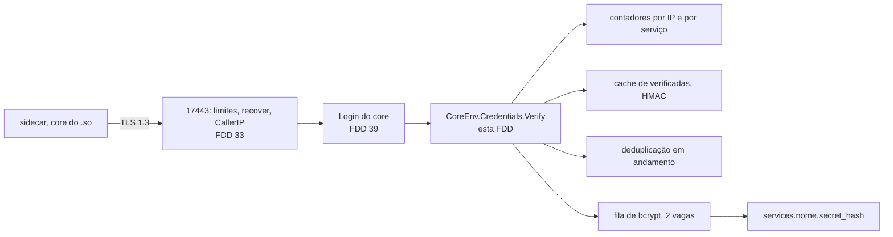
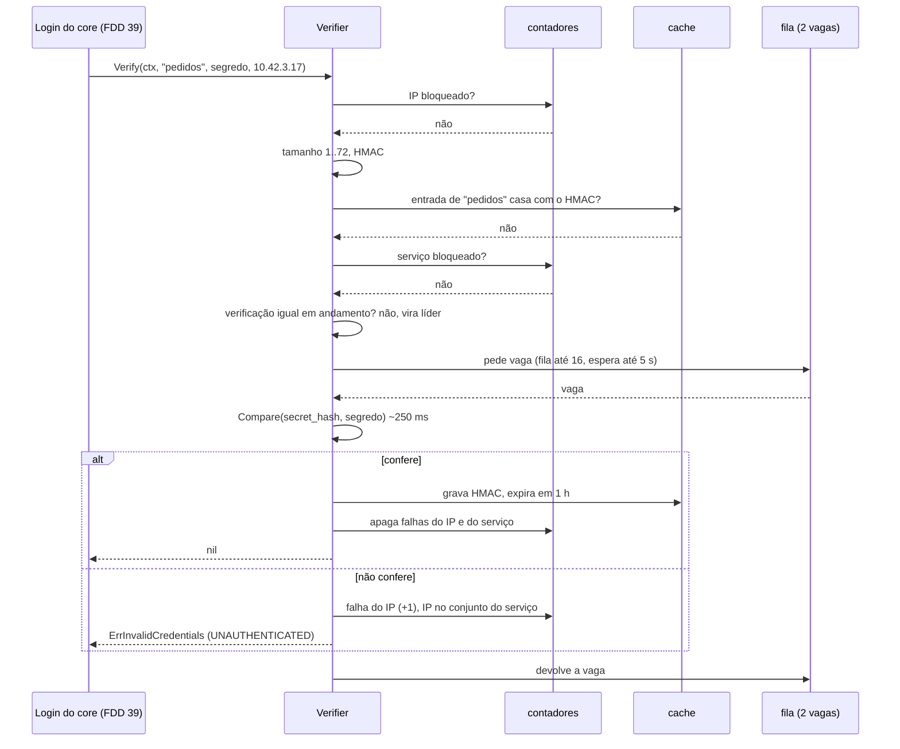
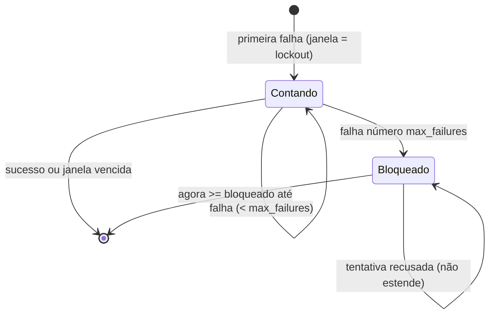
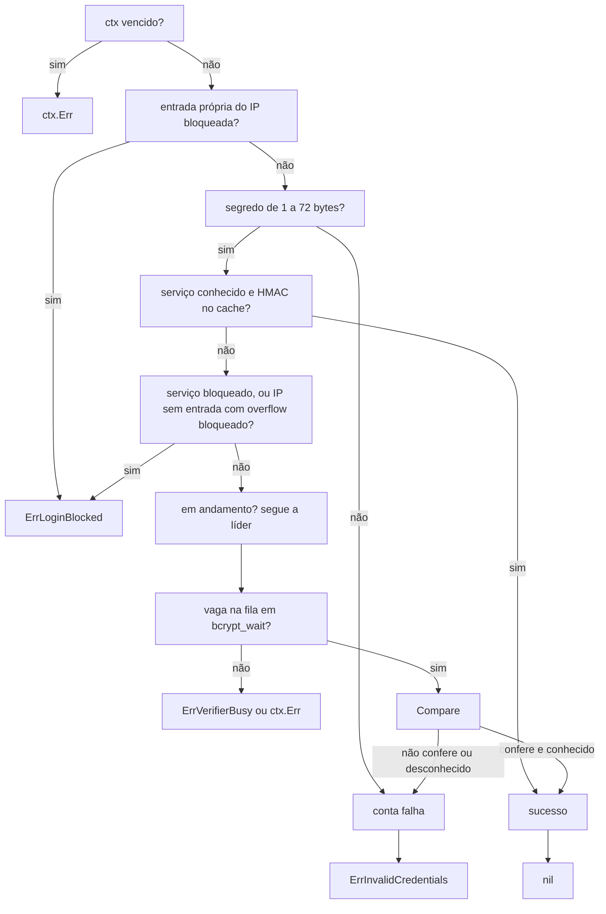

### FDD: Verificador de credencial de serviço (CTL-02)

Versão: 1.0
Data: 2026-10-21
Responsável: Guilherme Giusti

---

### 1. Contexto e motivação técnica

**Problema técnico.** O login do sidecar (`/n3x.plugins.n3x.core.v1.Login/Login`, FDD 36) é a única rota do controller aceita sem sessão (FR-005). Cada tentativa confere um segredo contra um hash bcrypt de custo 12 ou mais, o que custa cerca de 250 ms de CPU. Isso cria três problemas que o ADR-004 do `n3x-controller` decidiu em linhas gerais, mas sem comportamento verificável:

- **DoS de CPU.** Qualquer cliente que alcança a `17443` pode pedir bcrypt à vontade. Sem fila limitada, 100 pedidos simultâneos ocupam a CPU de 1 vCPU por 25 s e o painel para de responder.
- **Força bruta.** O PRD exige "limite de tentativas por IP e por serviço" com `RESOURCE_EXHAUSTED` (FR-005), mas nenhum documento diz qual é a chave do contador, quando a janela começa, se o sucesso zera, quanto de memória os contadores podem ocupar nem o que acontece com IPs forjados em massa.
- **Rajada após restart.** Sem `session.hmac_key`, todo restart invalida os tokens e os 500 sidecars refazem o login juntos (ADR-004 do `n3x-plugin-core`). O HLD promete "cerca de um bcrypt por serviço" graças ao cache, mas o cache só é preenchido depois do primeiro sucesso: os 10 pods de um serviço chegam ao mesmo tempo, todos erram o cache e rodariam 10 bcrypt. Sem deduplicar a verificação em andamento, a promessa do HLD não vale (inconsistência I-06).

Esta FDD define o verificador do host: a fila de bcrypt com prazo, a deduplicação das verificações iguais em andamento, os dois contadores de bloqueio (por IP e por serviço), o cache de credenciais verificadas, o tratamento de serviço desconhecido sem revelar a existência, os tetos de memória e a observabilidade, tudo sem nenhum segredo em log.

**Encaixe no HLD.** É o componente `host/credential` do HLD do `n3x-controller` ("Componentes e responsabilidades"), que a FDD 30 colocou em `host/internal/credential` (H-03 dela). O host monta o verificador antes do repositório de sessões e do host de plugins (ordem 31, 34, 32, 33, 35 do contrato 11 da FDD 30), a partir de `boot.Deps`, lendo `File.Services` e `File.GRPC.Login`. O host de plugins (FDD 32) entrega o verificador ao core por `ctrl.CoreEnv.Credentials()` (FDD 09, contrato 14); só o core recebe essa porta. O handler `Login` do core (FDD 39) chama `Verify(ctx, serviço, segredo, ip)` com o IP resolvido por `CallerIP(ctx)` (FDD 33) e devolve as sentinelas como estão.



**Atores.** Handler `Login` do plugin core (único chamador, FDD 39); host de plugins (entrega a porta, FDD 32); servidor gRPC (resolve o IP e impõe o prazo, FDD 33); operador (escreve os `secret_hash` e os campos de `grpc.login`, FDD 30); sidecars (indiretamente, pelo login do core no `.so`, FDDs 38 e 39); atacante na rede interna (força bruta, DoS de CPU, inundação de IPs).

**Limites.** O verificador não abre porta, não lê arquivo, não cria goroutine própria e não guarda nada em disco (ADR-002: o restart limpa tudo). Ele não conhece o token, a instância do sidecar nem o formato do `LoginRequest`; recebe serviço, segredo, IP e `ctx` e devolve `nil` ou um erro. Não protege o login do painel (FDD 34).

**Suposições**
- O segredo do serviço é gerado por `n3x-controller credential new` (32 bytes aleatórios em base64url, 43 caracteres, FDD 30); um segredo escrito à mão é possível e é o caso em que o bloqueio importa
- O IP recebido já passou pela regra de `grpc.trusted_proxies` da FDD 09 (contrato 14), aplicada pela FDD 33; IP zero significa "sem IP conhecido"
- O prazo da chamada no servidor é `min(prazo do cliente, runtime.plugin_call_timeout)` (FDD 08, aplicado pela FDD 33); o cliente usa `controller.timeouts.login` de 10 s (FDD 38)
- O orçamento do controller é de 1 vCPU (HLD do `n3x-controller`); bcrypt de custo 12 leva cerca de 250 ms de CPU; com 2 vagas em 1 vCPU, a vazão é de cerca de 4 verificações por segundo

**Restrições**
- Nenhum segredo, HMAC, hash bcrypt ou nome de serviço desconhecido em log, métrica, erro ou mensagem de status (requisitos não funcionais de segurança, ADR-020 do `n3x-sdk`)
- Comparações de cache em tempo constante (`hmac.Equal`)
- Estado só em memória, perdido no restart (ADR-002 do `n3x-controller`)
- Um único `secret_hash` por serviço; rotação com troca do hash, restart e redeploy (ADR-005 do `n3x-controller`)
- Documentação e mensagens em pt-BR; identificadores de código em inglês

**Rastreabilidade**
- PRD 1.5: FR-005 (conferência contra o hash bcrypt, limite por IP e por serviço, `RESOURCE_EXHAUSTED`), FR-002 (credencial inválida devolve `UNAUTHENTICATED`, o sidecar segue servindo), FR-016 (o login antecede registro, eventos e saída); requisitos não funcionais de disponibilidade (volta ao painel em até 30 s, cerca de 200 serviços sem `session.hmac_key`) e de segurança (bcrypt custo 12, nenhum segredo em log); critérios de aceite "sidecar com credencial inválida recusado com `UNAUTHENTICATED`" e "sidecar de volta ao painel em até 30 s"
- HLD do `n3x-controller`: "Componentes e responsabilidades" (`host/credential`), "Fluxo de requisição: login de um sidecar", "Modelo de dados" (contador de bloqueio, credencial verificada), "Considerações de escalabilidade" (proteção do bcrypt), "Segurança" e "Observabilidade"; HLD de plataforma, risco "Login como rota pública vira alvo de força bruta ou de DoS de CPU por bcrypt"
- ADRs: ADR-002, ADR-004 e ADR-005 do `n3x-controller`; ADR-019 e ADR-020 do `n3x-sdk`; ADR-004 do `n3x-plugin-core` (efeito da `session.hmac_key` no volume de logins)
- FDDs: 03 (`plugin.Secret`, `secret.Wipe`), 08 (`Caller` zero na tabela pública, prazo da chamada), 09 (contrato 14 `CredentialVerifier`, contrato 17 sentinelas e mensagens; pedidos "`Verify` com `plugin.Secret` e `netip.Addr`" e "IP zero com balde próprio"), 12 (`FakeCredentials`, `hostconformance.RunCoreEnv`, P-10), 30 (`File.Services`, `File.GRPC.Login`, faixas, `boot.Deps`, P-02), 36 (`LoginRequest.secret` de 1 a 1.024 bytes), 38 (login com 10 s, backoff da conexão)
- Lacunas do README aplicadas: L-02 (IP do chamador, decidida na FDD 09) e L-39 (prefixos bcrypt `$2a$`, `$2b$` e `$2y$`, decidida na FDD 30). Nenhuma lacuna é atribuída a esta FDD
- Decisões da clarificação (responsável, 2026-10-22):
  - Bloqueio com dois contadores independentes (IP e serviço, este por IPs distintos), e não um contador por par (IP, serviço) como no modelo de dados do HLD (I-01); o HLD será ajustado no WORKFLOW 3
  - Com o serviço bloqueado, o acerto de cache passa (I-02); só o caminho que gastaria bcrypt é fechado; o texto "IP ou serviço bloqueado" do HLD será ajustado
  - `bcrypt_queue` e `bcrypt_wait` são campos configuráveis do `n3x.yaml`, com o aviso `login_wait_exceeds_call_timeout`; o schema da CTL-01 (contrato 4, `GRPCLogin`) e o HLD precisam recebê-los (WORKFLOW 3)
  - Hipóteses menores aprovadas em bloco: as 9 métricas novas da seção 7, segredo vazio ou acima de 72 bytes como falha sem bcrypt, tabela de 16.384 IPs com balde `overflow`, IPv6 contado pelo endereço inteiro (P-05) e hash de referência do serviço desconhecido (passo 4 da montagem)
- Ponto em aberto de FDD anterior fechado aqui: P-02 da FDD 30 (campos de fila e faixas de `grpc.login`) e P-10 da FDD 12 (a regra de contagem continua no host; o falso do kit não muda)

---

### 2. Objetivos técnicos

- **CPU do bcrypt limitada.** Invariante: nunca há mais de `bcrypt_concurrency` (padrão 2) comparações bcrypt ao mesmo tempo no processo, nem mais de `bcrypt_queue` (padrão 16) chamadas esperando vaga. Medida: `n3x_controller_bcrypt_inflight` nunca passa de 2 e `n3x_controller_bcrypt_waiting` nunca passa de 16 num teste com 1.000 chamadas simultâneas.
- **Um bcrypt por serviço na rajada.** Medida: 500 chamadas simultâneas de 50 serviços (10 pods cada, segredo certo, cache vazio), repetidas depois de cada `ErrVerifierBusy` até todas terem sucesso, rodam exatamente 50 comparações no total (contador do `Compare` injetado); as outras 450 respostas de sucesso vêm de seguidoras ou do cache (`n3x_controller_bcrypt_shared_total` mais `n3x_controller_credential_cache_hits_total` igual a 450).
- **Bloqueio determinístico.** Invariante: com `max_failures = 5`, a quinta falha do mesmo IP devolve `UNAUTHENTICATED` e a sexta devolve `RESOURCE_EXHAUSTED` sem rodar bcrypt; o bloqueio termina exatamente `lockout` depois da quinta falha (relógio controlável).
- **Bloqueio por serviço resistente a um IP só.** Invariante: falhas vindas de um único IP nunca bloqueiam um serviço; o serviço só bloqueia com `max_failures` IPs distintos falhando na janela, e mesmo bloqueado aceita quem acerta o cache.
- **Caminhos baratos sem bcrypt.** Medida: IP bloqueado, serviço bloqueado e acerto no cache respondem em p99 abaixo de 50 µs, com no máximo 2 alocações por chamada no acerto de cache (`testing.AllocsPerRun`) (hipótese das metas).
- **Memória limitada sob inundação.** Medida: 100.000 IPs distintos falhando deixam no máximo 16.384 entradas por IP (`n3x_controller_login_tracked_ips`) e o heap do verificador cresce no máximo 5 MiB.
- **Serviço desconhecido indistinguível pela resposta.** Invariante: serviço que não está em `services` recebe o mesmo `ErrInvalidCredentials` e a mesma ordem de grandeza de tempo (um bcrypt de referência) que um segredo errado; o nome nunca vira rótulo nem campo de log.
- **Falha sempre contada.** Invariante: uma comparação bcrypt que começou tem o resultado registrado (cache ou contador) mesmo que o `ctx` expire no meio, para um atacante não fugir da contagem com prazos curtos.
- **Nenhum segredo em saída.** Medida: com o segredo igual a um canário `n3x-canary-`, `secrettest.Leaks` encontra 0 ocorrência em logs, métricas, textos de erro e mensagens de status; o HMAC do cache também nunca aparece.

---

### 3. Escopo e exclusões

**Incluído**
- Pacote `github.com/giustech/n3x-controller/host/internal/credential` (hipótese de caminho, coerente com a H-03 da FDD 30) com o tipo `Verifier`, que implementa `ctrl.CredentialVerifier`
- `Verify(ctx, serviço, segredo, ip) error`: ordem das checagens, mapeamento para as sentinelas da FDD 09, respeito ao prazo do `ctx`
- Fila de bcrypt FIFO com `bcrypt_concurrency` vagas, `bcrypt_queue` lugares de espera e prazo `bcrypt_wait` (campos novos, P-02 da FDD 30)
- Deduplicação das verificações em andamento por (serviço, HMAC do segredo)
- Contador por IP e contador por serviço (IPs distintos), janela, bloqueio, desbloqueio, efeito do sucesso e limpeza
- Cache de credenciais verificadas: HMAC-SHA256 com chave aleatória do processo, uma entrada por serviço, só sucessos
- Serviço desconhecido: bcrypt de referência, resultado descartado, sem contador por serviço
- Tetos de memória dos contadores, balde de transbordo e varredura preguiçosa, sem goroutine própria
- Métricas, logs e alertas do verificador; registro das métricas em `Deps.Registry`
- Pacote de teste `host/internal/credential/credentialtest` (hashes de custo baixo para o harness da FDD 32)
- Decisão sobre o P-10 da FDD 12

**Excluído**
- Handler `Login`, validação do `LoginRequest`, emissão e validação do token HMAC, renovação e backoff do sidecar: FDD 39 (CORE-03)
- Interface `ctrl.CredentialVerifier`, sentinelas e mensagens genéricas: FDD 09 (SDK-09); entrega ao core pelo `CoreEnv`: FDD 32 (CTL-03)
- Servidor gRPC, interceptors, resolução do IP (`x-forwarded-for` com `grpc.trusted_proxies`), limites de conexão e prazo da chamada: FDD 33 (CTL-04)
- Carga e validação de `services` e `grpc.login` (gramática, bcrypt `$2a$`, `$2b$` e `$2y$`, custo de 12 a 16): FDD 30 (CTL-01); esta FDD só pede os campos novos
- Login do painel, bloqueio por usuário e IP e conferência do root: FDD 34 (CTL-05)
- Medição da rajada com 500 sidecars: FDD 51 (CTL-07)
- Falso do verificador no kit de testes: FDD 12 (SDK-12), sem mudança

---

### 4. Fluxos detalhados e diagramas

**Fluxo de montagem (dentro do `run`, FDD 30)**
1. `host.Run` termina as etapas 0 a 4 (config, manifesto, chave, TLS) e abre a `17091`.
2. `credential.New(deps)` copia os hashes de `deps.Config.File.Services` (já validados pela FDD 30) e os valores de `deps.Config.File.GRPC.Login`.
3. Gera a chave do cache com 32 bytes de `crypto/rand`; falha de leitura do gerador devolve erro e a montagem sai com 8 (`internal_error`).
4. Escolhe o hash de referência para serviço desconhecido: o `secret_hash` do primeiro serviço em ordem de bytes do nome; sem nenhum serviço, gera um hash de custo `config.MinBcryptCost` (12) sobre 32 bytes aleatórios, uma vez (cerca de 250 ms na subida, só quando `services` está vazio, caso já avisado com `no_services` pela FDD 30) (aprovado em 2026-10-22).
5. Registra as métricas em `deps.Registry`; nome repetido devolve erro (saída 8, regra da FDD 30). A família compartilhada `n3x_controller_login_blocked_total{kind}` vem pronta do `boot` (pedido à FDD 30) e o verificador usa só `kind="sidecar"`.
6. Loga `credential_verifier_ready` com os valores efetivos e, se `bcrypt_concurrency` passar de `GOMAXPROCS`, o aviso `credential_warning` com `code=bcrypt_concurrency_high`.
7. O host de plugins (FDD 32) recebe o `*Verifier` e o devolve em `CoreEnv.Credentials()`.

**Fluxo principal: `Verify(ctx, serviço, segredo, ip)`**
1. **Prazo.** Se `ctx.Err() != nil`, devolve `ctx.Err()` sem tocar em nada.
2. **Chave do IP.** IPv4 mapeado em IPv6 vira IPv4 (`Unmap`); IP zero (sem IP conhecido) vira o balde `unknown` (pedido da FDD 09); IPv6 conta pelo endereço inteiro (P-05, aprovado em 2026-10-22).
3. **Serviço.** Procura `serviço` no mapa de hashes. Ausente: o chamador é tratado como "desconhecido", com rótulo e campo de log `_unknown` (o `_` inicial não cabe na gramática de `services`, então nunca colide); o nome recebido nunca é guardado nem logado.
4. **IP bloqueado.** Se a entrada própria do IP está bloqueada, devolve `ctrl.ErrLoginBlocked` sem cache e sem bcrypt (ordem do HLD). Conta `logins_total{result="blocked"}` e `login_blocked_total{kind="sidecar"}`. Um IP sem entrada própria com o balde `overflow` bloqueado não para aqui: a recusa dele fica para o passo 8, depois do cache (fluxo de transbordo).
5. **Tamanho do segredo.** Vazio ou acima de 72 bytes (limite do bcrypt; o `credential new` gera 43): falha sem bcrypt, contada como as demais (passo 10), e devolve `ctrl.ErrInvalidCredentials`. O valor nunca chega a `Compare`.
6. **HMAC.** Copia o segredo para um buffer de 72 bytes na pilha e calcula `mac = HMAC-SHA256(chave do processo, nomeDoServiço || 0x00 || segredo)` com um `hash.Hash` reaproveitado de um `sync.Pool`; o buffer é zerado com `secret.Wipe` ao fim da chamada.
7. **Cache (só serviço conhecido).** Se há entrada do serviço não expirada e `hmac.Equal(entrada.mac, mac)`, devolve `nil` sem bcrypt; conta `credential_cache_hits_total` e `logins_total{result="ok"}` e aplica o efeito do sucesso (passo 11). O acerto não estende o prazo da entrada.
8. **Serviço ou transbordo bloqueado.** Se o serviço é conhecido e o contador dele está bloqueado, ou se o IP não tem entrada própria e o balde `overflow` está bloqueado, devolve `ctrl.ErrLoginBlocked` sem bcrypt. Quem acertou o cache já saiu no passo 7: esses dois bloqueios só fecham o caminho que gastaria CPU (I-02, decisão do responsável em 2026-10-22).
9. **Deduplicação e fila.** Procura uma verificação em andamento com a chave (serviço ou `_unknown`, `mac`):
   - existe: a chamada vira seguidora e espera o resultado com o próprio `ctx`, sem ocupar vaga nem lugar na fila; conta `bcrypt_shared_total`
   - não existe: a chamada vira líder, registra a chave e pede vaga na fila (contrato 3). Fila cheia: `ctrl.ErrVerifierBusy` na hora (`reason=queue_full`). Sem vaga em `bcrypt_wait`: `ctrl.ErrVerifierBusy` (`reason=wait_timeout`). `ctx` vencido antes da vaga: `ctx.Err()`. Nos três casos a chave sai do mapa e as seguidoras recebem `ctrl.ErrVerifierBusy`; nada é contado como falha
   - com a vaga, a líder chama `Compare(hash, segredo)` (padrão `bcrypt.CompareHashAndPassword`); para serviço desconhecido, contra o hash de referência, e o resultado é descartado (sempre falha)
   - a comparação não é interrompida pelo `ctx`; o resultado é sempre registrado (passos 10 e 11) antes de a vaga voltar à fila
10. **Falha** (segredo errado, tamanho inválido ou serviço desconhecido). Para a líder e para cada seguidora, separadamente:
    - contador do IP: soma 1 falha; se é a primeira da janela, a janela começa agora e dura `lockout`; ao chegar a `max_failures`, o IP fica bloqueado até `agora + lockout`, conta `login_lockouts_total{scope="ip"}` e loga `login_blocked`
    - contador do serviço (só serviço conhecido): acrescenta o IP ao conjunto de IPs que falharam na janela, se ainda não estiver lá; ao chegar a `max_failures` IPs distintos, o serviço fica bloqueado até `agora + lockout` para o caminho com bcrypt, conta `login_lockouts_total{scope="service"}` e loga `login_blocked`
    - conta `logins_total{result="fail"}` e loga `login_failed` (amostrado)
    - devolve `ctrl.ErrInvalidCredentials`, ou `ctx.Err()` se o prazo venceu durante a comparação
11. **Sucesso** (só serviço conhecido). A líder grava a entrada do cache (`mac`, expira em `agora + verified_cache_ttl`). Para a líder e cada seguidora: apaga a entrada do IP, se não estiver bloqueada; limpa o conjunto de falhas do serviço, se não estiver bloqueado (um bloqueio ativo só termina pelo tempo); conta `logins_total{result="ok"}`; devolve `nil`, ou `ctx.Err()` se o prazo venceu durante a comparação (o cache fica gravado, e o próximo login entra sem bcrypt).

**Fluxo de limpeza (preguiçosa, sem goroutine)**
- No máximo uma vez por `SweepInterval` (1 min), dentro de um `Verify` e sob a trava, a varredura remove entradas de IP com janela vencida e sem bloqueio, entradas com bloqueio vencido, conjuntos de serviço vencidos e entradas de cache expiradas. Custo: O(n) com n até 16.384, abaixo de 2 ms (hipótese da meta)
- Fora da varredura, cada leitura confere o vencimento da própria entrada: uma entrada vencida é tratada como ausente na hora, então o resultado não depende de quando a varredura rodou
- Os gauges (`login_tracked_ips`, `login_lockouts_active`, `credential_cache_entries`) são calculados no scrape por um coletor que lê as tabelas sob a trava, descontando o que venceu

**Fluxo de transbordo (inundação de IPs)**
- A tabela de IPs guarda só IPs com falha recente (o sucesso apaga a entrada) e tem teto de `MaxTrackedIPs` (16.384)
- Ao chegar uma falha de IP novo com a tabela cheia: uma varredura extra (no máximo 1 por segundo) tira os vencidos e, se preciso, as entradas não bloqueadas com a primeira falha mais antiga, até 90% do teto; bloqueados nunca são despejados (despejar um bloqueado o desbloquearia). Cada despejo soma em `login_tracker_evictions_total`
- Sem espaço depois disso (tabela cheia de bloqueados), a falha conta no balde `overflow`, com as mesmas regras de um IP; o log `login_tracker_full` sai no máximo uma vez por minuto
- Com o `overflow` bloqueado, um IP sem entrada na tabela só passa pelo acerto de cache (passo 7); o caminho com bcrypt dele é recusado no passo 8 com `ErrLoginBlocked`. Um IP com entrada própria segue a própria entrada

**Fluxos alternativos e exceções**
- **Segredo certo durante bloqueio do IP:** recusado com `RESOURCE_EXHAUSTED` sem bcrypt (ordem do HLD; o atacante não descobre se acertou)
- **Segredo certo durante bloqueio do serviço:** aceito se está no cache; senão, recusado sem bcrypt. Os pods que já entraram antes do ataque seguem renovando pelo cache
- **Restart do controller durante um ataque ao serviço:** cache vazio e contadores zerados (ADR-002); o atacante precisa de novos `max_failures` IPs distintos para bloquear de novo, e cada IP dele bloqueia sozinho depois de `max_failures` falhas
- **Renovação do token a 80% do TTL (FDD 39):** com `session.ttl` de 1 h e `verified_cache_ttl` de 1 h, a primeira renovação (48 min) acerta o cache e a seguinte (96 min) roda um bcrypt; o custo em regime é de no máximo um bcrypt por serviço por `verified_cache_ttl`
- **Dois serviços com o mesmo segredo:** cada serviço tem a própria entrada de cache e o HMAC inclui o nome; acertar um não autentica o outro
- **Segredo de outro serviço mandado com nome desconhecido:** a comparação é contra o hash de referência (que pode ser o de um serviço real) e o resultado é descartado; sempre `ErrInvalidCredentials`
- **Hash que o `Compare` recusa por formato** (não deve acontecer: a FDD 30 valida na subida): tratado como falha, `logins_total{result="fail"}`, log `credential_hash_error` em `error`, uma vez por minuto por serviço
- **IP zero:** todas as chamadas sem IP dividem o balde `unknown`; cinco falhas sem IP bloqueiam as demais sem IP, nunca um IP real
- **Socket Unix ou proxy L4 sem preservar a origem:** o bloqueio por IP vira bloqueio do balanceador; o bloqueio por serviço exige IPs distintos e não dispara com um IP só (risco documentado; guia na FDD 47)
- **`ctx` vencido na espera:** `ctx.Err()` (`DEADLINE_EXCEEDED` ou `CANCELED`), sem contagem; `logins_total{result="timeout"}`
- **Desligamento:** o servidor gRPC para antes (FDD 30); chamadas em espera saem pelo `ctx`; não há `Close`

**Diagramas**

Sequência de um login que precisa de bcrypt:



Estados de uma entrada de contador (IP, serviço ou `overflow`):



Ordem das decisões em `Verify`:



---

### 5. Contratos públicos (assinaturas, endpoints, headers, exemplos)

Os contratos 1 a 4 e 6 são internos ao módulo `github.com/giustech/n3x-controller/host` (pacotes `host/internal/...`, H-03 da FDD 30): estáveis para as FDDs 30, 32 e 33, sem garantia de semver para fora. O contrato 2 implementa uma interface pública do SDK (FDD 09) e segue a semântica dela. O contrato 5 é público para o operador (campos do `n3x.yaml`) e o 7 é público para quem lê métricas e logs.

**Contrato 1: construção do verificador**
- Tipo: sdk (API Go interna)
- Assinatura/Rota:
  ```go
  package credential // github.com/giustech/n3x-controller/host/internal/credential

  const (
      UnknownService    = "_unknown"        // rótulo e campo de log de serviço desconhecido
      MaxSecretLen      = 72                // limite do bcrypt; acima, falha sem bcrypt
      MaxTrackedIPs     = 16384             // teto da tabela por IP
      SweepInterval     = time.Minute       // varredura preguiçosa
      LogSampleInterval = time.Second       // login_failed e verifier_busy
      BlockLogInterval  = time.Minute       // login_blocked repetido e login_tracker_full
      CacheKeyLen       = 32                // bytes da chave HMAC do processo
  )

  // Verifier implementa ctrl.CredentialVerifier. Seguro para uso concorrente.
  type Verifier struct{ /* tabelas sob uma trava, fila, cache, deduplicação */ }

  var _ ctrl.CredentialVerifier = (*Verifier)(nil)

  // New monta o verificador do run a partir da config já validada (FDD 30).
  func New(deps boot.Deps) (*Verifier, error)

  // NewWithOptions é a mesma montagem com tudo injetável (testes, harness da FDD 32).
  func NewWithOptions(o Options) (*Verifier, error)

  type Options struct {
      Services map[string]string     // nome do serviço -> secret_hash; copiado
      Login    config.GRPCLogin       // max_failures, lockout, bcrypt_*, verified_cache_ttl
      Log      *slog.Logger           // nil = descarta
      Registry prometheus.Registerer  // nil = não registra
      Blocked  *prometheus.CounterVec // família compartilhada login_blocked_total{kind}; nil = cria uma local
      Now      func() time.Time       // nil = time.Now
      After    func(time.Duration) <-chan time.Time // nil = time.After; espera por vaga
      Compare  func(hash, secret []byte) error      // nil = bcrypt.CompareHashAndPassword
      Rand     io.Reader              // nil = crypto/rand.Reader; chave do cache e hash de referência
      Procs    int                    // 0 = runtime.GOMAXPROCS(0); só para o aviso bcrypt_concurrency_high
  }
  ```
- Método: n/a (chamada local)
- Semântica:
  - `New(deps)` equivale a `NewWithOptions` com `Services` de `deps.Config.File.Services`, `Login` de `deps.Config.File.GRPC.Login`, `Log` = `deps.Log.With("component", "credential")`, `Registry` = `deps.Registry`, `Blocked` = família compartilhada do `boot` (pedido à FDD 30), `Now` = `deps.Clock`
  - Erros (todos viram saída 8 na montagem, FDD 30): leitura de `Rand` falhou (`ErrRandom`); registro de métrica recusado (erro do `prometheus`); `Options.Login` fora das faixas do contrato 5 (`ErrOptions`, só em `NewWithOptions`, porque o `run` já validou)
  - O verificador não confere gramática nem custo dos hashes: isso é da FDD 30 (regras `name_format`, `bcrypt_format`, `bcrypt_cost`, L-39). Ele aceita os três prefixos `$2a$`, `$2b$` e `$2y$`, que `bcrypt.CompareHashAndPassword` compara com o mesmo algoritmo
  - Nenhum valor de `Services` aparece em erro ou log; o log de pronto traz só a contagem
  - O retorno com erro em vez de `cred := credential.New(deps)` sem erro é uma mudança de forma do contrato 11 da FDD 30, que deixou os nomes como proposta (I-04)

**Exemplo de requisição**
```go
v, err := credential.NewWithOptions(credential.Options{
    Services: map[string]string{"pedidos": "$2y$12$R9h/cIPz0gi.URNNX3kh2OPST9/PgBkqquzi.Ss7KIUgO2t0jWMUW"},
    Login:    config.GRPCLogin{MaxFailures: 5, Lockout: 15 * time.Minute, BcryptConcurrency: 2, BcryptQueue: 16, BcryptWait: 5 * time.Second, VerifiedCacheTTL: time.Hour},
    Log:      logger,
    Registry: reg,
})
```

**Exemplo de resposta**
```json
{"ts":"2026-10-21T14:00:00.120Z","level":"info","component":"credential","msg":"credential_verifier_ready","services":1,"max_failures":5,"lockout":"15m0s","bcrypt_concurrency":2,"bcrypt_queue":16,"bcrypt_wait":"5s","verified_cache_ttl":"1h0m0s","max_tracked_ips":16384,"reference_hash":"service"}
```
(`reference_hash` vale `service` quando o hash de referência é o do primeiro serviço e `generated` quando `services` está vazio.)

---

**Contrato 2: `Verify` (implementação de `ctrl.CredentialVerifier`, FDD 09, contrato 14)**
- Tipo: method
- Assinatura/Rota:
  ```go
  func (v *Verifier) Verify(ctx context.Context, service string, secret plugin.Secret, ip netip.Addr) error
  ```
- Método: chamada local, feita só pelo handler `Login` do core
- Semântica de retorno (sentinelas da FDD 09, contrato 17, devolvidas sem embrulho, para `status.Code(err)` funcionar direto):

| Retorno | Quando | gRPC (pela `GRPCStatus()` da FDD 09) | `logins_total{result}` | Conta falha |
| --- | --- | --- | --- | --- |
| `nil` | serviço conhecido e segredo confere, pelo cache ou pelo bcrypt | `OK` (o core emite o token) | `ok` | não; apaga as falhas do IP e do serviço |
| `ctrl.ErrInvalidCredentials` | segredo errado; serviço desconhecido; segredo vazio ou com mais de 72 bytes; hash recusado pelo `Compare` | `UNAUTHENTICATED`, "credencial inválida" | `fail` | sim |
| `ctrl.ErrLoginBlocked` | IP bloqueado; `overflow` bloqueado para IP sem entrada (fora do acerto de cache); serviço bloqueado no caminho com bcrypt | `RESOURCE_EXHAUSTED`, "muitas tentativas; tente mais tarde" | `blocked` | não |
| `ctrl.ErrVerifierBusy` | fila cheia; sem vaga em `bcrypt_wait`; líder da verificação igual não conseguiu vaga | `RESOURCE_EXHAUSTED`, "controller ocupado; tente mais tarde" | `busy` | não |
| `ctx.Err()` | prazo ou cancelamento antes da vaga, ou depois de a comparação terminar (resultado registrado mesmo assim) | `DEADLINE_EXCEEDED` ou `CANCELED` | `timeout` | só se a comparação rodou e falhou |

- **Prazo:** usa o `ctx` recebido, que a FDD 33 limita a `min(prazo do cliente, runtime.plugin_call_timeout)`. A espera por vaga termina no que vier primeiro entre `bcrypt_wait` e o prazo do `ctx`. A comparação já iniciada não é interrompida (bcrypt não aceita cancelamento): no pior caso a resposta sai uma comparação (cerca de 250 ms) depois do prazo
- **Tempo constante:** o acerto de cache usa `hmac.Equal`; o bcrypt compara em tempo constante internamente. Serviço desconhecido roda um bcrypt de referência para não responder mais rápido que um serviço existente. Os caminhos sem bcrypt (bloqueio, tamanho inválido, acerto de cache) são rápidos por desenho e não revelam a existência do serviço: o bloqueio por IP vem antes da consulta ao serviço, e o tamanho inválido é decidido pelo próprio texto enviado
- **Segredo:** lido uma vez por `secret.Reveal()` e copiado para um buffer de 72 bytes zerado no fim; nunca entra em log, métrica, erro, mapa ou chave de deduplicação (a chave usa o HMAC)
- **Cache:** uma entrada por serviço conhecido; aceita o segredo de qualquer instância e de qualquer IP (os pods de um serviço dividem o segredo, ADR-004); expira `verified_cache_ttl` depois do bcrypt que a criou e não é estendida pelo acerto; falha nunca entra (ADR-004)
- **Concorrência:** seguro para chamadas simultâneas; uma trava protege contadores, cache e mapa de deduplicação, e nunca é mantida durante o bcrypt nem durante a espera por vaga
- **Limites:** sem limite de taxa próprio além dos contadores e da fila; a vazão máxima de bcrypt é cerca de `bcrypt_concurrency` vezes 4 por segundo por vCPU livre

**Exemplo de requisição**
```go
ip, _ := cenv.CallerIP(ctx) // FDD 09; 10.42.3.17
err := cenv.Credentials().Verify(ctx, "pedidos", plugin.NewSecret(req.GetSecret()), ip)
fmt.Println(errors.Is(err, ctrl.ErrInvalidCredentials), status.Code(err))
```

**Exemplo de resposta** (sequência num mesmo IP, `max_failures: 5`, relógio parado)
```json
{
  "tentativas 1 a 5, segredo errado": ["Unauthenticated", "Unauthenticated", "Unauthenticated", "Unauthenticated", "Unauthenticated"],
  "tentativa 6, segredo certo, cache vazio": "ResourceExhausted: muitas tentativas; tente mais tarde",
  "Compare chamado": 5,
  "outro IP, segredo certo": "OK",
  "outro IP, mesmo segredo, 10 min depois": "OK (cache, Compare continua 6)",
  "primeiro IP, 15 min depois da quinta falha, segredo certo": "OK",
  "serviço \"nao-existe\"": "Unauthenticated: credencial inválida (Compare contra o hash de referência, resultado descartado)",
  "segredo com 73 bytes": "Unauthenticated (sem Compare)"
}
```

---

**Contrato 3: fila de bcrypt e deduplicação**
- Tipo: method (comportamento interno observável do contrato 2)
- Assinatura/Rota: parte de `Verify`; sem API própria
- Método: n/a
- Semântica:
  - **Vagas:** `bcrypt_concurrency` (padrão 2) comparações simultâneas no processo inteiro, para todos os serviços
  - **Fila:** até `bcrypt_queue` (padrão 16) líderes esperando, em ordem FIFO de chegada (implementação própria com lista de espera; `chan` sem ordem garantida não serve). `bcrypt_queue: 0` desliga a espera: sem vaga livre, `ErrVerifierBusy` na hora
  - **Prazo da espera:** `bcrypt_wait` (padrão 5 s), menor que o prazo do login no cliente (10 s, FDD 38) e que `runtime.plugin_call_timeout` (10 s), para sobrar tempo da comparação; quem sai por prazo libera o lugar na hora
  - **Dimensionamento do padrão** (hipótese, confirmação na FDD 51): em 1 vCPU, 2 vagas dão cerca de 4 comparações por segundo; em 5 s saem cerca de 20 da fila, então 16 lugares esperando mais 2 em andamento cabem no prazo. Quem não cabe recebe `ErrVerifierBusy` logo e tenta de novo com o jitter do core (FDD 39), em vez de esperar em vão
  - **Deduplicação:** chave (nome do serviço ou `_unknown`, HMAC do segredo). Chamadas com a mesma chave enquanto a líder está na fila ou comparando viram seguidoras: não ocupam vaga nem lugar, recebem o mesmo resultado e cada uma conta a própria falha (pelo próprio IP). A líder que não consegue vaga leva as seguidoras a `ErrVerifierBusy`. O mapa de verificações em andamento tem no máximo `bcrypt_concurrency + bcrypt_queue` chaves; as seguidoras são limitadas pelas chamadas simultâneas que a FDD 33 aceita (1.000 conexões e 16 streams cada)
  - **Seguidora com `ctx` vencido:** sai com `ctx.Err()` sem afetar a líder nem as outras

**Exemplo de requisição**
```go
// harness: Compare que leva 250 ms; 500 chamadas simultâneas, 50 serviços com 10 pods cada
for s := range 50 { for p := range 10 { go v.Verify(ctx, nome(s), plugin.NewSecret(segredo(s)), ipDoPod(s, p)) } }
```

**Exemplo de resposta**
```json
{
  "primeira passada": { "ok": 180, "busy (queue_full)": 320, "Compare": 18 },
  "repetindo as busy até o sucesso": { "Compare no total": 50, "bcrypt_shared_total + credential_cache_hits_total": 450, "ok": 500 },
  "max n3x_controller_bcrypt_inflight": 2,
  "max n3x_controller_bcrypt_waiting": 16
}
```
(Na primeira passada, 2 líderes pegam as vagas e 16 entram na fila; os outros 32 líderes e as seguidoras deles recebem `ErrVerifierBusy` na hora. Ao repetir, cada chamada encontra o cache já preenchido, uma verificação igual em andamento ou um lugar na fila: nenhum serviço compara duas vezes. Com `Compare` de 250 ms de parede, a fila esvazia a 8 por segundo; com bcrypt real em 1 vCPU, a cerca de 4 por segundo.)

---

**Contrato 4: contadores de bloqueio**
- Tipo: method (comportamento interno observável do contrato 2)
- Assinatura/Rota: parte de `Verify`; sem API própria
- Método: n/a
- Semântica:

| Contador | Chave | O que conta | Limite | Efeito do bloqueio | Teto de memória |
| --- | --- | --- | --- | --- | --- |
| Por IP | IP normalizado; `unknown` para IP zero | toda falha do IP, em qualquer serviço, conhecido ou não | `max_failures` falhas na janela | recusa tudo do IP antes do cache (passo 4) | `MaxTrackedIPs` entradas (cerca de 128 bytes cada, 2 MiB) |
| Transbordo | `overflow` | falhas de IPs novos com a tabela cheia de bloqueados | `max_failures` falhas na janela | recusa IPs sem entrada, exceto acerto de cache | 1 entrada |
| Por serviço | nome do serviço conhecido | IPs distintos com falha no serviço (cada IP conta uma vez na janela) | `max_failures` IPs distintos | recusa o caminho com bcrypt do serviço; acerto de cache passa (passo 8) | até 1.024 serviços com até `max_failures` IPs (no pior caso, 1.024 vezes 100 vezes 24 bytes, cerca de 2,4 MiB) |
| (nenhum) | serviço desconhecido | só o contador por IP | | | |

  - **Janela:** fixa, começa na primeira falha e dura `lockout` (15 min); vencida sem bloqueio, a entrada some. Com `max_failures: 5` e `lockout: 15m`, são 5 falhas em 15 min (H-03)
  - **Bloqueio:** começa na falha que atinge o limite e dura `lockout` contado dali; tentativas durante o bloqueio não o estendem (um atacante não prende o serviço para sempre só insistindo; o próprio IP dele continua bloqueado pelo contador por IP); terminado o bloqueio, a entrada some e a contagem recomeça do zero
  - **Sucesso:** apaga a entrada do IP que acertou e o conjunto de falhas do serviço, se não estiverem bloqueados; não encerra um bloqueio ativo
  - **Por que o serviço conta IPs distintos** (decisão do responsável em 2026-10-22; resposta ao risco novo do ASSUNTO): com falhas simples, um único IP com 5 tentativas bloquearia o login do serviço inteiro para todos os pods depois de um restart. Contando IPs distintos, o atacante precisa de `max_failures` IPs na janela, e cada um deles bloqueia sozinho depois de `max_failures` falhas. A força bruta distribuída num segredo fraco escrito à mão continua barrada: com qualquer número de IPs, são no máximo 21 tentativas por janela (5 falhas em cada um de 4 IPs e a primeira do quinto) antes de o serviço fechar o caminho com bcrypt
  - **Leitura de "por IP e por serviço"** (ADR-004, FR-005): dois contadores independentes, não um contador por par (IP, serviço) como sugere o modelo de dados do HLD (I-01; a leitura da FDD foi aprovada em 2026-10-22 e o HLD será ajustado). O par não protege contra um IP que varre 1.024 serviços (5.120 bcrypt a cada 15 min, cerca de 21 min de CPU)
  - **Vazamento residual:** um serviço conhecido bloqueado responde `RESOURCE_EXHAUSTED` e um nome desconhecido nunca bloqueia pelo serviço; descobrir isso custa `max_failures` IPs por nome testado. Os nomes de serviço não são tratados como segredo (aparecem no inventário e no DNS); a resposta a uma tentativa comum continua igual

**Exemplo de requisição**
```go
for i := range 5 { v.Verify(ctx, "pedidos", plugin.NewSecret("errado"), ipDe(i)) }   // 5 IPs distintos, 1 falha cada
err := v.Verify(ctx, "pedidos", plugin.NewSecret(segredoCerto), netip.MustParseAddr("10.42.9.9"))
```

**Exemplo de resposta**
```json
{
  "depois de 5 IPs distintos com 1 falha cada": "serviço pedidos bloqueado até 14:15:00",
  "IP novo, segredo certo, cache vazio": "ResourceExhausted: muitas tentativas; tente mais tarde",
  "IP novo, segredo certo, depois de um sucesso anterior em cache": "OK",
  "1 IP com 5 falhas": { "ip": "bloqueado", "serviço": "1 IP no conjunto, não bloqueado" }
}
```

---

**Contrato 5: campos `grpc.login` do `n3x.yaml` do controller**
- Tipo: sdk (schema de configuração; dono do schema é a FDD 30, campos novos por adição, P-02 dela)
- Assinatura/Rota: `grpc.login.*` em `/etc/n3x/controller.yaml`
- Método: n/a
- Semântica:

| Campo | Tipo | Padrão | Faixa | Efeito | Situação |
| --- | --- | --- | --- | --- | --- |
| `max_failures` | inteiro | `5` | 1 a 100 | limite de falhas por IP e de IPs distintos por serviço, na janela | confirmado (FDD 30) |
| `lockout` | duração | `15m` | 1m a 24h | duração da janela de contagem e do bloqueio | confirmado (FDD 30) |
| `bcrypt_concurrency` | inteiro | `2` | 1 a 16 | comparações bcrypt simultâneas no processo; acima de `GOMAXPROCS` avisa | confirmado (FDD 30) |
| `bcrypt_queue` | inteiro | `16` | 0 a 1024 | chamadas esperando vaga; 0 desliga a espera | novo (aprovado em 2026-10-22; falta incluir no schema da FDD 30 e no HLD) |
| `bcrypt_wait` | duração | `5s` | 100ms a 30s | prazo máximo de espera por vaga; acima ou igual a `runtime.plugin_call_timeout`, a FDD 30 avisa `login_wait_exceeds_call_timeout` | novo (aprovado em 2026-10-22; falta incluir no schema da FDD 30 e no HLD) |
| `verified_cache_ttl` | duração | `1h` | 1m a 24h | vida da entrada de cache depois do bcrypt que a criou | confirmado (FDD 30) |

  - A struct `config.GRPCLogin` ganha `BcryptQueue int` (`n3x:"min=0,max=1024" default:"16"`) e `BcryptWait time.Duration` (`n3x:"min=100ms,max=30s" default:"5s"`), com os códigos de regra da FDD 02 (`type`, `min`, `max`)
  - Os padrões e as faixas mudam só em major do `host/` (garantia da FDD 30)
  - Não há campo para desligar o cache ou o bloqueio: o mínimo de 1 min e 1 falha já cobre testes

**Exemplo de requisição**
```yaml
grpc:
  login:
    max_failures: 5
    lockout: 15m
    bcrypt_concurrency: 2
    bcrypt_queue: 16
    bcrypt_wait: 5s
    verified_cache_ttl: 1h
```

**Exemplo de resposta** (`n3x-controller validate`, com `bcrypt_queue: -1` e `bcrypt_wait: 12s` e `plugin_call_timeout` de 10 s)
```text
erro: n3x.yaml inválido (N3X-C002)
  grpc.login.bcrypt_queue: menor que o mínimo 0 [min]
aviso: grpc.login.bcrypt_wait: 12s é maior ou igual a runtime.plugin_call_timeout (10s); a espera nunca termina antes do prazo da chamada [login_wait_exceeds_call_timeout]
```

---

**Contrato 6: apoio de teste `credentialtest`**
- Tipo: sdk (API Go interna, só em `_test.go` e no harness da FDD 32)
- Assinatura/Rota:
  ```go
  package credentialtest // github.com/giustech/n3x-controller/host/internal/credential/credentialtest

  // Hashes gera bcrypt de custo bcrypt.MinCost (4) para cada segredo; rápido, nunca em produção.
  func Hashes(secrets map[string]string) map[string]string

  // SlowCompare devolve um Compare que espera release antes de comparar, para testar a fila.
  func SlowCompare(release <-chan struct{}) func(hash, secret []byte) error

  // CountingCompare conta as chamadas ao Compare de base.
  func CountingCompare(base func(hash, secret []byte) error) (fn func(hash, secret []byte) error, calls func() int)

  // Clock é um relógio manual: Now, Advance e After coerentes entre si.
  type Clock struct{ /* ... */ }
  func NewClock(start time.Time) *Clock
  func (c *Clock) Now() time.Time
  func (c *Clock) Advance(d time.Duration)
  func (c *Clock) After(d time.Duration) <-chan time.Time
  ```
- Método: n/a
- Semântica:
  - É o que o harness do host real (FDD 32) usa para rodar `hostconformance.RunCoreEnv` (FDD 12): `Setup.Credentials` (mapa serviço para segredo) vira `Options.Services` por `Hashes`; `ErrLoginBlocked` sai de `max_failures` falhas reais com o `Clock`; `ErrVerifierBusy` sai de `bcrypt_concurrency: 1`, `bcrypt_queue: 0` e `SlowCompare`
  - O verificador não aceita custo baixo por opção escondida: a FDD 30 recusa custo abaixo de 12 no `n3x.yaml`, e `credentialtest` só existe em testes (o pacote não é importado por código de produção, conferido por `go list -deps` na CI)

**Exemplo de requisição**
```go
clk := credentialtest.NewClock(t0)
v, _ := credential.NewWithOptions(credential.Options{
    Services: credentialtest.Hashes(map[string]string{"pedidos": "n3x-canary-5f1c9a0e7b3d2a41"}),
    Login:    config.GRPCLogin{MaxFailures: 5, Lockout: 15 * time.Minute, BcryptConcurrency: 2, BcryptQueue: 16, BcryptWait: 5 * time.Second, VerifiedCacheTTL: time.Hour},
    Now: clk.Now, After: clk.After,
})
```

**Exemplo de resposta**
```json
{ "Hashes[\"pedidos\"]": "$2a$04$... (60 caracteres)", "go list -deps ./cmd/... contém credentialtest": false }
```

---

**Contrato 7: métricas e logs do verificador**
- Tipo: stream (exposição Prometheus na `17091` e log JSON em stderr)
- Assinatura/Rota: `GET /metrics` na `17091` (FDD 30); eventos de log com `component: "credential"`
- Método: GET (métricas)
- Semântica: nomes, tipos e rótulos na seção 7. Valores de `result`: `ok`, `fail`, `blocked`, `busy`, `timeout`. Valores de `scope`: `ip`, `service`, `overflow`. `service` só assume nomes de `services` ou `_unknown` (no máximo 1.025 valores)

**Exemplo de requisição**
```http
GET /metrics HTTP/1.1
Host: 127.0.0.1:17091
```

**Exemplo de resposta**
```text
n3x_controller_logins_total{result="ok",service="pedidos"} 48
n3x_controller_logins_total{result="fail",service="_unknown"} 7
n3x_controller_logins_total{result="blocked",service="pedidos"} 3
n3x_controller_login_blocked_total{kind="sidecar"} 3
n3x_controller_login_lockouts_total{scope="ip"} 1
n3x_controller_login_lockouts_active{scope="ip"} 1
n3x_controller_bcrypt_inflight 0
n3x_controller_bcrypt_waiting 0
n3x_controller_credential_cache_hits_total 41
n3x_controller_credential_cache_entries 12
n3x_controller_bcrypt_shared_total 9
n3x_controller_login_tracked_ips 3
```

---

### 6. Erros, exceções e fallback

**Matriz de erros previstos e tratamentos**

| Condição | Tratamento | Observações |
| --- | --- | --- |
| Segredo errado, serviço conhecido | `ErrInvalidCredentials` (`UNAUTHENTICATED`); falha no IP e no serviço | O core devolve como está; o sidecar segue servindo e tenta de novo (FR-002) |
| Serviço desconhecido | bcrypt de referência pela mesma fila, resultado descartado; `ErrInvalidCredentials`; falha só no IP | Nome nunca logado nem rotulado (`_unknown`) |
| Segredo vazio ou acima de 72 bytes | `ErrInvalidCredentials` sem bcrypt; falha contada | O proto aceita até 1.024 bytes (FDD 36); bcrypt só usa 72 |
| IP bloqueado | `ErrLoginBlocked` (`RESOURCE_EXHAUSTED`) antes do cache | Não estende o bloqueio; `login_blocked` repetido no máximo 1 por minuto por chave |
| Serviço bloqueado, cache vazio ou diferente | `ErrLoginBlocked` sem bcrypt | Acerto de cache passa |
| Tabela de IPs cheia de bloqueados | falha no balde `overflow`; com ele bloqueado, IP sem entrada só entra pelo cache | `login_tracker_full` no máximo 1 por minuto |
| Fila cheia | `ErrVerifierBusy` (`RESOURCE_EXHAUSTED`) na hora, `reason=queue_full` | Sem contagem de falha |
| Sem vaga em `bcrypt_wait` | `ErrVerifierBusy`, `reason=wait_timeout` | Sem contagem |
| `ctx` vencido antes da vaga | `ctx.Err()` | Sem contagem; `result="timeout"` |
| `ctx` vencido durante a comparação | resultado registrado; devolve `ctx.Err()` | Fecha o atalho de prazo curto para fugir da contagem |
| `Compare` recusa o hash por formato | `ErrInvalidCredentials`; `credential_hash_error` em `error` | Não deve ocorrer (FDD 30 valida na subida) |
| Panic dentro do verificador | não há `recover` próprio; o recover do interceptor da FDD 33 devolve `INTERNAL` | A trava é liberada por `defer`; a vaga também |
| `crypto/rand` falha na montagem | `New` devolve erro; saída 8 | Sem verificador o controller não sobe |
| Métrica com nome repetido | `New` devolve erro; saída 8 | Regra da FDD 30 |

**Estratégias de resiliência**
- **Timeouts:** espera por vaga limitada por `bcrypt_wait` e pelo prazo do `ctx`; a comparação em andamento termina sozinha (cerca de 250 ms)
- **Retries:** nenhum dentro do verificador; quem repete é o core no sidecar, com jitter (FDD 39)
- **Backoff:** do cliente (FDD 39 e FDD 38); o verificador não atrasa respostas de propósito (atraso artificial ocuparia goroutines e não reduz CPU)
- **Circuit breaker:** não há; o papel equivalente é do bloqueio por IP, do bloqueio por serviço, do transbordo e da fila limitada

**Política de fallback**
- Sem caminho de reserva: na dúvida, o verificador recusa. Nenhum erro interno vira `nil`
- O cache é o único atalho e só existe para segredo que já passou num bcrypt contra o hash atual; como o hash só muda com restart (ADR-005), o cache nunca fica velho
- O restart limpa contadores, bloqueios e cache (ADR-002); não há persistência para recuperar

**Invariantes**
- No máximo `bcrypt_concurrency` comparações e `bcrypt_queue` líderes esperando, no processo inteiro
- Serviço desconhecido nunca devolve `nil`, mesmo que o segredo confira com o hash de referência
- Toda comparação iniciada tem o resultado registrado antes de a vaga voltar
- Falha nunca entra no cache; o cache só guarda HMAC, nunca o segredo
- Bloqueado nunca é despejado da tabela; despejo só de entrada não bloqueada
- Um único IP nunca bloqueia um serviço
- `ErrLoginBlocked` e `ErrVerifierBusy` nunca contam falha
- Nenhum segredo, HMAC, hash ou nome desconhecido sai do verificador por log, métrica ou erro
- A trava nunca é mantida durante o bcrypt nem durante a espera por vaga

---

### 7. Observabilidade

**Métricas** (registradas em `Deps.Registry`, servidas na `17091`; as quatro primeiras são do HLD do `n3x-controller`, as demais são novas e foram aprovadas em 2026-10-22; o HLD será atualizado)

| Métrica | Tipo | Rótulos | Significado |
| --- | --- | --- | --- |
| `n3x_controller_logins_total` | counter | `result` (`ok`, `fail`, `blocked`, `busy`, `timeout`), `service` (nome de `services` ou `_unknown`) | Resultado de cada `Verify`; `ok` inclui o acerto de cache |
| `n3x_controller_login_blocked_total` | counter | `kind` (`sidecar` aqui; `panel` na FDD 34) | Tentativas recusadas por bloqueio; família compartilhada registrada pelo `boot` (pedido à FDD 30) |
| `n3x_controller_bcrypt_inflight` | gauge | | Comparações em andamento (0 a `bcrypt_concurrency`) |
| `n3x_controller_credential_cache_hits_total` | counter | | Logins aceitos sem bcrypt |
| `n3x_controller_bcrypt_waiting` | gauge | | Líderes esperando vaga (0 a `bcrypt_queue`) |
| `n3x_controller_bcrypt_duration_seconds` | histogram | | Duração de cada comparação; buckets 0,05; 0,1; 0,25; 0,5; 1; 2,5; 5 |
| `n3x_controller_bcrypt_wait_seconds` | histogram | | Espera por vaga dos líderes que conseguiram; buckets 0,01; 0,05; 0,1; 0,25; 0,5; 1; 2,5; 5; 10 |
| `n3x_controller_bcrypt_shared_total` | counter | | Chamadas que seguiram uma verificação igual em andamento |
| `n3x_controller_login_lockouts_total` | counter | `scope` (`ip`, `service`, `overflow`) | Bloqueios iniciados |
| `n3x_controller_login_lockouts_active` | gauge | `scope` | Bloqueios em vigor (calculado no scrape) |
| `n3x_controller_login_tracked_ips` | gauge | | Entradas na tabela por IP (até 16.384) |
| `n3x_controller_login_tracker_evictions_total` | counter | | Entradas não bloqueadas despejadas por falta de espaço |
| `n3x_controller_credential_cache_entries` | gauge | | Entradas válidas no cache (até o número de serviços) |

- **Cardinalidade:** `logins_total` tem no máximo 5 vezes 1.025 séries; com 50 serviços, 255. O rótulo `service` nunca recebe texto enviado pelo cliente: só nomes do `n3x.yaml` ou `_unknown`. Nenhuma métrica tem rótulo de IP
- **Relação com o sidecar:** o sidecar também publica `n3x_controller_logins_total` com `result` `ok`, `fail` e `error` (FDD 09, L-12), noutro processo e com outro sentido; os dois nomes convivem porque nunca estão no mesmo registro (I-08)

**Logs** (JSON em stderr pelo handler da FDD 06, `component: "credential"`, campos na ordem da FDD 30: `ts`, `level`, `component`, `msg`, `request_id` quando o `ctx` traz, e os do evento)

| Evento (`msg`) | Nível | Campos | Quando e amostragem |
| --- | --- | --- | --- |
| `credential_verifier_ready` | info | `services`, `max_failures`, `lockout`, `bcrypt_concurrency`, `bcrypt_queue`, `bcrypt_wait`, `verified_cache_ttl`, `max_tracked_ips`, `reference_hash` | uma vez, na montagem |
| `credential_warning` | warn | `code` (`bcrypt_concurrency_high`), `bcrypt_concurrency`, `gomaxprocs` | na montagem |
| `login_failed` | warn | `service` (nome ou `_unknown`), `ip`, `reason` (`secret`, `unknown_service`, `secret_length`, `hash_error`), `ip_failures`, `service_ips` (só serviço conhecido), `suppressed` | no máximo 1 por segundo por IP; `suppressed` conta as omitidas |
| `login_blocked` | warn | `scope`, `service` (em `service`), `ip` (em `ip`; em `service`, o IP que completou o limite), `failures`, `until`, `refused` (tentativas recusadas desde o último log) | ao iniciar um bloqueio e, enquanto chegam tentativas, no máximo 1 por minuto por chave (nome da FDD 09, contrato 17) |
| `verifier_busy` | warn | `reason` (`queue_full`, `wait_timeout`), `inflight`, `waiting`, `wait_ms`, `suppressed` | no máximo 1 por segundo (nome da FDD 09, contrato 17) |
| `login_tracker_full` | warn | `tracked`, `blocked`, `evicted` | no máximo 1 por minuto |
| `credential_hash_error` | error | `service` | no máximo 1 por minuto por serviço |
| `login_verified` | debug | `service`, `ip`, `source` (`cache`, `bcrypt`, `shared`) | cada sucesso, só em `runtime.log_level: debug` |

- **Proteção de dados:** nunca entram segredo, tamanho exato do segredo, HMAC, chave do cache, hash bcrypt, nome de serviço desconhecido, `instance` nem metadados. Entram nome de serviço conhecido (chave do `n3x.yaml`, não sensível pela FDD 30) e IP (dado pessoal tratado como no log do painel; retenção do coletor, HLD de plataforma, LGPD). Garantido pelo teste de canário (seção 9)
- Exemplo: `{"ts":"2026-10-21T14:00:05.410Z","level":"warn","component":"credential","msg":"login_blocked","request_id":"9f2c1d7e4b6a8053","scope":"ip","ip":"10.42.3.17","failures":5,"until":"2026-10-21T14:15:05.410Z","refused":0}`

**Tracing**
- Sem tracing distribuído na v1 (ADR-009 do `n3x-sdk`); não há spans. A correlação é pelo `request_id` do `ctx`, posto pela FDD 33 a partir do `x-request-id` do sidecar (L-13)

**Dashboards e alertas** (guia da FDD 47)
- `rate(n3x_controller_login_blocked_total{kind="sidecar"}[5m]) > 0` (HLD)
- `n3x_controller_login_lockouts_active{scope="service"} > 0`: possível ataque distribuído ou segredo trocado sem redeploy
- `n3x_controller_login_lockouts_active{scope="overflow"} > 0` ou `n3x_controller_login_tracked_ips > 14745` (90% do teto): inundação de IPs
- `sum(rate(n3x_controller_logins_total{result="busy"}[5m])) > 0` por 10 min: fila saturada fora de rajada; rever `bcrypt_concurrency` e vCPUs
- `histogram_quantile(0.95, rate(n3x_controller_bcrypt_duration_seconds_bucket[5m])) > 1`: CPU disputada
- Painel de referência: logins por resultado e serviço, bloqueios ativos por escopo, bcrypt em andamento e esperando, acertos de cache contra comparações

---

### 8. Dependências e compatibilidade

| Componente | Versão mínima | Observações |
| --- | --- | --- |
| Go | 1.26 | `net/netip`, `crypto/hmac`, `crypto/sha256`, `crypto/rand`, `sync` |
| `n3x-sdk` `controller/` (`ctrl`) (FDD 09) | versão do SDK da release | `CredentialVerifier`, `ErrInvalidCredentials`, `ErrLoginBlocked`, `ErrVerifierBusy` com `GRPCStatus()` |
| `n3x-sdk` `plugin/` (FDD 03) | idem | `plugin.Secret` (`Reveal`) |
| `n3x-sdk` `secret/` (FDD 03) | idem | `Wipe`; `secrettest` só em testes |
| `n3x-sdk` `telemetry/` (FDD 06) | idem | `RequestID(ctx)` no log |
| `golang.org/x/crypto/bcrypt` | a mesma da FDD 30 | `CompareHashAndPassword` aceita `$2a$`, `$2b$` e `$2y$` (L-39); `GenerateFromPassword` só para o hash de referência sem serviços e em `credentialtest` |
| `prometheus/client_golang` | a mesma da FDD 30 | counters, gauges, histograms e um `Collector` para os gauges calculados no scrape |
| FDD 30 (`host/internal/config`, `boot`) | consumida | `File.Services`, `File.GRPC.Login` com os dois campos novos, `boot.Deps`, família compartilhada `login_blocked_total` |
| FDD 32 | consumidora | entrega o `*Verifier` em `CoreEnv.Credentials()`; harness com `credentialtest` |
| FDD 33 | vizinha | IP por `CallerIP`, prazo da chamada, `request_id` no `ctx`, recover |
| FDD 39 | consumidora | único chamador de `Verify` |

**Garantias de compatibilidade**
- `Verify` segue a semântica do contrato 14 da FDD 09: sentinelas, mensagens genéricas e códigos gRPC só mudam em major do SDK
- Os campos de `grpc.login` só crescem por adição; padrões e faixas só mudam em major do `host/` (FDD 30)
- Nomes de métrica, valores de `result` e `scope` e nomes de evento de log são estáveis na major do `host/`; métrica e campo de log novos só por adição
- O pacote é interno (`host/internal/credential`): a assinatura pode mudar em minor, desde que as FDDs 30, 32 e 33 mudem juntas no mesmo repositório
- Paridade com o kit (P-10 da FDD 12, fechado): a regra de contagem continua só no host. O `FakeCredentials` da FDD 12 só simula resultados (`Allow`, `Block`, `SetBusy`) e não muda; o core não depende da regra, só do mapeamento dos erros, que a FDD 09 já fixa e a `hostconformance.RunCoreEnv` confere nos dois lados. Uma função pura no SDK congelaria uma política do host na major do SDK sem ganho para o autor de plugin (H-17)

---

### 9. Critérios de aceite técnicos

- **Erro e mensagem:** segredo errado devolve `errors.Is(err, ctrl.ErrInvalidCredentials)` com `status.Code` `Unauthenticated` e mensagem "credencial inválida"; bloqueio dá `ResourceExhausted` "muitas tentativas; tente mais tarde"; fila dá `ResourceExhausted` "controller ocupado; tente mais tarde"
- **Bloqueio por IP:** com `max_failures: 5` e relógio manual, 5 falhas do mesmo IP dão 5 `Unauthenticated`; a sexta, mesmo com o segredo certo, dá `ResourceExhausted` e o contador do `Compare` não sobe; 14 min 59 s depois da quinta falha ainda recusa; 15 min depois aceita o segredo certo; 4 falhas e 1 sucesso zeram o IP (mais 4 falhas não bloqueiam)
- **Janela:** 4 falhas, 15 min sem tentativa, mais 4 falhas: nenhum bloqueio
- **Bloqueio por serviço:** 1 IP com 5 falhas não bloqueia o serviço (outro IP com o segredo certo e cache vazio entra); 5 IPs distintos com 1 falha cada bloqueiam o serviço: um sexto IP com o segredo certo e cache vazio recebe `ResourceExhausted` sem `Compare`, e com o segredo já em cache recebe `nil`; o bloqueio termina 15 min depois
- **Serviço desconhecido:** devolve `ErrInvalidCredentials` com 1 chamada ao `Compare` contra o hash de referência, também quando o segredo é o de um serviço real cujo hash é a referência; não cria entrada de serviço; o log e as métricas trazem `_unknown` e o nome enviado não aparece em nenhuma saída
- **Tempo do desconhecido:** com bcrypt real de custo 12, a mediana de 20 logins com serviço desconhecido fica dentro de 20% da mediana de 20 logins com segredo errado num serviço conhecido do mesmo custo
- **Tamanho:** segredo vazio e com 73 bytes dão `ErrInvalidCredentials` sem `Compare` e contam falha; com 72 bytes, roda `Compare`
- **Fila:** com `bcrypt_concurrency: 2`, `bcrypt_queue: 1`, `bcrypt_wait: 100ms` e `SlowCompare` preso, as chamadas 1 e 2 comparam, a 3 espera e recebe `ErrVerifierBusy` em 100 ms mais ou menos 20 ms (relógio manual: exatamente no `Advance`), a 4 recebe `ErrVerifierBusy` na hora (`queue_full`); com `ctx` de 50 ms e `bcrypt_wait` de 5 s, a espera termina com `DeadlineExceeded`; a ordem de atendimento é FIFO (10 líderes em sequência saem na ordem de chegada)
- **Deduplicação:** 10 chamadas simultâneas com o mesmo serviço e o mesmo segredo certo, cache vazio: 1 `Compare`, 10 `nil`, `bcrypt_shared_total` igual a 9; com o mesmo segredo errado de 10 IPs: 1 `Compare`, 10 falhas contadas, uma por IP
- **Rajada:** 500 chamadas simultâneas de 50 serviços (10 pods cada) com `Compare` de 250 ms, repetindo as que recebem `ErrVerifierBusy` até o sucesso: exatamente 50 comparações no total, `bcrypt_inflight` máximo 2, `bcrypt_waiting` máximo 16, todas com sucesso em até 10 s de relógio, e cada chamada recebe resposta em até `bcrypt_wait` mais uma comparação
- **Cache:** segundo login do mesmo serviço em 59 min não chama `Compare` e soma `credential_cache_hits_total`; em 60 min e 1 s chama; um acerto aos 50 min não estende a entrada; dois serviços com o mesmo segredo têm entradas separadas; falha nunca cria entrada
- **Prazo durante a comparação:** `ctx` que vence no meio de um `Compare` com segredo errado devolve `DeadlineExceeded` e a falha é contada (5 chamadas assim bloqueiam o IP)
- **IP:** `::ffff:10.0.0.1` e `10.0.0.1` dividem a entrada; 5 falhas com IP zero bloqueiam outra chamada com IP zero, mas não `10.0.0.1`
- **Memória:** 100.000 IPs distintos com 1 falha cada (com `Compare` instantâneo) deixam `login_tracked_ips` no máximo 16.384 e o heap (`runtime.ReadMemStats`, depois de `runtime.GC`) cresce no máximo 5 MiB; com a tabela cheia de bloqueados, a falha seguinte cai no `overflow`, e com o `overflow` bloqueado um IP novo só entra pelo cache; nenhum bloqueado é despejado
- **Desempenho:** caminhos de IP bloqueado, serviço bloqueado e acerto de cache com p99 abaixo de 50 µs (`BenchmarkVerifyBlocked`, `BenchmarkVerifyCached`) e acerto de cache com no máximo 2 alocações por chamada; varredura de 16.384 entradas abaixo de 2 ms (hipótese das metas)
- **bcrypt real (L-39):** hashes `$2a$12$`, `$2b$12$` e `$2y$12$` (este gerado por `htpasswd -B -C 12`) do mesmo segredo de teste aceitam o segredo certo e recusam o errado
- **Canário:** com o segredo e o nome desconhecido iguais a marcadores `n3x-canary-`, `secrettest.Leaks` acha 0 marcador em logs (todos os níveis, inclusive `debug`), na exposição de `/metrics`, nos textos de erro e nas mensagens de status; o HMAC hexadecimal de cada chamada também não aparece
- **Conformidade:** o harness do host real (FDD 32) passa nos casos de `Verify` de `hostconformance.RunCoreEnv` (FDD 12) usando `credentialtest`
- **Concorrência:** todos os testes com `-race`; teste de estresse com 64 goroutines por 10 s misturando IPs, serviços, segredos certos e errados e `Advance`, sem corrida e com os invariantes da seção 6 conferidos ao fim
- **Fuzzing:** `FuzzVerify` (serviço, segredo e IP arbitrários) por 5 minutos na CI noturna, sem panic e sem `nil` para serviço desconhecido (hipótese de duração, igual às FDDs anteriores)
- **Isolamento:** `go list -deps` do binário de produção não contém `credentialtest`; cobertura de linhas do pacote de no mínimo 90% (hipótese)

---

### 10. Riscos e mitigação

### Login como alvo de DoS de CPU por bcrypt

- **Probabilidade:** média
- **Impacto:** CPU saturada, painel lento e sidecars sem login; o tráfego das aplicações não é afetado
- **Mitigação:**
    - No máximo 2 comparações simultâneas e 16 na fila, com prazo de 5 s
    - Bloqueio por IP antes de qualquer trabalho; tamanho inválido sem bcrypt; deduplicação de verificações iguais
    - Porta `17443` só em rede interna (HLD de plataforma)
- **Plano de contingência:** baixar `bcrypt_concurrency` para 1 e `bcrypt_queue` para 0 num restart; escala vertical temporária

### Força bruta distribuída num segredo fraco escrito à mão

- **Probabilidade:** baixa
- **Impacto:** acesso de um atacante como sidecar de um serviço (pode forjar registro e eventos daquele serviço)
- **Mitigação:**
    - `credential new` gera 256 bits aleatórios; o guia (FDD 47) desaconselha segredo à mão
    - Bloqueio por serviço com `max_failures` IPs distintos: no máximo cerca de 21 tentativas por janela antes de fechar o caminho com bcrypt
    - bcrypt de custo 12 ou mais (FDD 30)
- **Plano de contingência:** rotacionar o segredo (`credential new`, troca do hash, restart e redeploy, ADR-005)

### Bloqueio por serviço usado para tirar um serviço do painel

- **Probabilidade:** média
- **Impacto:** pods novos do serviço não fazem login durante o bloqueio e somem do painel; o tráfego segue
- **Mitigação:**
    - O serviço conta IPs distintos: um IP só nunca bloqueia
    - Acerto de cache passa durante o bloqueio; os pods já autenticados seguem renovando
    - O bloqueio não é estendido por novas tentativas; alerta `login_lockouts_active{scope="service"}`
- **Plano de contingência:** achar e cortar os IPs na rede (o log `login_blocked` traz cada um); restart do controller zera os contadores

### Contadores como vetor de consumo de memória com IPs forjados

- **Probabilidade:** baixa (TCP exige handshake; forjar exige muitos IPs reais na rede interna)
- **Impacto:** memória do controller crescendo até o `GOMEMLIMIT`
- **Mitigação:**
    - Teto de 16.384 entradas, só IPs com falha, despejo dos não bloqueados mais antigos
    - Balde `overflow` quando a tabela está cheia de bloqueados; alerta acima de 90%
    - Limite de conexões da FDD 33 (1.000) limita a taxa de tentativas
- **Plano de contingência:** restart do controller; regra de rede que barre a origem

### Rajada de logins após restart estoura a meta de 30 s

- **Probabilidade:** média
- **Impacto:** sidecars voltam ao painel depois de 30 s quando há muitos serviços sem `session.hmac_key`
- **Mitigação:**
    - Cache por serviço e deduplicação: um bcrypt por serviço
    - `session.hmac_key` recomendada (ADR-004 do `n3x-plugin-core`); jitter no login do core (FDD 39)
    - Medição na FDD 51 com 500 sidecars; I-09 registra que o teto de cerca de 200 serviços exige cerca de 2 vCPUs
- **Plano de contingência:** configurar `session.hmac_key`; subir vCPUs e `bcrypt_concurrency` juntos

### Impressão do segredo em memória por até 1 h

- **Probabilidade:** baixa
- **Impacto:** quem lê a memória do processo ganha um HMAC que só serve contra a chave aleatória do mesmo processo
- **Mitigação:**
    - O cache guarda HMAC-SHA256 com chave de 32 bytes do processo, nunca o segredo; a chave nunca sai do pacote
    - Buffer do segredo zerado com `secret.Wipe`; entrada não estendida pelo acerto
    - Sem core dump e sem swap (guia da FDD 47)
- **Plano de contingência:** restart (troca a chave e limpa o cache) e rotação do segredo

### Proxy ou balanceador L4 sem preservar o IP de origem

- **Probabilidade:** média
- **Impacto:** todas as tentativas parecem vir de um IP: um serviço mal configurado bloqueia o login dos outros atrás do mesmo IP
- **Mitigação:**
    - `grpc.trusted_proxies` para proxy L7 (FDD 09, aplicado na FDD 33)
    - Guia (FDD 47): balanceador L4 com preservação do IP de origem
    - Bloqueio por serviço independente do IP do balanceador
- **Plano de contingência:** subir `max_failures` temporariamente e corrigir a configuração do serviço que erra
