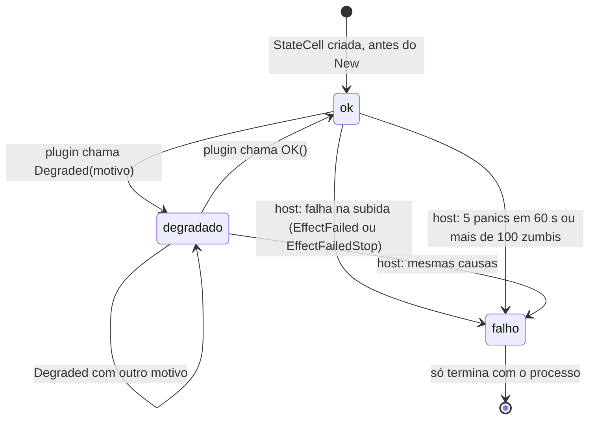
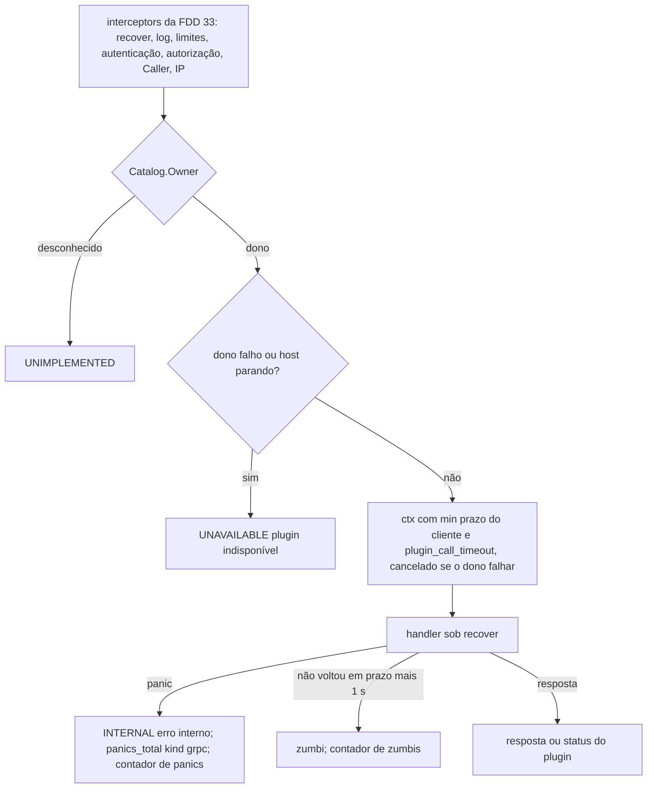

### FDD: Host de plugins do controller (CTL-03)

Versão: 1.0
Data: 2026-10-21
Responsável: Guilherme Giusti

---

### 1. Contexto e motivação técnica

**Problema técnico.** No controller tudo é plugin, inclusive o core: o host só serve o que as metades de controller compiladas no binário registram (ADR-001 e ADR-002 do `n3x-controller`). O contrato do lado do plugin já está fechado (FDDs 08, 09, 10 e 11), o pré-voo entrega os plugins conferidos e na ordem de subida (FDD 30) e o verificador de credencial existe (FDD 31). Falta o lado de dentro do contrato, o que transforma o `Bundle` do pré-voo em plugins vivos e protegidos:

- como cada plugin recebe o `ctrl.Env` (memória, métricas, log, estado, tarefas, conexões, cliente HTTP e `Dependency`) e só o core recebe o `ctrl.CoreEnv`
- em que ordem o host chama `Instantiate`, `CheckPrivileged`, `Start` e os registros, o que acontece em cada falha e como o obrigatório e o opcional se separam
- como o host junta as recusas de registro de todos os plugins, confere o que um plugin sozinho não vê (o mesmo serviço em dois plugins) e entrega às FDDs 33 e 35 um catálogo que nunca faz o grpc-go encerrar o processo
- como cada chamada a plugin (gRPC, página, ação, cartão, autenticação, API entre plugins) ganha prazo, `recover`, métrica e log, sem que cada servidor reinvente a contenção
- quando um plugin vira `falho` em tempo de execução: os documentos só tratam a falha no `Start` (L-36)
- qual é a lista de destinos negados ao `env.Dial` no controller, já que as portas são configuráveis (P-03 da FDD 12 e P-07 da FDD 30)
- como as métricas dos plugins (em `telemetry.Registry`) e as da plataforma por plugin chegam ao `/metrics` do host
- como o host real roda as suítes de conformidade do SDK (`sdktest/hostconformance`, FDD 12) contra a implementação de verdade

**Encaixe no HLD.** Esta FDD especifica o componente "Host de plugins" do HLD do `n3x-controller` ("Componentes e responsabilidades"), as etapas 5 e 6 da "Sequência de subida", a etapa 3 do "Desligamento", o fluxo "Estado de cada plugin → host → banner e `n3x_controller_plugin_state`", a interface "Host → plugin" e os riscos "Plugin acessa o que não deve", "Panic ou travamento em tela ou serviço" e "O plugin core concentra login". Do HLD do `n3x-sdk`, implementa o lado do host de "Contrato de controller", "Capacidades privilegiadas do core" e "Subida no controller". O pacote é `host/internal/plugins`, seguindo a regra da FDD 30 de manter só `host` como API estável (H-03 dela; I-01).

**Recorte com as FDDs vizinhas.** O host de plugins não abre porta, não tem servidor gRPC, roteador HTTP, sessão nem renderização:

- FDD 33 (servidor gRPC): listener, TLS, keepalive, limites, interceptors de recover do servidor, log e métricas por método, autenticação (chamando `Host.Authenticate`), autorização, resolução do IP e montagem dos serviços do catálogo. Ela instala, por último na cadeia, a camada do plugin que esta FDD entrega (contrato 5)
- FDD 34 (sessão e login): sessão, CSRF, bloqueio do login do painel, regra "só o root entra" lendo `Host.CoreState()` e login de leitura por `Host.CheckUser`; implementa o `ctrl.SessionRevoker` que esta FDD entrega ao core
- FDD 35 (painel): roteador, layout, menu, slots, banners, visão geral, renderização com o `ui` do SDK, polling e exportação; chama as funções de página, ação e cartão do host (contrato 6) e lê o catálogo (contrato 4)
- Esta FDD: ciclo de vida, `Env`, registros e conferências, catálogo, estado, contenção de cada chamada a plugin, transporte da API entre plugins e métricas por plugin

**Consumidores**
- FDD 30: `host.Run` monta `plugins.New(deps, cred, sess)` e chama `Start`, `StartBackground` e `Stop` (contrato 11 dela)
- FDDs 33, 34 e 35: catálogo, estado e chamadas protegidas (contratos 4, 5, 6 e 12)
- FDDs 36 a 45 (plugin core): `CoreEnv` com o `*Verifier`, `ControllerManifest()` e `CallerIP`; estado do core; contenção das capacidades privilegiadas
- FDD 12 (kit): o harness do host real roda as mesmas suítes (contrato 11); a regra de `falho` em runtime volta para o SDK como pedido
- FDDs 47, 48 e 51: alertas, testes de ponta a ponta e orçamento com 500 sidecars

**Atores.** `host.Run` (FDD 30, monta e chama), plugins compilados (core obrigatório e opcionais), servidor gRPC e painel (FDDs 33 a 35, chamam pelo host), verificador de credencial (FDD 31, entregue ao core), operador (lê estado, banners, métricas e logs) e autor de plugin (recebe recusas claras na subida).

**Limites.**
- O host de plugins não lê arquivo, não lê variável de ambiente e não abre porta; recebe tudo pronto em `boot.Deps` (FDD 30)
- Não guarda dado de plugin nem tem armazenamento (ADR-002); o estado que guarda é o ciclo de vida, o catálogo, as células de estado e os contadores de contenção
- Não renderiza HTML, não lê cookie e não confere token: só chama as funções registradas com as regras de `controller/hostrules` (FDD 12)
- Não trata sinal nem chama `os.Exit`; erros sobem para `host.Run`, que decide a saída (FDD 30)

**Suposições**
- Go 1.26 ou superior, sem cgo (HLD); grpc-go e `prometheus/client_golang` nas versões do `go.mod` do `host/`
- O `Bundle` do pré-voo já garante IDs únicos, core presente e de origem oficial pelo par (ID, módulo), dependências sem falta e sem ciclo, e a ordem de `hostrules.Order` com o core primeiro (FDD 30, contrato 5)
- A fase de config (`Check`, `CheckHost`, `PrivilegesOf(p, nil)` e `secret_unexpected`) já passou no `config.Load` (FDD 30, contrato 4); esta FDD nunca chama `ValidateHost`
- Uma instância de controller por plugin, criada uma vez (HLD do `n3x-sdk`); controller em instância única por ambiente (ADR-001 do `n3x-sdk`)
- O plugin core mínimo `v0.1.0` (FDD 36) existe antes da implementação, para os testes de integração com core real

**Restrições**
- Capacidades privilegiadas aceitas só de `n3x.core` vindo do módulo oficial; qualquer outro plugin que as implemente aborta a subida (ADR-004 e ADR-019 do `n3x-sdk`, FDD 09)
- `WriteAudit` reservado para a v2, nunca chamado; `Sessions().Revoke` sem uso na v1 (ADR-019 do `n3x-sdk`, ADR-002 e ADR-003 do `n3x-plugin-core`)
- `falho` só pelo host e terminal na v1; o plugin declara `ok` ou `degradado` com motivo (FDD 08, contrato 9)
- Prazos: `Start` com `runtime.plugin_start_timeout` (padrão 30 s), `Stop` com 5 s por plugin, tarefas de fundo com 2 s no desligamento (HLD do `n3x-controller`, FDD 08)
- Cota de memória isolada de 64 MiB por plugin no controller, ajustável em `runtime.plugin_limits` (ADR-017 do `n3x-sdk`, FDD 04)
- Métricas de plugin com prefixo `n3x_<namespace>_<nome>_` e rótulo `plugin`; o rótulo `instance` é vazio no controller (ADR-022 do `n3x-sdk`, FDDs 06 e 08)
- Regras de decisão do host vêm de `controller/hostrules` (FDD 12); o host real não reescreve ordem, efeito de falha, status de página nem falha de cartão
- Nenhum segredo, token, hash, valor de config, valor de panic que não seja texto curto ou corpo de requisição em log, métrica, motivo de estado ou erro devolvido a cliente
- Documentação e mensagens em pt-BR; identificadores, valores de rótulo e nomes de evento em inglês

**Rastreabilidade**
- PRD 1.5: FR-011 (registro respeitando dependências, início e parada em ordem inversa, obrigatório e opcional, panic contido com 500 ou `INTERNAL`, autenticação antes do plugin, API pública entre plugins), FR-013 (recusas na subida: namespace, rota e capacidade privilegiada), FR-008 (banner por plugin degradado ou falho; telas de plugin no menu), FR-009 (core falho ou degradado: só o root entra), FR-016 (core obrigatório); requisitos não funcionais de confiabilidade e segurança; critérios de aceite "plugin novo adicionado via Dockerfile aparece no painel com página e cartão, sem mudar nenhum repositório do core" e "plugin opcional que falha sobe desligado e aparece como falho"
- HLD do `n3x-controller`: "Sequência de subida" (etapas 5 e 6), "Desligamento", "Componentes e responsabilidades", "Fluxo de requisições e de dados", "Interfaces públicas" (convenções e códigos do gRPC), "Observabilidade" e "Riscos"
- HLD do `n3x-sdk`: "Contrato de controller", "Capacidades privilegiadas do core" e "Subida no controller"
- ADRs do `n3x-controller`: ADR-001, ADR-002, ADR-003 e ADR-007; do `n3x-sdk`: ADR-004, ADR-012, ADR-015, ADR-016, ADR-017, ADR-018, ADR-019 e ADR-022; do `n3x-builder`: ADR-003
- FDDs aplicadas: 01 (`OwnsGRPCService`, `OwnsRoute`, `RoutePrefix`, `FieldErrors`, notação L-34), 02 (`DecodeConfig` com opener), 04 (`memory.Runtime`), 06 (`telemetry`, `Background`, `Dial`, `DialDenyList`, `Sleep`), 08 (contrato inteiro), 09 (`CheckPrivileged`, `CoreEnv`, tabela pública, `Authenticate`, `CheckUser`, estado do core), 10 e 11 (`ui.Widget`, `ui.Query`, `ui.Reply`, `Routes.Action`), 12 (`hostrules`, `hostconformance`), 13 (exemplo com `grpc`, `routes` e `cards`), 30 (`boot`, `Config`, `Bundle`, saídas), 31 (`*Verifier`, `credentialtest`), 36 (core obrigatório, sem dependências), 40 (`ctrl.UserDirectory` sobre a instância do core), 41 (Store fora da cota)
- Lacunas do README:
  - **L-36 fechada aqui:** um plugin vira `falho` em runtime quando acumula 5 panics em 60 s nas chamadas de entrada (gRPC, página, ação, cartão, autenticação e API entre plugins) ou quando passa de 100 chamadas presas (zumbis) ao mesmo tempo; panic em tarefa de fundo e falha de ciclo de vida não contam; vale também para o obrigatório, que não derruba o processo (contrato 7) (limiares fixos aprovados pelo responsável em 2026-10-22, H-06 e H-07)
  - **L-02 aplicada:** `CoreEnv.ControllerManifest()` devolve cópia dos bytes do manifesto lido pelo pré-voo; `CallerIP(ctx)` lê a marca que a FDD 33 põe no `ctx` com `plugins.ContextWithCallerIP`; o estado do core é o `StateCell` lido por `Host.CoreState()` (contratos 2 e 4)
  - **L-51 e L-15 aplicadas:** limites efetivos de `Config.Limits` por plugin; o Store do core fica fora da conta de memória do SDK (FDD 41)
  - **L-52, L-53 e L-63 aplicadas:** transporte em processo da API entre plugins (contrato 8); `Routes.Action` no catálogo (contrato 4); `ValidateHost` só na fase de config da FDD 30
- Decisões da clarificação (responsável, 2026-10-22):
  - Critério de `falho` em runtime com valores fixos (5 panics de entrada em 60 s, ou mais de 100 chamadas presas), válido também para o core, sem campo no `n3x.yaml` (P-01 fica fora da v1); o processo nunca é derrubado por isso (coerente com o HLD: o host funciona com o core `falho` ou `degradado`)
  - Hipóteses menores aprovadas em bloco: 3 métricas novas da seção 7, rótulos `kind` extras de `plugin_panics_total` (`auth`, `plugin_api`, `background`, `lifecycle`), 7 eventos de log novos, destinos negados do `Dial` (só as 3 portas do controller em loopback), sem cascata de falha entre dependentes (H-08), limites da API entre plugins (4 MiB por mensagem, 16 em trânsito) e sem delegação da identidade do usuário nessa API
  - Consequência da decisão da CTL-01 (`/ready` 503 com plugin `failed` na subida): corrigidos o fluxo "plugin opcional com `Start` falhando" e as referências à L-40
  - A CTL-01 (contrato 9) descreve `N3X-C005` como "plugin obrigatório falhou na subida", mas o contrato 10 desta FDD o aplica a todo `EffectAbort`, inclusive recusa de registro e de privilégio de opcional (I-04); o texto da CTL-01 precisa de ajuste (WORKFLOW 3)
- Pontos em aberto de FDDs anteriores fechados aqui: P-03 da FDD 12 (`DefaultDialDeny` confirmado para as portas padrão; o host real usa `Config.Ports()`), P-05 da FDD 12 (critério de `falho` em runtime), P-07 da FDD 12 (`Advance` com espera real), P-07 da FDD 30 (lista de destinos negados a partir de `Config.Ports()`)
- Pedidos atendidos:
  - FDDs 01 e 08: recusa fora do namespace por `OwnsGRPCService` e `OwnsRoute`, no `Registrar` e de novo na montagem do catálogo (contrato 3)
  - FDD 04 (dirigido às FDDs 17 e 32): `memory.Runtime` por processo, conta e escopo por plugin, `Instantiate` sob `recover`, `Seal` depois do `New`, `Run` numa goroutine própria, logs `memory_quota` e `memory_oversize` (contrato 2)
  - FDD 06: exportação no controller em texto Prometheus com valores exatos e `_sum` (contrato 9); FDD 16: mesmo `le` (contrato 9, com P-04)
  - FDD 08: transporte em processo, vigia das etapas sem `ctx`, políticas, métricas, logs, L-36 e cascata de dependência (contratos 1, 7 e 8)
  - FDD 09: `CoreEnv` só para a origem do core e capacidades exigidas conferidas por `CheckPrivileged` (contratos 1 e 2)
  - FDD 12: `hostrules` (`Order` pela ordem do `Bundle`, `OnFailure`, `HandlerStatus`, `CardFailure`; `PanelMode` e `FlashAllowed` ficam com a FDD 35), harness do host real e suítes como critério de aceite (contrato 11)
  - FDD 30: `boot.PluginHost` com `Start`, `StartBackground`, `Stop` e `StartupError`; `Sections` e `Opener(id)` sem chamar `ValidateHost`; destinos negados a partir de `Config.Ports()`; métricas de plugin no registro do host
  - FDD 31: `CoreEnv.Credentials()` devolve o `*Verifier`; o harness usa `credentialtest` (contrato 11)

---

### 2. Objetivos técnicos

- **Nenhum registro fora do namespace e nenhum registro que derrube o processo.** Invariante: todo serviço do catálogo passa em `id.OwnsGRPCService` e toda página e ação passam em `id.OwnsRoute`; nenhum nome de serviço aparece em dois plugins. Medida: 100% dos casos de recusa do contrato 3 abortam a subida com `Path` e `Rule` iguais aos do `Registrar` (FDD 08); 0 chamadas a `RegisterService` do grpc-go real com catálogo inválido (as FDDs 33 e 35 só leem o catálogo depois de `Start` sem erro).
- **Ordem e efeitos idênticos aos do kit.** Medida: a ordem de subida é a do `Bundle` (igual a `hostrules.Order`) e a de parada é a inversa; os 10 pares dos 5 estágios desta fase (`new`, `privileged`, `start`, `register_panic`, `registration`) com obrigatório e opcional dão exatamente o efeito de `hostrules.OnFailure` (o estágio `config` é da FDD 30); `RunLifecycle` (14 casos) passa no harness do host real.
- **Toda chamada a plugin com prazo, `recover` e contabilidade.** Medida: página, ação e gRPC unário com `runtime.plugin_call_timeout`, cartão com 1 s, `Start` com `runtime.plugin_start_timeout`, `Stop` com 5 s, API entre plugins com `min(prazo, plugin_call_timeout)`, conferidos com tolerância de 50 ms; 0 panics de plugin escapam para o processo em `-race` com 10.000 chamadas que dão panic.
- **Opcional nunca derruba o controller; obrigatório na subida sim.** Medida: opcional com `New` ou `Start` falhando sobe `falho`, sem serviços, telas nem cartões; obrigatório falhando aborta com `*boot.StartupError` e chama `Stop` dos que já subiram, em ordem inversa.
- **`falho` em runtime determinístico (L-36).** Invariante: o 5º panic dentro de 60 s (janela deslizante) marca `falho` na mesma chamada; 4 panics não marcam; o 101º zumbi vivo marca `falho`; panic de tarefa de fundo nunca marca. Medida: testes com relógio injetado no contador de panics.
- **Contenção barata no caminho de cada chamada.** Medida: `Host.Authenticate` com 0 alocações a mais que o `Authenticate` do core; camada do plugin no gRPC unário com no máximo 2 alocações e p99 de até 2 µs de custo próprio; `State`, `CoreState` e `Catalog().Owner` com 0 alocações (`testing.AllocsPerRun(1000, ...)`) (hipótese das metas, H-15).
- **Isolamento entre plugins.** Invariante: `env.(ctrl.CoreEnv)` só é verdadeiro para a origem do core; `env.Dial` nega as portas de `Config.Ports()` em loopback e no endereço não especificado; uma chamada pela API entre plugins só alcança serviços de `PluginAPI` de uma dependência declarada, com mensagens copiadas e `Caller` `{plugin, consumidor}`.
- **Métricas completas e estáveis no `/metrics`.** Medida: golden do texto exportado com 2 plugins de teste (counter, gauge e histogram com `_sum`), sem o rótulo `instance`; scrape com 20 plugins e 200 séries cada em até 20 ms no p99 (hipótese).
- **Paridade com o kit verificada.** Medida: `RunLifecycle`, `RunPluginAPI` e `RunEnv` (34 casos) passam inteiras no harness do host real nesta FDD; com as FDDs 33 a 35 implementadas, `hostconformance.Run` com `WithCore` passa os 79 casos sem pulos fora de `-short`.

---

### 3. Escopo e exclusões

**Incluído**
- Pacote `host/internal/plugins`: `New`, `Host`, implementação de `boot.PluginHost` (`Start`, `StartBackground`, `Stop`) e `boot.StartupError` preenchido (contrato 1)
- Montagem do ambiente por plugin: conta e escopo de memória, conta e escopo de métricas, logger, `StateCell`, tarefas de fundo, `Dial` e `HTTPClient` com limites e destinos negados, `Dependency`; `CoreEnv` só para o core, com `Credentials`, `Sessions`, `ControllerManifest` e `CallerIP` (contrato 2)
- Fase de instâncias na ordem do `Bundle`: `Instantiate` sob `recover` e vigia, selo, `CheckPrivileged`, `CapabilitiesOf`, `Start`, `GRPC`, `PublicGRPC` (só o core), `PluginAPI`, `Routes` (com `Action`), `Cards` e `Close`, com os efeitos de `hostrules.OnFailure`
- Conferência global dos registros e montagem do catálogo imutável (contratos 3 e 4)
- Estado por plugin: observador do `StateCell` com log e métricas, banners, critério de `falho` em runtime e seus efeitos (contrato 7, L-36)
- Contenção das chamadas a plugin: camada do plugin para o gRPC (interceptors unário e de stream), `Authenticate`, `CheckUser`, `Page`, `Action` e `Card` (contratos 5 e 6)
- Transporte em processo da API entre plugins (contrato 8, L-52)
- Exportação das métricas de plugin e das métricas por plugin da plataforma no registro do host (contrato 9)
- Tarefas de fundo dos plugins (`StartBackground`, reinício com backoff, desligamento com 2 s) e varredura de memória
- Desligamento dos plugins em ordem inversa com 5 s cada e o `StopReport`
- Harness de conformidade do host real (`hostconformance.Harness`) e a tabela do que fica para as FDDs 33 a 35 (contrato 11)

**Excluído**
- Fase de config dos plugins (`Check`, `CheckHost`, `PrivilegesOf(p, nil)`, `secret_unexpected`), pré-voo, `Bundle`, `boot.Deps` e códigos de saída: FDD 30 (CTL-01)
- Verificador de credencial e `credentialtest`: FDD 31 (CTL-02)
- Servidor gRPC, TLS, interceptors de servidor (recover do servidor, log e métricas por método, limites, autenticação, autorização), resolução do IP e `n3x_controller_auth_total`: FDD 33 (CTL-04)
- Sessão do painel, login, CSRF, bloqueio, regra "só o root entra" e implementação do `SessionRevoker`: FDD 34 (CTL-05)
- Roteador, layout, menu e banners na tela, visão geral, renderização, `PanelMode`, `FlashAllowed`, polling, exportação e métricas do painel: FDD 35 (CTL-06)
- Interfaces do contrato de controller, `Registrar`, `StateCell`, `CheckPrivileged` e `hostrules`: FDDs 08, 09 e 12 do SDK
- Telas, cartões, login e lógica do core: FDDs 36 a 45
- Fora da v1: reinício de plugin `falho`, recarga de config, limiar de `falho` configurável no `n3x.yaml` (P-01), delegação da identidade do usuário na API entre plugins, várias réplicas do controller

---

### 4. Fluxos detalhados e diagramas

**Fluxo de montagem (`plugins.New`)**
1. Recebe `boot.Deps` (FDD 30), o `ctrl.CredentialVerifier` (o `*credential.Verifier` da FDD 31) e o `ctrl.SessionRevoker` (FDD 34; até ela existir, `plugins.NoSessions`, H-17).
2. Cria um `memory.Runtime` com `DefaultMaxBytes: memory.DefaultControllerMaxBytes` e um `telemetry.Registry` com `OnMisuse` ligado ao log `metric_misuse` amostrado (FDDs 04 e 06).
3. Monta a `DialDenyList` do processo: `LoopbackPorts` igual a `Config.Ports()` (`listen.grpc`, `listen.panel` e `listen.ops`, padrões 17443, 17444 e 17091), `UnixDirs` vazio (H-10).
4. Registra em `Deps.Registry` os coletores das métricas do host de plugins e o coletor de exportação do `telemetry.Registry` (contrato 9). Nome repetido devolve erro, que a FDD 30 transforma em saída 8.
5. Não chama nenhum plugin e não cria goroutine.

**Fluxo principal: `Start(ctx)`** (etapas 5 e 6 do HLD, na ordem do contrato 2 da FDD 08)
1. Confere que `Start` não rodou antes; loga `plugins_starting` com a ordem do `Bundle` e a obrigatoriedade de cada um; inicia `memory.Runtime.Run` numa goroutine própria, com `recover`, fora das tarefas dos plugins.
2. Para cada plugin de `Bundle.Plugins`, nesta ordem (core primeiro, dependências antes de quem depende; o host não recalcula, só confere em teste que é a ordem de `hostrules.Order`):
   1. **Ambiente:** `NewAccount(id, Limits[id].MemoryMaxBytes)` e `NewScope("")` de memória; `telemetry.Registry.NewAccount(id)` e `NewScope("")`; `telemetry.PluginLogger(Deps.LogHandler, id, "")`; `ctrl.NewStateCell(id, Deps.Clock)` com o observador do host; registro de tarefas com `Limits[id].BackgroundMaxTasks`; discador com `Limits[id].DialMaxConns` e a `DialDenyList`; visão de `Dependency` com o `DependsOn` do manifesto. Loga `memory_quota`. Se `id == plugin.CoreID()` (origem oficial já conferida pelo pré-voo), embrulha o `Env` num `CoreEnv` (contrato 2); para os demais, nunca.
   2. **`New`:** `p.Instantiate(Config.Sections[id], env, plugin.WithSecretOpener(Config.Opener(id)))` numa goroutine com `recover`, vigiada por `runtime.plugin_start_timeout`. A decodificação abre os segredos depois de validar cada campo (FDD 02) e a `Validate` do tipo `C` roda de novo com os `plugin.Secret` já abertos (FDD 08); `ValidateHost` não roda aqui (FDD 09, contrato 15). Erro, panic, `(nil, nil)` ou prazo: estágio `new`.
   3. **Selo:** com `defer`, sempre (sucesso, erro, panic ou prazo): `Seal` do escopo de memória, do escopo de métricas e do registro de tarefas. Depois disso `memory.NewMap`, criação de métrica e `Background` dão panic (FDDs 04, 06 e 08).
   4. **Privilégios:** `ctrl.CheckPrivileged(id, module, p, inst)`; erro: estágio `privileged` (sempre aborta). Core aprovado: log `privileged_granted` e, se implementar `WriteAudit`, `capability_unused` (FDD 09).
   5. **Capacidades:** `ctrl.CapabilitiesOf(p, inst)`, uma vez.
   6. **`Start`:** se existir, `Start(ctx)` com `ctx` filho do `ctx` da subida e prazo `runtime.plugin_start_timeout`, numa goroutine com `recover`. Erro, panic ou prazo: estágio `start`. Retorno tardio é ignorado e esse plugin nunca recebe `Stop`.
   7. **Registros:** `ctrl.NewRegistrar(id)` e, nesta ordem e só se existirem, `GRPC(r.GRPC())`, `PublicGRPC(r.Public())` (só o core), `PluginAPI(r.PluginAPI())`, `Routes(r.Routes())` (páginas e ações, FDD 11) e `Cards(r.Cards())`, cada uma sob `recover` e com a mesma vigia de prazo. Panic ou prazo: estágio `register_panic`. Depois, `r.Close()`; erro: estágio `registration` (sempre aborta).
   8. **Sucesso:** o plugin entra na lista de iniciados (recebe `Stop` no desligamento), as entradas do `Registrar` ficam guardadas para o catálogo e sai `plugin_started` com capacidades, estado e duração.
3. **Falha num plugin:** o efeito vem de `hostrules.OnFailure(estágio, Required)` (FDD 12, contrato 11):
   - `EffectAbort`: loga `plugin_start_failed`; chama `Stop` dos plugins já iniciados, em ordem inversa, 5 s cada; devolve `*boot.StartupError{Plugin, Stage, Err}`. A FDD 30 loga `startup_failed` e sai com 5
   - `EffectFailed`: loga `plugin_start_failed`; `cell.Fail(motivo da subida)`; o plugin não recebe os passos seguintes nem `Stop`; a subida segue com o próximo
   - `EffectFailedStop`: igual a `EffectFailed`, e chama `Stop` com 5 s para liberar o que o `Start` abriu
4. **Conferência global** (depois do último plugin; contrato 3): nenhum serviço da tabela `sidecar` ou pública em dois plugins, reconferência de `OwnsGRPCService` e `OwnsRoute` em toda entrada, nenhum padrão de rota em dois plugins. Problema: estágio `registration` do plugin que registrou por último, com o mesmo efeito de aborto.
5. **Catálogo:** monta o `Catalog` imutável (serviços por tabela, dono de cada método, páginas, ações e cartões), só com plugins que não ficaram `falho` na subida. `Start` devolve `nil`.
6. **`ctx` da subida cancelado** (sinal durante a subida, FDD 30): o `Start` em curso recebe o cancelamento; o host chama `Stop` dos iniciados em ordem inversa e devolve `ctx.Err()` (a FDD 30 sai com 0).

**Fluxo de `StartBackground()`**
- Inicia, uma vez e na ordem de subida e de registro, as tarefas de fundo dos plugins que não estão `falho` (FDD 08, contrato 7): `ctx` sem prazo, filho do contexto base do plugin; `recover` em cada execução, log `background_panic` com stack amostrado, `n3x_controller_plugin_panics_total{kind="background"}` e `n3x_plugin_background_restarts_total`, espera de `ctrl.BackgroundBackoff` (1 s a 60 s, jitter de 20%) e nova execução. Panic de tarefa não conta para o critério de `falho` (contrato 7)
- Inicia o monitor de 1 s que compara `Account.Stats().Oversize` de cada plugin e loga `memory_oversize` (no máximo 1 por minuto por plugin)
- Chamada antes de `Start` sem erro ou repetida não faz nada

**Fluxo de uma chamada gRPC de sidecar** (servidor da FDD 33; camada do plugin desta FDD, contrato 5)
1. A FDD 33 aplica recover do servidor, log e métricas por método, limites, autenticação (`Host.Authenticate`, exceto a tabela pública), autorização (papel `sidecar`, ADR-007), `request_id`, `ContextWithCaller` e `ContextWithCallerIP`.
2. A camada do plugin, último interceptor antes do handler, acha o dono do método em `Catalog.Owner(info.FullMethod)` (0 alocações).
3. Dono `falho` ou host parando: `UNAVAILABLE` com "plugin indisponível", sem chamar o handler. Método de plugin que ficou `falho` na subida não tem serviço montado: o `UnknownServiceHandler` do host responde `UNAVAILABLE` (e `UNIMPLEMENTED` para o que não é de nenhum plugin).
4. Unária: `ctx` com prazo `min(prazo do cliente, runtime.plugin_call_timeout)`, cancelado também se o dono virar `falho`; stream: sem teto total (o teto de 1 s por mensagem é da FDD 33).
5. Handler sob `recover`: panic vira `INTERNAL` com "erro interno", `n3x_controller_plugin_panics_total{kind="grpc"}`, log `plugin_panic` com stack amostrado e um ponto no contador de panics do dono.
6. Unária que não volta até o prazo mais `ZombieGrace` (1 s) vira zumbi até voltar: `n3x_controller_plugin_zombies` sobe e o contador do dono pode levar a `falho`.

**Fluxo de uma página, ação ou cartão** (painel da FDD 35; contrato 6)
1. A FDD 35 confere a sessão, o CSRF (ações) e monta a `ui.Query`; chama `Host.Page`, `Host.Action` ou `Host.Card` com a entrada do catálogo e o `Caller`.
2. O host confere `caller.Role.Meets(entrada.Role)` (403 sem chamar) e o estado do plugin (`falho` ou parando: 503 sem chamar).
3. Chama a função com `ctx` de `runtime.plugin_call_timeout` (cartão: `ctrl.CardTimeout`, 1 s), `Caller` e `request_id`, sob `recover`, numa goroutine vigiada pelo prazo; resultado tardio descartado.
4. Status por `hostrules.HandlerStatus` (página e ação) ou motivo por `hostrules.CardFailure` (cartão); panic conta em `n3x_controller_plugin_panics_total{kind="panel"}` e no contador de panics; erro gera `page_failed` ou `card_failed` amostrado.
5. A FDD 35 renderiza o widget (ou a página genérica do status) e responde.

**Fluxo da autenticação e do login de leitura** (contrato 5)
- `Host.Authenticate(ctx, token)` (FDD 33): core `falho` ou host parando dá `ErrPluginUnavailable` sem chamar; senão chama o `Authenticate` do core sob `recover` (`kind="auth"`); identidade que não é `RoleSidecar` válida dá `ErrMisbehavior` e o log `privileged_misbehavior` (FDD 09)
- `Host.CheckUser(ctx, user, senha)` (FDD 34): core `falho` dá `ErrPluginUnavailable` sem chamar; prazo `runtime.plugin_call_timeout`; `recover` (`kind="auth"`); identidade diferente de `{RoleRead, user}` dá `ErrMisbehavior`. A regra "core `degradado`: só o root entra" é da FDD 34, que lê `Host.CoreState()` antes de chamar

**Fluxo da API entre plugins** (contrato 8)
- O consumidor chama `env.Dependency(id)` (no `New` ou depois): fora de `depends_on` dá `ErrNotDependency`; dependência `falho` dá `ErrDependencyFailed`; sem serviço em `PluginAPI` dá `ErrNoPluginAPI`; senão a conexão em processo, a mesma para o par
- Numa chamada, a conexão confere o método na tabela `plugin` do provedor (`Unimplemented` se não está), serializa, monta o `ctx` novo (prazo, cancelamento, `request_id`, `Caller` `{plugin, consumidor}`), chama o handler do `ServiceDesc` sob `recover` e devolve cópia da resposta; provedor `falho` ou parado dá `Unavailable`

**Fluxo do estado e do `falho` em runtime** (contrato 7)
- O plugin declara `Degraded` e `OK` quando quiser; o observador do host loga `plugin_state_changed` (no máximo 1 por segundo por plugin, com `suppressed`) e atualiza `n3x_controller_plugin_state_changes_total`; `n3x_controller_plugin_state` é lido no scrape
- O contador de panics de cada plugin guarda os instantes dos últimos 5 panics de entrada; o 5º dentro de 60 s, ou o 101º zumbi vivo, dispara `Fail` com o motivo do host
- Ao virar `falho` em runtime: o contexto base do plugin é cancelado (chamadas em curso recebem o cancelamento), novas chamadas recebem `UNAVAILABLE`, 503, cartão `unavailable` ou `Unavailable`; as tarefas de fundo dele são canceladas com 2 s; o host chama `Stop` uma vez, com 5 s, numa goroutine com `recover`; o plugin sai do menu e da visão geral e ganha banner; cada plugin que declarou dependência dele recebe `ErrDependencyFailed` em `Dependency` e o log `dependency_failed`; o host não mexe no estado do dependente (H-08)
- Plugin obrigatório (inclusive o core) que vira `falho` em runtime não derruba o processo e não muda o `/ready` (L-40 revista da FDD 30: só falha na subida deixa o `/ready` em 503; H-07); com o core `falho`, a FDD 33 responde `UNAVAILABLE` a tudo e a FDD 34 só deixa o root entrar (FDD 09, contrato 16)

**Fluxo de desligamento: `Stop(ctx)`** (etapa 3 do HLD; a FDD 30 chama depois de parar os servidores)
1. Marca o host como parando: toda chamada nova recebe `UNAVAILABLE`, 503 ou `Unavailable`.
2. Cancela o `ctx` de todas as tarefas de fundo e espera até `ctrl.ShutdownGrace` (2 s); tarefa que não volta é registrada em `background_zombie`.
3. Chama `Stop(ctx)` de cada plugin iniciado (com `Start` bem-sucedido ou sem `Start`, e que não recebeu `Stop` por `falho`), na ordem inversa da subida, com `ctrl.StopTimeout` (5 s) cada, sob `recover`. Erro, panic ou prazo: log `plugin_stop_failed` e o plugin entra em `StopReport.Forced`; o host segue para o próximo. A API entre plugins continua funcionando até o `Stop` do provedor, então o `Stop` de um consumidor ainda alcança as dependências dele.
4. Se o `ctx` recebido vence no meio (vigia da FDD 30), os plugins restantes não são chamados e entram em `Forced` com `reason: skipped` (H-16).
5. Cancela o `memory.Runtime.Run` e o monitor; devolve o `StopReport`.

**Fluxos alternativos e exceções**
- **Plugin opcional com `Start` falhando:** `falho` com motivo "falhou na subida: start (erro)"; sem serviços, páginas, ações e cartões no catálogo; banner com o motivo; o controller sobe com as portas abertas, mas o `/ready` fica em 503 `plugin_failed` até o restart (L-40 revista, FDD 30)
- **Plugin opcional com `New` que estoura o prazo:** `falho` com estágio `new` e `reason: timeout`; a goroutine do `New` fica abandonada (Go não mata goroutine), log `plugin_call_abandoned`; se ela voltar depois com uma instância, a instância é descartada
- **Plugin obrigatório com `Start` falhando:** `*boot.StartupError{Stage: start}`; `Stop` dos já iniciados em ordem inversa; saída 5 pela FDD 30
- **Plugin opcional que registra serviço fora do namespace:** recusa no `Close` (`foreign_service`), estágio `registration`, aborta a subida, mesmo sendo opcional (FDD 08)
- **Plugin que não é o core com `Authenticate` ou `PublicGRPC`:** `CheckPrivileged` devolve `privileged_capability`, estágio `privileged`, aborta (FDD 09)
- **Dependência opcional `falho` na subida:** o consumidor sobe normalmente; `env.Dependency` devolve `ErrDependencyFailed` e o consumidor decide (falhar o `New` ou o `Start`, ou subir `degradado`) (FDD 08, H-08)
- **`ErrMetricConflict` ou `ErrTooManyTasks` no `New`:** o panic do SDK é contido como falha do estágio `new`
- **Registrador guardado e usado depois do `Close`:** panic com `ErrRegistrationClosed` dentro de um handler, contido como panic da chamada (500 ou `INTERNAL`)
- **`Degraded` ou `OK` depois de `falho`:** sem efeito; log `state_ignored` uma vez
- **Handler gRPC que ignora o `ctx`:** a chamada volta `DEADLINE_EXCEEDED` ao cliente pelo grpc-go; a goroutine segue presa e vira zumbi depois de 1 s; acima de 100 zumbis o plugin vira `falho`
- **Erro fatal do runtime Go num plugin** (escrita concorrente em map, estouro de pilha, falta de memória): não é recuperável por `recover` e derruba o processo; o orquestrador reinicia (risco documentado)

**Diagramas**

Sequência do `Start` para um plugin:

```mermaid
sequenceDiagram
    participant B as host.Run (FDD 30)
    participant H as host de plugins
    participant P as ctrl.Plugin
    participant I as instância
    participant R as ctrl.Registrar
    B->>H: Start(ctx)
    loop cada plugin do Bundle, na ordem
        H->>H: contas de memória e métricas, logger, StateCell, tarefas, Dial, Dependency; CoreEnv só para o core
        H->>P: Instantiate(seção, env, Opener(id)) com recover e vigia
        P->>I: New(cfg, env)
        I-->>H: Instance
        H->>H: Seal; CheckPrivileged; CapabilitiesOf
        H->>I: Start(ctx com plugin_start_timeout)
        H->>R: NewRegistrar(id)
        H->>I: GRPC, PublicGRPC (core), PluginAPI, Routes, Cards
        H->>R: Close()
        alt falha
            H->>H: hostrules.OnFailure(estágio, obrigatório)
        end
    end
    H->>H: conferência global e Catalog imutável
    H-->>B: nil ou *boot.StartupError
    B->>H: StartBackground()
```

Estados de um plugin no host real:



Camada do plugin numa chamada gRPC unária:



---

### 5. Contratos públicos (assinaturas, endpoints, headers, exemplos)

**Contrato 1: `plugins.New` e o ciclo de vida (`boot.PluginHost`)**
- Tipo: sdk (API Go interna do módulo `host/`, consumida pela FDD 30)
- Assinatura/Rota:
  ```go
  package plugins // github.com/giustech/n3x-controller/host/internal/plugins

  // Host é o host de plugins do processo. Um por processo; sem estado global.
  type Host struct{ /* ciclo de vida, catálogo, células de estado, contadores */ }

  // New monta o host. Não chama nenhum plugin e não cria goroutine.
  // Erro só de montagem (coletor repetido no registro): a FDD 30 sai com 8.
  func New(deps boot.Deps, cred ctrl.CredentialVerifier, sess ctrl.SessionRevoker) (*Host, error)

  var _ boot.PluginHost = (*Host)(nil)

  // Start roda a fase de instâncias. Devolve nil, *boot.StartupError (efeito
  // EffectAbort) ou ctx.Err() (subida interrompida). Uma vez por processo.
  func (h *Host) Start(ctx context.Context) error
  // StartBackground inicia as tarefas de fundo e o monitor de memória. Idempotente.
  func (h *Host) StartBackground()
  // Stop cancela as tarefas (2 s) e chama Stop dos plugins em ordem inversa (5 s cada).
  func (h *Host) Stop(ctx context.Context) boot.StopReport

  // NoSessions é o revogador entregue ao core enquanto a FDD 34 não existe.
  type NoSessions struct{}
  func (NoSessions) Revoke(user string) int // sempre 0

  var ErrStarted = errors.New("plugins: Start já foi chamado")
  ```
  `boot.StartupError` e `boot.StopReport` são os da FDD 30 (contrato 11 dela): `StartupError{Plugin, Stage hostrules.Stage, Err}` e `StopReport{Forced []plugin.ID}`.
- Método: n/a (chamada local)
- Semântica:
  - **Ordem:** a de `Bundle.Plugins` (core primeiro, dependências antes); passos por plugin na ordem da seção 4, iguais aos do contrato 2 da FDD 08
  - **Vigia das etapas sem `ctx`** (`Instantiate`, `GRPC`, `PublicGRPC`, `PluginAPI`, `Routes`, `Cards`): cada uma roda numa goroutine própria com `recover`, e o host espera até `runtime.plugin_start_timeout` contado do início da etapa; estouro vale como falha da etapa (`new` ou `register_panic`) com `reason: timeout`; a goroutine fica abandonada, com o log `plugin_call_abandoned` (H-03)
  - **Efeitos:** `hostrules.OnFailure(estágio, Required)`, tabela do contrato 11 da FDD 12; o core é sempre obrigatório (FDD 36)
  - **`StartupError.Err`:** embrulha o erro original: `ctrl.ErrRegistration` com `plugin.FieldErrors` prefixados por `plugins["<id>"]` (registro), `ctrl.ErrPrivileged` com os problemas (privilégio), o erro do plugin (`New` e `Start`), `context.DeadlineExceeded` (prazo) ou `*plugins.PanicError` (panic); `errors.Is` funciona sobre todos
  - **Motivo do `falho` na subida** (H-04): texto fixo do host, sem o texto do erro do plugin (que pode citar dado sensível e vai só para o log): `falhou na subida: <estágio> (<razão>)`, com razão `erro`, `panic` ou `prazo de <duração> estourado`
  - **`ctx` da subida:** cancelado, o `Start` para no próximo ponto de espera, chama `Stop` dos iniciados e devolve `ctx.Err()`
  - **`StartBackground`:** só tem efeito depois de `Start` sem erro; tarefas de plugin `falho` nunca começam
  - **`Stop`:** idempotente; com o `ctx` vencido no meio, os restantes entram em `Forced` sem chamada (H-16)
  - **Concorrência:** `Start`, `StartBackground` e `Stop` são chamados só pela goroutine do `host.Run`; as leituras dos contratos 4 a 6 são seguras entre goroutines depois do `Start`

**Exemplo de requisição**
```go
// host/internal/boot (FDD 30), etapas 5 a 7
cred, err := credential.New(deps)            // FDD 31
sess := plugins.NoSessions{}                  // até a FDD 34
ph, err := plugins.New(deps, cred, sess)
if err := ph.Start(ctx); err != nil {
    var se *boot.StartupError
    if errors.As(err, &se) {
        return exitStartup(se) // startup_failed e saída 5
    }
    return exitSignal(err) // ctx cancelado: saída 0
}
ph.StartBackground()
```

**Exemplo de resposta** (logs JSON de uma subida com o core e `giustech.quota` opcional cujo `Start` falha)
```text
{"ts":"2026-10-21T14:00:01.010Z","level":"info","component":"host","msg":"plugins_starting","plugins":"n3x.core,giustech.quota","required":"n3x.core"}
{"ts":"2026-10-21T14:00:01.011Z","level":"info","component":"host","msg":"memory_quota","plugin_id":"n3x.core","max_bytes":67108864,"source":"default"}
{"ts":"2026-10-21T14:00:01.020Z","level":"info","component":"host","msg":"privileged_granted","plugin_id":"n3x.core","module":"github.com/giustech/n3x-plugin-core","capabilities":"public_grpc,authenticate,user_directory"}
{"ts":"2026-10-21T14:00:01.031Z","level":"info","component":"host","msg":"plugin_started","plugin_id":"n3x.core","capabilities":"validate,start,stop,grpc,routes,cards","state":"ok","duration_ms":20}
{"ts":"2026-10-21T14:00:01.032Z","level":"info","component":"host","msg":"memory_quota","plugin_id":"giustech.quota","max_bytes":33554432,"source":"n3x.yaml"}
{"ts":"2026-10-21T14:00:06.040Z","level":"error","component":"host","msg":"plugin_start_failed","plugin_id":"giustech.quota","required":false,"stage":"start","reason":"error","effect":"failed","duration_ms":5008,"error":"pool do banco: dial tcp 10.0.4.7:5432: connection refused"}
{"ts":"2026-10-21T14:00:06.040Z","level":"error","component":"host","msg":"plugin_state_changed","plugin_id":"giustech.quota","from":"ok","to":"failed","cause":"startup","reason":"falhou na subida: start (erro)","suppressed":0}
```

---

**Contrato 2: ambiente por plugin (`ctrl.Env` e `ctrl.CoreEnv`)**
- Tipo: sdk (implementação das interfaces das FDDs 08 e 09; tipos internos, o plugin só vê as interfaces)
- Assinatura/Rota:
  ```go
  package plugins

  // ContextWithCallerIP é usada pela FDD 33 em toda chamada gRPC, antes da
  // camada do plugin, com o IP resolvido (par TCP ou x-forwarded-for confiável).
  func ContextWithCallerIP(ctx context.Context, ip netip.Addr) context.Context

  // DialDeny monta a lista de destinos negados do processo (P-07 da FDD 30).
  func DialDeny(ports []int) proxy.DialDenyList // LoopbackPorts = ports; UnixDirs vazio

  // Tipos não exportados: env (implementa ctrl.Env) e coreEnv (implementa ctrl.CoreEnv).
  ```
- Método: n/a
- Semântica (uma linha por método do `Env`; regras das FDDs 04, 06 e 08):

| Método | Implementação no host | Limite e erro |
| --- | --- | --- |
| `Memory()` | `scope.Handle()` da conta `NewAccount(id, Limits[id].MemoryMaxBytes)`, escopo `""` | cota de 64 MiB por padrão; `NewMap` depois do selo dá panic (FDD 04) |
| `Metrics()` | `*telemetry.Metrics` de `Registry.NewAccount(id).NewScope("")` | criação só no `New`; namespace reservado ou nome repetido entre plugins dá `ErrReservedMetric` ou `ErrMetricConflict` (estágio `new`) |
| `Log()` | `telemetry.PluginLogger(Deps.LogHandler, id, "")` | `component=plugin`, `plugin_id`, `request_id` do `ctx` |
| `State()` | `cell.Reporter()` do `StateCell` do plugin | `falho` só pelo host |
| `Background(name, fn)` | registro do plugin; tarefas começam em `StartBackground` | só no `New` (`ErrSealed`), nome por `ctrl.CheckTaskName` (`ErrInvalidTask`), até `Limits[id].BackgroundMaxTasks` (`ErrTooManyTasks`), todos por panic |
| `Dial(ctx, rede, endereço)` | `net.Dialer` com `Control` que aplica `ctrl.CheckDialTarget` e a `DialDenyList` no endereço escrito e no resolvido; semáforo de `Limits[id].DialMaxConns`; prazo de I/O de 30 s quando o chamador não define | `ErrDialDenied`, `ErrTooManyConns` (espera até o prazo do `ctx` ou 5 s), `dial_leak` para conexão coletada sem `Close` |
| `HTTPClient()` | um `*http.Client` por plugin, `Transport.DialContext` igual ao `Dial`, `Proxy: nil`, teto de 10 s | as mesmas regras do `Dial` |
| `Dependency(id)` | conexão em processo do contrato 8, guardada por par | `ErrNotDependency`, `ErrDependencyFailed`, `ErrNoPluginAPI` |

  - **Destinos negados (H-10):** `DialDeny(Config.Ports())`, isto é, as portas de `listen.grpc`, `listen.panel` e `listen.ops` em `localhost`, `127.0.0.0/8`, `::1`, IPv4 mapeado e endereço não especificado (regra da FDD 06). Sem diretórios Unix: o controller não tem socket interno (a `/run/n3x` guarda só a chave AES, que não é socket). Com as portas padrão, a lista é igual ao `ctrltest.DefaultDialDeny` (P-03 da FDD 12 confirmado); com portas trocadas no `n3x.yaml`, a lista acompanha
  - **`CoreEnv`** (só quando `id == plugin.CoreID()`; a origem pelo par (ID, módulo) já foi conferida pelo pré-voo e o tipo dinâmico é conferido pelo `CheckPrivileged` logo depois do `New`):
    - `Credentials()`: o `ctrl.CredentialVerifier` recebido no `New`, que em produção é o `*credential.Verifier` da FDD 31 (pedido da FDD 31 atendido); o host não embrulha nem conta nada
    - `Sessions()`: o `ctrl.SessionRevoker` recebido (FDD 34; até lá, `NoSessions`)
    - `ControllerManifest()`: cópia nova de `Bundle.File.Raw` a cada chamada (L-02)
    - `CallerIP(ctx)`: o IP posto por `ContextWithCallerIP`; `false` sem a marca (página, cartão, `Start`, tarefa) ou com IP zero; IPv4 mapeado já vem convertido pela FDD 33
  - **Contexto base:** cada plugin tem um contexto cancelado quando ele vira `falho` ou quando o host para; todo `ctx` que o host entrega a handler, tarefa ou API entre plugins é filho dele
  - **Métricas da plataforma por plugin:** o host publica `n3x_plugin_memory_*`, `n3x_plugin_background_*`, `n3x_plugin_dial_*` e `n3x_plugin_metric_series` a partir das contas (contrato 9)

**Exemplo de requisição**
```go
// No n3x.yaml: listen.grpc 18443 (as outras portas no padrão)
deny := plugins.DialDeny(cfg.Ports()) // [18443 17444 17091]
_, err1 := env.Dial(ctx, "tcp", "127.0.0.1:18443")
_, err2 := env.Dial(ctx, "tcp", "[::]:17091")
c3, err3 := env.Dial(ctx, "tcp", "10.0.4.7:5432")
cenv, ok := env.(ctrl.CoreEnv) // env de giustech.quota
```

**Exemplo de resposta**
```json
{
  "deny": { "LoopbackPorts": [18443, 17444, 17091], "UnixDirs": [] },
  "err1": "ctrl: rede ou endereço não permitido: 127.0.0.1:18443 é porta reservada do controller",
  "err2": "ctrl: rede ou endereço não permitido: [::]:17091 é porta reservada do controller",
  "err3": null,
  "ok (giustech.quota)": false,
  "ok (n3x.core)": true,
  "cenv.Credentials() == cred (n3x.core)": true
}
```

---

**Contrato 3: aceitação e recusa dos registros**
- Tipo: sdk (regras aplicadas na subida; mensagens estáveis)
- Assinatura/Rota: `ctrl.Registrar.Close()` por plugin (FDDs 08, 09 e 11) mais a conferência global do host
- Método: n/a
- Semântica:
  - **Por plugin:** o host usa o `Registrar` do SDK sem regra própria; as recusas e os textos são os do contrato 3 e 4 da FDD 08, do contrato 10 da FDD 09 e do contrato 4 da FDD 11 (`invalid_service`, `foreign_service`, `duplicate_service`, `too_many`, `public_method`, `public_overlap`, `invalid_role`, `nil_handler`, `path_format`, `foreign_route`, `duplicate_route`, `menu_label`, `menu_wildcard`, `card_id`, `duplicate_card`), prefixados com `plugins["<id>"]` e logados um por problema em `plugin_registration_refused`
  - **Rotas e caminhos estranhos:** `..`, barra dupla, maiúsculas, `%`, `?`, `#` e curinga de resto são recusados pela gramática do `CheckPagePath` (FDD 08, contrato 4) antes de o padrão ser montado; o padrão montado é `id.RoutePrefix()` mais o path, conferido por `id.OwnsRoute`; a comparação na requisição é exata e sensível a maiúsculas (pedido à FDD 35)
  - **Conferência global** (H-05), depois do último plugin, nas entradas aceitas de todos:

| # | Condição | `Rule` | `Path` |
| --- | --- | --- | --- |
| 1 | Serviço da tabela `sidecar` ou pública que não passa em `id.OwnsGRPCService` (defesa em profundidade; o `Registrar` já recusa) | `foreign_service` | `plugins["<id>"].grpc["<serviço>"]` ou `.public_grpc[...]` |
| 2 | Página ou ação cujo padrão não passa em `id.OwnsRoute` | `foreign_route` | `plugins["<id>"].routes["<path>"]` ou `.actions["<path>"]` |
| 3 | Mesmo nome de serviço nas tabelas `sidecar` ou pública de dois plugins | `duplicate_service` | do segundo plugin na ordem de subida, com o primeiro no `Detail` |
| 4 | Mesmo padrão e método de rota em dois plugins | `duplicate_route` | do segundo plugin, com o primeiro no `Detail` |
| 5 | Tabela pública fora do core | `privileged_capability` | `plugins["<id>"].privileged.public_grpc` |

  - As regras 1 a 5 não acontecem com o `Registrar` e IDs únicos; existem para que um defeito em outra camada nunca chegue ao grpc-go (que encerra o processo com serviço repetido) nem ao roteador (que dá panic com padrão repetido). Problema global aborta com estágio `registration`
  - O que um plugin `falho` na subida registrou antes de falhar é descartado; ele não entra na conferência global

**Exemplo de requisição**
```go
// plugin opcional giustech.quota
func (q *Quota) GRPC(r ctrl.GRPCRegistrar) {
    otherv1.RegisterReportServer(r, q) // n3x.plugins.giustech.other.v1.Report
}
func (q *Quota) Routes(r ctrl.Routes) {
    r.Page("/../core/usuarios", ctrl.RoleRead, q.visao)
}
```

**Exemplo de resposta** (logs; a FDD 30 sai com 5)
```text
{"level":"error","component":"host","msg":"plugin_registration_refused","plugin_id":"giustech.quota","path":"plugins[\"giustech.quota\"].grpc[\"n3x.plugins.giustech.other.v1.Report\"]","rule":"foreign_service","detail":"serviço fora do namespace n3x.plugins.giustech.quota.v<N>"}
{"level":"error","component":"host","msg":"plugin_registration_refused","plugin_id":"giustech.quota","path":"plugins[\"giustech.quota\"].routes[\"/../core/usuarios\"]","rule":"foreign_route","detail":"padrão /plugins/giustech/quota/../core/usuarios fora de /plugins/giustech/quota/"}
{"level":"error","component":"host","msg":"plugin_start_failed","plugin_id":"giustech.quota","required":false,"stage":"registration","reason":"error","effect":"abort"}
{"level":"error","component":"host","msg":"startup_failed","stage":"registration","plugin_id":"giustech.quota","code":"N3X-C005","exit_code":5}
```

---

**Contrato 4: catálogo e estado (leitura pelas FDDs 33, 34 e 35)**
- Tipo: sdk (API Go interna)
- Assinatura/Rota:
  ```go
  package plugins

  type PluginInfo struct {
      ID           plugin.ID
      Module       string
      Version      plugin.Version
      Required     bool
      Core         bool
      Capabilities ctrl.Capabilities
      Started      bool // Start terminou com sucesso (ou não existe)
  }

  func (h *Host) Plugins() []PluginInfo                     // ordem de subida; cópia
  func (h *Host) State(id plugin.ID) (ctrl.StateInfo, bool) // 0 alocações
  func (h *Host) CoreState() ctrl.StateInfo                 // 0 alocações (FDD 34)
  func (h *Host) Banners() []Banner                         // plugins fora de ok, ordem de ID
  func (h *Host) Catalog() *Catalog                         // nil antes de Start sem erro
  func (h *Host) Menu(role ctrl.Role) []MenuItem            // páginas InMenu visíveis e de plugin não falho
  func (h *Host) Cards(role ctrl.Role) []Card               // cartões visíveis e de plugin não falho

  type Catalog struct{ /* imutável depois do Start; leitura sem trava */ }
  func (c *Catalog) Services(t ctrl.Table) []Service          // TableSidecar ou TablePublic; cópia
  func (c *Catalog) Owner(fullMethod string) (plugin.ID, bool) // "/pacote.Servico/Metodo"; 0 alocações
  func (c *Catalog) IsPublic(fullMethod string) bool           // método da tabela pública
  func (c *Catalog) Pages() []Page
  func (c *Catalog) Actions() []Action

  type Service struct {
      Plugin plugin.ID
      Table  ctrl.Table
      Desc   *grpc.ServiceDesc
      Impl   any
  }
  type Page struct {
      Plugin plugin.ID
      ctrl.PageEntry // Path, Pattern, Role, Menu, Fn
  }
  type Action struct {
      Plugin plugin.ID
      ctrl.ActionEntry // Path, Pattern, Role, Fn
  }
  type Card struct {
      Plugin plugin.ID
      ctrl.CardEntry // ID, Role, Fn
  }
  type MenuItem struct {
      Plugin  plugin.ID
      Label   string
      Pattern string // "/plugins/n3x/example/negacoes"
  }
  type Banner struct {
      Plugin plugin.ID
      State  ctrl.State
      Reason string
      Since  time.Time
  }
  ```
- Método: n/a
- Semântica:
  - **O que cada estado bloqueia:**

| Estado | Serviços gRPC | Páginas e ações | Menu | Cartões | API entre plugins | Banner |
| --- | --- | --- | --- | --- | --- | --- |
| `ok` | atendem | atendem | sim | sim | atende | não |
| `degraded` | atendem | atendem | sim | sim | atende | sim, com o motivo |
| `failed` na subida (só opcional) | não existem no catálogo; método no namespace do plugin dá `UNAVAILABLE` pelo `UnknownServiceHandler` (contrato 5) | não existem (404 pelo roteador) | não | não | `ErrDependencyFailed` no `Dependency` | sim, com o motivo |
| `failed` em runtime | `UNAVAILABLE` | 503 com página genérica | não | não | `Unavailable` e `ErrDependencyFailed` | sim, com o motivo |

  - **Ordem:** `Plugins` na ordem de subida; `Banners`, `Menu` e `Cards` por ID de plugin e, dentro do plugin, ordem de registro, igual ao kit (H-13 da FDD 12); se a FDD 35 escolher outra ordem, a regra vira função de `hostrules` (P-09 da FDD 12)
  - `Menu(role)` e `Cards(role)` filtram por `role.Meets(entrada.Role)` e pelo estado atual; são calculados a cada chamada (cópia), porque o estado muda em runtime
  - `Services` serve à FDD 33 para chamar `RegisterService` no servidor real; os serviços já passaram pelas conferências do contrato 3, então o grpc-go nunca recebe repetição
  - `Owner` e `IsPublic` são consultas por mapa montado no `Start`; o `fullMethod` é o de `grpc.UnaryServerInfo.FullMethod`
  - Banner com core `falho` ou `degradado` aparece como os outros; a regra de login é da FDD 34

**Exemplo de requisição**
```go
cat := ph.Catalog()
svcs := cat.Services(ctrl.TableSidecar)
owner, _ := cat.Owner("/n3x.plugins.n3x.example.v1.Example/Report")
menuRead := ph.Menu(ctrl.RoleRead)
cardsRead := ph.Cards(ctrl.RoleRead)
st, _ := ph.State(plugin.MustParseID("giustech.quota"))
```

**Exemplo de resposta**
```json
{
  "svcs": ["n3x.plugins.n3x.core.v1.Core", "n3x.plugins.n3x.example.v1.Example"],
  "public": ["n3x.plugins.n3x.core.v1.Login"],
  "owner": "n3x.example",
  "menuRead": [
    { "Plugin": "n3x.core", "Label": "Sidecars", "Pattern": "/plugins/n3x/core/sidecars" },
    { "Plugin": "n3x.example", "Label": "Negações", "Pattern": "/plugins/n3x/example/negacoes" }
  ],
  "cardsRead": [{ "Plugin": "n3x.core", "ID": "sidecars" }, { "Plugin": "n3x.example", "ID": "negacoes" }],
  "st": { "State": "failed", "Reason": "falhou na subida: start (erro)", "Since": "2026-10-21T14:00:06Z" }
}
```

---

**Contrato 5: camada do plugin no gRPC, `Authenticate` e `CheckUser`**
- Tipo: sdk (API Go interna, consumida pelas FDDs 33 e 34)
- Assinatura/Rota:
  ```go
  package plugins

  // Interceptors da camada do plugin: a FDD 33 os põe por último na cadeia,
  // depois da autenticação, da autorização, do Caller e do IP.
  func (h *Host) UnaryServerInterceptor() grpc.UnaryServerInterceptor
  func (h *Host) StreamServerInterceptor() grpc.StreamServerInterceptor

  // UnknownServiceHandler é o grpc.UnknownServiceHandler do servidor da FDD 33:
  // método no namespace n3x.plugins.<ns>.<nome>.v<N> de plugin falho, ou com o
  // host parando, dá UNAVAILABLE; qualquer outro método desconhecido dá UNIMPLEMENTED.
  func (h *Host) UnknownServiceHandler() grpc.StreamHandler

  // Authenticate chama o Authenticate do core com contenção (FDD 33).
  func (h *Host) Authenticate(ctx context.Context, token string) (ctrl.Identity, error)

  // CheckUser chama o CheckUser do core com contenção (FDD 34).
  func (h *Host) CheckUser(ctx context.Context, user string, password plugin.Secret) (ctrl.Identity, error)

  var (
      ErrPluginUnavailable = errors.New("plugins: plugin indisponível")   // falho ou host parando
      ErrPluginPanic       = errors.New("plugins: panic contido no plugin")
      ErrMisbehavior       = errors.New("plugins: resposta inválida do core")
  )

  // PanicError carrega o tipo e, só para error e string, o texto cortado em 256 bytes.
  type PanicError struct {
      Kind  string // grpc, panel, plugin_api, auth, lifecycle, background
      Type  string // tipo do valor do panic
      Text  string // vazio para outros tipos
  }
  func (e *PanicError) Error() string
  func (e *PanicError) Unwrap() error // ErrPluginPanic

  const (
      ZombieGrace         = 1 * time.Second
      StackSampleInterval = 1 * time.Second
      MaxPanicText        = 256
      MaxStackBytes       = 16 << 10
  )
  ```
- Método: gRPC unário e de stream (camada), chamadas locais (`Authenticate` e `CheckUser`)
- Semântica da camada do plugin:
  - Dono pelo `Catalog.Owner`; método sem dono: `UNIMPLEMENTED` (só acontece se a FDD 33 montar algo fora do catálogo)
  - **Plugin `falho` na subida não tem serviço montado:** a chamada nem chega à camada; o `UnknownServiceHandler` confere o pacote do método contra o `GRPCPackage` dos plugins `falho` (sem a major) e responde `UNAVAILABLE` com "plugin indisponível", como manda a tabela de códigos do HLD; o resto recebe `UNIMPLEMENTED` (e o core, com proto de major não registrada, cai na regra `FAILED_PRECONDITION` da FDD 36, aplicada pela FDD 33 antes)
  - `Caller` ausente ou inválido fora da tabela pública: `INTERNAL` com "erro interno" e o log `caller_missing` (erro de montagem da FDD 33; a suíte pega)
  - Dono `falho` ou host parando: `UNAVAILABLE` com "plugin indisponível"
  - Unária: prazo `min(prazo do cliente, runtime.plugin_call_timeout)` (atende o pedido da FDD 31 à FDD 33: a FDD 33 impõe o prazo instalando esta camada); `request_id` do `ctx` ou novo; zumbi depois de prazo mais `ZombieGrace`
  - Stream: sem prazo total; `ctx` filho do contexto base do dono, então o stream fecha com `UNAVAILABLE` quando o dono vira `falho` ou o host para; stream nunca vira zumbi (heartbeat é longo de propósito)
  - Panic no handler: `status.Error(codes.Internal, "erro interno")`, métrica `kind="grpc"`, log `plugin_panic` e ponto no contador de panics do dono
  - Erros devolvidos pelo plugin passam como estão (o plugin escolhe o código, HLD)
- Semântica de `Authenticate`:
  - Core `falho` ou host parando: `ErrPluginUnavailable`, sem chamar (FDD 09, contrato 16); `degraded`: chama normalmente
  - Panic: `*PanicError` (`kind="auth"`), ponto no contador de panics do core
  - Identidade que não é `RoleSidecar` com `Valid()` verdadeiro: `ErrMisbehavior` e `privileged_misbehavior` (no máximo 1 por minuto)
  - Erro do core: devolvido como veio (a FDD 33 responde `UNAUTHENTICATED` com a mensagem genérica e loga o motivo sem o token)
  - Sem prazo próprio: usa o `ctx` da chamada; 0 alocações a mais que o `Authenticate` do core (H-15)
- Semântica de `CheckUser`:
  - Core `falho` ou host parando: `ErrPluginUnavailable`, sem chamar; a decisão "degradado: só o root" é da FDD 34, que lê `CoreState()` antes
  - Prazo `runtime.plugin_call_timeout`; `ctx.Err()`, `ctrl.ErrInvalidCredentials` e `ctrl.ErrVerifierBusy` passam como estão (FDD 40)
  - Identidade diferente de exatamente `{RoleRead, user}`: `ErrMisbehavior` e `privileged_misbehavior`
  - Panic: `*PanicError` (`kind="auth"`); a senha nunca aparece no erro nem no log (`plugin.Secret`)
- Mapeamento que as FDDs 33 e 34 aplicam:

| Retorno | gRPC (FDD 33) | `n3x_controller_auth_total{result}` (FDD 33) | Login do painel (FDD 34) |
| --- | --- | --- | --- |
| identidade válida | segue | `ok` | sessão de leitura |
| `ErrPluginUnavailable` | `UNAVAILABLE` | `core_unavailable` | mensagem genérica, `auth_core_unavailable` |
| `ErrMisbehavior` | `UNAUTHENTICATED` | `invalid_identity` | mensagem genérica |
| `ErrPluginPanic` | `INTERNAL` | `panic` | mensagem genérica |
| outro erro | `UNAUTHENTICATED` | `unauthenticated` | mensagem genérica (bloqueio só para credencial inválida, FDD 34) |

**Exemplo de requisição**
```go
// FDD 33, ordem da cadeia (resumo)
grpc.ChainUnaryInterceptor(recoverSrv, logMetrics, limits, authn /* h.Authenticate */, authz, callerAndIP, ph.UnaryServerInterceptor())

// core falho por panics repetidos; sidecar chama Core/Register
id, err := ph.Authenticate(ctx, token)
```

**Exemplo de resposta**
```json
{
  "Authenticate": { "id": "valor zero", "errors.Is(err, plugins.ErrPluginUnavailable)": true },
  "resposta ao sidecar": "rpc error: code = Unavailable desc = plugin indisponível",
  "panic num handler do n3x.example": "rpc error: code = Internal desc = erro interno",
  "log": "{\"level\":\"error\",\"component\":\"host\",\"msg\":\"plugin_panic\",\"plugin_id\":\"n3x.example\",\"kind\":\"grpc\",\"where\":\"/n3x.plugins.n3x.example.v1.Example/Report\",\"panic_type\":\"runtime.boundsError\",\"panic\":\"runtime error: index out of range [3] with length 3\",\"request_id\":\"8b0f3c2e-4f1a-4c55-9a77-2d6e1b9f0c31\",\"suppressed\":0,\"stack\":\"goroutine 812 [running]: ...\"}"
}
```

---

**Contrato 6: chamadas protegidas do painel (`Page`, `Action` e `Card`)**
- Tipo: sdk (API Go interna, consumida pela FDD 35)
- Assinatura/Rota:
  ```go
  package plugins

  type PageCall struct {
      Widget ui.Widget
      Status int           // 200, 403, 400, 404, 500, 503 ou 504
      Err    error         // para log e diagnóstico; nunca vai para a página
      Took   time.Duration
  }
  func (h *Host) Page(ctx context.Context, p Page, caller ctrl.Identity, q ui.Query) PageCall

  type ActionCall struct {
      Reply  ui.Reply
      Status int // 200 (Reply válido), 403, 400, 404, 500, 503 ou 504
      Err    error
      Took   time.Duration
  }
  func (h *Host) Action(ctx context.Context, a Action, caller ctrl.Identity, in ui.Query) ActionCall

  type CardCall struct {
      Widget ui.Widget
      Reason string // "" ok; "forbidden", "unavailable", "timeout", "error", "panic", "nil_widget"
      Took   time.Duration
  }
  func (h *Host) Card(ctx context.Context, c Card, caller ctrl.Identity) CardCall
  ```
- Método: chamadas locais feitas pelos handlers HTTP da FDD 35
- Semântica:
  - Ordem: papel (`caller.Role.Meets(Role)`; senão 403 ou `forbidden`, sem chamar), estado (`falho` ou host parando: 503 ou `unavailable`, sem chamar), chamada
  - `ctx`: filho do `ctx` da requisição e do contexto base do plugin, com `runtime.plugin_call_timeout` (página e ação) ou `ctrl.CardTimeout` (cartão), `ContextWithCaller(caller)` e `request_id` (o do `ctx` ou novo)
  - A função roda numa goroutine com `recover`, vigiada pelo prazo; resultado tardio é descartado; função que não volta até prazo mais 1 s vira zumbi
  - Status de página e ação por `hostrules.HandlerStatus(err, ctx.Err(), panicked)` (com `ctrl.ErrNilWidget` para `(nil, nil)`); motivo do cartão por `hostrules.CardFailure`
  - Panic: `kind="panel"` (páginas, ações e cartões), log `plugin_panic` e ponto no contador de panics (H-19)
  - Página e ação com status 500 ou 504: log `page_failed` (no máximo 1 por segundo por plugin) com `route` = padrão registrado, `status` e o texto do erro; 400 e 404 não logam
  - Cartão: `n3x_controller_card_duration_seconds{plugin,card}` sempre; falha soma `n3x_controller_card_failures_total{plugin,card,reason}` e loga `card_failed` (no máximo 1 por minuto por cartão); `forbidden` e `unavailable` não contam como falha
  - A FDD 35 renderiza o `Widget` (o renderizador decide 500 em `ErrInvalidTree`), monta o cabeçalho e escolhe o modo; o host não toca em HTTP

**Exemplo de requisição**
```go
pg := cat.Pages()[1] // /plugins/n3x/example/negacoes/{servico}
q, _ := ui.NewQuery(map[string]string{"servico": "desconhecido"}, nil)
r1 := ph.Page(ctx, pg, ctrl.Identity{Role: ctrl.RoleRead, User: "ana"}, q)
r2 := ph.Card(ctx, ph.Cards(ctrl.RoleRead)[1], ctrl.Identity{Role: ctrl.RoleRead, User: "ana"})
```

**Exemplo de resposta**
```json
{
  "r1": { "Status": 404, "Widget": null, "Err": "ctrl: não encontrado", "Took": "0.4ms" },
  "r2": { "Reason": "timeout", "Widget": null, "Took": "1s" },
  "métricas": ["n3x_controller_card_failures_total{plugin=\"n3x.example\",card=\"negacoes\",reason=\"timeout\"} 1"]
}
```

---

**Contrato 7: estado do plugin e critério de `falho` em runtime (L-36)**
- Tipo: sdk (máquina de estados aplicada pelo host sobre o `StateCell` da FDD 08)
- Assinatura/Rota:
  ```go
  package plugins

  const (
      PanicThreshold  = 5                // panics de entrada na janela para virar falho
      PanicWindow     = 60 * time.Second // janela deslizante, relógio monotônico
      ZombieThreshold = 100              // falho quando os zumbis vivos passam deste valor
  )

  type FailCause string

  const (
      CauseStartup FailCause = "startup"
      CausePanics  FailCause = "panics"
      CauseZombies FailCause = "zombies"
  )
  ```
- Método: n/a
- Semântica:
  - **Transições** (FDD 08, contrato 9, mais a L-36):

| De | Para | Quem dispara | Condição |
| --- | --- | --- | --- |
| `ok` | `degraded` | plugin | `env.State().Degraded(motivo)` |
| `degraded` | `degraded` | plugin | `Degraded` com outro motivo (troca o motivo, mantém `Since`) |
| `degraded` | `ok` | plugin | `env.State().OK()` |
| `ok` ou `degraded` | `failed` | host, subida | `EffectFailed` ou `EffectFailedStop` de `hostrules.OnFailure` |
| `ok` ou `degraded` | `failed` | host, runtime | 5º panic de entrada dentro de 60 s |
| `ok` ou `degraded` | `failed` | host, runtime | zumbis vivos acima de 100 |
| `failed` | qualquer | ninguém | terminal na v1; `Degraded` e `OK` ignorados com `state_ignored` |

  - **Panics de entrada que contam:** gRPC (`grpc`), página, ação e cartão (`panel`), API entre plugins (`plugin_api`, contado no provedor) e capacidades do core chamadas pelo host (`auth`). **Não contam:** tarefa de fundo (já reinicia com backoff, igual ao sidecar, FDD 18) e ciclo de vida (`lifecycle`: `New`, `Start`, registros, `Stop`), que já têm efeito próprio
  - **Janela:** anel com os instantes dos últimos 5 panics; o 5º com o mais antigo a menos de 60 s marca `falho` dentro da mesma chamada, que ainda responde 500 ou `INTERNAL` (mesmo operador `>=` do disjuntor do sidecar, FDD 18)
  - **Zumbi:** chamada unária, página, ação, cartão ou chamada pela API entre plugins que não voltou até o prazo mais 1 s; conta enquanto não volta; o 101º vivo marca `falho` (mesmo operador `>` do sidecar)
  - **Valores fixos na v1** (aprovados pelo responsável em 2026-10-22, H-06): os mesmos padrões do `runtime.panic_breaker` do sidecar (5, 60 s, 100), sem campo no `n3x.yaml` do controller; um campo por paridade fica em aberto (P-01)
  - **Motivos do host:** `falhou na subida: <estágio> (<razão>)`, `desligado pelo host: 5 panics em 60s`, `desligado pelo host: mais de 100 chamadas presas`
  - **Efeitos do `falho` em runtime** (H-07): contexto base cancelado; novas chamadas recusadas sem tocar o plugin; tarefas canceladas com 2 s; `Stop` chamado uma vez, com 5 s, em goroutine com `recover`, e não chamado de novo no desligamento; saída do menu e da visão geral; banner; `dependency_failed` para cada dependente. O processo segue, inclusive com o core: o `/ready` não muda (falha depois da subida não afeta o `/ready`, L-40 revista) e o operador reinicia o controller para voltar
  - **Sem cascata** (H-08): o host não marca o dependente; ele recebe `ErrDependencyFailed` ou `Unavailable` e decide
  - **Observador:** cada transição loga `plugin_state_changed` com `cause` (`plugin` para as do próprio plugin; `startup`, `panics` ou `zombies` para as do host), soma `n3x_controller_plugin_state_changes_total{state}` e nunca bloqueia; sem evento para fora do processo (FDD 08)

**Exemplo de requisição**
```go
// cartão do giustech.quota com bug: panic a cada renderização; uma aba aberta com polling de 5 s
for i := 0; i < 5; i++ {
    r := ph.Card(ctx, card, leitor) // t = 0 s, 5 s, 10 s, 15 s, 20 s
    fmt.Println(i+1, r.Reason, mustState(ph, "giustech.quota"))
}
```

**Exemplo de resposta**
```text
1 panic ok
2 panic ok
3 panic ok
4 panic ok
5 panic failed
{"level":"error","component":"host","msg":"plugin_state_changed","plugin_id":"giustech.quota","from":"ok","to":"failed","cause":"panics","reason":"desligado pelo host: 5 panics em 60s","suppressed":0}
{"level":"info","component":"host","msg":"plugin_stopped","plugin_id":"giustech.quota","duration_ms":12,"cause":"runtime_failure"}
```

---

**Contrato 8: transporte em processo da API entre plugins (L-52)**
- Tipo: sdk (implementação de `grpc.ClientConnInterface` devolvida por `env.Dependency`)
- Assinatura/Rota:
  ```go
  // Tipo não exportado; o consumidor só vê grpc.ClientConnInterface.
  //   Invoke(ctx, method string, args, reply any, opts ...grpc.CallOption) error
  //   NewStream(ctx, desc *grpc.StreamDesc, method string, opts ...grpc.CallOption) (grpc.ClientStream, error)

  const (
      MaxPluginMessage      = 4 << 20 // bytes por mensagem serializada (hipótese)
      PluginStreamBuffer    = 16      // mensagens em trânsito por sentido num stream (hipótese)
  )
  ```
- Método: gRPC unário e de stream, sem rede
- Semântica (H-11):
  - **Sem HTTP/2 e sem socket:** a conexão acha o método no `grpc.ServiceDesc` da tabela `plugin` do provedor e chama o handler do grpc-go (`MethodDesc.Handler` ou `StreamDesc.Handler`) com um decodificador que desserializa os bytes, pelo codec `proto` do grpc-go; a resposta é serializada e desserializada de novo no `reply`. Nenhum ponteiro atravessa
  - **Método fora da tabela `plugin` do provedor** (inclusive os da tabela `sidecar`): `Unimplemented`, sem tocar o provedor
  - **`ctx` do provedor:** novo, filho do contexto base do provedor, com prazo `min(prazo do ctx do consumidor, runtime.plugin_call_timeout)` em unária, cancelamento ligado ao do consumidor (`context.AfterFunc`), `request_id` do consumidor (ou novo) e `ContextWithCaller(Identity{Role: RolePlugin, Plugin: consumidor})`. Metadados e outros valores do `ctx` do consumidor não atravessam
  - **Estado:** provedor `falho` ou host parando dá `Unavailable`; panic no provedor dá `Internal` com `kind="plugin_api"` e conta no contador de panics do provedor; prazo dá `DeadlineExceeded`; mensagem acima de 4 MiB dá `ResourceExhausted`
  - **Streams:** pares de canais com até 16 mensagens em trânsito por sentido; `Send` bloqueia até haver vaga ou o `ctx` acabar; sem teto total; o teto de 1 s por mensagem processada da FDD 33 vale igual (FDD 08)
  - **Métrica:** `n3x_controller_plugin_api_calls_total{plugin=<consumidor>, dependency=<provedor>, code}` em toda chamada
  - **Ordem garante a ausência de espera circular:** a dependência sobe antes (`depends_on` sem ciclo, FDD 20 e pré-voo) e para depois (ordem inversa)

**Exemplo de requisição**
```go
// giustech.quota (consumidor), depends_on: [giustech.ratelimit]
conn, _ := env.Dependency(plugin.MustParseID("giustech.ratelimit"))
lim := ratelimitv1.NewLimitsClient(conn)
s, err := lim.Snapshot(ctx, &ratelimitv1.SnapshotReq{})
_, errSidecar := ratelimitv1.NewRateLimitClient(conn).Check(ctx, &ratelimitv1.CheckReq{})
```

**Exemplo de resposta**
```json
{
  "s": "cópia da resposta do provedor",
  "Caller visto pelo provedor": { "Role": "plugin", "Plugin": "giustech.quota" },
  "errSidecar": "rpc error: code = Unimplemented desc = método fora da API entre plugins de giustech.ratelimit",
  "métrica": "n3x_controller_plugin_api_calls_total{plugin=\"giustech.quota\",dependency=\"giustech.ratelimit\",code=\"OK\"} 1"
}
```

---

**Contrato 9: exportação das métricas no registro do host**
- Tipo: http_endpoint (conteúdo do `GET /metrics` da `17091`, servido pela FDD 30)
- Assinatura/Rota: coletores `prometheus.Collector` registrados em `boot.Deps.Registry` no `plugins.New`
- Método: `GET`, `HEAD` (pela FDD 30)
- Semântica:
  - **Métricas de autor:** um coletor percorre `telemetry.Registry.EachFamily` e `EachSeries` a cada scrape (leituras atômicas) e entrega counter, gauge e histogram com valores exatos em ponto flutuante; histogram com `_bucket` cumulativo, `_sum` e `_count`, buckets em segundos (pedido da FDD 06)
  - **Rótulo `instance`:** omitido no controller, porque é sempre vazio (FDD 08; evita `exported_instance`) (H-12)
  - **`le`:** escrito pelo `expfmt` do `client_golang` a partir dos mesmos limites de `telemetry.DefaultBuckets`; a igualdade do texto do `le` entre sidecar e controller depende da normalização do Prometheus 3 ou do ajuste da FDD 16 (P-04)
  - **Métricas da plataforma por plugin** (coletores do host, a cada scrape): `n3x_controller_plugin_state`, `n3x_plugin_memory_bytes`, `n3x_plugin_memory_max_bytes` e `n3x_plugin_memory_evictions_total` (de `memory.Account.Stats`), `n3x_plugin_background_tasks`, `n3x_plugin_dial_conns`, `n3x_plugin_dial_max_conns`, `n3x_plugin_metric_series`; as de evento (`panics`, `card_*`, `plugin_api_calls`, `background_restarts`, `dial_failures`, `state_changes`) são counters e histogramas do próprio host
  - **Store do core:** fora de `n3x_plugin_memory_bytes{plugin="n3x.core"}`; o teto do Store sai em `n3x_n3x_core_memory_bytes`, publicada pelo core (FDD 41, L-15)
  - **Conflito:** os namespaces reservados (`plugin`, `controller`, `sidecar`, `build`, `config`) já são recusados pelo `telemetry.NewAccount`; um nome igual a uma métrica do host registrada à mão daria erro no `New` do host (saída 8, H-02)
  - **Custo:** sem cópia de famílias entre scrapes; até 4 scrapes simultâneos (limite da FDD 30)

**Exemplo de requisição**
```text
GET /metrics HTTP/1.1
Host: 10.42.3.9:17091
```

**Exemplo de resposta** (trecho)
```text
# HELP n3x_controller_plugin_state Estado de cada plugin (1 no estado atual).
# TYPE n3x_controller_plugin_state gauge
n3x_controller_plugin_state{plugin="giustech.quota",state="degraded"} 0
n3x_controller_plugin_state{plugin="giustech.quota",state="failed"} 1
n3x_controller_plugin_state{plugin="giustech.quota",state="ok"} 0
# TYPE n3x_controller_plugin_panics_total counter
n3x_controller_plugin_panics_total{kind="panel",plugin="giustech.quota"} 5
# TYPE n3x_n3x_example_reports_received_total counter
n3x_n3x_example_reports_received_total{plugin="n3x.example",result="accepted"} 1240
# TYPE n3x_giustech_quota_lookup_seconds histogram
n3x_giustech_quota_lookup_seconds_bucket{plugin="giustech.quota",le="0.0001"} 3
n3x_giustech_quota_lookup_seconds_bucket{plugin="giustech.quota",le="+Inf"} 4
n3x_giustech_quota_lookup_seconds_sum{plugin="giustech.quota"} 0.00231
n3x_giustech_quota_lookup_seconds_count{plugin="giustech.quota"} 4
# TYPE n3x_plugin_memory_bytes gauge
n3x_plugin_memory_bytes{plugin="n3x.example"} 183296
```

---

**Contrato 10: erros da subida e códigos de saída**
- Tipo: sdk e CLI (o host de plugins devolve; a FDD 30 transforma em saída)
- Assinatura/Rota: `*boot.StartupError` e erros de `plugins.New`
- Método: n/a
- Semântica:

| Situação | Onde é detectada | Efeito | Saída (FDD 30) |
| --- | --- | --- | --- |
| Dependência faltando, ciclo, ID duplicado, core com dependência | pré-voo, `hostrules.Order` (FDD 30) | o host de plugins nem é montado | 4 (`N3X-C004`) |
| `HostValidator` fora do core | fase de config (FDD 30) | idem | 4 |
| Config inválida de qualquer plugin | fase de config (FDD 30) | idem | 2 |
| Capacidade privilegiada fora do core depois do `New`, core sem capacidade exigida, tipo do core fora do módulo | `CheckPrivileged`, estágio `privileged` | aborta, obrigatório ou opcional | 5 (`N3X-C005`) |
| Recusa de registro ou conflito global | `Close` ou conferência global, estágio `registration` | aborta, obrigatório ou opcional | 5 |
| `New`, `Start` ou panic de registro em obrigatório | estágios `new`, `start`, `register_panic` | aborta | 5 |
| Os mesmos em opcional | idem | `falho` (com `Stop` em `register_panic`) | a subida segue |
| Bundle sem o core ou fora da ordem (defeito do pré-voo) | conferência do `Start` | erro interno | 8 (`N3X-C008`) |
| Coletor repetido no registro | `plugins.New` | erro de montagem | 8 |
| `ctx` cancelado durante a subida | `Start` | `Stop` dos iniciados e `ctx.Err()` | 0 |

  - A FDD 30 descreve o `N3X-C005` como "plugin obrigatório falhou na subida"; aqui ele cobre todo `EffectAbort`, inclusive recusa de registro e de privilégio de opcional (I-04; pedido de ajuste do texto)
  - O log `startup_failed` (FDD 30) leva `stage`, `plugin_id`, `code` e `exit_code`; os detalhes ficam nos `plugin_start_failed`, `plugin_registration_refused` e `privileged_refused` que o host de plugins já logou

**Exemplo de requisição**
```go
err := ph.Start(ctx) // plugin acme.auth (opcional) com Authenticate
var se *boot.StartupError
fmt.Println(errors.As(err, &se), se.Plugin, se.Stage, errors.Is(err, ctrl.ErrPrivileged))
```

**Exemplo de resposta**
```json
{ "errors.As": true, "Plugin": "acme.auth", "Stage": "privileged", "errors.Is(err, ctrl.ErrPrivileged)": true, "saída": 5, "stderr": "erro N3X-C005: subida de plugin abortada (acme.auth, privileged)" }
```

---

**Contrato 11: harness de conformidade do host real (`hostconformance.Harness`)**
- Tipo: sdk (API Go de teste no `n3x-controller`)
- Assinatura/Rota:
  ```go
  package pluginstest // github.com/giustech/n3x-controller/host/internal/plugins/pluginstest (só em testes)

  // Harness devolve o harness do host real para as suítes da FDD 12.
  func Harness() hostconformance.Harness // Name() = "n3x-controller"

  // No repositório:
  //   func TestConformidade(t *testing.T) {
  //       hostconformance.Run(t, pluginstest.Harness(), hostconformance.WithCore(corectl.Plugin()))
  //   }
  ```
- Método: n/a
- Semântica:
  - **`Start(t, Setup)`:** monta um `preflight.Bundle` em memória (plugins do `Setup` mais o core: `Setup.Core` ou, sem ele, o core mínimo `v0.1.0` da FDD 36), um `config.Config` com `Sections` e `Limits` do `Setup` (sem chave: o `Opener` devolve o texto igual), roda a fase de config com a mesma função do `config.Load` (pedido à FDD 30 de expô-la no pacote interno, `config.CheckPlugins`), cria o verificador com `credential.NewWithOptions` e `credentialtest.Hashes(Setup.Credentials)` (pedido da FDD 31 atendido), um revogador falso, `plugins.New` e `Start`, com `StartTimeout` e `CallTimeout` do `Setup` no `runtime`
  - **`Advance(d)` com espera real** (P-07 da FDD 12, H-13): espera `d` em tempo real com um timer e depois até 50 ms para o trabalho em curso assentar; não há relógio falso no host real e as constantes do SDK (`StopTimeout`, `ShutdownGrace`, `CardTimeout`) não são trocadas; os casos com mais de 1 s de espera real são os marcados `Slow`, pulados com `-short`
  - **Métodos que dependem de FDDs seguintes:** chamam `t.Skipf("depende da FDD %d: %s", ...)` até a FDD dona implementar a parte dela no harness:

| Método do `Runtime` | Nesta FDD | Liga em |
| --- | --- | --- |
| `Err`, `Lifecycle`, `State`, `CoreEnv`, `Fail`, `Advance`, `Metric`, `Logs`, `Shutdown`, `Close` | completo | |
| `Card` | completo (pelo `Host.Card` e `ui.NewRenderer` em `ModeCard`) | |
| `Page` | `ModePage` sem sessão: o path casa num `http.ServeMux` do próprio harness e a chamada vai pelo `Host.Page` e `ui.NewRenderer` | FDD 35 (fragmento, polling, exportação e o roteador real) |
| `Submit` | pulado | FDDs 34 (CSRF e aviso) e 35 (envio) |
| `Dial` | pulado | FDD 33 (servidor, autenticação e IP) |

  - **Gravador de ciclo de vida:** `Lifecycle()` sai do próprio host (hook interno de teste que registra `plugin:passo:resultado`), não do `ScriptPlugin`, para conferir o que o host real chamou
  - **CI:** em todo PR, `go test -race -short ./...`; na noite e em `main`, sem `-short`
  - **Critério desta FDD:** `RunLifecycle`, `RunPluginAPI` e `RunEnv` passam inteiras; `RunCalls`, `RunPanel` e `RunCoreEnv` passam em todos os casos que não chamam um método pulado. Com as FDDs 33, 34 e 35 implementadas, nenhum caso fica pulado fora de `-short`

**Exemplo de requisição**
```text
$ go test -race -run TestConformidade ./host/internal/plugins/...
```

**Exemplo de resposta**
```text
--- PASS: TestConformidade (41.20s)
    PASS: 14 de ciclo de vida, 8 de API entre plugins, 12 de Env
    calls: 12 passaram, 7 pulados (depende da FDD 33: Dial)
    panel: 0 passaram, 12 pulados (depende da FDD 34 e da FDD 35)
    core: 7 passaram, 7 pulados (depende da FDD 33: Dial; depende da FDD 34: login)
```

---

**Contrato 12: pontos de encaixe consumidos pelas FDDs 33, 34 e 35**
- Tipo: sdk (resumo do que cada FDD usa e do que deve fazer)
- Assinatura/Rota: métodos dos contratos 2, 4, 5 e 6
- Método: n/a
- Semântica:

| FDD | Usa | Deve fazer |
| --- | --- | --- |
| 33 (gRPC) | `Catalog.Services(TableSidecar)`, `Catalog.Services(TablePublic)`, `Catalog.IsPublic`, `Host.Authenticate`, `UnaryServerInterceptor`, `StreamServerInterceptor`, `UnknownServiceHandler`, `ContextWithCallerIP` | registrar só os serviços do catálogo; usar o `UnknownServiceHandler` do host; pôr `request_id`, `ContextWithCaller` e `ContextWithCallerIP` antes da camada do plugin; instalar a camada por último; tabela pública sem `Authenticate`; mapear os retornos de `Authenticate` (contrato 5); teto de 1 s por mensagem em stream; implementar `Dial` no harness |
| 34 (sessão) | `Host.CoreState`, `Host.CheckUser`; entrega um `ctrl.SessionRevoker` ao `plugins.New` | regra "core fora de `ok`: só o root entra"; comparar com `root.user` antes de chamar `CheckUser`; logar `auth_core_unavailable`; implementar sessão, CSRF e aviso no harness |
| 35 (painel) | `Catalog.Pages`, `Catalog.Actions`, `Host.Menu`, `Host.Cards`, `Host.Banners`, `Host.Plugins`, `Host.Page`, `Host.Action`, `Host.Card` | roteamento exato por padrão e método; página genérica para cada status; 503 para plugin `falho`; renderizar com o `ui` do SDK; `PanelMode` e `FlashAllowed`; `n3x_controller_panel_*`; implementar o resto de `Page` e `Submit` no harness |

**Exemplo de requisição**
```go
// FDD 35, handler de página de plugin (resumo)
r := ph.Page(req.Context(), pg, sess.Identity(), q)
if r.Status != http.StatusOK {
    return renderErro(w, r.Status) // página genérica
}
return render(w, r.Widget, modo)
```

**Exemplo de resposta**
```json
{ "plugin falho": "503 com página genérica", "papel insuficiente": "403 com mensagem clara", "prazo": "504 com página genérica", "ok": "200 com a árvore renderizada" }
```

---

### 6. Erros, exceções e fallback

**Matriz de erros previstos e tratamentos**

| Condição | Tratamento | Observações |
| --- | --- | --- |
| `New` com erro, panic, `(nil, nil)` ou prazo | Obrigatório: aborta (5); opcional: `falho` sem `Start` | Goroutine abandonada no prazo; instância tardia descartada |
| `ErrMetricConflict`, `ErrTooManyTasks`, `ErrSealed` no `New` | Contidos como falha do estágio `new` | Panic do SDK com sentinela, classificado por `errors.Is` |
| `CheckPrivileged` com erro | Aborta, obrigatório ou opcional (5) | `privileged_refused` por problema |
| `Start` com erro, panic ou prazo | Obrigatório: aborta; opcional: `falho` sem registros e sem `Stop` | Retorno tardio ignorado |
| Panic ou prazo em `GRPC`, `PublicGRPC`, `PluginAPI`, `Routes` ou `Cards` | Obrigatório: aborta; opcional: `falho` e `Stop` | Registros parciais descartados |
| `Registrar.Close` com erro ou conflito global | Aborta, obrigatório ou opcional (5) | `plugin_registration_refused` por problema |
| Abortou com plugins já iniciados | `Stop` deles em ordem inversa, 5 s cada | Depois a FDD 30 sai com 5 |
| `ctx` da subida cancelado | `Stop` dos iniciados; `ctx.Err()` | Saída 0 |
| Handler gRPC com panic | `INTERNAL` "erro interno"; `kind="grpc"`; contador de panics | Processo segue |
| Plugin `falho` ou host parando | `UNAVAILABLE`, 503, cartão `unavailable`, `Unavailable` | Sem tocar o plugin |
| Método gRPC no namespace de plugin `falho` na subida (sem serviço montado) | `UNAVAILABLE` pelo `UnknownServiceHandler` | Outro método desconhecido: `UNIMPLEMENTED` |
| Página ou ação: papel, `ErrNotFound`, `ErrBadRequest`, prazo, erro, panic, nulo | 403, 404, 400, 504, 500, 500, 500 | `hostrules.HandlerStatus` |
| Cartão: prazo, erro, panic, nulo | "indisponível" com o motivo de `hostrules.CardFailure` | Os outros cartões seguem |
| 5 panics de entrada em 60 s | `falho` com `cause=panics` | Inclusive obrigatório; processo segue |
| Mais de 100 zumbis vivos | `falho` com `cause=zombies` | Goroutines presas continuam até voltar |
| Panic em tarefa de fundo | `recover`, `background_panic`, reinício com backoff de 1 s a 60 s | Não conta para `falho` |
| `Authenticate` do core com identidade inválida | `ErrMisbehavior`; a FDD 33 responde `UNAUTHENTICATED` | `privileged_misbehavior` |
| `CheckUser` com identidade diferente de `{read, user}` | `ErrMisbehavior`; login recusado | `privileged_misbehavior` |
| `Dependency` fora de `depends_on`, dependência `falho`, sem `PluginAPI` | `ErrNotDependency`, `ErrDependencyFailed`, `ErrNoPluginAPI` | `dependency_refused` amostrado |
| Chamada entre plugins: método fora da tabela, provedor parado, panic, prazo, mensagem grande | `Unimplemented`, `Unavailable`, `Internal`, `DeadlineExceeded`, `ResourceExhausted` | Métrica por código |
| `Dial` para porta do controller ou além do limite | `ErrDialDenied` ou `ErrTooManyConns` | Regras da FDD 06 |
| `Stop` com erro, panic ou 5 s | `plugin_stop_failed`; `Forced`; segue para o próximo | |
| Prazo total do desligamento vencido no meio | Restantes em `Forced` com `reason: skipped` | A FDD 30 sai com 7 |
| `Degraded` ou `OK` depois de `falho` | Sem efeito; `state_ignored` uma vez | |
| Erro fatal do runtime Go (map concorrente, pilha, memória) | Não recuperável; o processo cai | O orquestrador reinicia |

**Estratégias de resiliência**
- **Timeouts:** prazo em toda chamada a plugin (contratos 1, 5, 6 e 8); vigia nas etapas sem `ctx`; tarefas com 2 s e cada `Stop` com 5 s no desligamento
- **Retries e backoff:** nenhum retry de `New`, `Start` ou chamada; tarefas de fundo reiniciam com `ctrl.BackgroundBackoff` (1 s a 60 s, jitter de 20%); o consumidor da API entre plugins repete com `ctrl.Sleep` se quiser
- **Circuit breaker:** não há disjuntor reversível; o equivalente é o `falho` por panics ou zumbis, terminal na v1 (contrato 7)
- **Isolamento:** contexto base por plugin, contas de memória, métricas, tarefas e conexões por plugin, `Caller` imposto em toda entrada, mensagens copiadas entre plugins, catálogo imutável

**Política de fallback**
- Opcional que falha na subida fica `falho` e o controller segue (FR-011)
- Degradado continua servindo com banner (FR-008)
- Cartão que falha vira "indisponível" sem afetar os outros (ADR-018)
- `falho` em runtime desliga só aquele plugin; o resto do controller, o root e o `/ready` seguem
- Violação de contrato (registro fora do namespace, privilégio fora do core, conflito de serviço) nunca tem fallback: a subida é abortada

**Invariantes**
- Nenhum `New` roda fora da ordem do `Bundle`; nenhum `ValidateHost` é chamado por esta FDD
- Nenhum `CoreEnv` é montado para plugin que não é o core; nenhum `PublicGRPC` é chamado fora dele
- Nenhum serviço, página ou ação fora do namespace entra no catálogo; nenhum nome de serviço aparece em dois plugins
- Todo plugin com `Start` bem-sucedido recebe `Stop` exatamente uma vez (subida abortada, `falho` em runtime ou desligamento), salvo vencimento do prazo total
- Nenhuma capacidade ausente é chamada; nenhuma chamada a plugin roda sem prazo, `recover` e `Caller` posto pelo host (exceto `Start`, `Stop`, tarefas e tabela pública, que não têm chamador)
- `falho` só pelo host e terminal; o processo nunca cai por um plugin `falho`
- Panic de plugin nunca escapa para o processo; o valor do panic só aparece em log como tipo, ou como texto de até 256 bytes quando é `error` ou `string`

---

### 7. Observabilidade

**Métricas** (registro do host, `/metrics` da `17091`; nomes e rótulos das FDDs 04, 06, 08 e 09, mais os novos marcados)

| Métrica | Tipo | Rótulos | Fonte |
| --- | --- | --- | --- |
| `n3x_controller_plugin_state` | gauge 0/1 | `plugin`, `state` (`ok`, `degraded`, `failed`) | `StateCell.Load` no scrape (HLD) |
| `n3x_controller_plugin_state_changes_total` | counter | `plugin`, `state` (destino) | observador (FDD 08) |
| `n3x_controller_plugin_panics_total` | counter | `plugin`, `kind` (`grpc`, `panel`, `plugin_api`, `auth`, `background`, `lifecycle`) | `recover` do host (FDDs 08 e 09) |
| `n3x_controller_card_duration_seconds` | histogram (`telemetry.DefaultBuckets`) | `plugin`, `card` | `Host.Card` (FDD 08) |
| `n3x_controller_card_failures_total` | counter | `plugin`, `card`, `reason` (`timeout`, `error`, `panic`, `nil_widget`) | `Host.Card` (FDD 08) |
| `n3x_controller_plugin_api_calls_total` | counter | `plugin`, `dependency`, `code` | transporte em processo (FDD 08) |
| `n3x_controller_plugin_inflight` | gauge | `plugin` | chamadas de entrada em curso (nova, aprovada em 2026-10-22; HLD a atualizar) |
| `n3x_controller_plugin_zombies` | gauge | `plugin` | chamadas presas além do prazo mais 1 s (nova, aprovada em 2026-10-22; HLD a atualizar) |
| `n3x_controller_plugin_start_seconds` | gauge | `plugin` | duração de `New` mais `Start` mais registros (nova, aprovada em 2026-10-22; HLD a atualizar) |
| `n3x_plugin_memory_bytes`, `n3x_plugin_memory_max_bytes`, `n3x_plugin_memory_evictions_total` | gauge, gauge, counter | `plugin` | `memory.Account.Stats` (FDD 04) |
| `n3x_plugin_background_tasks`, `n3x_plugin_background_restarts_total` | gauge, counter | `plugin`; `plugin`, `task` | tarefas de fundo (FDD 06, sem `instance` no controller) |
| `n3x_plugin_dial_conns`, `n3x_plugin_dial_max_conns`, `n3x_plugin_dial_failures_total` | gauge, gauge, counter | `plugin`; o último também `reason` | `Dial` (FDD 06) |
| `n3x_plugin_metric_series` | gauge | `plugin` | `telemetry.Account.Series` (FDD 06) |
| `n3x_<namespace>_<nome>_*` | do autor | `plugin` e os do autor | `env.Metrics()` (ADR-022) |

- Cardinalidade por plugin, constante: 3 de estado, 6 de panic, até 16 cartões vezes 4 motivos, até 32 dependências vezes 17 códigos, até 64 tarefas; nenhum rótulo com path real, curinga, usuário, serviço do sidecar, motivo ou IP
- `n3x_controller_auth_total` é da FDD 33; `n3x_controller_panel_*` e `n3x_controller_grpc_*` são das FDDs 33 e 35

**Logs** (JSON pelo handler da FDD 30, `component=host`, campos na ordem `ts`, `level`, `component`, `msg`, `plugin_id`, `caller`, `request_id` e os do evento; logs do próprio plugin com `component=plugin`)

| Evento (`msg`) | Nível | Campos | Amostragem |
| --- | --- | --- | --- |
| `plugins_starting` | info | `plugins` (ordem), `required` | um por subida (novo, aprovado em 2026-10-22) |
| `memory_quota` | info | `plugin_id`, `max_bytes`, `source` (`default` ou `n3x.yaml`) | um por plugin (FDD 04) |
| `memory_oversize` | warn | `plugin_id`, `map`, `count`, `max_bytes` | no máximo 1 por minuto por plugin (FDD 04) |
| `privileged_granted`, `privileged_refused`, `capability_unused` | info, error, info | os da FDD 09 | os da FDD 09 |
| `privileged_misbehavior` | error | `plugin_id`, `capability`, `rule` | no máximo 1 por minuto (FDD 09) |
| `plugin_registration_refused` | error | `plugin_id`, `path`, `rule`, `detail` | um por problema (FDD 08) |
| `plugin_started` | info | `plugin_id`, `capabilities`, `state`, `duration_ms` | um por plugin (FDD 08) |
| `plugin_start_failed` | error | `plugin_id`, `required`, `stage`, `reason` (`error`, `timeout`, `panic`), `effect` (`abort`, `failed`, `failed_stop`), `duration_ms`, `error` | um por plugin (FDD 08, campos `stage` e `effect` novos) |
| `plugin_call_abandoned` | warn | `plugin_id`, `step` | um por etapa abandonada (novo, aprovado em 2026-10-22) |
| `plugin_state_changed` | info, warn ou error pelo destino | `plugin_id`, `from`, `to`, `cause`, `reason`, `suppressed` | no máximo 1 por segundo por plugin (FDD 08; `cause` novo) |
| `state_ignored` | warn | `plugin_id`, `call` | uma vez por plugin (FDD 08) |
| `plugin_panic` | error | `plugin_id`, `kind`, `where` (método, padrão de rota, cartão ou tarefa), `panic_type`, `panic` (só `error` e `string`, até 256 bytes), `request_id`, `suppressed`, `stack` (até 16 KiB) | no máximo 1 por segundo por plugin; os outros contados em `suppressed` (HLD) |
| `plugin_call_zombie` | warn | `plugin_id`, `kind`, `where`, `zombies` | no máximo 1 por minuto por plugin (novo, aprovado em 2026-10-22) |
| `page_failed` | error | `plugin_id`, `route`, `status`, `error` | no máximo 1 por segundo por plugin (FDD 08) |
| `card_failed` | warn | `plugin_id`, `card`, `reason` | no máximo 1 por minuto por cartão (FDD 08) |
| `dependency_refused` | warn | `plugin_id`, `dependency`, `rule` | no máximo 1 por minuto por par (FDD 08) |
| `dependency_failed` | warn | `plugin_id` (dependente), `dependency`, `reason` | um por par e transição (novo, aprovado em 2026-10-22) |
| `caller_missing` | error | `method` | no máximo 1 por minuto (novo, aprovado em 2026-10-22) |
| `background_panic`, `background_zombie`, `dial_slot_timeout`, `dial_leak`, `metric_misuse` | os da FDD 06 | os da FDD 06 | os da FDD 06 |
| `plugin_stopped` | info | `plugin_id`, `duration_ms`, `cause` (`shutdown`, `abort`, `runtime_failure`, `register_panic`) | um por `Stop` (FDD 08; `cause` novo) |
| `plugin_stop_failed` | warn | `plugin_id`, `reason` (`error`, `timeout`, `panic`, `skipped`) | um por plugin (FDD 08) |

- `error` em `plugin_start_failed` e `page_failed` é o texto devolvido pelo plugin: o guia proíbe valor sensível nele e `plugin.Secret` sai como `***` (FDD 03); o motivo do estado nunca leva esse texto (H-04)
- Nunca registra token, `authorization`, senha, segredo, hash, valor de config, corpo de requisição ou valor de panic que não seja `error` ou `string`
- Exemplo: `{"ts":"2026-10-21T14:12:40.120Z","level":"warn","component":"host","msg":"plugin_call_zombie","plugin_id":"giustech.quota","kind":"grpc","where":"/n3x.plugins.giustech.quota.v1.Quota/Check","zombies":12}`

**Tracing**
- Sem tracing distribuído na v1 (ADR-009 do `n3x-sdk`); correlação pelo `request_id` posto em todo `ctx` de handler, inclusive na API entre plugins (o do consumidor)

**Dashboards e alertas**
- Painel de referência (FDD 47): estado por plugin, transições, panics por tipo, zumbis e chamadas em curso, latência e falhas dos cartões, chamadas entre plugins por código, memória por plugin contra a cota
- Alertas sugeridos:
  - `n3x_controller_plugin_state{state="failed"} == 1` (imediato; com `plugin="n3x.core"`, crítico)
  - `n3x_controller_plugin_state{state="degraded"} == 1` por 5 minutos (HLD)
  - `rate(n3x_controller_plugin_panics_total{kind!="background"}[5m]) > 0`
  - `n3x_controller_plugin_zombies > 10` por 5 minutos (hipótese)
  - `n3x_plugin_memory_bytes / n3x_plugin_memory_max_bytes > 0.9` por 15 minutos
  - `rate(n3x_controller_plugin_api_calls_total{code=~"Unavailable|DeadlineExceeded|Internal"}[5m]) > 0` por 10 minutos (FDD 08)

---

### 8. Dependências e compatibilidade

| Componente | Versão mínima | Observações |
| --- | --- | --- |
| Go | 1.26 | `context.AfterFunc`, `net/netip`, `Unwrap() []error` |
| grpc-go | a do `go.mod` do `host/` | `ServiceDesc`, `MethodDesc.Handler`, `StreamDesc.Handler`, interceptors, codec `proto` |
| `prometheus/client_golang` | a da FDD 30 | `Collector`, `MustNewConstMetric`, `NewConstHistogram` |
| `n3x-sdk` `controller/` (`ctrl`) e `controller/ui` (FDDs 08 a 11) | versão do SDK da release | `Plugin`, `Env`, `CoreEnv`, `Registrar`, `StateCell`, `CheckPrivileged`, `CapabilitiesOf`, `ContextWithCaller`, `ui.Query`, `ui.Widget`, `ui.Reply`, constantes de prazo e limite |
| `n3x-sdk` `controller/hostrules` (FDD 12) | idem | `Order` (conferência em teste), `Stage`, `OnFailure`, `HandlerStatus`, `CardFailure` |
| `n3x-sdk` `memory/` (FDD 04) e `telemetry/` (FDD 06) | idem | `NewRuntime`, `NewAccount`, `Seal`, `Run`, `Stats`; `Registry`, `Account`, `EachFamily`, `PluginLogger` |
| `n3x-sdk` `proxy/` (FDD 06) | idem | só o tipo `DialDenyList` e `Check`, como o `ctrltest` |
| `n3x-sdk` `sdktest/hostconformance` (FDD 12) | idem | só em testes |
| `n3x-controller` FDD 30 | mesma versão do `host/` | `boot.Deps`, `boot.PluginHost`, `boot.StartupError`, `boot.StopReport`, `config.Config`, `preflight.Bundle` |
| `n3x-controller` FDD 31 | idem | `*credential.Verifier`; `credentialtest` só em testes |
| `n3x-plugin-core` | `v0.1.0` (core mínimo da FDD 36) para testes | testes de integração e harness sem `Setup.Core` |
| FDDs 33, 34 e 35 | consumidoras | contratos 4, 5, 6 e 12 |

**Garantias de compatibilidade**
- `host/internal/plugins` é interno: muda com o `host/` sem semver próprio; a estabilidade vem do contrato do SDK que ele implementa (FDDs 08 e 09), conferida pelas suítes da FDD 12
- O host é compilado com o SDK do binário; método novo numa interface do SDK implementada pela plataforma (`Env`, `CoreEnv`, `Routes`) exige `host/` atualizado na mesma imagem de build (FDD 08, contrato 12; L-57)
- Mudança de regra em `hostrules` muda o host real e o kit juntos; as suítes reprovam a divergência
- Nomes e rótulos das métricas e nomes de eventos de log são estáveis na major do `host/`; campos de log só por adição
- As constantes do critério de `falho` (5, 60 s, 100) mudam só em minor do `host/`, com nota de versão (hipótese, igual às FDDs 06 e 08)

---

### 9. Critérios de aceite técnicos

- **Ordem:** com o core e `a`, `b` (depende de `a`) e `c` (depende de `b`), o gravador do host registra, para o core, `new`, `check_privileged`, `start`, `grpc`, `public_grpc`, `routes`, `cards`, `close`, e depois `new`, `check_privileged`, `start`, `grpc`, `plugin_api`, `routes`, `cards`, `close` de `a`, `b` e `c`; no desligamento, `stop` de `c`, `b`, `a` e do core; nenhum `ValidateHost` é chamado; a ordem usada é igual à de `hostrules.Order` sobre o mesmo grafo
- **Política:** os 10 pares (estágios `new`, `privileged`, `start`, `register_panic` e `registration`, obrigatório e opcional) produzem o efeito de `hostrules.OnFailure` (teste de tabela com `ScriptPlugin`); obrigatório com `Start` falhando devolve `*boot.StartupError{Stage: start}` e chama `Stop` dos iniciados em ordem inversa; opcional com `Start` falhando fica `falho`, sem serviços, páginas, ações e cartões no catálogo, sem `Stop`, e o `Start` devolve `nil`; uma chamada gRPC a `/n3x.plugins.giustech.quota.v1.Quota/Check` desse plugin recebe `UNAVAILABLE` pelo `UnknownServiceHandler`, e uma a `/n3x.plugins.giustech.nada.v1.X/Y` recebe `UNIMPLEMENTED`
- **Prazos:** `Start` que ignora o `ctx` com `plugin_start_timeout` de 1 s falha em até 1,1 s; `New` que nunca volta falha no prazo mais 100 ms e loga `plugin_call_abandoned`; `Stop` que dorme 10 s é abandonado em 5 s mais 50 ms e o próximo `Stop` é chamado; página e unária gRPC estouram em `plugin_call_timeout` mais 50 ms; cartão em 1 s mais 50 ms
- **Recusas:** `foreign_service`, `foreign_route`, `duplicate_service`, `invalid_service`, `public_method` e `too_many` de opcional abortam com `Stage` `registration`, `Path` e `Rule` iguais aos do `Registrar`; a conferência global recusa um serviço repetido entre dois plugins (teste da função de montagem com entradas forjadas) sem chamar o grpc-go; 0 chamadas ao `RegisterService` real em todos os casos de recusa
- **Privilégios:** `acme.auth` opcional com `Authenticate`, `PublicGRPC`, `CheckUser` ou `WriteAudit` aborta com `Stage` `privileged` e `errors.Is(err, ctrl.ErrPrivileged)`; `env.(ctrl.CoreEnv)` falso para todo plugin que não é o core e verdadeiro para o core; `cenv.Credentials()` é o mesmo ponteiro do `*credential.Verifier` passado ao `New`; `ControllerManifest()` devolve cópia nova (alterar o retorno não muda a próxima chamada); `CallerIP` falso fora de `ContextWithCallerIP`
- **Memória:** cada plugin tem conta própria com a cota de `Limits` (64 MiB por padrão, 32 MiB com `runtime.plugin_limits`); `memory.NewMap` depois do `New` dá panic contido; `memory_quota` sai uma vez por plugin com o `source` certo; 3 itens maiores que a cota em 10 s geram um único `memory_oversize`; `memory.Runtime.Run` para no `Stop`
- **Destinos negados:** com `listen.grpc` 18443, `Dial` para `127.0.0.1:18443`, `localhost:17444`, `[::]:17091` e `[::ffff:127.0.0.1]:18443` dá `ErrDialDenied`; `127.0.0.1:17443` passa (porta não usada); com as portas padrão, a lista é igual a `ctrltest.DefaultDialDeny`
- **Contenção:** 10.000 chamadas gRPC, de página e de cartão que dão panic, sob `-race`, não derrubam o processo; 100 panics em 1 s geram exatamente 1 `plugin_panic` com stack e `suppressed` igual a 99 no seguinte; panic com valor de tipo próprio sai só com `panic_type`
- **`falho` em runtime (L-36):** 4 panics em 59 s deixam `ok`; o 5º dentro de 60 s marca `failed` com `cause=panics` na mesma chamada; panics espaçados de 15 s (janela deslizante) não marcam; 1.000 panics em tarefa de fundo não marcam; 100 zumbis vivos não marcam e o 101º marca `cause=zombies`; depois do `falho`, a próxima chamada recebe `UNAVAILABLE` (gRPC), 503 (página), `unavailable` (cartão) e `Unavailable` (API entre plugins) sem tocar o plugin; as tarefas param em até 2,1 s; `Stop` é chamado uma vez e não de novo no desligamento; o plugin some de `Menu` e `Cards`; o dependente recebe `ErrDependencyFailed`; com o core, `Authenticate` devolve `ErrPluginUnavailable` e o processo continua
- **Estado:** `Degraded` no `Start` sobe degradado com banner; 16 goroutines alternando `Degraded` e `OK` por 1 s sob `-race` sem corrida; `plugin_state_changed` limitado a 1 por segundo com `suppressed`; `Degraded` depois de `falho` loga `state_ignored` uma vez
- **API entre plugins:** os 8 casos de `RunPluginAPI`; mensagem de 5 MiB dá `ResourceExhausted`; metadado posto pelo consumidor não chega ao provedor; stream com 1.000 mensagens nos dois sentidos sem corrida; p99 de uma chamada unária de 1 KiB em processo até 100 µs no runner da CI (hipótese)
- **Métricas:** golden do texto de `/metrics` com 2 plugins de teste (counter, gauge e histogram) igual ao versionado, sem rótulo `instance` e com `_sum`; `n3x_controller_plugin_state` com 3 séries por plugin e exatamente uma em 1; scrape com 20 plugins e 200 séries cada em até 20 ms no p99 (hipótese); `n3x_plugin_memory_bytes{plugin="n3x.core"}` não inclui o Store (teste com o core real)
- **Custo:** `State`, `CoreState`, `Catalog().Owner` e `IsPublic` com 0 alocações; `Host.Authenticate` com 0 alocações a mais que o `Authenticate` de um core de teste sem alocação; camada do plugin unária com no máximo 2 alocações; medido em passo sem `-race` (FDD 07)
- **Desligamento:** com 3 plugins, `Stop` cancela as tarefas, espera até 2 s e chama `Stop` em ordem inversa; com o `ctx` vencido depois do primeiro, os outros dois entram em `Forced` com `reason: skipped`; nenhuma goroutine do host fica viva depois do `Stop` (`goleak`), fora as abandonadas registradas
- **Conformidade:** `hostconformance.RunLifecycle`, `RunPluginAPI` e `RunEnv` (34 casos) passam com `pluginstest.Harness()`; `RunCalls`, `RunPanel` e `RunCoreEnv` passam nos casos que não usam `Submit` nem `Dial`, e os pulados citam a FDD que os liga; a suíte completa roda sem `-short` na CI noturna
- **Critério do PRD:** com o `n3x.example` compilado no binário de teste (FDD 13), a página `/plugins/n3x/example/negacoes` entra em `Menu(RoleRead)`, o cartão `negacoes` em `Cards(RoleRead)` e o serviço `n3x.plugins.n3x.example.v1.Example` em `Services(TableSidecar)`, sem nenhuma mudança no `n3x-controller` além do registro
- **Dependências do pacote:** `go list -deps ./host/internal/plugins` sem Echo, templ, `secret/`, `credentialtest` e `sdktest`; `go vet` e `go test -race ./host/internal/plugins/...` passam
- **Cobertura:** no mínimo 90% de linhas em `host/internal/plugins` (hipótese, igual às FDDs anteriores)

---

### 10. Riscos e mitigação

### Plugin acessa o que não deve

- **Probabilidade:** baixa
- **Impacto:** um plugin lê dados de outro, se passa pelo core, expõe rota sem autenticação ou fala com as portas do próprio controller
- **Mitigação:**
    - Namespace conferido pelo `Registrar` e de novo na montagem do catálogo; capacidades privilegiadas só para a origem do core, com o tipo dinâmico conferido (FDD 09)
    - `CoreEnv` montado só para o core; `Caller` imposto pelo host em toda entrada; mensagens copiadas entre plugins
    - `DialDenyList` com as portas configuradas; análise estática no build (FDD 24); `replace` do core recusado no build (`core_replacement`, FDD 20)
- **Plano de contingência:** remover o plugin da imagem e redeployar; patch do host se a conferência falhou

### Panic ou travamento em tela ou serviço

- **Probabilidade:** média
- **Impacto:** 500 ou `INTERNAL` naquela chamada; goroutines presas consumindo memória
- **Mitigação:**
    - `recover` e prazo em toda chamada (contratos 5, 6 e 8); contagem de zumbis e `falho` acima de 100
    - Stack amostrado em 1 por segundo por plugin para não inundar o log
- **Plano de contingência:** o plugin vira `falho`; o operador reinicia o controller depois de corrigir ou retirar o plugin

### Erro fatal do runtime Go num plugin derruba o processo

- **Probabilidade:** baixa
- **Impacto:** o controller cai (escrita concorrente em map, estouro de pilha, falta de memória); sidecars perdem o painel até o restart, sem afetar o tráfego
- **Mitigação:**
    - `-race` nos testes do kit (FDD 12) e na CI dos plugins (FDD 14); cotas de memória por plugin e `GOMEMLIMIT` (FDD 30)
    - Guia do autor com as armadilhas que `recover` não pega (FDD 47)
- **Plano de contingência:** o orquestrador reinicia; o estado se reconstrói pelos sidecars em até 30 s (HLD)

### Critério de `falho` desliga um plugin por um bug pequeno

- **Probabilidade:** média
- **Impacto:** um cartão com bug, renderizado pelo polling, desliga também os serviços gRPC do plugin até o restart
- **Mitigação:**
    - Mesmos limiares já aceitos no sidecar (5 em 60 s); alerta imediato de panic antes do 5º; motivo claro no banner
    - Kit de testes com `uitest.Lint` e cartões cobertos (FDD 12)
- **Plano de contingência:** tornar o limiar configurável por adição (P-01) ou excluir cartões da contagem numa minor do `host/`, se a operação mostrar desligamentos indevidos

### O core vira `falho` em runtime

- **Probabilidade:** baixa
- **Impacto:** sidecars recebem `UNAVAILABLE` e somem do painel; só o root entra; o tráfego não é afetado (FR-002)
- **Mitigação:**
    - Core obrigatório e testado com as suítes `WithCore`; alerta crítico em `n3x_controller_plugin_state{plugin="n3x.core",state="failed"}`
    - Root independente do core (ADR-003)
- **Plano de contingência:** reiniciar o controller; se repetir, rollback da imagem (HLD); reavaliar encerrar o processo nesse caso (P-02)

### Host real e kit divergem

- **Probabilidade:** média
- **Impacto:** plugin passa no kit e falha no controller, ou o contrário
- **Mitigação:**
    - `Registrar`, `StateCell`, `CheckPrivileged`, `CapabilitiesOf` e `hostrules` vindos do SDK; suítes `hostconformance` no harness do host real
    - Pedido à FDD 12 para levar o critério de `falho` em runtime para `hostrules` e para as suítes
- **Plano de contingência:** corrigir o lado divergente e acrescentar o caso na suíte (FDD 12, contrato 12)

### Goroutines abandonadas por `New`, `Start` ou handlers que não voltam

- **Probabilidade:** média
- **Impacto:** vazamento de memória e de conexões do plugin; `goleak` reprovando testes de integração
- **Mitigação:**
    - Log `plugin_call_abandoned`, gauge de zumbis e `falho` acima de 100; contexto base cancelado
    - Guia do autor: sempre respeitar o `ctx` (FDD 47); análise estática de laço sem `ctx` (FDD 24, metade de proxy)
- **Plano de contingência:** reinício do controller; correção do plugin

### Harness do host real lento ou instável na CI

- **Probabilidade:** média
- **Impacto:** testes de conformidade demorados (esperas reais de 5 s a 20 s) ou intermitentes
- **Mitigação:**
    - Casos `Slow` pulados com `-short` nos PRs e rodados na noite; tolerância de 50 ms; espera de assentamento de até 50 ms no `Advance`
    - `StartTimeout` e `CallTimeout` curtos vindos do `Setup`
- **Plano de contingência:** se a instabilidade passar de 1% das execuções, injetar o relógio só nas vigias do host (sem trocar as constantes do SDK)

### Texto do `le` diferente entre sidecar e controller

- **Probabilidade:** média
- **Impacto:** `histogram_quantile` agregando a mesma família das duas metades separa os buckets por texto diferente do `le` no Prometheus 2
- **Mitigação:**
    - Mesmos limites numéricos (`telemetry.DefaultBuckets`); normalização do `le` no Prometheus 3; pedido à FDD 16 para conferir no spike (P-04)
- **Plano de contingência:** regra de gravação no Prometheus ou formatação própria do `le` no exportador do controller
