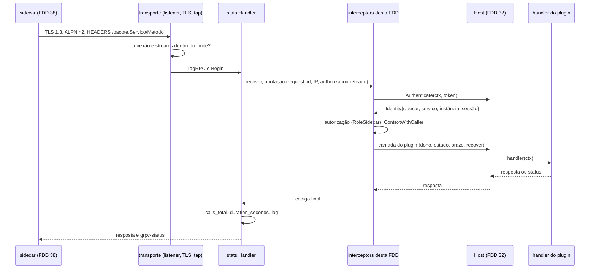
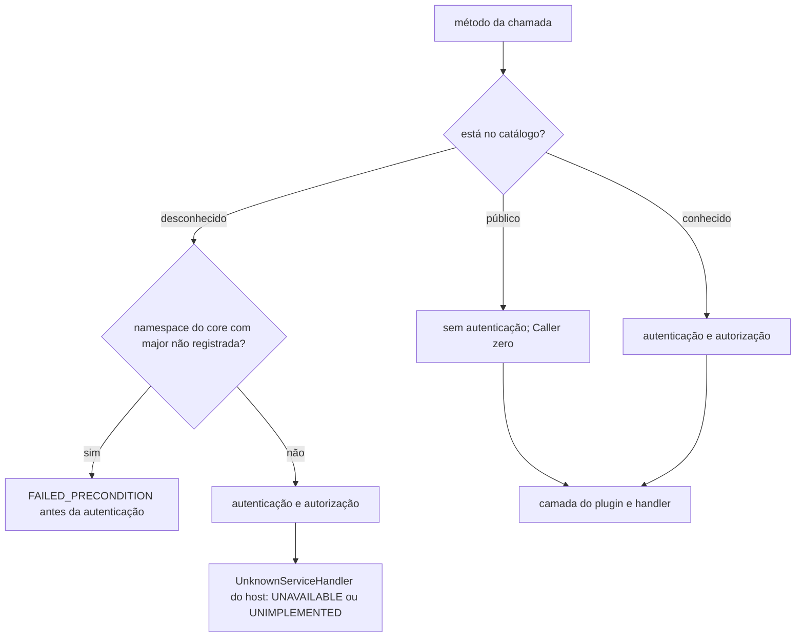

### FDD: Servidor gRPC do controller (CTL-04)

Versão: 1.0
Data: 2026-10-21
Responsável: Guilherme Giusti

---

### 1. Contexto e motivação técnica

**Problema técnico.** O controller tem um único servidor gRPC, com uma porta, um TLS e uma autenticação, e os serviços dele crescem conforme os plugins são compilados no binário (FR-005, ADR-006 do `n3x-sdk`). Quem garante isso é o host, antes de qualquer handler de plugin. As peças vizinhas já estão fechadas: a config e o `tls.Config` (FDD 30), o verificador de credencial (FDD 31), o catálogo, a camada do plugin e o `Host.Authenticate` (FDD 32), a regra do IP e as sentinelas (FDD 09), o `Caller` (FDD 08), o proto do core (FDD 36) e o cliente do sidecar (FDD 38). Falta o servidor que junta tudo:

- em que ordem cada interceptor roda (recover, log e métricas, limites, autenticação, autorização), onde cada limite age de fato no grpc-go e por que essa ordem não deixa um chamador sem sessão gastar mais do que os limites permitem
- como o login passa sem sessão, como o token é lido, conferido pelo core e retirado antes do handler, e como cada retorno de `Host.Authenticate` vira código gRPC e `n3x_controller_auth_total`
- como o IP do chamador é resolvido (par TCP ou `x-forwarded-for` de proxy confiável) e entregue ao core por `CallerIP`
- qual política de keepalive aceita o ping de 30 s do sidecar (o padrão do grpc-go encerra a conexão com `ENHANCE_YOUR_CALM`, I-06 da FDD 38)
- como 1.000 conexões, 16 streams por conexão e mensagens de 4 MiB viram `RESOURCE_EXHAUSTED` em vez de travar o processo
- o que significa "1 s por mensagem processada" em stream longo, o que acontece com método ou versão desconhecida e com o desligamento quando 500 streams de heartbeat nunca terminam sozinhos

**Encaixe no HLD.** Esta FDD especifica o componente "Servidor gRPC" do HLD do `n3x-controller` ("Componentes e responsabilidades"), o "Fluxo de requisição: chamada gRPC de um sidecar", as "Convenções do servidor gRPC" e os "Códigos de erro do servidor gRPC" de "Interfaces públicas", os limites e o keepalive de "Técnicas aplicadas", o passo 2 do "Desligamento" e as métricas `grpc_*` de "Observabilidade". O pacote é `host/internal/grpcsrv`, pela regra da FDD 30 de manter só `host` como API estável (H-01; I-01). Do HLD de plataforma, implementa o lado do servidor de "Fluxo de controle" e "Segurança".

**Recorte com as FDDs vizinhas.**
- FDD 30: abre a porta (`listen.grpc`), entrega `boot.Deps`, chama `Serve`, `Shutdown` e `Close`, trata sinais e saídas. Aqui só o servidor que implementa `boot.Server`
- FDD 31: o verificador e o bloqueio do login. Aqui só o IP e o prazo que ele recebe
- FDD 32: catálogo, camada do plugin (dono, estado, prazo unário, `recover` do handler, zumbis), `UnknownServiceHandler` e `Host.Authenticate`. Aqui a cadeia que vem antes dela e a montagem do `grpc.Server`
- FDD 39: handler `Login`, emissão e conferência do token (o `Authenticate` do core). Aqui só a chamada a `Host.Authenticate`
- FDD 38: o cliente. Aqui o que o servidor promete a ele
- FDD 51: a carga com 500 sidecars e a calibração final dos números

**Atores.** Sidecars (pela conexão compartilhada da FDD 38), plugin core (autenticador e rota pública de login), plugins com metade de controller (serviços do catálogo), operador (limites e `grpc.trusted_proxies` no `n3x.yaml`), proxy L7 opcional na frente da `17443`, `host.Run` (FDD 30).

**Limites.**
- Não abre porta, não lê arquivo nem variável de ambiente, não trata sinal e não chama `os.Exit`
- Não confere token nem credencial: chama `Host.Authenticate` e deixa o `Verify` para o core
- Não muda o código nem a mensagem de um status devolvido por plugin; só troca erro sem status por `INTERNAL` genérico e corta mensagem longa (contrato 8)
- Nenhum plugin enxerga o token: o metadado `authorization` sai do `ctx` antes da camada do plugin

**Suposições**
- Go 1.26, sem cgo; grpc-go na versão do `go.mod` do `host/`, no mínimo 1.67 (exigência de ALPN `h2` no handshake) (hipótese, H-18)
- `PluginHost.Start` terminou sem erro antes de `grpcsrv.New` (FDD 30, contrato 11): o `Catalog` é imutável e não tem serviço repetido (FDD 32, contrato 3)
- O core registra o serviço público `n3x.plugins.n3x.core.v1.Login` com o único método `Login` (L-11, FDD 36) e o serviço `n3x.plugins.n3x.core.v1.Core`
- O cliente é o da FDD 38: TLS 1.3 com ALPN `h2`, keepalive de 30 s com `PermitWithoutStream`, mensagens até 4 MiB, `x-request-id` em toda chamada, `authorization` depois do login

**Restrições**
- TLS 1.3 mínimo, certificado de `tls.cert_file` e `tls.key_file`, lido uma vez pela FDD 30 (`Config.TLSConfig()` devolve clone)
- O login é a única rota sem sessão; todo o resto passa pelo autenticador do core (ADR-004 e ADR-019 do `n3x-sdk`)
- Na v1, todo método exige o papel `sidecar` (ADR-007 do `n3x-controller`)
- O controller não guarda tokens (ADR-005 do `n3x-plugin-core`)
- Sem tracing; correlação pelo `request_id` vindo de `x-request-id` (ADR-009 do `n3x-sdk`, L-13)
- Nenhum token, `authorization`, segredo, hash ou corpo de mensagem em log, métrica, erro ou status

**Rastreabilidade**
- PRD 1.5: FR-005 (inteiro), FR-011 (autenticação e permissão antes do plugin; única rota pública), FR-016 (proto incompatível com `FAILED_PRECONDITION`); não funcionais de desempenho (500 sidecars em 1 vCPU e 512 MB), segurança (TLS 1.3, autorização antes do handler, nenhum token em log) e observabilidade (chamadas por método e status); critérios de aceite "chamada sem sessão válida recusada com `UNAUTHENTICATED`", "conexões com TLS 1.3" e "nenhum segredo em logs ou erros"
- HLD do `n3x-controller`: "Componentes e responsabilidades", "Fluxo de requisição: chamada gRPC de um sidecar", "Interfaces públicas", "Técnicas aplicadas", "Desligamento", "Segurança" e "Observabilidade"
- HLD do `n3x-sdk` (plataforma): "Fluxo de controle" e "Segurança"
- ADRs: ADR-007 do `n3x-controller`; ADR-004, ADR-006, ADR-009, ADR-012 e ADR-019 do `n3x-sdk`; ADR-005 e ADR-007 do `n3x-plugin-core`
- FDDs aplicadas: 01 (`OwnsGRPCService`, `GRPCPackage`), 06 (`telemetry.ContextWithRequestID`, `NewRequestID`, `MetadataRequestID`, `NewLogHandler`), 08 (`Caller`, `ContextWithCaller`, `Identity`, `Role.Meets`, tabela de prazos), 09 (tabela pública, contrato 11 do `Authenticate`, contrato 14 da regra do IP, contrato 16 do estado do core, contrato 17 das sentinelas, `n3x_controller_auth_total`, `auth_failed`, `auth_core_unavailable`), 12 (`Host.Dial`, cadeia do kit, `hostconformance.RunCalls` e `RunCoreEnv`), 30 (`boot.Server`, `TLSConfig()`, `TrustedProxies`, `grpc.limits`, `plugin_call_timeout`, desligamento), 31 (`CallerIP`, prazo do `Verify`), 32 (`Catalog`, camada do plugin, `UnknownServiceHandler`, `Authenticate`, `ContextWithCallerIP`, harness), 36 (nomes de serviço, regra de major), 38 (keepalive, mensagens, streams, metadados)
- Lacunas do README:
  - **L-25 fechada aqui:** reflection e health gRPC desligados na `17443`; a saúde do controller fica só na `17091` (FDD 30) (hipótese, confirmando a do HLD, H-02)
  - **L-02 aplicada:** IP pelo par TCP ou por `x-forwarded-for` vindo de par em `grpc.trusted_proxies`, regra do contrato 14 da FDD 09, implementada no pacote puro `host/internal/clientip` e entregue por `plugins.ContextWithCallerIP` (contrato 5)
  - **L-08 aplicada:** o teto unário do servidor é `min(prazo do cliente, runtime.plugin_call_timeout)`, imposto pela camada do plugin que esta FDD instala por último; streams sem teto total, com 1 s por mensagem processada (contrato 7)
  - **L-11 aplicada:** passagem sem sessão pelo que o core registrou em `PublicGRPC` (`Catalog.IsPublic`), nunca por nome fixo no código do servidor
  - **L-13 aplicada:** `x-request-id` no fio, `request_id` no `ctx` e nos logs
- Pontos em aberto de FDDs anteriores fechados aqui: P-02 da FDD 12 (teto por mensagem de stream e `x-forwarded-for`), P-06 da FDD 31 (sem interceptor de taxa para o login), P-09 da FDD 30 (ALPN `h2` sobre o clone do `tls.Config`)
- Pedidos atendidos:
  - FDD 32: registrar só o `Catalog`; usar o `UnknownServiceHandler` do host; `request_id`, `ContextWithCaller` e `ContextWithCallerIP` antes da camada do plugin; camada do plugin por último (é ela que aplica o prazo unário pedido pela FDD 31); retornos de `Authenticate` mapeados para códigos e para `n3x_controller_auth_total`; teto de 1 s por mensagem em stream; `Dial` no `pluginstest.Harness` (contratos 3, 4, 7 e 11)
  - FDD 31: IP por `CallerIP`, prazo `min(cliente, plugin_call_timeout)`, `request_id` no `ctx`; sem interceptor de taxa para o login (contratos 3, 5 e 7; H-20)
  - FDD 30: `boot.Server`; `TLSConfig()` (clone) com ALPN próprio; `TrustedProxies` (contratos 1, 2 e 5)
  - FDD 12 (P-02): semântica do teto por mensagem e do `x-forwarded-for` (contratos 5 e 7)
  - FDD 09: retirar `authorization` dos metadados e resolver o IP; publicar `n3x_controller_auth_total` (contratos 4 e 5)
  - FDD 36: pacote do core em major não registrada recebe `FAILED_PRECONDITION` antes da autenticação (contrato 9)
  - FDD 38: keepalive com `MinTime` de no máximo 30 s e `PermitWithoutStream`; mensagens de 4 MiB; 16 streams por conexão contando as unárias (contratos 2 e 6)
  - FDD 08: injetar o `Caller` em toda chamada gRPC autenticada (contrato 4)

---

### 2. Objetivos técnicos

- **Nada de plugin roda sem passar pela cadeia.** Invariante: todo handler da tabela `sidecar` recebe `ctx` com `Caller` `RoleSidecar` válido, `request_id`, marca de IP e sem `authorization`; todo handler da tabela pública recebe `Caller` zero, `request_id` e marca de IP. Medida: suíte com servidor de eco (o handler devolve o que viu) em 100% dos métodos do catálogo de teste.
- **Recusa sem sessão é barata e completa.** Medida: chamada sem `authorization` a método não público volta `UNAUTHENTICATED` sem chamar o core (0 chamadas a `Host.Authenticate`); token inválido, expirado ou identidade inválida volta `UNAUTHENTICATED` com a mesma mensagem genérica; o `Login` passa sem token.
- **Limites viram `RESOURCE_EXHAUSTED`, não travamento.** Medida: com `max_connections` 1.000, a 1.001ª conexão recebe `RESOURCE_EXHAUSTED` na primeira chamada e é fechada em até 1,1 s; com 16 streams abertos numa conexão, o 17º recebe `RESOURCE_EXHAUSTED`; mensagem de 4 MiB mais 1 byte recebe `RESOURCE_EXHAUSTED`; o processo segue atendendo as outras conexões sem aumento de latência acima de 10% no p99 (H-04, H-05).
- **TLS 1.3 só.** Medida: cliente com TLS 1.2 no máximo é recusado no handshake; cliente sem ALPN `h2` é recusado; ambos contam em `n3x_controller_grpc_handshake_failures_total`.
- **Keepalive do sidecar aceito.** Medida: cliente com ping a cada 30 s e `PermitWithoutStream`, sem chamada nenhuma, mantém a conexão por 30 min sem `GOAWAY` (teste de longa duração da CI noturna; na CI de PR, 5 pings com o relógio do grpc-go ajustado por `KeepaliveMinTime` de teste).
- **Prazos determinísticos.** Medida: unária com cliente sem prazo é cortada em `plugin_call_timeout` mais 50 ms com `DEADLINE_EXCEEDED`; cliente com prazo de 2 s é cortado em 2 s mais 50 ms; num stream, handler que leva 1,5 s para tratar uma mensagem tem o `ctx` cancelado em 1 s mais 50 ms e o stream termina com `DEADLINE_EXCEEDED`; o heartbeat que responde em 10 ms por mensagem dura 1 h sem corte.
- **Desligamento rápido com streams longos.** Medida: com 500 streams de heartbeat abertos e nenhuma unária em curso, `Shutdown` termina em até 1 s e cada stream recebe `UNAVAILABLE` "controller parando"; com uma unária de 3 s em curso, ela termina e `Shutdown` volta logo depois.
- **Custo próprio baixo.** Medida: a cadeia desta FDD (sem `Authenticate`, sem a camada do plugin e sem o handler) custa no máximo 4 alocações e p99 de até 15 µs por unária; 0 alocações por mensagem no wrapper do teto de stream; até 512 bytes de estado próprio por conexão (hipótese das metas, H-17).
- **Paridade com o kit.** Medida: `hostconformance.RunCalls` e `RunCoreEnv` passam no `pluginstest.Harness()` sem nenhum pulo que cite a FDD 33; com as FDDs 34 e 35 implementadas, `hostconformance.Run` com `WithCore` passa os 79 casos.

---

### 3. Escopo e exclusões

**Incluído**
- Pacote `host/internal/grpcsrv`: `New`, `Server` (implementa `boot.Server`), `NewWithOptions` só para testes, constantes de keepalive, limites fixos e textos de status (contrato 1)
- Pacote puro `host/internal/clientip`: resolução do IP do chamador pela regra da FDD 09, reutilizável pela FDD 34 no painel (contrato 5)
- Montagem do `grpc.Server`: credenciais TLS sobre o clone de `TLSConfig()` com ALPN `h2`, keepalive, `MaxConcurrentStreams`, tamanho de mensagem, `InTapHandle`, `stats.Handler`, cadeias de interceptors unária e de stream, `UnknownServiceHandler` do host, registro só dos serviços do catálogo (contratos 2 e 3)
- Limite de conexões com teto rígido, limite de streams por conexão, tamanho de mensagem e prazo de handshake (contrato 6)
- Classificação do método (público, conhecido, desconhecido), regra da major do core, autenticação por `Host.Authenticate`, retirada de `authorization`, autorização por papel, `request_id`, `ContextWithCaller`, `ContextWithCallerIP` (contratos 3, 4 e 9)
- Teto de 1 s por mensagem processada em stream (contrato 7)
- Matriz de situação para código e mensagem; troca de erro sem status por `INTERNAL` genérico (contrato 8)
- `Shutdown` gracioso com corte dos streams longos, e `Close` forçado (contrato 10)
- Métricas `n3x_controller_grpc_*` e `n3x_controller_auth_total`, logs com `component=grpc` (seção 7)
- `Dial` do `pluginstest.Harness` (FDD 32) e os casos de `RunCalls` e `RunCoreEnv` que dependiam dele (contrato 11)

**Excluído**
- Abertura da porta, ordem de subida e desligamento do processo, sinais, códigos de saída e campos do `n3x.yaml`: FDD 30 (CTL-01)
- Verificador de credencial, contadores e bloqueio do login: FDD 31 (CTL-02)
- Catálogo, camada do plugin (dono, estado `falho`, prazo unário, `recover` do handler, zumbis), `UnknownServiceHandler` e `Host.Authenticate`: FDD 32 (CTL-03)
- Handler `Login`, emissão e validação do token, chave HMAC: FDD 39 (CORE-03)
- Mensagens e regras de `Register`, `Heartbeat`, `Event` e `Exit`: FDDs 36 (CORE-01) e 43 (CORE-07)
- Conexão do lado do sidecar: FDD 38 (SID-10); teste com 500 sidecars e calibração: FDD 51 (CTL-07)
- Fora da v1: papéis por método no gRPC (ADR-007), mTLS de sidecar, recarga do certificado sem restart, reflection, health gRPC na `17443`, compressão negociada além do padrão do grpc-go, várias réplicas, cabeçalho `Forwarded` (RFC 7239), interceptor de taxa para o login (H-20)

---

### 4. Fluxos detalhados e diagramas

**Fluxo de montagem (`grpcsrv.New`)**
1. Recebe `boot.Deps` e o host de plugins (FDD 30, contrato 11), depois de `PluginHost.Start` sem erro; `Catalog()` nulo devolve `ErrNoCatalog` (a FDD 30 sai com 8).
2. Monta a tabela de métodos: para cada serviço de `Catalog.Services(TableSidecar)` e `Catalog.Services(TablePublic)`, cada método e stream do `ServiceDesc` vira uma entrada `{fullMethod, plugin, público, stream}`; o texto da entrada é o próprio rótulo `method` das métricas (sem cópia por chamada). Guarda também as majors registradas do pacote do core (`n3x.plugins.n3x.core.v<N>`), para a regra do contrato 9.
3. Monta o `tls.Config`: `deps.Config.TLSConfig()` (clone, TLS 1.3 mínimo) com `NextProtos = ["h2"]` e `ClientAuth = NoClientCert` (P-09 da FDD 30); embrulha `credentials.NewTLS` para contar falhas de handshake.
4. Monta o `grpc.Server` com as opções do contrato 2, as cadeias do contrato 3 e `grpc.UnknownServiceHandler` com o embrulho do contrato 9 sobre `ph.UnknownServiceHandler()`.
5. Registra cada serviço do catálogo com `RegisterService(desc, impl)`, uma vez; não registra reflection nem `grpc.health.v1` (L-25).
6. Registra as métricas em `deps.Registry` (nome repetido: erro, saída 8) e loga `grpc_server_configured` com os limites efetivos e o número de serviços e métodos. Limites abaixo do que o cliente da FDD 38 precisa geram `grpc_limits_warning` (H-19).
7. Não abre porta e não cria goroutine.

**Fluxo principal: chamada unária autenticada** (ex.: `/n3x.plugins.n3x.core.v1.Core/Register`)
1. **Transporte** (antes dos interceptors): a conexão já passou pela contagem do listener e pelo handshake TLS 1.3 com ALPN `h2`. O `InTapHandle` confere, para o stream novo: conexão acima do limite (`RESOURCE_EXHAUSTED`), streams da conexão acima de `max_streams_per_connection` (`RESOURCE_EXHAUSTED`), servidor parando (`UNAVAILABLE`). O grpc-go lê a mensagem e recusa acima de `max_message` (`RESOURCE_EXHAUSTED`).
2. **Log e métricas** (`stats.Handler`): abre o registro da chamada (início, método normalizado) no `ctx`; os interceptors seguintes anotam nele dono, chamador, resultado da autenticação e `request_id`; o fim da chamada (`stats.End`) soma `n3x_controller_grpc_calls_total` e `n3x_controller_grpc_duration_seconds` e decide o log.
3. **Recover** (primeiro interceptor): panic em qualquer interceptor do host vira `INTERNAL` "erro interno", log `grpc_panic` com stack amostrado e `n3x_controller_grpc_host_panics_total`. Panic de handler de plugin é contido antes, pela camada do plugin (FDD 32).
4. **Anotação**: `request_id` de `x-request-id` (gramática do contrato 2) ou novo (`telemetry.NewRequestID`), posto com `telemetry.ContextWithRequestID`; IP por `clientip.Resolve(peer, x-forwarded-for, TrustedProxies)` e `plugins.ContextWithCallerIP`; `authorization` lido (primeiro valor) e retirado dos metadados de entrada; classificação do método pela tabela do passo 2 de `New`.
5. **Versão** (só para método desconhecido do namespace do core): major não registrada responde `FAILED_PRECONDITION` sem autenticar (contrato 9).
6. **Autenticação** (métodos que não são públicos): sem token, `UNAUTHENTICATED` com `missing_token`, sem chamar o core; com token, `Host.Authenticate(ctx, token)`; retornos mapeados pela tabela do contrato 4; sucesso põe `ctrl.ContextWithCaller(ctx, id)`.
7. **Autorização**: papel exigido pelo método (na v1, `RoleSidecar` para todos); `Caller.Role.Meets` falso dá `PERMISSION_DENIED`.
8. **Camada do plugin** (FDD 32, sempre a última): dono pelo `Catalog.Owner`, estado `falho` ou host parando dá `UNAVAILABLE`, prazo `min(prazo do cliente, runtime.plugin_call_timeout)`, `recover` do handler, zumbi.
9. **Handler** do plugin com o `ctx` montado.
10. **Saída**: o recover troca erro sem status por `INTERNAL` genérico e corta mensagem acima de 1 KiB (contrato 8); o `stats.End` registra o código final.

**Fluxo do login (tabela pública)** (`/n3x.plugins.n3x.core.v1.Login/Login`)
- Passos 1 a 4 iguais; `Catalog.IsPublic` verdadeiro: sem autenticação e sem autorização; `Caller` fica zero (FDD 09, contrato 10); o metadado `authorization`, se vier, também sai do `ctx`
- A camada do plugin aplica o prazo `min(cliente, plugin_call_timeout)` (10 s no padrão, igual ao `controller.timeouts.login` do cliente, FDD 38) e o handler `Login` do core lê o IP com `CallerIP(ctx)` e chama `Credentials().Verify` (FDDs 31 e 39)
- Sem interceptor de taxa (H-20): o verificador recusa IP ou serviço bloqueado antes do bcrypt, a fila de bcrypt é curta e o limite de conexões limita a vazão; uma rajada sem credencial custa um HMAC e consultas a mapa por chamada (FDD 31)

**Fluxo de um stream** (ex.: `/n3x.plugins.n3x.core.v1.Core/Heartbeat`)
- Passos 1 a 7 iguais, na cadeia de stream
- **Teto por mensagem** (contrato 7), logo antes da camada do plugin: o stream é embrulhado; cada `RecvMsg` que entrega uma mensagem ao handler arma um temporizador de 1 s, reutilizado; o próximo `RecvMsg`, `SendMsg` ou o retorno do handler desarma. Estourado: o `ctx` do stream é cancelado com causa `stream_message_timeout`, chamadas seguintes a `RecvMsg` e `SendMsg` voltam `DEADLINE_EXCEEDED` na hora, e o stream termina com `DEADLINE_EXCEEDED` "processamento de mensagem excedeu 1s"
- A camada do plugin dá ao handler um `ctx` filho do `ctx` do stream embrulhado e do contexto base do dono (FDD 32), sem prazo total
- O stream conta como 1 dos 16 da conexão enquanto viver

**Fluxos alternativos e exceções**
- **Sem `authorization`:** `UNAUTHENTICATED` "sessão ausente, inválida ou expirada"; `auth_total{result="missing_token"}`; log `auth_failed` amostrado; o core não é chamado
- **Token inválido ou expirado:** o core devolve erro (`ErrUnauthenticated` na FDD 39); `UNAUTHENTICATED` com a mesma mensagem; `result="unauthenticated"`; o texto do core vai só para o log (`detail`), sem o token
- **Core devolve identidade inválida:** `ErrMisbehavior` (FDD 32); `UNAUTHENTICATED`; `result="invalid_identity"`; a FDD 32 loga `privileged_misbehavior`
- **Core `falho` em runtime:** `Host.Authenticate` devolve `ErrPluginUnavailable` sem chamar o core; `UNAVAILABLE` "plugin indisponível"; `result="core_unavailable"`; log `auth_core_unavailable` (no máximo 1 por minuto). O login também recebe `UNAVAILABLE`, pela camada do plugin (dono `falho`); "a tudo", como manda o contrato 16 da FDD 09
- **Panic no `Authenticate` do core:** `*plugins.PanicError` (`kind="auth"`, contado pela FDD 32); `INTERNAL` "erro interno"; `result="panic"`
- **Prazo do cliente vencido durante a autenticação:** `DEADLINE_EXCEEDED` (ou `CANCELED`), `result="timeout"` (H-12; I-03)
- **Plugin dono `falho` em runtime ou host parando:** `UNAVAILABLE` "plugin indisponível" pela camada do plugin, sem tocar o handler
- **Método no namespace de plugin `falho` na subida** (sem serviço montado): autenticação normal; depois, `UNAVAILABLE` pelo `UnknownServiceHandler` do host
- **Método desconhecido de qualquer outro namespace, ou método novo de um serviço conhecido** (minor mais nova do cliente): autenticação normal; depois, `UNIMPLEMENTED` pelo `UnknownServiceHandler`; rótulo `method="unknown"`
- **Pacote do core em major não registrada** (ex.: `/n3x.plugins.n3x.core.v2.Login/Login`): `FAILED_PRECONDITION` "proto do core v2 não suportado; este controller aceita a major 1", antes da autenticação; log `core_proto_rejected` (contrato 9)
- **Reflection ou health gRPC** (`grpc.reflection.v1.ServerReflection`, `grpc.health.v1.Health`): não registrados; como qualquer método desconhecido fora do core, exigem sessão e depois dão `UNIMPLEMENTED` (L-25)
- **1.001ª conexão:** aceita e com handshake; todo stream dela recebe `RESOURCE_EXHAUSTED` "limite de conexões do controller atingido" no `InTapHandle`; a conexão é fechada 1 s depois de aceita (`OverLimitGrace`); acima de `max_connections + 64`, o accept fecha na hora, sem handshake (H-04)
- **17º stream na mesma conexão:** `RESOURCE_EXHAUSTED` "limite de streams por conexão atingido" no `InTapHandle`; o 21º (acima do anunciado no HTTP/2, `16 + 4`) recebe `RST_STREAM REFUSED_STREAM` do próprio grpc-go, que o cliente vê como `UNAVAILABLE` (H-05)
- **Mensagem acima de `max_message`:** `RESOURCE_EXHAUSTED` do grpc-go, antes de qualquer interceptor; contada pelo `stats.Handler`
- **Handshake com TLS 1.2, sem ALPN `h2` ou que não termina em 10 s:** conexão fechada sem resposta gRPC; `n3x_controller_grpc_handshake_failures_total{reason}` e log `grpc_handshake_failed` amostrado
- **`x-forwarded-for` de par não confiável:** ignorado; vale o par (contrato 5)
- **Handler devolve erro sem status gRPC** (ex.: `errors.New("pool")`): `INTERNAL` "erro interno"; o texto vai para o log `grpc_plain_error` (no máximo 1 por minuto por método); erro de `context` vira `DEADLINE_EXCEEDED` ou `CANCELED`
- **Handler devolve status com mensagem acima de 1 KiB:** a mensagem é cortada em 1 KiB numa fronteira de UTF-8; código e detalhes ficam
- **Panic num interceptor do host:** `INTERNAL` "erro interno", `grpc_panic`, o servidor segue
- **Ping mais frequente que 20 s, ou com mais de duas faltas:** o grpc-go encerra com `GOAWAY ENHANCE_YOUR_CALM`; o cliente da FDD 38 (30 s) nunca chega lá
- **Conexão morta sem FIN:** o servidor pinga depois de 60 s sem leitura e fecha se não houver resposta em 20 s, liberando a vaga
- **`Shutdown`:** `GOAWAY`, recusa de stream novo, corte dos streams abertos com `UNAVAILABLE` "controller parando", espera das unárias até o prazo; depois `Stop` (contrato 10)

**Diagramas**

Sequência de uma unária autenticada:



Classificação do método:



Estados de uma conexão:

```mermaid
stateDiagram-v2
    state "aceita" as A
    state "handshake" as HS
    state "ativa" as AT
    state "excedente" as EX
    state "drenando" as DR
    [*] --> A: accept com contagem
    A --> [*]: acima de max_connections + 64, fecha na hora
    A --> HS
    HS --> [*]: TLS 1.2, sem h2 ou 10 s
    HS --> AT: dentro de max_connections
    HS --> EX: acima de max_connections
    EX --> [*]: RESOURCE_EXHAUSTED em todo stream; fecha em 1 s
    AT --> DR: Shutdown (GOAWAY)
    AT --> [*]: keepalive sem resposta, cliente fecha
    DR --> [*]: streams cortados, unárias terminam, ou Stop
```



---

### 5. Contratos públicos (assinaturas, endpoints, headers, exemplos)

**Contrato 1: `grpcsrv.New` e a implementação de `boot.Server`**
- Tipo: sdk (API Go interna do módulo `host/`, consumida pela FDD 30)
- Assinatura/Rota:
  ```go
  package grpcsrv // github.com/giustech/n3x-controller/host/internal/grpcsrv

  // Plugins é o que o servidor usa do host de plugins; *plugins.Host implementa (FDD 32).
  type Plugins interface {
      Catalog() *plugins.Catalog
      Authenticate(ctx context.Context, token string) (ctrl.Identity, error)
      UnaryServerInterceptor() grpc.UnaryServerInterceptor
      StreamServerInterceptor() grpc.StreamServerInterceptor
      UnknownServiceHandler() grpc.StreamHandler
  }

  type Server struct{ /* grpc.Server, tabela de métodos, contadores, registro de streams */ }

  var _ boot.Server = (*Server)(nil)

  // New monta o servidor depois de PluginHost.Start sem erro. Não abre porta
  // nem cria goroutine. Erro: catálogo ausente ou métrica repetida (saída 8).
  func New(deps boot.Deps, ph Plugins) (*Server, error)

  func (s *Server) Name() string                       // "grpc"
  func (s *Server) Serve(ln net.Listener) error        // bloqueia; nil depois de Shutdown ou Close
  func (s *Server) Shutdown(ctx context.Context) error // contrato 10
  func (s *Server) Close() error                       // Stop do grpc-go

  // Só para testes do módulo (pluginstest e arquivos _test.go; a CI confere).
  type Options struct {
      TLS          *tls.Config // nil: deps.Config.TLSConfig() com NextProtos ["h2"]
      Authenticate func(ctx context.Context, token string) (ctrl.Identity, error) // nil: ph.Authenticate
      Now          func() time.Time
  }
  func NewWithOptions(deps boot.Deps, ph Plugins, o Options) (*Server, error)

  const (
      KeepaliveMinTime     = 20 * time.Second // menor intervalo de ping aceito do cliente
      KeepaliveTime        = 60 * time.Second // servidor pinga depois de 60 s sem leitura
      KeepaliveTimeout     = 20 * time.Second // sem resposta ao ping, fecha
      HandshakeTimeout     = 10 * time.Second
      StreamMessageTimeout = 1 * time.Second  // teto por mensagem processada (contrato 7)
      StreamHeadroom       = 4                // anunciado no HTTP/2 = limite + 4
      ConnectionHeadroom   = 64               // teto rígido = max_connections + 64
      OverLimitGrace       = 1 * time.Second  // conexão excedente fecha depois disso
      MaxHeaderListBytes   = 16 << 10
      MaxStatusMessage     = 1 << 10
      UnknownMethodLabel   = "unknown"
  )

  var ErrNoCatalog = errors.New("grpcsrv: catálogo ausente; monte o servidor depois de PluginHost.Start")
  ```
- Método: n/a (chamada local)
- Semântica:
  - **Assinatura de `New`:** o exemplo do contrato 11 da FDD 30 passava também o verificador (`grpcsrv.New(deps, ph, cred)`); o servidor não usa o verificador, que só o core chama pelo `CoreEnv`, então o parâmetro sai (H-24; I-02)
  - **Config lida** (FDD 30, contrato 11): `File.GRPC.Limits`, `TrustedProxies`, `File.Runtime.PluginCallTimeout` (a camada do plugin já usa) e `TLSConfig()`; nenhum campo novo no `n3x.yaml`: keepalive, folgas e prazos de handshake são constantes na v1 (H-03)
  - **`Serve`:** embrulha `ln` no listener de contagem (contrato 6) e chama `grpc.Server.Serve`; pode ser chamado mais de uma vez só nos testes (um `bufconn` por `Dial` no harness, contrato 11); depois de `Shutdown` ou `Close`, devolve `nil`
  - **`Shutdown` e `Close`:** contrato 10; seguros para chamada repetida e concorrente; `Close` depois de `Shutdown` é a parada forçada da FDD 30
  - **`NewWithOptions`:** existe para o harness e os testes; o `boot` da FDD 30 só chama `New`. A CI recusa uso de `NewWithOptions` fora de `host/internal/plugins/pluginstest` e de arquivos `_test.go` (busca por `go/ast`)
  - **Concorrência:** o servidor é seguro entre goroutines; a tabela de métodos é imutável depois de `New`

**Exemplo de requisição**
```go
// host/internal/boot (FDD 30), etapa 7
srv, err := grpcsrv.New(deps, ph)
if err != nil {
    return exitInternal(err) // N3X-C008
}
ln, err := net.Listen("tcp", fmt.Sprintf(":%d", deps.Config.File.Listen.GRPC))
if err != nil {
    return exitPort(err) // N3X-C006
}
go func() { errc <- srv.Serve(ln) }()
```

**Exemplo de resposta** (log da montagem)
```json
{"ts":"2026-10-21T14:00:01.120Z","level":"info","component":"grpc","msg":"grpc_server_configured","services":3,"methods":7,"public_methods":1,"max_connections":1000,"max_streams_per_connection":16,"max_message_bytes":4194304,"keepalive_min_time":"20s","trusted_proxies":0,"reflection":false,"health":false}
```

---

**Contrato 2: contrato de conexão da `17443` (TLS, ALPN, keepalive, mensagens e metadados)**
- Tipo: stream (conexão HTTP/2 do gRPC)
- Assinatura/Rota: `tcp://<host>:<listen.grpc>`, padrão `17443`; serviços `/n3x.plugins.<namespace>.<nome>.v<major>.<Servico>/<Metodo>` (ADR-012, FDD 01)
- Método: gRPC sobre HTTP/2 com TLS
- Semântica de status/headers:
  - **TLS:** só TLS 1.3 (`MinVersion` do clone de `TLSConfig()`); certificado de `tls.cert_file`; sem certificado de cliente; ALPN `h2` anunciado e exigido (cliente sem `h2` é recusado pelo grpc-go 1.67 ou superior, H-18); handshake em até 10 s (H-15)
  - **HTTP/2:** `SETTINGS_MAX_CONCURRENT_STREAMS` igual a `max_streams_per_connection + 4` (padrão 20); o limite efetivo de 16 é conferido no `InTapHandle` (contrato 6); lista de cabeçalhos até 16 KiB
  - **Keepalive (política para o cliente):** `EnforcementPolicy{MinTime: 20s, PermitWithoutStream: true}`, compatível com o ping de 30 s sem chamada da FDD 38; ping mais frequente que 20 s gera falta e, depois de duas, `GOAWAY ENHANCE_YOUR_CALM` (comportamento do grpc-go)
  - **Keepalive (do servidor):** `ServerParameters{Time: 60s, Timeout: 20s}`, sem `MaxConnectionIdle` e sem `MaxConnectionAge` (as conexões dos sidecars vivem enquanto o processo viver, FR-002) (H-03)
  - **Mensagens:** recebidas e enviadas até `grpc.limits.max_message` (padrão 4 MiB); compressão só a que o grpc-go registra por padrão (nenhuma além de `identity`)
  - **Metadados aceitos:**

| Metadado | Quem envia | O que o servidor faz | O handler vê |
| --- | --- | --- | --- |
| `authorization` | interceptor do core no sidecar, depois do login (FDD 39) | primeiro valor vai para `Host.Authenticate`; todos os valores saem do `ctx` antes da camada do plugin, inclusive no login | nunca |
| `x-request-id` | toda chamada da conexão compartilhada (FDD 38, L-13) | valor que casa com `^[A-Za-z0-9._-]{1,64}$` vira `request_id`; ausente ou fora da gramática, `telemetry.NewRequestID()` (H-10) | o metadado como veio e `request_id` no `ctx` |
| `x-forwarded-for` | proxy L7 na frente da `17443` | lido só se o par TCP está em `grpc.trusted_proxies` (contrato 5) | o metadado como veio |
| `grpc-*` e pseudo-cabeçalhos | grpc-go | tratados pelo grpc-go (`grpc-timeout` vira o prazo do cliente) | o que o grpc-go entrega |
| qualquer outro (ex.: `x-tenant`, `user-agent`) | plugins pela conexão (FDD 38) | passa sem mudança, dentro dos 16 KiB | como veio (H-22) |

**Exemplo de requisição** (cliente da FDD 38, `Core/Register`)
```text
:method POST
:scheme https
:path /n3x.plugins.n3x.core.v1.Core/Register
:authority controller.interno:17443
content-type: application/grpc
te: trailers
grpc-timeout: 5S
user-agent: n3x-sidecar/1.0.0 grpc-go/1.70.0
authorization: <token>
x-request-id: 8b0f3c2e-4f1a-4c55-9a77-2d6e1b9f0c31
```

**Exemplo de resposta** (o que o handler `Register` recebe no `ctx`, e a recusa de TLS 1.2)
```json
{
  "metadados no handler": { "x-request-id": ["8b0f3c2e-4f1a-4c55-9a77-2d6e1b9f0c31"], "user-agent": ["n3x-sidecar/1.0.0 grpc-go/1.70.0"] },
  "ctrl.Caller(ctx)": { "Role": "sidecar", "Service": "pedidos", "Instance": "pedidos-7d9f8b-xk2lp", "Session": "c41f0e9a7b2d4e10" },
  "telemetry.RequestIDFrom(ctx)": "8b0f3c2e-4f1a-4c55-9a77-2d6e1b9f0c31",
  "cliente com MaxVersion TLS 1.2": "remote error: tls: protocol version not supported",
  "log": "{\"level\":\"info\",\"component\":\"grpc\",\"msg\":\"grpc_handshake_failed\",\"reason\":\"version\",\"ip\":\"10.42.3.17\",\"suppressed\":0}"
}
```

---

**Contrato 3: cadeia do servidor (ordem e responsabilidade de cada camada)**
- Tipo: sdk (montagem interna do `grpc.Server`; a ordem é contrato porque as suítes da FDD 12 dependem dela)
- Assinatura/Rota:
  ```go
  // dentro de New (resumo)
  grpc.NewServer(
      grpc.Creds(handshakeCounting(credentials.NewTLS(tlsCfg))),
      grpc.ConnectionTimeout(HandshakeTimeout),
      grpc.KeepaliveEnforcementPolicy(keepalive.EnforcementPolicy{MinTime: KeepaliveMinTime, PermitWithoutStream: true}),
      grpc.KeepaliveParams(keepalive.ServerParameters{Time: KeepaliveTime, Timeout: KeepaliveTimeout}),
      grpc.MaxConcurrentStreams(uint32(lim.MaxStreamsPerConnection + StreamHeadroom)),
      grpc.MaxRecvMsgSize(int(lim.MaxMessage)), grpc.MaxSendMsgSize(int(lim.MaxMessage)),
      grpc.MaxHeaderListSize(MaxHeaderListBytes),
      grpc.InTapHandle(s.tap),
      grpc.StatsHandler(s.stats),
      grpc.ChainUnaryInterceptor(s.recoverU, s.annotateU, s.versionU, s.authnU, s.authzU, ph.UnaryServerInterceptor()),
      grpc.ChainStreamInterceptor(s.recoverS, s.annotateS, s.versionS, s.authnS, s.authzS, s.messageCeilingS, s.pluginLayerS(ph.StreamServerInterceptor())),
      grpc.UnknownServiceHandler(s.unknown(ph.UnknownServiceHandler())),
  )
  ```
- Método: gRPC unário e de stream
- Semântica (ordem lógica do HLD: recover, log e métricas, limites, autenticação, autorização; a coluna "onde roda" diz onde cada passo age no grpc-go):

| # | Camada | Onde roda | Responsabilidade | Recusa |
| --- | --- | --- | --- | --- |
| 0 | Listener | `Serve` | contagem de conexões; teto rígido `max_connections + 64` | fecha na hora |
| 0 | TLS | credenciais | TLS 1.3, ALPN `h2`, 10 s | fecha sem resposta |
| 1 | Limites de transporte | `InTapHandle` | conexão excedente, streams por conexão, servidor parando; conta a recusa em `calls_total` | `RESOURCE_EXHAUSTED`, `UNAVAILABLE` |
| 1 | Tamanho de mensagem | grpc-go | `max_message` na leitura e na escrita | `RESOURCE_EXHAUSTED` |
| 2 | Log e métricas | `stats.Handler` | registro da chamada no `ctx`; no fim, código, duração, gauges e log | (não recusa) |
| 3 | Recover | 1º interceptor | panic do host vira `INTERNAL`; erro sem status vira `INTERNAL`; corte da mensagem | `INTERNAL` |
| 4 | Anotação | 2º interceptor | `request_id`, IP e `ContextWithCallerIP`, leitura e retirada de `authorization`, classificação do método | (não recusa) |
| 5 | Versão | 3º interceptor | major não registrada do core | `FAILED_PRECONDITION` |
| 6 | Autenticação | 4º interceptor | `Host.Authenticate`, `ContextWithCaller`, `auth_total`; pula a tabela pública | `UNAUTHENTICATED`, `UNAVAILABLE`, `INTERNAL`, `DEADLINE_EXCEEDED` |
| 7 | Autorização | 5º interceptor | papel do método (`RoleSidecar` na v1); pula a tabela pública | `PERMISSION_DENIED` |
| 8 | Teto por mensagem | 6º interceptor (só stream) | contrato 7 | `DEADLINE_EXCEEDED` |
| 9 | Camada do plugin | último (FDD 32) | dono, estado, prazo unário, `recover` do handler, zumbi; pulada para método desconhecido, que vai direto ao `UnknownServiceHandler` | `UNAVAILABLE`, `INTERNAL`, `DEADLINE_EXCEEDED` |

  - **Por que os limites vêm antes da autenticação** (risco novo do ASSUNTO): os limites de conexão, stream e mensagem custam um contador ou uma comparação e agem antes de o grpc-go alocar o stream ou decodificar a mensagem; a autenticação custa um HMAC do core por chamada. Um chamador sem sessão nunca ocupa mais do que 1.000 conexões, 16 streams cada e 4 MiB por mensagem, e nenhuma linha de código de plugin roda para ele. Inverter a ordem faria cada stream excedente pagar a autenticação antes da recusa
  - **Por que log e métricas vêm antes do recover:** o `stats.Handler` vê toda chamada que ganhou stream, inclusive as recusadas pelo tamanho de mensagem e pelo `UnknownServiceHandler`, que os interceptors não veem; o `InTapHandle` soma as que ele recusa, para `calls_total` ter todas as chamadas (I-05)
  - **Por que a versão vem antes da autenticação:** um sidecar de outra major chama o `Login` da major dele, que não é público neste controller; sem a regra, ele veria `UNAUTHENTICATED` para sempre em vez de `FAILED_PRECONDITION` (FDD 36)
  - **Por que a camada do plugin é a última:** é ela que impõe o prazo unário e o `recover` do handler e que precisa do `Caller`, do `request_id` e do IP já postos (FDD 32, contrato 12)
  - **Método desconhecido:** o grpc-go passa o `UnknownServiceHandler` pela cadeia de stream; o interceptor `pluginLayerS` chama direto o handler quando a classificação é "desconhecido", porque a camada do plugin responderia `UNIMPLEMENTED` e esconderia o `UNAVAILABLE` de plugin `falho` na subida
  - **Unária e stream têm a mesma ordem** e o mesmo código de decisão; só o passo 8 é exclusivo de stream

**Exemplo de requisição**
```go
// teste de ordem: servidor com um plugin de eco e um gravador de camadas
conn := dialTLS(t, srv)
_, err := echov1.NewEchoClient(conn).Ping(ctxSemToken, &echov1.PingRequest{})
_, err2 := echov1.NewEchoClient(conn).Ping(ctxComToken, &echov1.PingRequest{})
```

**Exemplo de resposta**
```json
{
  "err": "rpc error: code = Unauthenticated desc = sessão ausente, inválida ou expirada",
  "camadas (sem token)": ["tap", "stats.begin", "recover", "annotate", "version", "authn:missing_token", "stats.end"],
  "camadas (com token)": ["tap", "stats.begin", "recover", "annotate", "version", "authn:ok", "authz:ok", "plugin_layer", "handler", "stats.end"],
  "chamadas a Host.Authenticate": 1,
  "err2": null
}
```

---

**Contrato 4: autenticação, autorização e identidade no `ctx`**
- Tipo: sdk (regras aplicadas pelo servidor; o plugin lê com `ctrl.Caller(ctx)`, FDD 08)
- Assinatura/Rota: `Host.Authenticate(ctx, token)` (FDD 32), `ctrl.ContextWithCaller`, `ctrl.Caller`, `Catalog.IsPublic`
- Método: gRPC, todo método fora da tabela pública
- Semântica:
  - **Passagem sem sessão:** só o que o core registrou em `PublicGRPC` (`Catalog.IsPublic(fullMethod)`); o servidor não tem nome de método fixo no código (L-11). Na v1 é exatamente `/n3x.plugins.n3x.core.v1.Login/Login`
  - **Token:** primeiro valor de `authorization`, como chegou (o esquema é do core, FDD 09, contrato 11); vazio conta como ausente; o servidor não loga, não guarda e não compara o token
  - **Identidade:** `Host.Authenticate` só devolve sucesso com `RoleSidecar` e `Valid()` verdadeiro (senão `ErrMisbehavior`, FDD 32); o servidor põe `ctrl.ContextWithCaller(ctx, id)`; o plugin lê `{Role: sidecar, Service, Instance, Session}`; `Session` é o nonce do token, não secreto (FDD 09)
  - **Tabela pública:** sem `ContextWithCaller` (`Caller` zero, FDD 09, contrato 10); o `ctx` que vem do grpc-go nunca tem `Caller`, então nada de fora alcança o handler
  - **Autorização (ADR-007):** papel exigido por método é `RoleSidecar` para todo método da tabela `sidecar` e para o método desconhecido; `Caller.Role.Meets(RoleSidecar)` falso dá `PERMISSION_DENIED` "papel sem permissão para este método". Com `Host.Authenticate`, esse caso não acontece na v1 (outro papel já vira `ErrMisbehavior`); ele existe para a regra valer igual no kit e para papéis por método numa versão futura
  - **Mapeamento dos retornos de `Host.Authenticate`** (atende a FDD 32, contrato 5; acrescenta `timeout`, H-12):

| Retorno | Código | Mensagem | `n3x_controller_auth_total{result}` | Log |
| --- | --- | --- | --- | --- |
| `authorization` ausente ou vazio (sem chamar) | `UNAUTHENTICATED` | sessão ausente, inválida ou expirada | `missing_token` | `auth_failed` `reason=missing_token` |
| identidade válida | segue | | `ok` | (nenhum) |
| `plugins.ErrMisbehavior` | `UNAUTHENTICATED` | sessão ausente, inválida ou expirada | `invalid_identity` | `auth_failed` `reason=invalid_identity` (a FDD 32 loga `privileged_misbehavior`) |
| `plugins.ErrPluginUnavailable` | `UNAVAILABLE` | plugin indisponível | `core_unavailable` | `auth_core_unavailable` |
| `plugins.ErrPluginPanic` (`*PanicError`) | `INTERNAL` | erro interno | `panic` | `plugin_panic` pela FDD 32 |
| `context.DeadlineExceeded` ou `context.Canceled` | `DEADLINE_EXCEEDED` ou `CANCELED` | context deadline exceeded ou context canceled | `timeout` | `auth_failed` `reason=timeout` |
| qualquer outro erro (ex.: `ctrl.ErrUnauthenticated`) | `UNAUTHENTICATED` | sessão ausente, inválida ou expirada | `unauthenticated` | `auth_failed` `reason=unauthenticated`, `detail` com o texto do core cortado em 256 bytes |

  - **Custo:** 0 alocações a mais que o `Host.Authenticate` no caminho de sucesso (o `ContextWithCaller` aloca o valor do `ctx`, contado na meta de 4 do objetivo de custo)

**Exemplo de requisição**
```text
# 1) sem token
:path /n3x.plugins.n3x.core.v1.Core/Register
x-request-id: 1d5c8e0a-3b7f-4a2e-9c41-6f0d2b8a7e13

# 2) login, sem token
:path /n3x.plugins.n3x.core.v1.Login/Login
x-request-id: 0f6a2d1e-9c3b-4e57-8a10-5b7c9d2e4f68
(mensagem) {"service":"pedidos","instance":"pedidos-7d9f8b-xk2lp","secret":"<segredo>"}

# 3) token expirado
:path /n3x.plugins.n3x.core.v1.Core/Heartbeat
authorization: <token expirado>
```

**Exemplo de resposta**
```text
# 1)
grpc-status: 16
grpc-message: sessão ausente, inválida ou expirada
# métrica: n3x_controller_auth_total{result="missing_token"} +1

# 2) chega ao handler Login com Caller zero e CallerIP 10.42.3.17
(mensagem) {"token":"<token>","expires_at":"2026-10-21T15:00:01Z"}
grpc-status: 0

# 3)
grpc-status: 16
grpc-message: sessão ausente, inválida ou expirada
# log: {"level":"info","component":"grpc","msg":"auth_failed","reason":"unauthenticated","method":"/n3x.plugins.n3x.core.v1.Core/Heartbeat","ip":"10.42.3.17","detail":"token expirado","request_id":"...","count":1}
```

---

**Contrato 5: IP do chamador (`clientip.Resolve` e `CallerIP`)**
- Tipo: sdk (pacote puro `host/internal/clientip`, só biblioteca padrão; reutilizável pela FDD 34 para `X-Forwarded-For` do painel, L-37)
- Assinatura/Rota:
  ```go
  package clientip // github.com/giustech/n3x-controller/host/internal/clientip

  type Source uint8

  const (
      SourceNone      Source = iota // par sem IP (bufconn, socket Unix)
      SourcePeer                    // par TCP
      SourceForwarded               // x-forwarded-for vindo de par confiável
  )

  const (
      MaxForwardedHops  = 16
      MaxForwardedBytes = 1 << 10
  )

  // Resolve aplica a regra do contrato 14 da FDD 09. 0 alocações com forwarded vazio.
  func Resolve(peer net.Addr, forwarded []string, trusted []netip.Prefix) (netip.Addr, Source)
  ```
- Método: chamada local em toda chamada gRPC, no passo de anotação; o resultado vai para `plugins.ContextWithCallerIP(ctx, ip)`, lido pelo core com `CallerIP(ctx)` (FDDs 09 e 32)
- Semântica (regra da FDD 09, com os refinos marcados, H-11):
  1. IP do par TCP (`peer.FromContext`), com IPv4 mapeado em IPv6 convertido para IPv4 e zona IPv6 descartada
  2. Par em `grpc.trusted_proxies` (`Config.TrustedProxies`, já conferido pela FDD 30): junta todos os valores de `x-forwarded-for` na ordem, separa por vírgula, tira espaços e lê da direita para a esquerda; endereço em lista confiável é pulado; o primeiro endereço válido fora da lista é o do chamador
  3. Refinos (hipótese): entrada que não é IP (inclusive com porta ou colchetes) interrompe a leitura e vale o par; mais de 16 entradas ou mais de 1 KiB no total: o metadado é ignorado e vale o par; todas as entradas em lista confiável (nenhum endereço fora dela): vale o par, como "sem endereço válido" da FDD 09; `Forwarded` (RFC 7239) não é lido
  4. Par fora da lista, lista vazia ou metadado ausente: vale o par; `x-forwarded-for` nunca é lido de par não confiável
  5. Par sem IP: `SourceNone`; o servidor não põe a marca e `CallerIP` devolve `false` (o verificador usa o balde de IP zero, FDD 31)
  - O IP vai para o log só nos eventos de recusa (`auth_failed`, `grpc_limit_reached`, `grpc_handshake_failed`) e nunca vira rótulo de métrica
  - Vetores: os publicados pela FDD 09 (seção 9 dela) mais os refinos acima, num teste de tabela

**Exemplo de requisição**
```go
trusted := []netip.Prefix{netip.MustParsePrefix("10.0.0.0/24")}
a, _ := clientip.Resolve(tcp("10.42.3.17:51234"), []string{"1.2.3.4"}, trusted)
b, _ := clientip.Resolve(tcp("10.0.0.9:40100"), []string{"203.0.113.7, 10.0.0.8"}, trusted)
c, _ := clientip.Resolve(tcp("10.0.0.9:40100"), []string{"lixo"}, trusted)
d, _ := clientip.Resolve(tcp("[::ffff:10.42.3.17]:51234"), nil, nil)
e, _ := clientip.Resolve(tcp("10.0.0.9:40100"), []string{"203.0.113.7", "198.51.100.4, 10.0.0.8"}, trusted)
f, s := clientip.Resolve(bufconnAddr{}, nil, nil)
```

**Exemplo de resposta**
```json
{ "a": "10.42.3.17", "b": "203.0.113.7", "c": "10.0.0.9", "d": "10.42.3.17", "e": "198.51.100.4", "f": "invalid IP", "s": "SourceNone" }
```

---

**Contrato 6: limites configuráveis e fixos**
- Tipo: sdk (efeito do `n3x.yaml` da FDD 30 e das constantes do contrato 1)
- Assinatura/Rota: `grpc.limits.*` do `n3x.yaml` do controller; constantes de `grpcsrv`
- Método: n/a
- Semântica:

| Limite | Origem | Padrão | Faixa | Onde age | Efeito ao exceder |
| --- | --- | --- | --- | --- | --- |
| Conexões abertas | `grpc.limits.max_connections` | 1.000 | 1 a 100.000 (FDD 30) | listener e `InTapHandle` | conexão excedente aceita; todo stream recebe `RESOURCE_EXHAUSTED` "limite de conexões do controller atingido"; fecha em 1 s |
| Teto rígido de conexões | `max_connections + 64` | 1.064 | fixo | listener | fecha no accept, sem handshake; o cliente vê `UNAVAILABLE` |
| Streams por conexão (unárias contam, FDD 38) | `grpc.limits.max_streams_per_connection` | 16 | 1 a 1.024 | `InTapHandle` | `RESOURCE_EXHAUSTED` "limite de streams por conexão atingido" |
| Streams anunciados no HTTP/2 | `max_streams_per_connection + 4` | 20 | fixo | grpc-go | `RST_STREAM REFUSED_STREAM`; o cliente vê `UNAVAILABLE` |
| Mensagem | `grpc.limits.max_message` | 4 MiB | 64 KiB a 64 MiB | grpc-go, leitura e escrita | `RESOURCE_EXHAUSTED` com o texto do grpc-go (só tamanhos, sem conteúdo) |
| Cabeçalhos | `MaxHeaderListBytes` | 16 KiB | fixo | grpc-go | stream recusado; o cliente vê `INTERNAL` ou `RESOURCE_EXHAUSTED` conforme o grpc-go |
| Handshake TLS | `HandshakeTimeout` | 10 s | fixo | grpc-go | conexão fechada; `reason=timeout` |
| Ping do cliente | `KeepaliveMinTime` | 20 s, com `PermitWithoutStream` | fixo | grpc-go | `GOAWAY ENHANCE_YOUR_CALM` depois de duas faltas |
| Conexão sem leitura | `KeepaliveTime` e `KeepaliveTimeout` | 60 s e 20 s | fixo | grpc-go | conexão fechada |

  - **Contagem de conexões:** o listener soma no accept e subtrai no `Close` da conexão; a conexão aceita acima de `max_connections` recebe a marca de excedente, guardada pelo endereço remoto e lida no `InTapHandle` (o `ctx` do tap traz o par); um temporizador de 1 s fecha a conexão excedente (H-04)
  - **Contagem de streams:** contador por conexão, somado no `InTapHandle` quando aceita e subtraído no `stats.End` da chamada; o 17º simultâneo recebe `RESOURCE_EXHAUSTED`; o anúncio do HTTP/2 fica 4 acima para o cliente grpc-go mandar o 17º e receber o código do HLD em vez de esperar em fila (H-05, P-01)
  - **Avisos na montagem** (`grpc_limits_warning`, H-19): `max_message` abaixo de 2 MiB (o `Register` chega a 1 MiB, FDD 36) com `code=max_message_below_register`; `max_streams_per_connection` abaixo de 10 (a conexão do sidecar abre até 8 streams mais unárias, FDD 38) com `code=streams_below_sidecar`; `max_connections` abaixo de 500 com `code=connections_below_budget`
  - **Sem interceptor de taxa** (H-20; P-06 da FDD 31): o login conta com os contadores e a fila do verificador; o resto, com os limites acima e com o custo da autenticação

**Exemplo de requisição**
```go
// max_connections: 2 e max_streams_per_connection: 2, só neste teste
c1, c2, c3 := dialTLS(t, srv), dialTLS(t, srv), dialTLS(t, srv)
_, e3 := echo(c3).Ping(ctx, req)
s1, _ := echo(c1).Watch(ctx, req) // stream
s2, _ := echo(c1).Watch(ctx, req)
_, e4 := echo(c1).Ping(ctx, req) // 3º stream de c1
_, e5 := echo(c2).Ping(ctx, &echov1.PingRequest{Pad: make([]byte, 4<<20+1)})
```

**Exemplo de resposta**
```json
{
  "e3": "rpc error: code = ResourceExhausted desc = limite de conexões do controller atingido",
  "c3 depois de 1 s": "conexão fechada",
  "e4": "rpc error: code = ResourceExhausted desc = limite de streams por conexão atingido",
  "e5": "rpc error: code = ResourceExhausted desc = grpc: received message larger than max (4194310 vs. 4194304)",
  "métricas": [
    "n3x_controller_grpc_limit_rejections_total{limit=\"connections\"} 1",
    "n3x_controller_grpc_limit_rejections_total{limit=\"streams\"} 1",
    "n3x_controller_grpc_calls_total{method=\"/n3x.plugins.giustech.echo.v1.Echo/Ping\",code=\"ResourceExhausted\"} 3"
  ]
}
```

---

**Contrato 7: prazos (unário e por mensagem em stream)**
- Tipo: sdk (comportamento prometido ao handler e ao cliente)
- Assinatura/Rota: `runtime.plugin_call_timeout` (FDD 30) e `StreamMessageTimeout`
- Método: gRPC unário e de stream
- Semântica:

| Chamada | Prazo no handler | Quem impõe | Ao estourar |
| --- | --- | --- | --- |
| Unária (inclusive o `Login`) | `min(prazo do cliente, runtime.plugin_call_timeout)`, padrão 10 s | camada do plugin (FDD 32), instalada por último por esta FDD | `DEADLINE_EXCEEDED`; handler que não volta em mais 1 s vira zumbi (FDD 32) |
| Autenticação (antes do handler) | o prazo do cliente, sem teto próprio (o `Authenticate` não faz I/O, FDD 09) | servidor | `DEADLINE_EXCEEDED`, `auth_total{result="timeout"}` |
| Stream, total | sem teto (heartbeat dura a vida da conexão, L-08) | | |
| Stream, por mensagem | 1 s entre o `RecvMsg` que entrega uma mensagem e o próximo `RecvMsg`, `SendMsg` ou o retorno do handler | servidor (passo 8 do contrato 3) | `ctx` do stream cancelado; `RecvMsg` e `SendMsg` seguintes voltam `DEADLINE_EXCEEDED`; stream termina com `DEADLINE_EXCEEDED` "processamento de mensagem excedeu 1s" |

  - **Leitura do "1 s por mensagem processada"** (HLD; P-02 da FDD 12) (H-06): mede só o trabalho do handler sobre uma mensagem recebida; não mede a espera por mensagem do cliente (o heartbeat espera 10 s entre pings) nem o tempo bloqueado em `SendMsg` por controle de fluxo (que termina pelo keepalive ou pelo cancelamento do cliente); stream só de envio do servidor, que nunca recebe, não tem teto
  - **Mecanismo:** um temporizador por stream, criado no início e rearmado com `Reset` a cada mensagem (0 alocações por mensagem); a causa do cancelamento é guardada para o recover trocar o erro do handler (normalmente `context.Canceled`) por `DEADLINE_EXCEEDED` com a mensagem acima
  - **Handler que ignora o `ctx`:** a chamada seguinte a `RecvMsg` ou `SendMsg` falha na hora; se ele não chamar mais nada, o stream continua aberto até o handler voltar, o cliente cancelar ou o keepalive derrubar a conexão; o caso é contado em `n3x_controller_grpc_stream_message_timeouts_total` e logado em `grpc_stream_message_timeout`
  - **Valor fixo na v1:** 1 s, sem campo no `n3x.yaml` (tabela de prazos da FDD 08: "Ajuste: não")
  - **Cliente:** a FDD 38 não põe teto em stream nem prazo por mensagem; o login usa 10 s; as outras unárias, `controller.timeouts.call` (5 s), menor que os 10 s do servidor

**Exemplo de requisição**
```go
// handler de teste: dorme d antes de responder cada ping
st, _ := core.Heartbeat(ctx)
st.Send(&corev1.HeartbeatPing{Seq: 1}) // handler responde em 10 ms
_, err1 := st.Recv()
slow.Store(1500 * time.Millisecond)
st.Send(&corev1.HeartbeatPing{Seq: 2})
_, err2 := st.Recv()
```

**Exemplo de resposta**
```json
{
  "err1": null,
  "err2": "rpc error: code = DeadlineExceeded desc = processamento de mensagem excedeu 1s",
  "duração até err2": "1.01s",
  "log": "{\"level\":\"warn\",\"component\":\"grpc\",\"msg\":\"grpc_stream_message_timeout\",\"method\":\"/n3x.plugins.n3x.core.v1.Core/Heartbeat\",\"plugin_id\":\"n3x.core\",\"caller\":\"pedidos/pedidos-7d9f8b-xk2lp\",\"request_id\":\"...\",\"suppressed\":0}"
}
```

---

**Contrato 8: matriz de situação, código e mensagem**
- Tipo: sdk (textos estáveis na major do `host/`; testes conferem código e texto)
- Assinatura/Rota: status gRPC devolvido pela `17443`
- Método: gRPC
- Semântica:

| # | Situação | Código | Mensagem devolvida | Quem decide |
| --- | --- | --- | --- | --- |
| 1 | Sem `authorization`, token inválido ou expirado, identidade inválida do core | `UNAUTHENTICATED` | sessão ausente, inválida ou expirada | esta FDD |
| 2 | Credencial errada no `Login` | `UNAUTHENTICATED` | credencial inválida | core (`ctrl.ErrInvalidCredentials`, FDD 09) |
| 3 | IP ou serviço bloqueado no `Login` | `RESOURCE_EXHAUSTED` | muitas tentativas; tente mais tarde | core (`ErrLoginBlocked`) |
| 4 | Sem vaga de bcrypt | `RESOURCE_EXHAUSTED` | controller ocupado; tente mais tarde | core (`ErrVerifierBusy`) |
| 5 | Papel sem permissão | `PERMISSION_DENIED` | papel sem permissão para este método | esta FDD |
| 6 | Conexão acima do limite | `RESOURCE_EXHAUSTED` | limite de conexões do controller atingido | esta FDD |
| 7 | Stream acima do limite da conexão | `RESOURCE_EXHAUSTED` | limite de streams por conexão atingido | esta FDD |
| 8 | Mensagem acima de `max_message` | `RESOURCE_EXHAUSTED` | texto do grpc-go (tamanhos) | grpc-go |
| 9 | Método ou serviço desconhecido, inclusive versão de plugin não registrada | `UNIMPLEMENTED` | texto do `UnknownServiceHandler` (FDD 32) | FDD 32 |
| 10 | Pacote do core em major não registrada | `FAILED_PRECONDITION` | proto do core v`<N>` não suportado; este controller aceita a major `<M>` | esta FDD (contrato 9) |
| 11 | Panic no handler do plugin | `INTERNAL` | erro interno | FDD 32 |
| 12 | Panic no host (interceptor) ou no `Authenticate` do core | `INTERNAL` | erro interno | esta FDD |
| 13 | Erro sem status devolvido pelo plugin | `INTERNAL` | erro interno | esta FDD (H-09) |
| 14 | Plugin `falho` ou host parando; core `falho` | `UNAVAILABLE` | plugin indisponível | FDD 32 |
| 15 | Servidor em `Shutdown` | `UNAVAILABLE` | controller parando | esta FDD (contrato 10) |
| 16 | Prazo unário estourado | `DEADLINE_EXCEEDED` | context deadline exceeded | grpc-go e FDD 32 |
| 17 | Mensagem de stream com mais de 1 s de processamento | `DEADLINE_EXCEEDED` | processamento de mensagem excedeu 1s | esta FDD |
| 18 | Cliente cancelou | `CANCELED` | context canceled | grpc-go |
| 19 | Campo inválido, proto incompatível no `Register`, capacidade do Store | `INVALID_ARGUMENT`, `FAILED_PRECONDITION`, `RESOURCE_EXHAUSTED` | definida pelo plugin | plugin (HLD; FDDs 36, 41 e 43) |

  - **Status do plugin passa como veio** (FDD 32): código, mensagem e detalhes; a única mudança é cortar a mensagem em 1 KiB numa fronteira de UTF-8 (`MaxStatusMessage`), para o trailer caber no limite de cabeçalhos (H-09)
  - **Mensagens com detalhe para `INVALID_ARGUMENT`** (pergunta do ASSUNTO): quem escreve é o plugin; o host não reescreve e o guia do autor (FDD 47) proíbe valor sensível na mensagem; as mensagens do próprio host são sempre genéricas e não citam token, segredo, serviço consultado nem IP
  - **Erro sem status:** `status.FromError` falso e não é erro de `context`: vira `INTERNAL` "erro interno"; o texto original vai para `grpc_plain_error` (cortado em 256 bytes), nunca ao cliente, porque o grpc-go mandaria o texto cru com `UNKNOWN`

**Exemplo de requisição**
```go
// handler do giustech.quota devolve três erros diferentes
return nil, errors.New("pool do banco: dial tcp 10.0.4.7:5432: connection refused")
return nil, status.Error(codes.InvalidArgument, "campo limite deve ser maior que zero")
return nil, status.Error(codes.InvalidArgument, strings.Repeat("x", 4000))
```

**Exemplo de resposta**
```json
{
  "1": "rpc error: code = Internal desc = erro interno",
  "2": "rpc error: code = InvalidArgument desc = campo limite deve ser maior que zero",
  "3": "rpc error: code = InvalidArgument desc = xxx... (1024 bytes)",
  "log de 1": "{\"level\":\"warn\",\"component\":\"grpc\",\"msg\":\"grpc_plain_error\",\"method\":\"/n3x.plugins.giustech.quota.v1.Quota/Check\",\"plugin_id\":\"giustech.quota\",\"error\":\"pool do banco: dial tcp 10.0.4.7:5432: connection refused\",\"request_id\":\"...\",\"suppressed\":0}"
}
```

---

**Contrato 9: método e versão desconhecidos**
- Tipo: sdk (regra de roteamento antes da camada do plugin)
- Assinatura/Rota: tabela de métodos montada em `New`; `ph.UnknownServiceHandler()` (FDD 32)
- Método: gRPC
- Semântica:
  - **Classificação** (passo de anotação): `público` (`Catalog.IsPublic`), `conhecido` (`Catalog.Owner` com dono) ou `desconhecido` (o resto, inclusive método novo num serviço conhecido)
  - **Regra da major do core** (pedido da FDD 36; H-07): método desconhecido cujo serviço passa em `plugin.CoreID().OwnsGRPCService` e cuja major `v<N>` não está entre as majors do core registradas no catálogo recebe `FAILED_PRECONDITION` antes da autenticação, com a mensagem "proto do core v`<N>` não suportado; este controller aceita a major `<M>`" (com mais de uma major registrada, `<M>` lista as majors separadas por vírgula); log `core_proto_rejected` com `plugin_id`, `method`, `proto_major` e `accepted_major`, no máximo 1 por minuto por major. O texto não tem a minor, que o host não conhece pelo nome do método (I-07)
  - **Demais desconhecidos:** passam pela autenticação e pela autorização (quem não tem sessão não aprende o catálogo); depois, a camada do plugin é pulada e o `UnknownServiceHandler` do host responde `UNAVAILABLE` "plugin indisponível" para o namespace de plugin `falho` na subida, ou `UNIMPLEMENTED` para o resto (FDD 32, contrato 5)
  - **Major de plugin comum:** sem regra especial na v1: método de outra major é desconhecido e recebe `UNIMPLEMENTED` (FR-005, "versão não suportada"); só o core tem a regra do FR-016 (I-08)
  - **Rótulo:** todo desconhecido vira `method="unknown"` nas métricas; o nome real só aparece no log de recusa
  - **Reflection e health** (L-25, H-02): não registrados; caem nesta regra como qualquer método fora do core

**Exemplo de requisição**
```text
# sidecar de outra major, sem token (o Login v2 não existe aqui)
:path /n3x.plugins.n3x.core.v2.Login/Login

# método novo de uma minor mais nova, com token válido
:path /n3x.plugins.n3x.core.v1.Core/Resync
authorization: <token>

# health gRPC, sem token
:path /grpc.health.v1.Health/Check
```

**Exemplo de resposta**
```text
grpc-status: 9
grpc-message: proto do core v2 não suportado; este controller aceita a major 1
# log: {"level":"warn","component":"grpc","msg":"core_proto_rejected","plugin_id":"n3x.core","method":"/n3x.plugins.n3x.core.v2.Login/Login","proto_major":2,"accepted_major":"1","request_id":"..."}

grpc-status: 12
grpc-message: (texto do UnknownServiceHandler da FDD 32)

grpc-status: 16
grpc-message: sessão ausente, inválida ou expirada
```

---

**Contrato 10: desligamento (`Shutdown` e `Close`)**
- Tipo: sdk (implementação do passo 2 do desligamento da FDD 30)
- Assinatura/Rota: `Server.Shutdown(ctx)` com prazo `runtime.shutdown_timeout`; `Server.Close()`
- Método: n/a
- Semântica (H-13):
  1. Marca o servidor como parando: o `InTapHandle` recusa stream novo com `UNAVAILABLE` "controller parando" (cobre a janela antes do `GOAWAY` chegar ao cliente)
  2. Chama `GracefulStop` numa goroutine: o listener fecha, cada conexão recebe `GOAWAY`, nenhuma conexão nova é aceita
  3. Cancela na hora o `ctx` de todo stream aberto, com causa `shutdown`; o handler que respeita o `ctx` volta e o recover troca o erro por `UNAVAILABLE` "controller parando", para o sidecar reconectar (FDD 38) em vez de tratar como erro do plugin. As unárias em curso seguem até terminar ou até o próprio prazo (no máximo `plugin_call_timeout`)
  4. Espera o `GracefulStop` ou o fim do `ctx`; com o `ctx` vencido, chama `Stop` (fecha todas as conexões), loga `grpc_shutdown` com `forced: true` e devolve `ctx.Err()`; a FDD 30 loga `shutdown_forced` e chama `Close`
  5. `Close` chama `Stop` direto; é idempotente
  - **Por que cortar os streams:** o `GracefulStop` espera todo stream terminar, e o heartbeat só termina com a conexão; sem o corte, todo desligamento duraria `shutdown_timeout` inteiro (20 s) e acabaria forçado
  - O host de plugins só para depois (FDD 30, passo 3), então a camada do plugin ainda atende as unárias em curso

**Exemplo de requisição**
```go
// 500 streams de heartbeat abertos, nenhuma unária em curso
ctx, cancel := context.WithTimeout(context.Background(), 20*time.Second)
defer cancel()
err := srv.Shutdown(ctx)
```

**Exemplo de resposta**
```json
{
  "err": null,
  "duração": "0.31s",
  "cada stream no cliente": "rpc error: code = Unavailable desc = controller parando",
  "log": "{\"level\":\"info\",\"component\":\"grpc\",\"msg\":\"grpc_shutdown\",\"streams_cut\":500,\"unary_waited\":0,\"duration_ms\":310,\"forced\":false}"
}
```

---

**Contrato 11: `Dial` do harness do host real (`pluginstest`) e opções de teste**
- Tipo: sdk (API Go de teste no `n3x-controller`; completa o contrato 11 da FDD 32)
- Assinatura/Rota:
  ```go
  package pluginstest // host/internal/plugins/pluginstest (só em testes)

  // Implementa hostconformance.Runtime.Dial (FDD 12) sobre o servidor real desta FDD.
  //   Dial(caller ctrl.Identity, peer netip.Addr) grpc.ClientConnInterface
  ```
- Método: gRPC sobre `bufconn` com TLS
- Semântica (H-14):
  - **Servidor:** o `Start` do harness monta o `grpcsrv.Server` real com `NewWithOptions`, depois do `plugins.Start`, com `TLS` de um certificado efêmero gerado no teste (mesma função do `dev-cert`, FDD 30) e `Authenticate` de teste (abaixo); a cadeia, os limites, os textos e as métricas são os de produção
  - **Uma conexão por `Dial`:** um `bufconn.Listener` novo por `Dial`, servido pelo mesmo `grpc.Server` (`Serve` chamado de novo); o listener é embrulhado para o servidor ver `RemoteAddr` igual a `peer` (porta fixa 40000); `peer` zero deixa o endereço do `bufconn` (sem IP), e `CallerIP` devolve `false`. Assim a resolução do IP roda pelo mesmo caminho de produção
  - **Identidade:** o cliente do harness anexa `authorization: pluginstest:<n>`, um token do próprio harness que aponta para `caller`; o `Authenticate` de teste devolve `caller` para os tokens do harness e chama `Host.Authenticate` para qualquer outro, então os casos com `WithCore` que mandam token do core passam pelo core real; com o token do harness, `caller` com papel diferente de `sidecar` chega à autorização e dá `PERMISSION_DENIED` (paridade com o kit, FDD 12)
  - **Prazo:** relógio real; `CallTimeout` do `Setup` vira `runtime.plugin_call_timeout`
  - **Critério:** `RunCalls` (19 casos) e `RunCoreEnv` passam sem nenhum pulo que cite a FDD 33; o que continua pulado cita só as FDDs 34 e 35
  - **Proteção:** o `Authenticate` de teste só existe em `pluginstest`; a CI recusa `NewWithOptions` fora dele e de `_test.go` (contrato 1)

**Exemplo de requisição**
```go
func TestConformidade(t *testing.T) {
    hostconformance.Run(t, pluginstest.Harness(), hostconformance.WithCore(corectl.Plugin()))
}
```

**Exemplo de resposta**
```text
--- PASS: TestConformidade (52.40s)
    PASS: 14 de ciclo de vida, 8 de API entre plugins, 12 de Env
    calls: 19 passaram, 0 pulados
    core: 12 passaram, 2 pulados (depende da FDD 34: login)
    panel: 0 passaram, 12 pulados (depende da FDD 34 e da FDD 35)
```

---

### 6. Erros, exceções e fallback

**Matriz de erros previstos e tratamentos**

| Condição | Tratamento | Observações |
| --- | --- | --- |
| `Catalog()` nulo em `New` | `ErrNoCatalog`; a FDD 30 sai com 8 | erro de montagem |
| Métrica repetida no registro | erro em `New`; saída 8 | |
| Bind da porta falha | da FDD 30 (saída 6) | o servidor não abre porta |
| `Serve` termina sozinho com erro | erro devolvido; a FDD 30 loga `listener_failed` e sai com 6 | |
| Handshake TLS 1.2, sem `h2`, certificado de cliente estranho, 10 s | conexão fechada; `handshake_failures_total{reason}` | `reason`: `version`, `alpn`, `timeout`, `other` |
| Conexão acima de `max_connections` | `RESOURCE_EXHAUSTED` em todo stream; fecha em 1 s | `limit_rejections_total{limit="connections"}` |
| Conexão acima do teto rígido | fecha no accept | `limit="connections_hard"` |
| Stream acima do limite | `RESOURCE_EXHAUSTED` | `limit="streams"` |
| Mensagem grande | `RESOURCE_EXHAUSTED` do grpc-go | contado pelo `stats.Handler` |
| Ping de cliente frequente demais | `GOAWAY ENHANCE_YOUR_CALM` | só cliente fora do contrato |
| Conexão morta | fechada depois de 60 s mais 20 s sem resposta | vaga liberada |
| Sem `authorization` | `UNAUTHENTICATED`, sem chamar o core | `missing_token` |
| Retornos de `Host.Authenticate` | tabela do contrato 4 | |
| Papel sem permissão | `PERMISSION_DENIED` | inalcançável com o core na v1 |
| Pacote do core em major não registrada | `FAILED_PRECONDITION` antes da autenticação | `core_proto_rejected` |
| Método desconhecido | autenticação; depois `UNIMPLEMENTED` ou `UNAVAILABLE` | rótulo `unknown` |
| `x-request-id` fora da gramática | `request_id` novo | o original fica no metadado |
| `x-forwarded-for` de par não confiável, inválido, longo | vale o par | contrato 5 |
| Panic em interceptor do host | `INTERNAL` "erro interno"; `grpc_panic`; servidor segue | `grpc_host_panics_total` |
| Panic no handler | `INTERNAL` pela FDD 32 | `plugin_panics_total{kind="grpc"}` |
| Erro sem status do plugin | `INTERNAL` "erro interno" | `grpc_plain_error` |
| Mensagem de status acima de 1 KiB | cortada | código e detalhes mantidos |
| Mensagem de stream com mais de 1 s | `DEADLINE_EXCEEDED`, `ctx` cancelado | `stream_message_timeouts_total` |
| `Shutdown` com streams abertos | streams cortados com `UNAVAILABLE` "controller parando" | |
| `Shutdown` com prazo vencido | `Stop`; `ctx.Err()`; a FDD 30 sai com 7 | `grpc_shutdown` `forced: true` |

**Estratégias de resiliência**
- **Timeouts:** handshake de 10 s; prazo unário pela camada do plugin; 1 s por mensagem em stream; keepalive do servidor para conexões mortas; `Shutdown` com `runtime.shutdown_timeout`
- **Retries e backoff:** nenhum no servidor; o cliente reconecta com backoff de 1 s a 60 s e jitter (FDD 38); o core repete o login com jitter (FDD 39)
- **Circuit breaker:** não há no servidor; o equivalente é o `falho` por plugin da FDD 32
- **Isolamento:** limites por conexão e por processo; nenhum código de plugin roda para chamador sem sessão; o token não chega a nenhum handler

**Política de fallback**
- Sem fallback de autenticação: na dúvida, `UNAUTHENTICATED`; core `falho` nunca deixa passar sem sessão, responde `UNAVAILABLE`
- Sem fallback de IP: na dúvida, vale o par TCP; sem par IP, o balde de IP zero do verificador
- Limite atingido recusa a chamada nova e preserva as que estão em curso
- O tráfego da aplicação nunca depende deste servidor (FR-002): qualquer recusa só afeta a conexão de controle

**Invariantes**
- Nenhum handler de plugin roda sem passar pela classificação, pela autenticação (fora da tabela pública) e pela autorização
- Nenhum handler vê `authorization`; nenhum log, métrica, erro ou status contém o token
- Nenhum serviço fora do catálogo é registrado; reflection e health nunca são registrados
- Todo handler da tabela `sidecar` recebe `Caller` `RoleSidecar` válido; todo handler recebe `request_id`
- `x-forwarded-for` nunca é lido de par fora de `grpc.trusted_proxies`
- O rótulo `method` só tem métodos do catálogo ou `unknown`
- Toda chamada que ganhou stream ou foi recusada no tap soma exatamente 1 em `n3x_controller_grpc_calls_total`

---

### 7. Observabilidade

**Métricas** (registro do host, `/metrics` da `17091`; prefixo `n3x_controller_`, família da plataforma)

| Métrica | Tipo | Rótulos | Fonte |
| --- | --- | --- | --- |
| `n3x_controller_grpc_calls_total` | counter | `method` (catálogo ou `unknown`), `code` (`codes.Code.String()`) | `stats.End` e recusas do tap (HLD) |
| `n3x_controller_grpc_duration_seconds` | histogram (`telemetry.DefaultBuckets`) | `method` | `stats.Begin` a `stats.End`, só unárias (HLD; H-23) |
| `n3x_controller_grpc_connections` | gauge | | listener: conexões abertas, inclusive excedentes (HLD) |
| `n3x_controller_grpc_streams` | gauge | | chamadas em curso, unárias e streams (HLD) |
| `n3x_controller_auth_total` | counter | `result` (`ok`, `unauthenticated`, `missing_token`, `invalid_identity`, `core_unavailable`, `panic`, `timeout`) | autenticação (FDD 09; `timeout` novo, H-12) |
| `n3x_controller_grpc_limit_rejections_total` | counter | `limit` (`connections`, `connections_hard`, `streams`) | listener e tap (nova, hipótese, H-16) |
| `n3x_controller_grpc_handshake_failures_total` | counter | `reason` (`version`, `alpn`, `timeout`, `other`) | credenciais embrulhadas (nova, hipótese) |
| `n3x_controller_grpc_stream_message_seconds` | histogram (`telemetry.DefaultBuckets`) | `method` | wrapper do teto, por mensagem processada (nova, hipótese) |
| `n3x_controller_grpc_stream_message_timeouts_total` | counter | `method` | teto de 1 s (nova, hipótese) |
| `n3x_controller_grpc_host_panics_total` | counter | | recover do host (nova, hipótese) |
| `n3x_controller_plugin_panics_total{kind="grpc"}` | counter | `plugin`, `kind` | camada do plugin (FDD 32); citada aqui porque é o efeito visível do panic no handler |

- Cardinalidade: `method` limitado aos métodos do catálogo (no máximo 16 serviços por plugin, FDD 08) mais `unknown`; `code` com 17 valores; `result`, `limit` e `reason` fixos; nenhum rótulo com IP, serviço, instância, token ou `request_id`
- As séries de `calls_total` só nascem na primeira ocorrência; a FDD 45 e o painel de referência usam `sum by (code)`
- Prazo do scrape: os contadores são atômicos; nenhum coletor percorre conexões

**Logs** (JSON pelo handler da FDD 30, `component=grpc`; campos na ordem `ts`, `level`, `component`, `msg`, `plugin_id`, `caller`, `request_id` e os do evento; `caller` é `<serviço>/<instância>` para sidecar, H-21)

| Evento (`msg`) | Nível | Campos | Amostragem |
| --- | --- | --- | --- |
| `grpc_server_configured` | info | limites efetivos, `services`, `methods`, `public_methods`, `trusted_proxies`, `reflection`, `health` | um por subida |
| `grpc_limits_warning` | warn | `code` (`max_message_below_register`, `streams_below_sidecar`, `connections_below_budget`), `value` | um por código |
| `grpc_call` | debug | `method`, `code`, `duration_ms`, `plugin_id`, `caller`, `request_id` | todas, só com `log_level: debug` (H-08) |
| `grpc_call_failed` | info (`warn` para `Internal`, `DeadlineExceeded` e `Unavailable`) | `method`, `code`, `duration_ms`, `plugin_id`, `caller`, `request_id`, `suppressed` | no máximo 1 por segundo por par (`method`, `code`); `Canceled` não loga |
| `grpc_stream_closed` | info | `method`, `code`, `duration_ms`, `messages_in`, `messages_out`, `plugin_id`, `caller` | um por stream que dura mais de 60 s (heartbeat) |
| `auth_failed` | info | `reason` (`unauthenticated`, `missing_token`, `invalid_identity`, `timeout`), `method`, `ip`, `detail` (texto do core, até 256 bytes), `request_id`, `count` | no máximo 1 por segundo por motivo (FDD 09; `ip` e `detail` novos) |
| `auth_core_unavailable` | warn | `plugin_id`, `state`, `count` | no máximo 1 por minuto (FDD 09) |
| `core_proto_rejected` | warn | `plugin_id`, `method`, `proto_major`, `accepted_major`, `request_id` | no máximo 1 por minuto por major (FDD 36) |
| `grpc_limit_reached` | warn | `limit`, `value`, `ip`, `suppressed` | no máximo 1 por minuto por limite |
| `grpc_handshake_failed` | info | `reason`, `ip`, `suppressed` | no máximo 1 por segundo |
| `grpc_stream_message_timeout` | warn | `method`, `plugin_id`, `caller`, `request_id`, `suppressed` | no máximo 1 por minuto por método |
| `grpc_plain_error` | warn | `method`, `plugin_id`, `error` (até 256 bytes), `request_id`, `suppressed` | no máximo 1 por minuto por método |
| `grpc_panic` | error | `where` (camada), `method`, `panic_type`, `panic` (só `error` e `string`, até 256 bytes), `request_id`, `stack` (até 16 KiB), `suppressed` | no máximo 1 por segundo |
| `grpc_shutdown` | info | `streams_cut`, `unary_waited`, `duration_ms`, `forced` | um por desligamento |

- **Proteção de dados:** nunca registra `authorization`, token, segredo do `Login`, hash, corpo de mensagem nem metadados inteiros; `detail` do `auth_failed` é o texto do core (FDD 39 garante que não leva o token); o IP aparece só nos eventos de recusa
- **PRD "toda chamada gera métrica e log":** toda chamada gera métrica; o log de cada chamada bem-sucedida fica em `debug`, porque 500 sidecars geram dezenas de unárias por segundo dentro de 1 vCPU; falhas sempre logam, amostradas (H-08; I-04; P-05)
- Exemplo: `{"ts":"2026-10-21T14:12:40.120Z","level":"warn","component":"grpc","msg":"grpc_call_failed","plugin_id":"n3x.example","caller":"pedidos/pedidos-7d9f8b-xk2lp","request_id":"3a0d5f2e-8b1c-4e7a-a6d9-0c2f4b8e1d57","method":"/n3x.plugins.n3x.example.v1.Example/Report","code":"Unavailable","duration_ms":0,"suppressed":12}`

**Tracing**
- Sem tracing distribuído na v1 (ADR-009 do `n3x-sdk`); correlação pelo `request_id` de `x-request-id`, igual nos logs do sidecar (FDD 38), do servidor, da camada do plugin (FDD 32) e do plugin (`env.Log()`)

**Dashboards e alertas**
- Painel de referência (FDD 47): chamadas por código e método, p95 e p99 por método, conexões e streams contra os limites, autenticação por resultado, recusas por limite, falhas de handshake, teto de mensagem
- Alertas sugeridos:
  - `sum(rate(n3x_controller_grpc_calls_total{code="Internal"}[5m])) > 0` por 5 minutos
  - `n3x_controller_grpc_connections > 0.9 * <max_connections>` por 10 minutos
  - `rate(n3x_controller_grpc_limit_rejections_total[5m]) > 0`
  - `rate(n3x_controller_auth_total{result=~"unauthenticated|missing_token"}[5m]) > 1` por 10 minutos (sidecar com relógio ou chave errados, ou varredura)
  - `rate(n3x_controller_auth_total{result="core_unavailable"}[5m]) > 0` (crítico: core `falho`)
  - `rate(n3x_controller_grpc_handshake_failures_total[5m]) > 0.1` por 15 minutos (certificado ou cliente fora do contrato)
  - `histogram_quantile(0.99, sum by (le, method) (rate(n3x_controller_grpc_duration_seconds_bucket[5m]))) > 1` por 10 minutos

---

### 8. Dependências e compatibilidade

| Componente | Versão mínima | Observações |
| --- | --- | --- |
| Go | 1.26 | `net/netip`, `context.AfterFunc`, `context.Cause` |
| grpc-go | a do `go.mod` do `host/`, no mínimo 1.67 (hipótese) | `InTapHandle` e `stats.Handler` (experimentais no grpc-go, P-04), `keepalive`, `UnknownServiceHandler`, `MaxConcurrentStreams`, exigência de ALPN `h2` |
| `prometheus/client_golang` | a da FDD 30 | counters, gauges e histogramas no `Deps.Registry` |
| `google.golang.org/grpc/test/bufconn` | a do grpc-go | só no harness e nos testes |
| `n3x-sdk` `controller/` (`ctrl`) | versão do SDK da release | `Identity`, `Caller`, `ContextWithCaller`, `Role.Meets`, `RoleSidecar`, `ErrUnauthenticated` |
| `n3x-sdk` `plugin/` e `telemetry/` | idem | `CoreID`, `OwnsGRPCService`; `ContextWithRequestID`, `NewRequestID`, `MetadataRequestID`, `DefaultBuckets` |
| `n3x-sdk` `sdktest/hostconformance` | idem | só em testes |
| `n3x-controller` FDD 30 | mesma versão do `host/` | `boot.Deps`, `boot.Server`, `config.Config` (`TLSConfig`, `TrustedProxies`, `File.GRPC.Limits`, `File.Runtime`), função do `dev-cert` |
| `n3x-controller` FDD 32 | idem | `*plugins.Host` (`Catalog`, `Authenticate`, interceptors, `UnknownServiceHandler`), `ContextWithCallerIP`, `ErrPluginUnavailable`, `ErrMisbehavior`, `ErrPluginPanic`, `pluginstest` |
| `n3x-plugin-core` | `v0.1.0` (core mínimo, FDD 36) para testes; a versão com `Login` e `Authenticate` (FDD 39) para os casos `WithCore` | o servidor não importa o core |
| Cliente (FDD 38) | `core/grpcconn` | TLS 1.3, `h2`, keepalive 30 s, 4 MiB, `x-request-id` |

**Garantias de compatibilidade**
- `host/internal/grpcsrv` e `host/internal/clientip` são internos: mudam com o `host/` sem semver próprio
- O contrato de fio é estável na major do `host/`: TLS 1.3, `h2`, keepalive com `MinTime` de no máximo 20 s e `PermitWithoutStream`, metadados aceitos, códigos e mensagens da matriz do contrato 8, regra da major do core
- Nomes e rótulos das métricas e nomes de eventos de log são estáveis na major; campos de log e valores de `result`, `limit` e `reason` só por adição
- Constantes fixas (keepalive, folgas, 1 s por mensagem) mudam só em minor do `host/`, com nota de versão; nenhuma vira campo do `n3x.yaml` sem pedido à FDD 30
- Sidecar mais novo (minor) que chama método novo recebe `UNIMPLEMENTED` e segue (FDD 36); sidecar de outra major do core recebe `FAILED_PRECONDITION`
- A ordem da cadeia é a mesma do kit (FDD 12); mudar a ordem exige mudar as suítes juntas

---

### 9. Critérios de aceite técnicos

- **Cadeia e identidade:** com um plugin de eco no catálogo, a unária e o stream autenticados veem `Caller` `{sidecar, pedidos, pedidos-0}`, `request_id` igual ao `x-request-id`, `CallerIP` igual ao par e nenhum `authorization`; o `Login` vê `Caller` zero, `CallerIP` e nenhum `authorization` mesmo quando o cliente manda um; a ordem gravada das camadas é a do contrato 3 nos dois modos
- **Autenticação:** sem token, `UNAUTHENTICATED` com "sessão ausente, inválida ou expirada" e 0 chamadas a `Host.Authenticate`; cada linha da tabela do contrato 4 tem teste com código, mensagem, valor de `auth_total{result}` e evento de log; com o core real (FDD 39), credencial errada no `Login` dá `UNAUTHENTICATED` "credencial inválida" e o `Login` certo passa sem token
- **Autorização:** com o `Authenticate` de teste devolvendo `RoleRead`, a chamada dá `PERMISSION_DENIED` sem chegar à camada do plugin
- **TLS:** cliente com `MaxVersion` TLS 1.2 é recusado; cliente sem ALPN `h2` é recusado; cliente que não termina o handshake é fechado em 10 s mais 100 ms; os três contam em `handshake_failures_total` com o `reason` certo; o certificado servido é o de `tls.cert_file`
- **Keepalive:** cliente com `Time: 30s` e `PermitWithoutStream` fica 30 min conectado sem `GOAWAY` (noturno); cliente com ping a cada 5 s recebe `GOAWAY ENHANCE_YOUR_CALM`; conexão cujo cliente para de responder (pausa do processo) é fechada em até 85 s
- **Limites:** com `max_connections` 1.000, a 1.001ª conexão recebe `RESOURCE_EXHAUSTED` "limite de conexões do controller atingido" e fecha em até 1,1 s; a 1.065ª fecha no accept; com 16 streams abertos, o 17º recebe `RESOURCE_EXHAUSTED` "limite de streams por conexão atingido"; mensagem de 4 MiB mais 1 byte recebe `RESOURCE_EXHAUSTED`; durante esses testes, uma conexão dentro do limite mantém p99 de unária de eco em até 1,1 vez o valor sem a sobrecarga
- **IP:** os vetores da FDD 09 e os refinos do contrato 5 passam em teste de tabela de `clientip.Resolve`; de ponta a ponta, com `trusted_proxies: [10.0.0.0/24]` e par 10.0.0.9, o `Login` do core vê `CallerIP` 203.0.113.7 para `x-forwarded-for: 203.0.113.7, 10.0.0.8`, e com par 10.42.3.17 vê 10.42.3.17; `Resolve` com `forwarded` vazio tem 0 alocações
- **Prazos:** unária sem prazo do cliente e handler que dorme 30 s volta `DEADLINE_EXCEEDED` em `plugin_call_timeout` (1 s no teste) mais 50 ms; com prazo de 300 ms do cliente, em 300 ms mais 50 ms; no stream, handler que leva 1,5 s numa mensagem tem o `ctx` cancelado em 1 s mais 50 ms e o cliente recebe `DEADLINE_EXCEEDED` "processamento de mensagem excedeu 1s"; heartbeat com 360 pings de 10 ms de processamento e 10 s de intervalo (relógio real na noite, 1 h) não é cortado
- **Desconhecidos:** `/n3x.plugins.n3x.core.v2.Login/Login` sem token dá `FAILED_PRECONDITION` com a mensagem do contrato 9 e `core_proto_rejected`; `/n3x.plugins.n3x.core.v1.Core/Resync` com token dá `UNIMPLEMENTED`; sem token dá `UNAUTHENTICATED`; método do namespace de opcional `falho` na subida dá `UNAVAILABLE`; `/grpc.health.v1.Health/Check` e `/grpc.reflection.v1.ServerReflection/ServerReflectionInfo` sem token dão `UNAUTHENTICATED` e com token `UNIMPLEMENTED`; todos com `method="unknown"`
- **Erros de plugin:** os três exemplos do contrato 8 dão o resultado mostrado; erro de `context` devolvido pelo handler dá `DEADLINE_EXCEEDED` ou `CANCELED`
- **Contenção:** panic no handler dá `INTERNAL` "erro interno" e as 100 chamadas seguintes de outros clientes respondem normalmente; panic injetado em cada interceptor do host (por gancho de teste) dá `INTERNAL`, `grpc_panic` e o servidor segue
- **Core `falho`:** com o core marcado `falho` pelo host, `Register` e `Login` dão `UNAVAILABLE` "plugin indisponível", `auth_total{result="core_unavailable"}` soma e `auth_core_unavailable` sai uma vez por minuto
- **Desligamento:** com 500 streams de heartbeat em `bufconn` e nenhuma unária, `Shutdown` volta em até 1 s e os 500 clientes recebem `UNAVAILABLE` "controller parando"; com uma unária de 3 s em curso, ela termina com sucesso e `Shutdown` volta em até 3,2 s; com prazo de 100 ms e uma unária presa, `Shutdown` devolve `context.DeadlineExceeded` em até 150 ms e `Close` fecha tudo; nenhuma goroutine do servidor fica viva (`goleak`)
- **Métricas:** golden do texto de `/metrics` depois de um roteiro fixo (1 `OK`, 1 `Unauthenticated`, 1 `ResourceExhausted` do tap, 1 `ResourceExhausted` de tamanho, 1 desconhecido) igual ao versionado; `calls_total` soma exatamente 5; `grpc_connections` e `grpc_streams` voltam a 0 depois de fechar tudo
- **Segredos:** com canário `n3x-canary-` como token e como segredo do `Login`, `secrettest.Leaks` não acha o canário em logs (inclusive em `debug`), métricas, status devolvidos nem metadados vistos pelos handlers
- **Custo:** a cadeia desta FDD (com `Authenticate` e camada do plugin de teste sem alocação) tem no máximo 4 alocações por unária e p99 de até 15 µs de custo próprio no runner da CI; o wrapper do teto tem 0 alocações por mensagem; medido no passo sem `-race`
- **Conformidade:** `hostconformance.RunCalls` (19 casos) e `RunCoreEnv` passam com `pluginstest.Harness()` sem pulo que cite a FDD 33; `go test -race ./host/internal/grpcsrv/... ./host/internal/clientip/...` passa
- **Superfície:** só os serviços do catálogo aparecem em `grpc.Server.GetServiceInfo()`; `NewWithOptions` não aparece fora de `pluginstest` e de `_test.go` (busca na CI)
- **Dependências do pacote:** `go list -deps ./host/internal/grpcsrv` sem Echo, templ, `secret/`, `n3x-plugin-core` e `sdktest`; `./host/internal/clientip` só com biblioteca padrão
- **Cobertura:** no mínimo 90% de linhas em `host/internal/grpcsrv` e 100% de ramos em `host/internal/clientip` (hipótese, igual às FDDs anteriores)
- **Carga:** 500 sidecars simulados dentro do orçamento de 1 vCPU e 512 MB: validado na FDD 51

---

### 10. Riscos e mitigação

### Login como rota pública vira alvo de força bruta e DoS

- **Probabilidade:** média
- **Impacto:** CPU gasta em bcrypt e em handshakes; sidecars legítimos demoram a voltar ao painel
- **Mitigação:**
    - Contadores por IP e por serviço e fila curta de bcrypt no verificador, que recusam antes do bcrypt (FDD 31)
    - Limites de conexões (com teto rígido), streams e mensagem antes de qualquer autenticação; handshake com 10 s
    - Porta `17443` só em rede interna, com política de rede (guia da FDD 47); `grpc.trusted_proxies` só para proxy L7 de verdade
- **Plano de contingência:** reduzir `max_connections` e `grpc.login.bcrypt_queue`, bloquear a origem na rede; se a operação mostrar necessidade, acrescentar um interceptor de taxa por IP numa minor (P-06 da FDD 31 reaberto)

### Ordem errada entre limites e autenticação permite DoS antes da recusa

- **Probabilidade:** baixa
- **Impacto:** um chamador sem sessão faz o controller pagar a autenticação ou alocar streams além do limite
- **Mitigação:**
    - Ordem do contrato 3 com justificativa: limites no transporte, antes de alocar stream e de ler mensagem; autenticação depois
    - Teste de ordem com gravador de camadas; teste com o 17º stream sem token que não chama `Host.Authenticate`
- **Plano de contingência:** corrigir a ordem e acrescentar o caso nas suítes da FDD 12

### 500 sidecars não cabem em 512 MB

- **Probabilidade:** média
- **Impacto:** `GOMEMLIMIT` apertado, GC frequente, latência do painel acima de 300 ms
- **Mitigação:**
    - Estado próprio por conexão até 512 bytes; nenhum buffer por mensagem no wrapper do teto; sem log por chamada bem-sucedida em `info`
    - Medição de memória por conexão e do custo da cadeia na FDD 51, com ajuste de buffers do grpc-go se preciso
- **Plano de contingência:** reduzir buffers de leitura e escrita do grpc-go e a janela inicial do HTTP/2 numa minor; subir o orçamento documentado

### Um bug no autenticador do core corta todos os plugins

- **Probabilidade:** baixa
- **Impacto:** todo sidecar recebe `UNAUTHENTICATED` ou `INTERNAL`; somem do painel; o tráfego não é afetado (FR-002)
- **Mitigação:**
    - Tabela do contrato 4 com teste por linha; panic no `Authenticate` contido (`kind="auth"`) e contado para o `falho` do core (FDD 32)
    - Alerta crítico em `auth_total{result=~"panic|core_unavailable"}` e em taxa alta de `unauthenticated`
- **Plano de contingência:** rollback da imagem do controller; o estado se reconstrói pelos sidecars em até 30 s

### Política de keepalive incompatível com o cliente

- **Probabilidade:** baixa
- **Impacto:** `GOAWAY ENHANCE_YOUR_CALM` a cada poucos minutos; reconexões e streams de heartbeat cortados
- **Mitigação:**
    - `MinTime` de 20 s contra o ping de 30 s do cliente; `PermitWithoutStream` verdadeiro; teste de longa duração na noite
    - Contrato de fio estável na major (seção 8)
- **Plano de contingência:** baixar `KeepaliveMinTime` numa minor do `host/`

### API experimental do grpc-go (`InTapHandle`, `stats.Handler`) muda

- **Probabilidade:** média
- **Impacto:** quebra de compilação ou de comportamento ao subir o grpc-go
- **Mitigação:**
    - Versão do grpc-go fixada no `go.mod`; testes dos limites e das métricas em todo PR
    - Lógica de decisão separada das APIs do grpc-go (funções puras para limites, classificação e mapeamento)
- **Plano de contingência:** mover a recusa de streams e conexões para o primeiro interceptor (o custo sobe um pouco, porque o stream já foi alocado) e as métricas para os interceptors mais o tap

### Teto de 1 s por mensagem corta handlers legítimos

- **Probabilidade:** média
- **Impacto:** heartbeat cortado quando o Store do core fica lento (trava, GC longo), e o sidecar reconecta sem necessidade
- **Mitigação:**
    - Medição por mensagem em `grpc_stream_message_seconds` e alerta antes de estourar
    - O core faz `Touch` em O(log n) sem I/O (FDD 41); o teto só mede o processamento, não a espera
- **Plano de contingência:** subir a constante numa minor ou excluir métodos específicos com nota de versão

### `grpc.trusted_proxies` mal configurado deixa o IP ser forjado

- **Probabilidade:** baixa
- **Impacto:** um chamador escolhe o IP que o verificador conta e burla o bloqueio por IP
- **Mitigação:**
    - Lista vazia por padrão; `/0` recusado (FDD 30); `x-forwarded-for` só lido de par confiável e da direita para a esquerda
    - Bloqueio por serviço independente do IP (FDD 31); guia na FDD 47
- **Plano de contingência:** esvaziar a lista e restart

### Gancho de teste do `Authenticate` usado em produção

- **Probabilidade:** baixa
- **Impacto:** autenticação contornada
- **Mitigação:**
    - Pacote interno; `boot` só chama `New`; busca na CI recusa `NewWithOptions` fora de `pluginstest` e de `_test.go`; `pluginstest` só é importado em `_test.go`
- **Plano de contingência:** release de correção; revisão do `go list -deps` do binário

### Desligamento lento com streams que ignoram o cancelamento

- **Probabilidade:** média
- **Impacto:** `Shutdown` vai até `shutdown_timeout` e termina forçado; saída 7
- **Mitigação:**
    - Corte imediato dos streams com causa; `RecvMsg` e `SendMsg` seguintes falham na hora; `Stop` no fim do prazo
    - Guia do autor: handler de stream sempre respeita o `ctx` (FDD 47); análise estática de laço sem `ctx` (FDD 24)
- **Plano de contingência:** reduzir `runtime.shutdown_timeout`; o estado do controller é só memória
