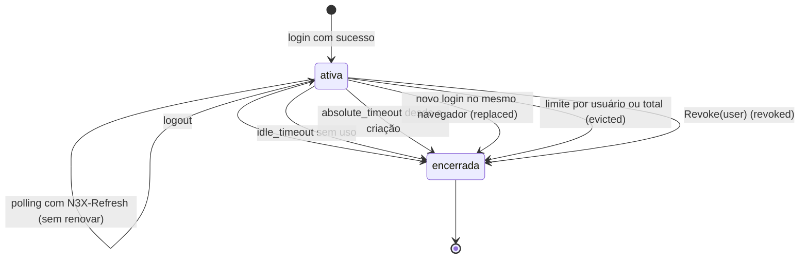
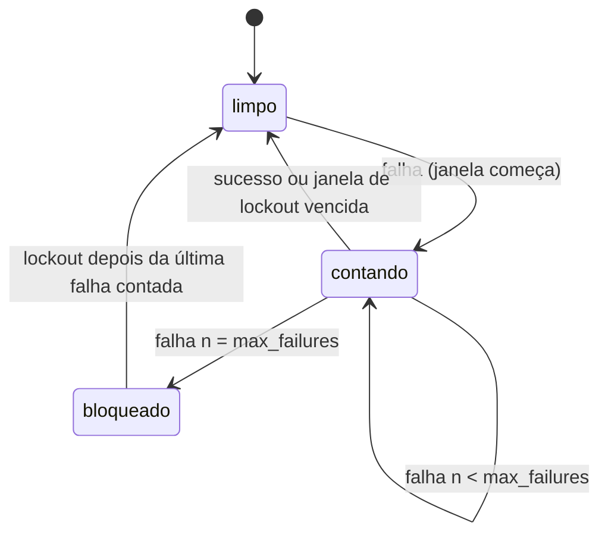

### FDD: Sessão do painel, root e login (CTL-05)

Versão: 1.0
Data: 2026-10-21
Responsável: Guilherme Giusti

---

### 1. Contexto e motivação técnica

**Problema técnico.** O painel em `17444` é a única interface humana do N3X e precisa de autenticação forte sem banco: o host não persiste nada (ADR-002 do `n3x-controller`) e a sessão vive só em memória (ADR-006). As FDDs anteriores fecharam as peças em volta: o `n3x.yaml` com `root`, `panel.session` e `panel.login` (FDD 30), o diretório de usuários de leitura com `CheckUser` (FDD 40), a contenção dessa chamada e o estado do core (FDD 32), a regra "só o root entra" (FDD 09, contrato 16), o envio de formulários com `_csrf`, o aviso de uso único e o polling com `N3X-Refresh` (FDD 11). Falta o comportamento verificável de quem junta tudo isso:

- em que ordem o login confere bloqueio, root, estado do core e diretório, e o que cada retorno do `CheckUser` significa para a tela e para o contador de bloqueio (P-01 da FDD 40)
- qual é a chave do bloqueio, de onde vem o IP quando há proxy reverso na frente da `17444` (L-37) e como evitar que um terceiro bloqueie o root
- como o bcrypt do root não fica preso atrás da fila dos sidecars nem das 2 vagas do diretório numa rajada (P-02 da FDD 31)
- como é a sessão em memória (ID, cookie, expiração ociosa e absoluta, limites, troca do ID no login, revogação) e como o painel lê a identidade e o papel
- como o token CSRF nasce, chega ao formulário, é conferido em tempo constante e resiste a vazamento por compressão (pedidos da FDD 11)
- como o polling não mantém a sessão viva e o que ele recebe quando a sessão expira (FDD 11)
- como o host guarda o aviso de uso único (`ui.Flash`) na sessão (FDD 11, P-08 da FDD 12)
- como o `ctrl.SessionRevoker` que o host entrega ao core é implementado (FDD 32), mesmo sem uso na v1
- quais avisos o operador recebe sobre senha padrão ou fraca do root e sobre prazo curto para o `CheckUser` (P-04 da FDD 40)

**Encaixe no HLD.** Esta FDD especifica o componente "Sessão do painel (`host/session`)" do HLD do `n3x-controller` ("Componentes e responsabilidades"), o "Fluxo de requisição: login no painel", as partes de sessão e CSRF do "Fluxo de requisição: painel", os itens "Sessão do painel", "Contador de bloqueio" e "Evento de acesso ao painel" do "Modelo de dados", e as linhas de cookie, CSRF, mensagem genérica, bloqueio e LGPD de "Segurança". O pacote é `host/internal/session`, seguindo a regra da FDD 30 de manter só `host` como API estável (H-03 dela; I-01). A montagem segue a ordem 31, 34, 32, 33, 35 do contrato 11 da FDD 30, em duas fases: o repositório de sessões nasce antes do host de plugins (que o entrega ao core como `SessionRevoker`) e o login nasce depois do `Start`, quando `CoreState` e `CheckUser` existem (I-02).

**Recorte com as FDDs vizinhas**
- FDD 30: dona do schema do `n3x.yaml` e da montagem; aqui só se lê `File.Root`, `File.Panel.Session`, `File.Panel.Login`, `File.Runtime.PluginCallTimeout` e o campo novo `panel.trusted_proxies` (pedido, P-01)
- FDD 31: verificador de credencial de serviço; esta FDD não usa a fila dele, só divide a família de métrica `n3x_controller_login_blocked_total` com `kind="panel"`
- FDD 32: `Host.CoreState()` e `Host.CheckUser(...)` com contenção (prazo, `recover`, conferência da identidade); esta FDD entrega o `ctrl.SessionRevoker` ao `plugins.New`
- FDD 35: roteador Echo v5, layout, menu, cabeçalhos de segurança, CSP, papel por rota, envio de `Form` e `Action` (ordem das checagens da FDD 11), renderização e axe; ela monta as rotas desta FDD, chama o middleware `Require` e usa a `View` da sessão
- FDD 39: sessão HMAC dos sidecars (token do core); nada aqui
- FDD 40: diretório de usuários; esta FDD só chama `CheckUser` pelo host de plugins

**Atores.** Root (entra sempre, conferido contra o bcrypt do `n3x.yaml`), usuário de leitura (entra pelo diretório do core, só com o core em `ok`), navegador (cookie e formulários, com ou sem htmx), host de plugins (FDD 32, estado do core e `CheckUser`), painel (FDD 35, consome a sessão e o papel), plugin core (recebe o revogador, sem uso na v1), proxy reverso opcional na frente da `17444`, operador de observabilidade (lê logs e métricas) e atacante na rede (força bruta, CSRF, fixação de sessão, redirecionamento aberto, DoS de CPU).

**Limites.**
- Não abre porta, não tem roteador e não escreve cabeçalho de segurança nem CSP (FDD 35); entrega `http.Handler` e middleware `net/http` que a FDD 35 monta no Echo
- Não lê arquivo nem variável de ambiente; recebe a config pronta em `boot.Deps` (FDD 30)
- Não guarda nada em disco e não cria goroutine própria: varredura preguiçosa no caminho das requisições e no scrape (H-24)
- Não decide papel por rota (FDD 35) e não entrega IP nem ID de sessão a plugin (FDD 08)
- Não é auditoria: login, logout e bloqueio vão só para o log JSON operacional (FR-010 adiado, ADR-002 do `n3x-plugin-core`)

**Suposições**
- Go 1.26 ou superior, sem cgo; `golang.org/x/crypto/bcrypt` e `prometheus/client_golang` nas versões do `go.mod` do `host/`
- A config já passou pelas regras da FDD 30: `root.user` com `^[A-Za-z0-9][A-Za-z0-9._@-]{0,63}$`, `root.password_hash` bcrypt `$2a$`, `$2b$` ou `$2y$` de custo 12 a 16 (L-39), faixas de `panel.session` e `panel.login`, `absolute_timeout >= idle_timeout`
- O painel serve TLS 1.3 próprio em `listen.panel` (FDD 35 com `Config.TLSConfig()`); o cookie é sempre `Secure`
- Navegadores com `SameSite=Strict` (Chrome 80, Firefox 69, Safari 13 ou mais novos) (hipótese de versão mínima)
- htmx 2.0.x faz só `GET` na v1: polling, paginação, ordenação e abas; `Form` e `Action` enviam `POST` comum, sem htmx (FDD 11)
- Controller em instância única por ambiente (ADR-001 do `n3x-sdk`); sessão em memória não se divide entre réplicas (ADR-006)

**Restrições**
- Root sempre do `n3x.yaml`, nunca do core; a senha do root nunca chega ao core (FR-009, ADR-003 do `n3x-controller`, contrato 7 da FDD 40)
- Sessão só em memória, ID aleatório de 32 bytes, cookie `n3x_session` com `HttpOnly`, `Secure` e `SameSite=Strict`, 30 min ociosa ou 12 h no total (ADR-006); restart desloga todos (risco aceito)
- Bloqueio de `panel.login.max_failures` (5) tentativas por `panel.login.lockout` (15 min) por usuário e IP (FR-009)
- CSRF em todo método que não é `GET` (HLD do `n3x-controller`); comparação em tempo constante (FDD 11)
- Core fora de `ok`: só o root entra; mensagem genérica aos demais e log `auth_core_unavailable` (FDD 09, contrato 16; FDD 32, contrato 5)
- `ChangePassword` devolve `ErrUnsupported` na v1 e o host não o chama; `Sessions().Revoke` sem uso na v1, mas implementado (ADR-019 do `n3x-sdk`, ADR-003 do `n3x-plugin-core`)
- Nunca entram em log, métrica, erro ou HTML: senha, hash, ID de sessão, cookie, token CSRF, corpo da requisição; IP e usuário só no log operacional (LGPD, HLD)
- Documentação e mensagens em pt-BR; identificadores, rótulos e nomes de evento em inglês

**Rastreabilidade**
- PRD 1.5: FR-009 (root no arquivo, leitura pelo core, mensagem genérica, 5 tentativas por 15 min por usuário e IP, sessão em memória com expiração por inatividade, restart exige login, core falho ou degradado: só o root), FR-008 (sem sessão vai ao login, sessão expirada volta à mesma página, 403 com mensagem clara), FR-010 (paliativo no log JSON); requisitos não funcionais de segurança (cookie `HttpOnly`, `Secure`, `SameSite=Strict`, CSRF em toda ação) e compliance (IP e usuário como dado pessoal); critérios de aceite "5 logins inválidos seguidos bloqueiam por 15 minutos" e testes de sessão, CSRF, bloqueio e permissões
- HLD do `n3x-controller`: "Componentes e responsabilidades" (`host/session`), "Fluxo de requisição: login no painel", "Fluxo de requisição: painel", "Modelo de dados", "Interfaces públicas" (mapa `/login` e `/logout`), "Segurança", "Observabilidade" e "Riscos" (core concentra login; restart desloga todos)
- ADRs do `n3x-controller`: ADR-002, ADR-003 (parte que segue valendo), ADR-006; do `n3x-sdk`: ADR-009 (sem tracing), ADR-019 (`CheckUser`, `ChangePassword`, `Revoke`), ADR-020 (segredos fora de logs); do `n3x-plugin-core`: ADR-002, ADR-003 e ADR-009
- FDDs aplicadas: 03 (`plugin.Secret`), 06 (`telemetry`, `request_id`), 08 (`Identity`, papéis, `ContextWithCaller`), 09 (contratos 12, 14, 16 e 17), 10 e 11 (`ui.Request.CSRFToken`, `_csrf`, `_return`, `ui.Flash`, `FlashTTL`, `MaxFlashBytes`, `N3X-Refresh`, `HX-Redirect`), 12 (`hostrules.FlashAllowed`, `PanelLogin` do kit, P-08), 30 (`File.Root`, `File.Panel`, faixas, `boot.Deps`, ordem de montagem, L-39), 31 (família `login_blocked_total`, regra de IP zero e IP mapeado, P-02), 32 (`CoreState`, `CheckUser`, `SessionRevoker`, harness), 40 (comparação exata com `root.user`, retornos do `CheckUser`, P-01 e P-04)
- Lacunas do README:
  - **L-37 fechada aqui:** o IP do bloqueio é o do par TCP da conexão com a `17444`; `X-Forwarded-For` só vale vindo de par listado no campo novo `panel.trusted_proxies` (mesma gramática de `grpc.trusted_proxies`, vazio por padrão), lido da direita para a esquerda até o primeiro endereço fora da lista; IPv4 mapeado vira IPv4; sem IP, balde `unknown` (contrato 8) (hipótese, H-03)
  - **L-02 aplicada:** a regra "só o root entra" lê `Host.CoreState()` (FDD 32), que é o `StateCell` do core (FDD 09, contrato 16)
  - **L-39 aplicada:** o root aceita `$2a$`, `$2b$` e `$2y$` com `bcrypt.CompareHashAndPassword`
- Pontos em aberto de FDDs anteriores fechados aqui: P-02 da FDD 31 (limitador próprio de 1 vaga para o root), P-01 da FDD 40 (`ErrVerifierBusy` e `ctx.Err()` não contam no bloqueio), P-04 da FDD 40 (aviso `panel_login_timeout_short` abaixo de 5 s, sem prazo próprio), P-03 da FDD 30 (campo `panel.trusted_proxies`), P-08 da FDD 12 (bloqueio e guarda do aviso reais aqui; o kit continua sem simular o bloqueio), hipótese do contrato 16 da FDD 09 (sessões abertas seguem até expirar)
- Pedidos atendidos:
  - FDD 08: identidade `{RoleRoot ou RoleRead, User}` pronta para o `ContextWithCaller` da FDD 35; sem IP nem ID de sessão para plugin (contrato 5)
  - FDD 09: login com bloqueio, root pelo arquivo, estado do core e `CheckUser` com `plugin.NewSecret`; `Revoke` implementado (contratos 2 e 7)
  - FDD 11: CSRF em tempo constante; guarda do aviso; `N3X-Refresh` não renova a inatividade; `HX-Redirect` no polling expirado; token mascarado por renderização contra BREACH (contratos 5 e 6)
  - FDD 12: sessão, bloqueio e guarda do aviso reais (P-08); `PanelLogin` no harness do host real (contrato 11)
  - FDD 30: lê `File.Root` e `File.Panel`; `panel.trusted_proxies` com a mesma gramática (P-03, L-37)
  - FDD 31: limitador de bcrypt próprio com 1 vaga (P-02); família compartilhada com `kind="panel"`; mesma regra de IP zero e IP mapeado
  - FDD 32: regra "só o root" sobre `CoreState()`; login de leitura por `Host.CheckUser`; `SessionRevoker`; log `auth_core_unavailable`; sessão, CSRF e aviso no harness
  - FDD 40: comparação exata com `root.user`; `ErrVerifierBusy` e `ctx.Err()` como falha genérica sem contar (P-01); aviso de prazo curto (P-04)

---

### 2. Objetivos técnicos

- **Força bruta limitada por usuário e IP.** Invariante: no máximo `max_failures` (5) conferências com bcrypt ou `CheckUser` que falham por credencial inválida, para o mesmo par (usuário, IP), dentro de cada janela de `lockout` (15 min), mesmo com tentativas em paralelo. Medida: 20 POSTs simultâneos com senha errada para o mesmo par executam no máximo 5 comparações (espião do `Compare` e do `CheckUser`); a sexta tentativa e as seguintes recebem 429 sem nenhuma comparação até `lockout` depois da quinta falha; com relógio falso, em `lockout + 1 s` a tentativa volta a ser conferida.
- **Resposta indistinguível para quem tenta adivinhar.** Invariante: usuário inexistente, senha errada, usuário desativado, diretório ocupado, prazo estourado, defeito do core e core fora de `ok` (para quem não é o root) dão a mesma resposta: status 200, o mesmo texto "Usuário ou senha inválidos." e o mesmo HTML a menos do token do formulário. Medida: teste de igualdade byte a byte depois de trocar o valor de `_csrf` por um marcador.
- **Root entra mesmo com o core fora do ar e durante uma rajada.** Medida: com o core em `degraded` ou `failed`, o root recebe 303 e uma sessão `root`; com o diretório saturado (2 em bcrypt e 16 na fila) e a fila do verificador de serviço cheia, um login do root termina em até o tempo de um bcrypt mais 100 ms (limitador próprio de 1 vaga, H-06).
- **Sessão com expiração exata.** Medida (relógio falso): sessão sem uso por `idle_timeout` mais 1 s é recusada; com uso a cada minuto, é recusada em `absolute_timeout` mais 1 s; uso registrado com granularidade de 1 s; requisições com `N3X-Refresh: 1` não renovam a inatividade (polling por 40 min sem outro uso expira em 30 min).
- **Sessão nova a cada login.** Invariante: o ID do cookie depois do login nunca é o de antes; qualquer sessão apresentada no POST de login é encerrada (`replaced`). Medida: teste de fixação com cookie plantado.
- **CSRF em toda ação.** Invariante: todo `POST` do host (login, logout) e de plugin (ações, conferidas pela FDD 35 com `View.CheckCSRF`) exige token válido; comparação em tempo constante e 0 alocações. Medida: 100% dos POSTs sem token, com token de outra sessão ou com token alterado em 1 bit recebem 403; `testing.AllocsPerRun` de `CheckCSRF` igual a 0.
- **Sem redirecionamento aberto.** Invariante: o destino depois do login é sempre um caminho interno do painel. Medida: os 24 vetores do contrato 4 (esquema, `//`, `\`, controle, `%2F%2F`, `/login`, mais de 2048 bytes e outros) viram `/`; fuzzing de `SafeNext` por 5 min sem destino que comece com `//`, contenha esquema ou não comece com `/`.
- **Memória limitada.** Medida: no máximo 1.024 sessões e 16 por usuário (H-08); tabela de bloqueio com no máximo 16.384 chaves; pior caso abaixo de 4 MiB somando as duas (teste de inundação com contagem de bytes estimada).
- **Custo baixo no caminho de cada página.** Medida: `Require` com sessão válida em p99 abaixo de 20 µs e no máximo 2 alocações; `CheckCSRF` e `FromContext` com 0 alocações (hipótese das metas, H-19).
- **Nenhum segredo fora do lugar.** Medida: varredura com canário (`sdktest.Canary()`) como senha de root e de leitura, e com os valores de ID de sessão e token CSRF emitidos: 0 ocorrências em logs, métricas, erros e HTML (o token só aparece no próprio formulário mascarado, que é o esperado).

---

### 3. Escopo e exclusões

**Incluído**
- Repositório de sessões em memória (`session.Store`): criação, busca pelo cookie, expiração ociosa e absoluta, limites por usuário e total, varredura preguiçosa, revogação (`ctrl.SessionRevoker`) e gauge `n3x_controller_panel_sessions`
- Login (`session.Login`): página `GET /login`, envio `POST /login`, `POST /logout`, conferência do root com limitador próprio, regra "só o root entra", chamada a `Host.CheckUser`, mapeamento dos retornos, troca do ID, retorno à página de origem com `SafeNext`
- Bloqueio por tentativas: contador por par (usuário, IP) e por IP, janela, desbloqueio, reserva das tentativas em voo, teto de entradas
- Resolução do IP do cliente com `panel.trusted_proxies` (L-37) e normalização (IPv4 mapeado, IP zero)
- Cookie `n3x_session` e cookie `n3x_login` (token CSRF do formulário de login, sem estado no servidor)
- Token CSRF por sessão, entrega mascarada por renderização, conferência em tempo constante; conferência de `Origin` e `Sec-Fetch-Site` nos POSTs do host e função para a FDD 35
- Middleware `Require`: sem sessão, 303 para o login com a página de origem; polling com `HX-Redirect`; POST com o `_return`; marcação do uso sem contar o polling
- `View` da sessão para o painel: identidade e papel, token, conferência de token, aviso de uso único (`SetFlash`, `TakeFlash`) e avisos da sessão (senha fraca do root)
- Avisos operacionais: senha padrão ou fraca do root, prazo curto para o `CheckUser`, proxy suspeito
- Log operacional de login, logout, bloqueio e fim de sessão; métricas do painel de login e de sessão
- Peças de sessão, CSRF, aviso e login no harness do host real (`pluginstest`, FDD 32)

**Excluído**
- Diretório de usuários e as regras da seção `users`: FDD 40 (CORE-04)
- Roteador, layout, menu, cabeçalhos de segurança, CSP, compressão, papel mínimo por rota, ordem do envio de `Form` e `Action`, páginas de erro e axe: FDD 35 (CTL-06)
- Lista de usuários (tela do core): FDD 45 (CORE-09)
- Auditoria formal, gestão de usuários pelo painel e troca da própria senha (não há rota de troca na v1): fora da v1 (ADR-002 e ADR-003 do `n3x-plugin-core`)
- Bloqueio do login de sidecar e fila de bcrypt de serviço: FDD 31 (CTL-02)
- Sessão HMAC do sidecar (token do core): FDD 39 (CORE-03)
- Schema do `n3x.yaml` (o campo novo `panel.trusted_proxies` é pedido à FDD 30)
- Sessão compartilhada entre réplicas, cookie assinado, "lembrar de mim", MFA e SSO: fora da v1 (ADR-006)

---

### 4. Fluxos detalhados e diagramas

**Fluxo principal: montagem (FDD 30, contrato 11)**
1. Depois do verificador (FDD 31), `host.Run` chama `session.New(deps)`: lê `File.Root`, `File.Panel.Session`, `File.Panel.Login` e `Config.PanelTrustedProxies`, gera a chave do processo de 32 bytes (`crypto/rand`, CSRF do login), registra as métricas em `deps.Registry` e usa a família `login_blocked_total` do `boot`. Erro (aleatório ou registro de métrica) vira saída 8.
2. `plugins.New(deps, cred, store)` recebe o `*session.Store` como `ctrl.SessionRevoker` do core (substitui o `plugins.NoSessions` da FDD 32).
3. Depois de `ph.Start(ctx)` sem erro, `host.Run` chama `session.NewLogin(store, ph, session.LoginOptions{CallTimeout: File.Runtime.PluginCallTimeout})`. Com `plugin_call_timeout` menor que 5 s, loga `panel_login_timeout_short` (P-04 da FDD 40).
4. `panel.New(deps, ph, store, login)` (FDD 35) monta `/login` e `/logout` com `login.ServeLogin` e `login.ServeLogout`, fora do `Require`, e envolve as demais rotas (menos `/assets/...`) com `store.Require`.
5. Log `panel_session_store_ready` com os prazos, os limites e a quantidade de proxies confiáveis.

**Fluxo principal: `GET /login`**
1. Com uma sessão válida no cookie: 303 para `SafeNext(next)` (padrão `/`).
2. Sem sessão: gera o cookie `n3x_login` (32 bytes aleatórios, se ainda não houver um válido) e o campo `_csrf` = HMAC-SHA256(chave do processo, rótulo e cookie); renderiza a página de login com `user`, `password`, `next` (já passado por `SafeNext`) e `_csrf`.
3. Com o core fora de `ok`, a página mostra o aviso fixo "O painel está em modo de emergência: só o root pode entrar agora." para qualquer visitante (H-12, I-04).
4. Com `?logout=1`, a página mostra "Você saiu do painel." (`role="status"`).
5. Resposta 200, `Content-Type: text/html; charset=utf-8`, `Cache-Control: no-store`.

**Fluxo principal: `POST /login`**
1. **Forma da requisição:** método `POST`; `Content-Type` `application/x-www-form-urlencoded` (senão 415); corpo até 8 KiB (senão 413); um único valor por campo (senão tratado como formulário inválido, 400).
2. **Origem:** com `Origin` presente e diferente de `https://<Host da requisição>`, ou com `Sec-Fetch-Site` presente e diferente de `same-origin` e `none`: 403 e `panel_login_refused` com `reason=origin` (H-10).
3. **CSRF do login:** cookie `n3x_login` presente e `_csrf` igual ao HMAC dele (`hmac.Equal`): senão 403 com a página de login, um token novo e "O formulário expirou. Tente de novo."; `panel_login_refused` com `reason=csrf`. Não conta no bloqueio.
4. **Entrada:** `user` de 1 a 64 bytes UTF-8 válido sem caractere de controle e `password` de 1 a 72 bytes; fora disso, a tentativa é falha de credencial sem bcrypt (conta no bloqueio, resposta genérica).
5. **IP:** `clientIP(r)` pela regra do contrato 8.
6. **Bloqueio:** consulta e reserva no rastreador (contrato 3): par (`user`, IP) bloqueado, ou com `falhas + em voo >= max_failures`; ou, para nome diferente do root, IP bloqueado: 429 com `Retry-After`, `n3x_controller_login_blocked_total{kind="panel"}`, `panel_login_blocked` (no máximo 1 por minuto por chave) e nenhum bcrypt.
7. **Root:** `user == File.Root.User` (igualdade exata de bytes, contrato 7 da FDD 40): limitador do root (1 vaga, até 4 na fila, até 3 s de espera, H-06); `bcrypt.CompareHashAndPassword(root.password_hash, senha)`. Sem vaga no prazo: resultado `busy`, resposta genérica, não conta.
8. **Outro usuário, core fora de `ok`:** `ph.CoreState().State != ctrl.StateOK`: resultado `core_unavailable`, resposta genérica, `auth_core_unavailable` (no máximo 1 por minuto, com a contagem do período), não conta, sem bcrypt.
9. **Outro usuário, core em `ok`:** `ph.CheckUser(r.Context(), user, plugin.NewSecret(senha))`; o host de plugins aplica `runtime.plugin_call_timeout`, `recover` e a conferência da identidade (FDD 32, contrato 5). Mapeamento na tabela abaixo.
10. **Falha que conta:** registra a falha no par e no IP (o IP só para nome diferente do root); na quinta falha do par, o par fica bloqueado por `lockout` e sai `panel_login_blocked` com `scope=pair`; resposta genérica.
11. **Sucesso:** apaga a contagem do par (a do IP fica); encerra a sessão apresentada no cookie, se houver (`replaced`); cria a sessão nova (contrato 2) com `RoleRoot` ou `RoleRead`; confere a senha do root contra a regra de senha fraca (H-16); grava o cookie `n3x_session`, apaga o `n3x_login`; `panel_login` com `result=ok`; 303 para `SafeNext(next)`.

| Retorno | Resultado (`result`) | Conta no bloqueio | Resposta | Log |
| --- | --- | --- | --- | --- |
| Root com senha certa ou `Identity{RoleRead, user}` | `ok` | não (apaga o par) | 303 para `next` | `panel_login` info |
| Senha do root errada, entrada inválida ou `ctrl.ErrInvalidCredentials` | `fail` | sim | 200 genérica | `panel_login` warn, `reason` `password` ou `input` |
| Par ou IP bloqueado | `blocked` | não | 429 com `Retry-After` | `panel_login_blocked` |
| Limitador do root sem vaga ou `ctrl.ErrVerifierBusy` | `busy` | não | 200 genérica | `panel_login` warn, `reason=busy` |
| Core fora de `ok` (não root) ou `plugins.ErrPluginUnavailable` | `core_unavailable` | não | 200 genérica | `auth_core_unavailable` e `panel_login` |
| `context.DeadlineExceeded` ou `context.Canceled` | `timeout` | não | 200 genérica | `panel_login` warn, `reason=timeout` |
| `plugins.ErrMisbehavior`, `plugins.ErrPluginPanic` ou outro erro | `error` | não | 200 genérica | `panel_login` warn, `reason` `misbehavior`, `panic` ou `error` (o host de plugins já loga o detalhe) |

**Fluxo principal: requisição ao painel com sessão (`Require`)**
1. Lê o cookie `n3x_session`; valor fora do formato (43 caracteres base64url) vale como ausente.
2. Busca pelo SHA-256 do ID decodificado; ausente, revogada ou expirada (`agora >= criada + absolute_timeout` ou `agora >= último uso + idle_timeout`): trata como sem sessão; expirada sai do mapa com `panel_session_ended` (`idle` ou `absolute`).
3. Sem `N3X-Refresh: 1`, registra o uso (último acesso com granularidade de 1 s, por operação atômica). Com o cabeçalho, não registra (pedido da FDD 11).
4. Põe a `*View` no `ctx` (`session.FromContext`) e chama o próximo handler. A FDD 35 aplica o papel da rota, faz `ctrl.ContextWithCaller(ctx, view.Identity())` e passa `view.CSRFToken()` ao `ui.Request`.

**Fluxo alternativo: sem sessão ou sessão expirada**
- `GET` ou `HEAD` sem `HX-Request`: 303 `Location: /login?next=<path e query escapados>`; `Cache-Control: no-store`
- Requisição htmx (`HX-Request: true`, inclusive o polling com `N3X-Refresh`): 200 com corpo vazio e `HX-Redirect: /login?next=<path e query de HX-Current-URL>`; sem `HX-Current-URL` válido, usa o path da própria requisição (H-21)
- `POST` (envio de `Form` ou `Action`): lê até 64 KiB do corpo urlencoded e usa o `_return` como `next` (passado por `SafeNext`); sem ele, `/`; 303 para o login; o envio não é repetido depois do login (FDD 11)
- Outros métodos: 303 para `/login?next=/`

**Fluxo principal: `POST /logout`**
1. Forma e origem como no login (passos 1 e 2).
2. Sem sessão válida: 303 para `/login` (idempotente).
3. Com sessão: `_csrf` conferido por `View.CheckCSRF`; inválido: 403 com a página genérica da FDD 35 ("O formulário expirou. Volte à página e tente de novo."), `panel_login_refused` com `kind=logout` e `reason=csrf`.
4. Encerra a sessão (`logout`), apaga o cookie (`Max-Age=0`), `panel_logout` com usuário e IP, 303 para `/login?logout=1`.
5. `GET /logout`: 405 com `Allow: POST` (o botão "Sair" do layout é um formulário POST com `_csrf`, FDD 35).

**Fluxo alternativo: aviso de uso único (FDD 11, contrato 6)**
- Depois de `sub.Finish(reply)`, a FDD 35 chama `view.SetFlash(f)`: um aviso por sessão, o mais novo vence; acima de `ui.MaxFlashBytes` (16 KiB) pelo `f.Bytes()`, o aviso é recusado em silêncio com `panel_flash_dropped` (o `Finish` já corta os valores antes)
- Na renderização, a FDD 35 chama `view.TakeFlash(modo, hxRequest, refresh, path)`: devolve o aviso só se `hostrules.FlashAllowed` aceitar e se ele tiver menos de `ui.FlashTTL` (60 s); entregue, sai da sessão; vencido, sai sem ser entregue

**Fluxo alternativo: revogação**
- `store.Revoke(user)` (pelo core, `env.Sessions().Revoke`, sem uso na v1): encerra todas as sessões com `User` exatamente igual, devolve quantas, loga `panel_sessions_revoked` com a contagem; a próxima requisição dessas sessões vai ao login

**Fluxos alternativos e exceções**
- **Core muda para `degraded` ou `failed` com sessões de leitura abertas:** as sessões seguem até expirar; o banner da FDD 35 avisa; o login de novos usuários de leitura é recusado (H-13, confirma a hipótese do contrato 16 da FDD 09)
- **Plugin core `failed` em runtime:** `Host.CheckUser` devolve `ErrPluginUnavailable` mesmo se o `CoreState` lido antes ainda dizia `ok` (corrida): mesmo resultado `core_unavailable`
- **Limite de sessões do usuário (16):** a 17ª encerra a sessão mais antiga dele (`evicted`)
- **Limite total (1.024):** a sessão nova encerra a de acesso mais antigo, de qualquer usuário (`evicted`); `panel_session_ended` sai para ela
- **Tabela de bloqueio cheia (16.384 chaves):** sai a entrada não bloqueada mais antiga; se todas estão bloqueadas, a falha nova não é rastreada e sai `panel_login_tracker_full` (no máximo 1 por minuto); as tentativas continuam limitadas pelo bcrypt (H-08)
- **`X-Forwarded-For` vindo de par não confiável:** ignorado; `caller_ip_proxy_suspected` com `component=panel` (no máximo 1 por minuto)
- **Restart do controller:** o repositório nasce vazio; todo cookie antigo vira "sem sessão" e o operador volta ao login com a página de origem (ADR-006, risco aceito)
- **Chave do processo nova no restart:** formulários de login abertos antes do restart recebem 403 "O formulário expirou" uma vez e funcionam com o token novo
- **Login com sessão válida já aberta:** a antiga é encerrada (`replaced`) e a nova é criada; o `next` é seguido
- **Senha do root fraca ou padrão:** login aceito; aviso na sessão e `root_password_weak` (no máximo 1 por hora) (H-16)
- **Relógio:** prazos pelo tempo monotônico de `deps.Clock` (`time.Now` com leitura monotônica); ajuste do relógio de parede não expira nem estende sessão

**Diagramas**

Sequência do `POST /login`:

```mermaid
sequenceDiagram
    participant B as navegador
    participant L as session.Login
    participant T as rastreador de bloqueio
    participant R as limitador do root
    participant P as host de plugins (FDD 32)
    participant S as session.Store
    B->>L: POST /login (user, password, next, _csrf)
    L->>L: forma, Origin, _csrf do login, entrada
    L->>T: reserva (user, IP) e IP
    alt bloqueado
        T-->>L: bloqueado até t
        L-->>B: 429 Retry-After
    else user == root.user
        L->>R: vaga (1, fila 4, 3 s)
        R-->>L: bcrypt(root.password_hash)
    else core fora de ok
        L->>P: CoreState()
        P-->>L: degraded ou failed
        L-->>B: 200 genérica (auth_core_unavailable)
    else core ok
        L->>P: CheckUser(ctx, user, Secret)
        P-->>L: Identity ou erro
    end
    L->>T: confirma falha ou sucesso
    alt sucesso
        L->>S: encerra a sessão apresentada; cria a nova
        L-->>B: 303 next, Set-Cookie n3x_session
    else falha
        L-->>B: 200 genérica
    end
```

Estados de uma sessão:



Contador do par (usuário, IP):



---

### 5. Contratos públicos (assinaturas, endpoints, headers, exemplos)

Os contratos 1, 2, 3, 5, 7 e 11 são internos ao módulo `github.com/giustech/n3x-controller/host` (pacote `host/internal/session`, H-01): estáveis para as FDDs 30, 32 e 35, sem garantia de semver para fora. O contrato 2 implementa uma interface pública do SDK (`ctrl.SessionRevoker`, FDD 09). Os contratos 4 (HTTP), 6 (cookies e CSRF), 8 (config e IP), 9 (log) e 10 (métricas) são públicos para o navegador, o operador e quem lê logs e métricas.

**Contrato 1: construção do repositório de sessões**
- Tipo: sdk (API Go interna)
- Assinatura/Rota:
  ```go
  package session // github.com/giustech/n3x-controller/host/internal/session

  const (
      CookieName         = "n3x_session"
      LoginCookieName    = "n3x_login"
      IDBytes            = 32               // ID de sessão; 43 caracteres base64url sem padding
      CSRFBytes          = 32               // token por sessão
      MaxSessions        = 1024             // teto total (H-08)
      MaxSessionsPerUser = 16               // teto por usuário (H-08)
      MaxTrackedLogins   = 16384            // chaves do rastreador de bloqueio (H-08)
      IPFailureFactor    = 4                // falhas por IP = 4 x max_failures (H-04)
      RootSlots          = 1                // vagas de bcrypt do root (H-06)
      RootQueue          = 4                // lugares de espera do root
      RootWait           = 3 * time.Second  // espera máxima por vaga do root
      MaxLoginBody       = 8 << 10          // corpo do POST /login e /logout
      MaxUserLen         = 64
      MaxPasswordLen     = 72               // limite do bcrypt
      MaxNextLen         = 2048
      LoginCookieTTL     = time.Hour
      SweepInterval      = time.Minute      // varredura preguiçosa
      TouchGranularity   = time.Second
      MinCallTimeout     = 5 * time.Second  // abaixo, aviso panel_login_timeout_short
  )

  // Store guarda as sessões do painel. Seguro para uso concorrente. Sem goroutine própria.
  type Store struct{ /* mapa por SHA-256 do ID, índice por usuário, rastreador, limitador do root */ }

  var _ ctrl.SessionRevoker = (*Store)(nil)

  // New monta o repositório a partir da config já validada (FDD 30).
  func New(deps boot.Deps) (*Store, error)

  // NewWithOptions é a mesma montagem com tudo injetável (testes, harness da FDD 32).
  func NewWithOptions(o Options) (*Store, error)

  type Options struct {
      Root           config.Root            // user e password_hash
      Session        config.PanelSession    // idle_timeout, absolute_timeout
      Login          config.PanelLogin      // max_failures, lockout
      TrustedProxies []netip.Prefix         // panel.trusted_proxies já conferido (pedido à FDD 30)
      Log            *slog.Logger           // nil = descarta; o New usa deps.Log.With("component", "panel")
      Registry       prometheus.Registerer  // nil = não registra
      Blocked        *prometheus.CounterVec // família login_blocked_total{kind}; nil = cria uma local
      Now            func() time.Time       // nil = time.Now
      Rand           io.Reader              // nil = crypto/rand.Reader
      Compare        func(hash, pw []byte) error // nil = bcrypt.CompareHashAndPassword
  }

  func (s *Store) Revoke(user string) int // ctrl.SessionRevoker; contrato 7
  func (s *Store) Len() int               // sessões vivas, depois da varredura devida
  ```
- Método: n/a (chamada local)
- Semântica:
  - `New(deps)` equivale a `NewWithOptions` com `Root` = `deps.Config.File.Root`, `Session` = `File.Panel.Session`, `Login` = `File.Panel.Login`, `TrustedProxies` = `Config.PanelTrustedProxies`, `Log` = `deps.Log.With("component", "panel")`, `Registry` = `deps.Registry`, `Blocked` = família compartilhada do `boot` (pedido da FDD 31 à FDD 30), `Now` = `deps.Clock`
  - Erros (saída 8 na FDD 30): `crypto/rand` falhou (`ErrRandom`); registro de métrica recusado (erro do `prometheus`); `Options` fora das faixas da FDD 30 (`ErrOptions`, só em `NewWithOptions`)
  - O repositório não confere gramática nem custo do hash do root (FDD 30); loga só o custo em `panel_session_store_ready` (`root_cost`), nunca o hash
  - A forma com erro substitui o `sess := session.New(deps)` sem erro do contrato 11 da FDD 30, que deixou os nomes como proposta (I-02)

**Exemplo de requisição**
```go
// host/internal/boot (FDD 30), ordem 31, 34, 32
cred, err := credential.New(deps)
store, err := session.New(deps)          // revogador entregue ao core
ph, err := plugins.New(deps, cred, store)
if err := ph.Start(ctx); err != nil { /* saída 5 */ }
login, err := session.NewLogin(store, ph, session.LoginOptions{CallTimeout: deps.Config.File.Runtime.PluginCallTimeout})
panelSrv, err := panel.New(deps, ph, store, login) // FDD 35
```

**Exemplo de resposta**
```json
{
  "store": "*session.Store",
  "log": "{\"ts\":\"2026-10-21T14:00:01Z\",\"level\":\"info\",\"component\":\"panel\",\"msg\":\"panel_session_store_ready\",\"idle_timeout\":\"30m0s\",\"absolute_timeout\":\"12h0m0s\",\"max_failures\":5,\"lockout\":\"15m0s\",\"trusted_proxies\":0,\"max_sessions\":1024,\"root_cost\":12}"
}
```

---

**Contrato 2: login (`session.Login`) e a porta para o host de plugins**
- Tipo: sdk (API Go interna)
- Assinatura/Rota:
  ```go
  package session

  // Backend é o que o login usa do host de plugins (FDD 32); *plugins.Host implementa.
  type Backend interface {
      CoreState() ctrl.StateInfo
      CheckUser(ctx context.Context, user string, password plugin.Secret) (ctrl.Identity, error)
  }

  type LoginOptions struct {
      CallTimeout time.Duration // runtime.plugin_call_timeout, só para o aviso (o prazo é do host de plugins)
  }

  type Login struct{ /* store, backend, chave do processo, amostradores de log */ }

  func NewLogin(s *Store, b Backend, o LoginOptions) (*Login, error)

  // Handlers HTTP montados pela FDD 35 (contrato 4).
  func (l *Login) ServeLogin(w http.ResponseWriter, r *http.Request)  // GET, HEAD e POST /login
  func (l *Login) ServeLogout(w http.ResponseWriter, r *http.Request) // POST /logout

  // Check é o núcleo do POST /login sem HTTP (harness da FDD 32 e testes).
  // Não cria sessão; Open cria a partir de um Outcome ok.
  func (l *Login) Check(ctx context.Context, a Attempt) Outcome
  func (l *Login) Open(o Outcome, replaced string) (cookieValue string, err error)

  type Attempt struct {
      User     string
      Password plugin.Secret
      IP       netip.Addr // zero = sem IP (balde unknown)
  }

  type Result uint8
  const (
      ResultOK Result = iota + 1
      ResultFail
      ResultBlocked
      ResultBusy
      ResultCoreUnavailable
      ResultTimeout
      ResultError
  )
  func (r Result) String() string // ok, fail, blocked, busy, core_unavailable, timeout, error

  type Outcome struct {
      Result     Result
      Identity   ctrl.Identity // só com ResultOK: {RoleRoot, user} ou {RoleRead, user}
      RetryAfter time.Duration // só com ResultBlocked
      Reason     string        // password, input, busy, timeout, misbehavior, panic, error (log)
      WeakRoot   bool          // senha do root fraca ou padrão (H-16)
  }

  var (
      ErrRandom  = errors.New("session: leitura de crypto/rand falhou")
      ErrOptions = errors.New("session: opções fora das faixas")
  )
  // Open nunca falha por falta de espaço: despeja pela regra dos limites (H-08).
  ```
- Método: n/a
- Semântica:
  - **Ordem das checagens** (contrato 7 da FDD 40, com o bloqueio antes de tudo): entrada, bloqueio (reserva), root ou não, estado do core, `CheckUser`; a reserva é confirmada como falha ou sucesso, ou liberada nos resultados que não contam
  - **Root:** `a.User == root.user` com igualdade exata de bytes; a senha do root nunca vai ao `Backend`; comparação pelo limitador próprio (H-06). Como a FDD 40 recusa usuário de leitura com o nome do root sem diferenciar maiúsculas, `Admin` com root `admin` cai no diretório e falha como usuário inexistente
  - **Não root:** com `CoreState().State != ctrl.StateOK`, `ResultCoreUnavailable` sem chamar `CheckUser`; senão `CheckUser` com o `ctx` recebido (o host de plugins aplica `plugin_call_timeout`)
  - **Mapeamento de erros:** tabela da seção 4 (`errors.Is` sobre `ctrl.ErrInvalidCredentials`, `ctrl.ErrVerifierBusy`, `plugins.ErrPluginUnavailable`, `plugins.ErrMisbehavior`, `plugins.ErrPluginPanic`, `context.DeadlineExceeded` e `context.Canceled`)
  - **`Check` não loga senha e não guarda a `Attempt`:** `Password` é `plugin.Secret` (FDD 03); o texto só sai por `Reveal()` dentro da comparação do root e da regra de senha fraca
  - **`NewLogin`:** loga `panel_login_timeout_short` (warn) quando `o.CallTimeout < MinCallTimeout`; o root não depende do prazo (P-04 da FDD 40, H-17). `Backend` nulo é erro de montagem
  - **`Open`:** cria a sessão (contrato 3), encerra `replaced` (valor do cookie apresentado, se válido) e devolve o valor do cookie; aplica os limites por usuário e total

**Exemplo de requisição**
```go
out := login.Check(ctx, session.Attempt{User: "ana", Password: plugin.NewSecret(senha), IP: netip.MustParseAddr("10.42.3.17")})
```

**Exemplo de resposta**
```json
{
  "core ok, senha certa": { "Result": "ok", "Identity": { "Role": "read", "User": "ana" } },
  "core degraded": { "Result": "core_unavailable" },
  "sexta tentativa errada": { "Result": "blocked", "RetryAfter": "14m52s" },
  "admin com a senha certa e core failed": { "Result": "ok", "Identity": { "Role": "root", "User": "admin" } },
  "diretório ocupado": { "Result": "busy", "Reason": "busy" }
}
```

---

**Contrato 3: sessão em memória e rastreador de bloqueio (modelo de dados)**
- Tipo: sdk (estruturas internas; comportamento observável pelos contratos 4 e 5)
- Assinatura/Rota:
  ```go
  // não exportado
  type sess struct {
      idHash    [32]byte     // SHA-256 do ID; o ID em si nunca é guardado
      user      string
      role      ctrl.Role    // RoleRoot ou RoleRead
      created   time.Time    // monotônico
      lastUse   atomic.Int64 // nanossegundos desde created, granularidade de 1 s
      csrf      [32]byte
      flash     ui.Flash     // um aviso, o mais novo vence
      flashAt   time.Time
      notices   []Notice     // avisos da sessão (senha fraca do root)
  }

  type entry struct { // chave: pair(user, ip) ou ip
      failures  int
      pending   int       // tentativas em voo reservadas
      first     time.Time // início da janela fixa
      blocked   time.Time // zero = não bloqueado
  }
  ```
- Método: n/a
- Semântica:
  - **ID:** 32 bytes de `crypto/rand`, em base64url sem padding (43 caracteres); o mapa usa o SHA-256 dos 32 bytes como chave, então um dump do mapa não dá cookies válidos e a busca não compara o ID byte a byte (H-07)
  - **Expiração:** recusada quando `agora >= created + absolute_timeout` ou `agora >= created + lastUse + idle_timeout`; o uso só avança para frente
  - **Limites:** 16 por usuário (despeja a mais antiga do usuário), 1.024 no total (despeja a de último uso mais antigo); cada sessão custa cerca de 400 bytes sem aviso, até 16 KiB com aviso (H-08)
  - **Rastreador, par (`user`, IP):** janela fixa de `lockout` a partir da primeira falha; `max_failures` falhas na janela bloqueiam por `lockout` contado da falha que bloqueou; tentativas durante o bloqueio não estendem; sucesso apaga o par; `failures + pending >= max_failures` recusa como bloqueado, o que impede passar do limite com tentativas em paralelo (H-04)
  - **Rastreador, IP:** conta falhas de nomes que não são o root; `IPFailureFactor * max_failures` (20 no padrão) falhas na janela bloqueiam o IP por `lockout` para nomes que não são o root; o root só obedece ao par, para um terceiro não negar o acesso do root a partir de outro IP nem varrendo nomes (H-04, P-05)
  - **Chave do IP:** IPv4 mapeado vira IPv4; IPv6 pelo endereço inteiro; IP zero vira o balde `unknown` (mesma regra da FDD 31, H-03); o `user` entra na chave exatamente como digitado (até 64 bytes)
  - **Teto e varredura:** até 16.384 chaves (cerca de 160 bytes cada, 2,6 MiB); varredura preguiçosa a cada `SweepInterval` no caminho de uma requisição ou do scrape, apagando sessões vencidas e entradas sem bloqueio com janela vencida
  - **Concorrência:** uma trava para os mapas e o rastreador; uso por operação atômica sem trava; nenhum bcrypt nem `CheckUser` roda com a trava

**Exemplo de requisição**
```text
5 POST /login com user=ana e senha errada a partir de 10.42.3.17 em 14:00:00..14:00:40
1 POST /login com user=ana e a senha certa a partir de 10.42.3.17 em 14:01:00
1 POST /login com user=ana e a senha certa a partir de 10.9.9.9 em 14:01:05
```

**Exemplo de resposta**
```json
{
  "pair(ana,10.42.3.17)": { "failures": 5, "first": "14:00:00", "blocked_until": "14:15:40" },
  "14:01:00": "429, Retry-After: 880",
  "14:01:05 (outro IP)": "303, sessão de leitura criada",
  "ip(10.42.3.17)": { "failures": 5, "blocked": false }
}
```

---

**Contrato 4: rotas HTTP `/login` e `/logout`**
- Tipo: endpoint (HTTPS em `listen.panel`, montado pela FDD 35)
- Assinatura/Rota: `GET /login`, `HEAD /login`, `POST /login`, `POST /logout`
- Método: GET, HEAD, POST
- Semântica de status/headers:
  - `GET /login?next=<destino>` 200: página de login; 303 com `Location: <SafeNext(next)>` quando já há sessão válida; `Set-Cookie: n3x_login=...` quando não há cookie de login válido
  - `POST /login` campos: `user` (1 a 64 bytes), `password` (1 a 72 bytes), `next` (opcional, até 2048 bytes), `_csrf` (token do login)
  - `POST /login` 303 `Location: <SafeNext(next)>`, `Set-Cookie: n3x_session=...`, `Set-Cookie: n3x_login=; Max-Age=0`: login aceito
  - `POST /login` 200: falha genérica ("Usuário ou senha inválidos."), mesmo HTML para todos os resultados da tabela que respondem 200 (H-11)
  - `POST /login` 429 com `Retry-After: <segundos até o desbloqueio, arredondado para cima>`: "Muitas tentativas. Tente de novo em alguns minutos."
  - `POST /login` 403: `Origin` ou `Sec-Fetch-Site` de outro site, ou `_csrf` ausente ou diferente ("O formulário expirou. Tente de novo.", com token novo)
  - `POST /login` 400 (campo repetido), 413 (corpo acima de 8 KiB), 415 (`Content-Type` diferente de urlencoded); `PUT`, `DELETE` e outros: 405 com `Allow: GET, HEAD, POST`
  - `POST /logout` 303 `Location: /login?logout=1` e `Set-Cookie: n3x_session=; Max-Age=0`; sem sessão: 303 `Location: /login`; `_csrf` inválido: 403; `GET /logout`: 405 com `Allow: POST`
  - Toda resposta: `Cache-Control: no-store`; cabeçalhos de segurança e CSP da FDD 35
  - **`SafeNext(raw) string`** (exportada para a FDD 35): devolve `raw` só se começa com `/`, não começa com `//` nem `/\`, não tem `\`, caractere de controle nem espaço, tem até 2048 bytes, decodifica com `url.Parse` sem esquema nem host, o path decodificado não começa com `//`, e o path não é `/login` nem `/logout`; o fragmento é retirado; qualquer outro caso devolve `/` (H-15)
  - **Página:** `lang="pt-BR"`, título "Entrar no N3X", `<form method="post" action="/login">` com `<label>` ligado a cada campo, `autocomplete="username"` e `autocomplete="current-password"`, `autofocus` no usuário (ou na mensagem de erro, com `role="alert"` e `tabindex="-1"`), aviso de emergência com `role="status"`, botão "Entrar"; sem script nem estilo inline; folha `/assets/<ui.StylesheetName()>` com as classes `n3x-*` do SDK (FDD 10); o campo `user` volta preenchido depois de uma falha, a senha nunca
- Limites: corpo até 8 KiB; `next` até 2048 bytes; sem limite de taxa global além do bloqueio e do limitador do root

**Exemplo de requisição**
```text
POST /login HTTP/1.1
Host: n3x.exemplo.com.br:17444
Content-Type: application/x-www-form-urlencoded
Origin: https://n3x.exemplo.com.br:17444
Sec-Fetch-Site: same-origin
Cookie: n3x_login=Zk3Jq9w2Qx7vT1mN5pR8sY4uZ6aB0cD2eF4gH6iJ8kL

user=ana&password=<senha>&next=%2Fplugins%2Fn3x%2Fcore%2Fsidecars%3Fservico%3Dpedidos&_csrf=pQ7rS9tU1vW3xY5zA7bC9dE1fG3hI5jK7lM9nO1pQ3r
```

**Exemplo de resposta**
```text
HTTP/1.1 303 See Other
Location: /plugins/n3x/core/sidecars?servico=pedidos
Cache-Control: no-store
Set-Cookie: n3x_session=q1W2e3R4t5Y6u7I8o9P0a1S2d3F4g5H6j7K8l9Z0x1C; Path=/; Secure; HttpOnly; SameSite=Strict
Set-Cookie: n3x_login=; Path=/login; Max-Age=0; Secure; HttpOnly; SameSite=Strict
```
```json
{
  "SafeNext(\"/plugins/n3x/core/sidecars?servico=pedidos#topo\")": "/plugins/n3x/core/sidecars?servico=pedidos",
  "SafeNext(\"https://mal.example/\")": "/",
  "SafeNext(\"//mal.example/\")": "/",
  "SafeNext(\"/\\\\mal.example\")": "/",
  "SafeNext(\"/%2F%2Fmal.example\")": "/",
  "SafeNext(\"/login?next=/x\")": "/",
  "POST /login com senha errada": "200, <p role=\"alert\">Usuário ou senha inválidos.</p>",
  "POST /login bloqueado": "429, Retry-After: 880"
}
```

---

**Contrato 5: middleware `Require` e a `View` da sessão (interface usada pelo painel)**
- Tipo: sdk (API Go interna, consumida pela FDD 35)
- Assinatura/Rota:
  ```go
  package session

  // Require carrega a sessão; sem sessão válida, redireciona ao login (seção 4).
  func (s *Store) Require(next http.Handler) http.Handler

  // FromContext devolve a sessão posta por Require. 0 alocações.
  func FromContext(ctx context.Context) (*View, bool)

  type View struct{ /* ponteiro para a sessão e o repositório */ }

  func (v *View) Identity() ctrl.Identity // {RoleRoot, user} ou {RoleRead, user}; nunca IP nem ID
  func (v *View) CSRFToken() string       // token mascarado novo a cada chamada (86 caracteres)
  func (v *View) CheckCSRF(token string) bool // tempo constante; aceita qualquer máscara do token; 0 alocações
  func (v *View) SetFlash(f ui.Flash)
  func (v *View) TakeFlash(mode ui.Mode, hxRequest, refresh bool, path string) (ui.Flash, bool)
  func (v *View) Notices() []Notice
  func (v *View) Expiry() time.Time // o menor entre o fim ocioso e o absoluto

  type Notice struct {
      Kind    string // "root_password_weak"
      Message string // "A senha do root é curta ou padrão. Gere outro hash com n3x-controller hash e reinicie o controller."
  }

  // CheckOrigin confere Origin e Sec-Fetch-Site de um POST (H-10); para a FDD 35 usar nas ações.
  func CheckOrigin(r *http.Request) bool

  // SafeNext e LoginURL montam o destino do login (contrato 4).
  func SafeNext(raw string) string
  func LoginURL(next string) string // "/login?next=" + escape de SafeNext(next)

  const RefreshHeader = ui.RefreshHeader // "N3X-Refresh"
  ```
- Método: n/a
- Semântica:
  - **Identidade e papel:** `Identity()` é `Valid()` pela FDD 08; a FDD 35 põe no `ctx` com `ctrl.ContextWithCaller`, usa `Role` para o papel da rota e `Request.Root` do renderizador; o ID de sessão nunca sai do pacote
  - **Uso:** `Require` registra o uso antes de chamar o próximo handler, salvo com `N3X-Refresh: 1`; exportação e cliques htmx contam como uso
  - **`CSRFToken`:** token `T` de 32 bytes; máscara `M` de 32 bytes aleatórios por chamada; saída `base64url(M || (M xor T))`, 86 caracteres, dentro do formato de `ui.Request.CSRFToken` (16 a 256 bytes ASCII imprimíveis); mascarar sempre evita depender da decisão de compressão da FDD 35 (BREACH, pedido da FDD 11) (H-09)
  - **`CheckCSRF`:** decodifica num vetor fixo, desfaz a máscara e compara com `subtle.ConstantTimeCompare`; formato errado devolve falso sem atalho de tempo pelo conteúdo; cada falso soma em `n3x_controller_panel_csrf_rejected_total{kind="action"}`
  - **Sem htmx fora de `GET`:** a v1 não tem `hx-post` (FDD 11); o token chega aos formulários só pelo campo `_csrf` que o renderizador gera de `Request.CSRFToken`; não há meta tag nem `hx-headers` com token. Se uma minor futura precisar de `hx-post`, o mesmo formato vai no cabeçalho `N3X-CSRF` (hipótese, reserva)
  - **Ordem no envio de ação (FDD 11, aplicada pela FDD 35):** sessão (`Require`), `Content-Type` e tamanho, `ReadSubmission`, `CheckOrigin`, `View.CheckCSRF(sub.CSRF())`, papel, handler
  - **`TakeFlash`:** entrega só se `hostrules.FlashAllowed(mode, hxRequest, refresh, path, f)` e o aviso tem menos de `ui.FlashTTL`; entregue ou vencido, sai da sessão
  - **`SetFlash`:** o mais novo vence; `f.Bytes() > ui.MaxFlashBytes` é descartado com `panel_flash_dropped`
  - **`Notices`:** cópia; o aviso de senha fraca vale para a sessão do root inteira (a FDD 35 mostra como banner do host)

**Exemplo de requisição**
```go
// FDD 35, handler de página (resumo)
v, _ := session.FromContext(r.Context())
ctx := ctrl.ContextWithCaller(r.Context(), v.Identity())
req := ui.Request{CSRFToken: v.CSRFToken(), Root: v.Identity().Role == ctrl.RoleRoot, Path: r.URL.Path}
if f, ok := v.TakeFlash(mode, r.Header.Get("HX-Request") == "true", r.Header.Get(session.RefreshHeader) == "1", r.URL.Path); ok {
    req.Flash = f
}
```

**Exemplo de resposta**
```json
{
  "Identity()": { "Role": "read", "User": "ana" },
  "CSRFToken()": "aZ3...(86 caracteres)",
  "CheckCSRF(token de outra sessão)": false,
  "CheckCSRF(outra máscara do mesmo token)": true,
  "polling sem sessão": "200, HX-Redirect: /login?next=%2Fplugins%2Fn3x%2Fexample%2Fnegacoes",
  "GET de página sem sessão": "303, Location: /login?next=%2Fplugins%2Fn3x%2Fexample%2Fnegacoes%3Fperiodo%3D24h"
}
```

---

**Contrato 6: cookies e tokens CSRF**
- Tipo: endpoint (atributos HTTP)
- Assinatura/Rota:
  - `n3x_session=<43 caracteres base64url>; Path=/; Secure; HttpOnly; SameSite=Strict`
  - `n3x_login=<43 caracteres base64url>; Path=/login; Max-Age=3600; Secure; HttpOnly; SameSite=Strict`
  - Campo `_csrf` do login: `base64url(HMAC-SHA256(chave do processo, "n3x-login-v1" || 0x00 || valor do cookie n3x_login))`, 43 caracteres
  - Campo `_csrf` das ações e do logout: `View.CSRFToken()`, 86 caracteres (contrato 5)
- Método: n/a
- Semântica de status/headers:
  - **`n3x_session`:** sem `Domain` (só o host do painel), sem `Expires` nem `Max-Age` (cookie de sessão do navegador; a expiração real é no servidor) (H-07, P-08); apagado com `Max-Age=0` no logout e quando o `Require` encontra um valor que não vale mais
  - **`n3x_login`:** só serve ao CSRF do formulário de login, sem estado no servidor (nenhuma memória por visitante anônimo); a chave do processo nasce na subida (H-10)
  - **Valor fora do formato:** cookie com tamanho ou alfabeto errado vale como ausente, sem log por requisição
  - **Nada disso em log:** valores de cookie, ID, token e HMAC nunca entram em log, métrica ou erro
  - **Restart:** todos os valores antigos deixam de valer (ADR-006)

**Exemplo de requisição**
```text
GET /login?next=%2F HTTP/1.1
Host: localhost:17444
```

**Exemplo de resposta**
```text
HTTP/1.1 200 OK
Content-Type: text/html; charset=utf-8
Cache-Control: no-store
Set-Cookie: n3x_login=Zk3Jq9w2Qx7vT1mN5pR8sY4uZ6aB0cD2eF4gH6iJ8kL; Path=/login; Max-Age=3600; Secure; HttpOnly; SameSite=Strict

<input type="hidden" name="_csrf" value="pQ7rS9tU1vW3xY5zA7bC9dE1fG3hI5jK7lM9nO1pQ3r" />
```

---

**Contrato 7: `ctrl.SessionRevoker` (`Store.Revoke`)**
- Tipo: sdk (implementação da interface da FDD 09, contrato 14)
- Assinatura/Rota: `func (s *Store) Revoke(user string) int`
- Método: chamada local pelo core (`env.(ctrl.CoreEnv).Sessions().Revoke`)
- Semântica:
  - Encerra todas as sessões cujo `User` é exatamente `user` (root ou leitura), com `reason=revoked`; devolve quantas encerrou; `user` vazio ou sem sessão devolve 0 sem log
  - Seguro em qualquer goroutine; não faz I/O; não bloqueia por mais que a trava do mapa
  - Sem uso na v1 (ADR-003 do `n3x-plugin-core`): a gestão de usuários é editar o `n3x.yaml` e reiniciar, o que já descarta todas as sessões (ADR-006 atualizado)
  - O kit (FDD 12) tem o mesmo comportamento sobre as sessões falsas de `PanelLogin`

**Exemplo de requisição**
```go
cenv := env.(ctrl.CoreEnv)
n := cenv.Sessions().Revoke("ana")
```

**Exemplo de resposta**
```json
{
  "n": 2,
  "log": "{\"ts\":\"2026-10-21T15:10:00Z\",\"level\":\"info\",\"component\":\"panel\",\"msg\":\"panel_sessions_revoked\",\"user\":\"ana\",\"count\":2}"
}
```

---

**Contrato 8: config lida e resolução do IP (L-37)**
- Tipo: sdk (schema do `n3x.yaml`; dono é a FDD 30, campo novo por adição)
- Assinatura/Rota: campos lidos

| Campo | Tipo | Padrão | Faixa | Uso aqui |
| --- | --- | --- | --- | --- |
| `root.user` | texto | (obrigatório) | gramática da FDD 30 | igualdade exata no login |
| `root.password_hash` | texto | (obrigatório) | bcrypt `$2a$`, `$2b$`, `$2y$`, custo 12 a 16 | comparação do root |
| `panel.session.idle_timeout` | duração | `30m` | 1m a 24h | expiração ociosa |
| `panel.session.absolute_timeout` | duração | `12h` | 5m a 168h, maior ou igual a `idle_timeout` | expiração absoluta |
| `panel.login.max_failures` | inteiro | `5` | 1 a 100 | par; o IP usa 4 vezes |
| `panel.login.lockout` | duração | `15m` | 1m a 24h | janela e duração do bloqueio |
| `panel.trusted_proxies` (novo) | lista de texto | `[]` | até 64; prefixo CIDR IPv4 ou IPv6 em forma canônica, sem repetição, sem `/0` (mesmas regras e códigos de `grpc.trusted_proxies`) | IP do cliente |
| `runtime.plugin_call_timeout` | duração | `10s` | 100ms a 5m | só o aviso `panel_login_timeout_short` |

- Método: n/a
- Semântica da resolução do IP (`clientIP`, H-03):
  1. Par TCP de `r.RemoteAddr` com `netip.ParseAddrPort`; IPv4 mapeado vira IPv4 (`Unmap`); falha de leitura vira IP zero
  2. Se o par está em `panel.trusted_proxies`, lê todos os cabeçalhos `X-Forwarded-For` na ordem, separa por vírgula e percorre da direita para a esquerda; o primeiro endereço válido que não está na lista vale; sem endereço válido, vale o par
  3. Par fora da lista: `X-Forwarded-For` nunca é lido; se veio, `caller_ip_proxy_suspected` (no máximo 1 por minuto)
  4. `Forwarded` (RFC 7239) e `X-Real-IP` são ignorados na v1 (hipótese)
  5. A mesma função pura é proposta para a FDD 33 (`host/internal/clientip`, P-04)

**Exemplo de requisição**
```yaml
# n3x.yaml do controller, com um proxy reverso em 10.0.0.0/24 na frente da 17444
panel:
  session: { idle_timeout: 30m, absolute_timeout: 12h }
  login: { max_failures: 5, lockout: 15m }
  trusted_proxies: [10.0.0.0/24]
```

**Exemplo de resposta**
```json
{
  "par 10.42.3.17, sem lista, X-Forwarded-For 1.2.3.4": "10.42.3.17 (e caller_ip_proxy_suspected)",
  "par 10.0.0.9, X-Forwarded-For \"203.0.113.7, 10.0.0.8\"": "203.0.113.7",
  "par 10.0.0.9, X-Forwarded-For \"lixo\"": "10.0.0.9",
  "par [::ffff:10.42.3.17]:51234": "10.42.3.17",
  "RemoteAddr ilegível": "IP zero, balde unknown"
}
```

---

**Contrato 9: eventos de acesso no log operacional**
- Tipo: stream (log JSON em stderr, handler da FDD 06, `component=panel`)
- Assinatura/Rota: campos de base `ts`, `level`, `component`, `msg`, `request_id` (do `ctx` posto pela FDD 35); campos do evento abaixo
- Método: n/a
- Semântica:

| Evento (`msg`) | Nível | Campos | Amostragem |
| --- | --- | --- | --- |
| `panel_login` | info (ok) ou warn | `user`, `ip`, `result` (`ok`, `fail`, `busy`, `core_unavailable`, `timeout`, `error`), `reason`, `role` (só ok), `target` (`root` ou `other`), `suppressed` | `ok` sempre; demais no máximo 1 por segundo por par, `suppressed` conta as omitidas |
| `panel_login_blocked` | warn | `user`, `ip`, `scope` (`pair` ou `ip`), `until`, `failures`, `suppressed` | ao bloquear sempre; tentativas no bloqueio no máximo 1 por minuto por chave |
| `panel_logout` | info | `user`, `ip`, `reason=logout` | sempre |
| `panel_session_ended` | info | `user`, `reason` (`idle`, `absolute`, `replaced`, `evicted`, `revoked`), `age_s` | sempre |
| `panel_sessions_revoked` | info | `user`, `count` | sempre |
| `auth_core_unavailable` | warn | `plugin_id=n3x.core`, `state`, `count` | no máximo 1 por minuto, com a contagem do período (FDD 09) |
| `panel_login_refused` | warn | `kind` (`login` ou `logout`), `reason` (`csrf`, `origin`, `content_type`, `too_large`, `method`, `form`), `ip` | no máximo 1 por segundo por IP |
| `root_password_weak` | warn | `user`, `reason` (`short`, `default`, `same_as_user`) | no máximo 1 por hora |
| `panel_login_timeout_short` | warn | `plugin_call_timeout_ms`, `min_ms=5000` | uma vez, na montagem |
| `panel_session_store_ready` | info | prazos, limites, `trusted_proxies`, `root_cost` | uma vez |
| `panel_login_tracker_full` | warn | `tracked` | no máximo 1 por minuto |
| `panel_flash_dropped` | warn | `bytes` | no máximo 1 por minuto |
| `caller_ip_proxy_suspected` | warn | `peer` | no máximo 1 por minuto |

  - **`user` como digitado:** sai como veio só se casa com a gramática do `root.user` (FDD 30); fora dela, sai `"<invalid>"`, porque um operador que digita a senha no campo do usuário não pode deixá-la no log (H-18)
  - **`ip`:** texto do endereço normalizado, ou `unknown`
  - **Nunca entram:** senha, hash, ID de sessão, valor de cookie, token CSRF, HMAC, corpo, `next` com query (só o path, se for preciso depurar, em debug)

**Exemplo de requisição**
```text
Login de ana com senha errada e depois com a certa; logout; sessão do root vencida por inatividade
```

**Exemplo de resposta**
```json
{"ts":"2026-10-21T14:00:10Z","level":"warn","component":"panel","msg":"panel_login","request_id":"5d0b8c1e-2f4a-4b7e-9c3d-1a2b3c4d5e6f","user":"ana","ip":"10.42.3.17","result":"fail","reason":"password","target":"other","suppressed":0}
{"ts":"2026-10-21T14:00:20Z","level":"info","component":"panel","msg":"panel_login","request_id":"9e8d7c6b-5a4f-4e3d-8c2b-1a0f9e8d7c6b","user":"ana","ip":"10.42.3.17","result":"ok","role":"read","target":"other"}
{"ts":"2026-10-21T14:40:00Z","level":"info","component":"panel","msg":"panel_logout","request_id":"0a1b2c3d-4e5f-4a6b-8c7d-9e0f1a2b3c4d","user":"ana","ip":"10.42.3.17","reason":"logout"}
{"ts":"2026-10-21T15:30:00Z","level":"info","component":"panel","msg":"panel_session_ended","user":"admin","reason":"idle","age_s":5400}
```

---

**Contrato 10: métricas**
- Tipo: stream (Prometheus em `17091/metrics`, registro do host)
- Assinatura/Rota:

| Métrica | Tipo | Rótulos | Significado |
| --- | --- | --- | --- |
| `n3x_controller_panel_sessions` | gauge | (nenhum) | sessões vivas, calculada no scrape depois da varredura devida (HLD) |
| `n3x_controller_login_blocked_total` | counter | `kind="panel"` (família compartilhada com a FDD 31) | tentativas recusadas por bloqueio (HLD) |
| `n3x_controller_panel_logins_total` | counter | `result` (`ok`, `fail`, `blocked`, `busy`, `core_unavailable`, `timeout`, `error`), `target` (`root`, `other`) | resultado de cada `POST /login` que passou da forma, origem e CSRF |
| `n3x_controller_panel_login_duration_seconds` | histogram | `target` | tempo do `Check`, buckets de 0,001 a 8 s (12 valores) |
| `n3x_controller_panel_sessions_ended_total` | counter | `reason` (`logout`, `idle`, `absolute`, `replaced`, `evicted`, `revoked`) | fim de sessão |
| `n3x_controller_panel_lockouts_active` | gauge | `scope` (`pair`, `ip`) | chaves bloqueadas agora |
| `n3x_controller_panel_login_tracked` | gauge | (nenhum) | chaves no rastreador |
| `n3x_controller_panel_csrf_rejected_total` | counter | `kind` (`login`, `logout`, `action`) | tokens recusados |
| `n3x_controller_panel_root_bcrypt_inflight` e `_waiting` | gauge | (nenhum) | ocupação do limitador do root |

- Método: n/a
- Semântica: cardinalidade fixa (no máximo 14 séries em `panel_logins_total`); nenhum rótulo com usuário, IP ou path; a família `login_blocked_total` é registrada uma vez pelo `boot` (pedido da FDD 31 à FDD 30) e recebida em `Options.Blocked`

**Exemplo de requisição**
```text
GET /metrics HTTP/1.1
Host: 127.0.0.1:17091
```

**Exemplo de resposta**
```text
n3x_controller_panel_sessions 3
n3x_controller_login_blocked_total{kind="panel"} 4
n3x_controller_login_blocked_total{kind="sidecar"} 0
n3x_controller_panel_logins_total{result="ok",target="root"} 2
n3x_controller_panel_logins_total{result="fail",target="other"} 5
n3x_controller_panel_logins_total{result="core_unavailable",target="other"} 1
n3x_controller_panel_sessions_ended_total{reason="idle"} 1
n3x_controller_panel_lockouts_active{scope="pair"} 1
```

---

**Contrato 11: peças da sessão no harness do host real (`pluginstest`, FDD 32)**
- Tipo: sdk (API Go de teste no `n3x-controller`)
- Assinatura/Rota:
  ```go
  // host/internal/plugins/pluginstest, acréscimos desta FDD
  // O harness monta session.NewWithOptions (relógio real, Compare com custo 4 de credentialtest),
  // entrega o *session.Store ao plugins.New no lugar do revogador falso e monta session.NewLogin depois do Start.

  // PanelLogin do Runtime (pedido à FDD 12): Check e Open sem HTTP.
  func (r *runtime) PanelLogin(user string, password plugin.Secret, ip netip.Addr) (ctrl.Identity, error)
  ```
- Método: n/a
- Semântica:
  - `PanelLogin` devolve a identidade com `ResultOK` e, nos outros resultados, `ctrl.ErrInvalidCredentials` (mesma regra do `PanelLogin` do kit, contrato 9 da FDD 12); com `ResultBlocked`, devolve `ctrl.ErrLoginBlocked`, que o kit não simula (P-08 da FDD 12 continua: o caso de bloqueio fica nos testes `httptest` deste repositório, não nas suítes)
  - `RootName` do `Setup` vira `root.user`; a senha do root do harness é um canário com hash de custo 4
  - `CoreEnv().Sessions()` é o `*session.Store` real: `Revoke` corta as sessões criadas por `PanelLogin`
  - `Submit` continua pulado até a FDD 35 ligar o envio; a FDD 35 usa `View.CheckCSRF`, `SetFlash` e `TakeFlash` desta FDD para os casos de CSRF e aviso do `RunPanel`
  - Critério: os 7 casos de `RunCoreEnv` com `WithCore` que dependem do login ("core `degraded` deixa só o root entrar" e os de `CheckUser`) passam quando a FDD 12 acrescentar `PanelLogin` ao `hostconformance.Runtime` (P-03)

**Exemplo de requisição**
```go
rt := pluginstest.Harness().Start(t, hostconformance.Setup{Core: corectl.Plugin(), RootName: "admin"})
rt.Fail(plugin.CoreID(), "teste") // ou o core se declara degraded
_, errAna := rt.PanelLogin("ana", plugin.NewSecret("senha-da-ana"), netip.MustParseAddr("192.0.2.10"))
```

**Exemplo de resposta**
```json
{
  "errAna": "ctrl: credencial inválida",
  "log": "{\"level\":\"warn\",\"component\":\"panel\",\"msg\":\"auth_core_unavailable\",\"plugin_id\":\"n3x.core\",\"state\":\"failed\",\"count\":1}"
}
```

---

### 6. Erros, exceções e fallback

**Matriz de erros previstos e tratamentos**

| Condição | Tratamento | Observações |
| --- | --- | --- |
| `crypto/rand` falha na montagem | `ErrRandom`; saída 8 (FDD 30) | Sem chave, não há CSRF do login |
| `crypto/rand` falha ao criar sessão ou máscara | login responde 200 genérica com `result=error` e `reason=random`; página sem sessão | Log `panel_login` warn |
| Registro de métrica recusado | erro do `prometheus`; saída 8 | Nome repetido é erro de montagem |
| Senha do root errada | `fail`, conta no par | Uma comparação bcrypt |
| Entrada vazia, acima de 64 ou 72 bytes, UTF-8 inválido | `fail` (`reason=input`), conta, sem bcrypt | Resposta igual à da senha errada |
| Par bloqueado ou reservas cheias | 429 com `Retry-After`; sem bcrypt | Não estende o bloqueio |
| IP bloqueado (nome que não é o root) | 429 | O root no mesmo IP segue pelo par |
| Limitador do root sem vaga em 3 s ou fila cheia | `busy`, 200 genérica, não conta | `panel_root_bcrypt_waiting` mostra |
| Core `degraded` ou `failed` (não root) | `core_unavailable`, 200 genérica, não conta | `auth_core_unavailable` 1 por minuto |
| `ErrInvalidCredentials` do diretório | `fail`, conta | Inclui desativado e inexistente |
| `ErrVerifierBusy` do diretório | `busy`, não conta (P-01 da FDD 40) | Alerta da FDD 40 em `result="busy"` |
| Prazo ou cancelamento do `CheckUser` | `timeout`, não conta | `plugin_call_timeout` curto avisado na montagem |
| `ErrMisbehavior` ou `ErrPluginPanic` | `error`, não conta | O host de plugins loga `privileged_misbehavior` ou `plugin_panic` |
| `ErrPluginUnavailable` (corrida com `failed`) | `core_unavailable` | Igual ao estado lido antes |
| CSRF do login ausente ou errado | 403 com token novo | Não conta; `csrf_rejected_total{kind="login"}` |
| `Origin` ou `Sec-Fetch-Site` de outro site | 403 | Não conta |
| `Content-Type`, tamanho, campo repetido, método | 415, 413, 400, 405 | Não conta |
| Cookie de sessão inválido, vencido ou revogado | como sem sessão (303, `HX-Redirect` ou 303 com `_return`) | Cookie apagado na resposta |
| Logout sem sessão | 303 para `/login` | Idempotente |
| Logout com `_csrf` errado | 403 | A sessão continua |
| Aviso acima de 16 KiB | descartado, `panel_flash_dropped` | O envio já foi aplicado |
| Limite por usuário ou total | despeja a mais antiga | `panel_session_ended` com `evicted` |
| Rastreador cheio só de bloqueados | falha nova sem rastreio | `panel_login_tracker_full`; bcrypt continua limitado |
| `next` inválido | destino `/` | Sem log por requisição |

- **Estratégias de resiliência:**
  - **Timeouts:** `CheckUser` com `runtime.plugin_call_timeout` aplicado pelo host de plugins (FDD 32); espera por vaga do root até 3 s, cancelada pelo `ctx` da requisição; o bcrypt já começado sempre termina e o resultado é registrado (mesma regra da H-10 da FDD 31); prazos de leitura e escrita HTTP são da FDD 35
  - **Retries:** nenhum no servidor; o navegador tenta de novo quando o operador reenvia
  - **Backoff:** o bloqueio de 5 por 15 min é o backoff contra força bruta; o `Retry-After` informa a espera
  - **Circuit breaker:** a regra "só o root entra" é o disjuntor do login de leitura: com o core fora de `ok`, o diretório nem é chamado
- **Política de fallback:** sem o core, só o root; sem vaga de bcrypt, falha genérica sem contar; com dado inválido no cookie, "sem sessão". Nunca há fallback que aceite login sem comparação de senha, que reaproveite ID de sessão ou que aceite token CSRF por aproximação.
- **Invariantes:**
  - A senha do root nunca é passada ao `Backend`; usuário diferente de `root.user` nunca é conferido contra o hash do root
  - Nenhuma comparação de senha roda para um par bloqueado nem acima de `max_failures` falhas mais reservas
  - Nenhum `CheckUser` roda com o core fora de `ok`
  - Todo login com sucesso cria um ID novo e encerra o apresentado
  - Toda sessão devolvida por `FromContext` está dentro dos dois prazos no momento do `Require`
  - `N3X-Refresh: 1` nunca avança o último uso
  - Todo destino de redirecionamento do login passa por `SafeNext`
  - O ID de sessão, o token CSRF e a senha nunca aparecem em log, métrica, erro ou atributo de outra sessão
  - O root nunca é bloqueado pelo contador por IP

---

### 7. Observabilidade

**Métricas**

- `n3x_controller_panel_sessions` (gauge, HLD) e `n3x_controller_login_blocked_total{kind="panel"}` (counter, HLD, família compartilhada com a FDD 31)
- Novas (H-18): `n3x_controller_panel_logins_total{result,target}`, `n3x_controller_panel_login_duration_seconds{target}`, `n3x_controller_panel_sessions_ended_total{reason}`, `n3x_controller_panel_lockouts_active{scope}`, `n3x_controller_panel_login_tracked`, `n3x_controller_panel_csrf_rejected_total{kind}`, `n3x_controller_panel_root_bcrypt_inflight` e `n3x_controller_panel_root_bcrypt_waiting`
- O `logins_total{result,service}` do HLD fica só para o login de sidecar (FDD 31); o painel tem família própria (resposta ao ASSUNTO, I-08)
- Cardinalidade: no máximo 14 séries em `panel_logins_total`, 2 no histograma por bucket, 6 em `sessions_ended_total`; nenhum rótulo com usuário, IP, path ou valor digitado

**Logs**

- JSON em stderr pelo handler da FDD 06, `component=panel`, com `ts`, `level`, `msg`, `request_id` e os campos do contrato 9
- Eventos: `panel_login`, `panel_login_blocked`, `panel_logout`, `panel_session_ended`, `panel_sessions_revoked`, `auth_core_unavailable`, `panel_login_refused`, `root_password_weak`, `panel_login_timeout_short`, `panel_session_store_ready`, `panel_login_tracker_full`, `panel_flash_dropped`, `caller_ip_proxy_suspected`
- Proteção de dados: IP e usuário são dados pessoais (LGPD); ficam só no log operacional, com a retenção do coletor, e na memória enquanto a sessão vive (sem o IP); nunca senha, hash, ID, cookie, token, HMAC ou corpo; usuário fora da gramática sai como `"<invalid>"`; garantido pelo teste de canário (seção 9)
- Amostragem: `ok`, logout e fim de sessão sem amostragem (paliativo da auditoria); falhas no máximo 1 por segundo por par com `suppressed`; repetições de bloqueio 1 por minuto por chave

**Tracing**

- Sem tracing distribuído na v1 (ADR-009 do `n3x-sdk`); correlação pelo `request_id` gerado pelo painel (FDD 35) em todos os eventos de login e logout

**Dashboards e alertas**

- `rate(n3x_controller_login_blocked_total{kind="panel"}[5m]) > 0` (HLD): força bruta ou operador esquecido
- `increase(n3x_controller_panel_logins_total{result="core_unavailable"}[10m]) > 0`: usuários de leitura barrados com o core fora de `ok`
- `rate(n3x_controller_panel_logins_total{result=~"busy|timeout"}[5m]) > 0`: diretório saturado ou prazo curto (junto do alerta `user_checks_total{result="busy"}` da FDD 40)
- `n3x_controller_panel_sessions > 900`: perto do teto de 1.024
- Painel de referência: logins por resultado e alvo, bloqueios ativos, sessões vivas e fins de sessão por motivo (FDD 47)

---

### 8. Dependências e compatibilidade

| Componente | Versão mínima | Observações |
| --- | --- | --- |
| Go | 1.26 | Sem cgo; `crypto/rand`, `crypto/hmac`, `crypto/sha256`, `crypto/subtle`, `net/netip`, `net/http` |
| `golang.org/x/crypto/bcrypt` | a do `go.mod` do `host/` | Root com `$2a$`, `$2b$` e `$2y$` (L-39) |
| `github.com/prometheus/client_golang` | a do `go.mod` do `host/` | Registro da FDD 30 |
| `github.com/a-h/templ` | a do `go.mod` do `host/` (FDD 35) | Só a página de login |
| `n3x-sdk` `controller/` (`ctrl`), `controller/ui`, `controller/hostrules`, `plugin/`, `telemetry/` | versão do SDK da release | `Identity`, papéis, `SessionRevoker`, sentinelas, `ui.Flash`, `FlashTTL`, `MaxFlashBytes`, `RefreshHeader`, `StylesheetName`, `FlashAllowed`, `plugin.Secret` |
| FDD 30 (`config`, `boot`) | consumida | `File.Root`, `File.Panel`, `File.Runtime`, `PanelTrustedProxies` (novo), `boot.Deps`, família `login_blocked_total` |
| FDD 31 | consumida | Regra de IP e família de métrica; nenhuma chamada |
| FDD 32 (`plugins.Host`) | consumida | `CoreState`, `CheckUser`, sentinelas; recebe o `*session.Store` |
| FDD 35 (`panel`) | consumidora | Monta rotas, `Require`, `View`, `CheckOrigin`, `SafeNext` |
| Plugin core (FDD 40) | core com `CheckUser` real | Com a versão mínima `v0.1.0` (FDD 36), todo login de leitura falha e só o root entra |
| Navegador | `SameSite=Strict` (Chrome 80, Firefox 69, Safari 13) | Hipótese de versão mínima |
| htmx | 2.0.x (FDD 35) | `HX-Redirect`, `HX-Current-URL`, `HX-Request` |

**Garantias de compatibilidade**

- Contratos internos (1, 2, 3, 5, 7 e 11) podem ganhar métodos e campos por adição; a FDD 35 é a única consumidora fora do pacote
- Nomes de cookie, campos de formulário (`user`, `password`, `next`, `_csrf`), rotas, códigos de status, nomes de evento, campos de log, métricas e rótulos são estáveis na major do controller; valores novos de `result`, `reason` e `kind` só por adição em minor
- O formato do token mascarado é interno: o navegador só devolve o que recebeu; trocar o formato numa minor invalida só formulários já abertos (uma recusa 403 com token novo)
- `Sessions().Revoke` segue a interface da FDD 09 (contrato 18 dela: só a plataforma implementa, cresce por minor)
- Restart descarta tudo; não há migração de estado entre versões
- O campo `panel.trusted_proxies` entra por adição de campo opcional no schema da FDD 30 (regra de evolução dela)

---

### 9. Critérios de aceite técnicos

- **Bloqueio (FR-009):** com relógio falso, 5 POSTs com senha errada de `ana` a partir de `10.42.3.17` bloqueiam o par; o sexto, com a senha certa, recebe 429 com `Retry-After` igual aos segundos que faltam e 0 chamadas ao `CheckUser`; em `lockout + 1 s` depois da quinta falha, a senha certa entra; o mesmo vale para o root com o espião do `Compare`
- **Paralelo:** 20 POSTs simultâneos com senha errada para o mesmo par executam no máximo 5 comparações; os demais recebem 429
- **Por IP:** 20 falhas em nomes diferentes de um IP bloqueiam o IP para nomes que não são o root; o root no mesmo IP continua sendo conferido; outro IP não é afetado
- **Sucesso apaga o par:** 4 falhas, um sucesso e mais 4 falhas não bloqueiam
- **Não contam:** `ErrVerifierBusy`, prazo, core fora de `ok`, `ErrMisbehavior`, panic, limitador do root sem vaga, CSRF e origem: 10 de cada seguidos não bloqueiam
- **Resposta igual:** usuário inexistente, senha errada, desativado, diretório ocupado, prazo, panic do core e core `degraded` (não root) dão 200 e HTML igual byte a byte depois de normalizar o `_csrf`
- **Root sem o core:** com o core em `degraded` e em `failed`, o root recebe 303 com sessão `root`; `ana` recebe a resposta genérica e sai `auth_core_unavailable` no máximo 1 vez por minuto com `count` certo
- **Rajada:** com o diretório em 2 bcrypt e 16 na fila (`SlowCompare`) e a fila do verificador de serviço cheia, o login do root termina em até um bcrypt mais 100 ms
- **Comparação exata:** `Admin` com root `admin` não é conferido contra o hash do root (vai ao diretório); `admin ` com espaço também não
- **Expiração:** sem uso por `idle_timeout + 1 s`, 303 para o login com `next`; com uso a cada 60 s, recusa em `absolute_timeout + 1 s`; com `N3X-Refresh: 1` a cada 5 s por 40 min, a sessão expira em 30 min e o polling recebe 200 com `HX-Redirect: /login?next=<página>`
- **Retorno à página (FR-008):** `GET /plugins/n3x/example/negacoes?periodo=24h` sem sessão dá 303 para `/login?next=%2Fplugins%2Fn3x%2Fexample%2Fnegacoes%3Fperiodo%3D24h`; o login com esse `next` dá 303 para a mesma página; POST sem sessão usa o `_return`
- **Redirecionamento aberto:** os 24 vetores de `SafeNext` (esquemas `http`, `https`, `javascript`, `data`; `//`, `/\`, `\`, `%2F%2F`, `%5C`, tab, quebra de linha, espaço, `/login`, `/logout`, vazio, relativo sem `/`, mais de 2048 bytes, host com `@` e variações) dão `/`; fuzzing de 5 min sem saída fora da regra
- **Fixação:** cookie plantado antes do login não sobrevive: o valor depois é diferente e o antigo dá 303 para o login
- **Cookie:** `Set-Cookie` igual a `n3x_session=<43 caracteres>; Path=/; Secure; HttpOnly; SameSite=Strict`, sem `Domain`, `Expires` nem `Max-Age`; logout apaga com `Max-Age=0`
- **CSRF:** POST `/login` sem `n3x_login`, com `_csrf` de outro cookie ou com 1 bit trocado: 403; POST `/logout` sem `_csrf` ou com o de outra sessão: 403 e a sessão continua; `CheckCSRF` aceita duas máscaras diferentes do mesmo token e recusa token de outra sessão; `testing.AllocsPerRun(1000, CheckCSRF)` igual a 0
- **Origem:** POST com `Origin: https://mal.example` ou `Sec-Fetch-Site: cross-site` dá 403 nas duas rotas
- **Limites:** a 17ª sessão de `ana` encerra a mais antiga dela; a 1.025ª sessão encerra a de uso mais antigo; 20.000 chaves de falha mantêm o rastreador em 16.384; memória somada abaixo de 4 MiB no teste de inundação
- **Revogação:** `Revoke("ana")` com 2 sessões devolve 2, as duas vão ao login e sai `panel_sessions_revoked`; `Revoke("")` devolve 0
- **Restart:** um `Store` novo recusa todos os cookies do anterior
- **Aviso:** `SetFlash` e `TakeFlash` entregam o aviso só na página inteira do mesmo path, nunca em `HX-Request`, `N3X-Refresh` nem exportação, somem depois de entregues e depois de 60 s; aviso de 17 KiB é descartado com `panel_flash_dropped`
- **Senha fraca:** root com senha `dev` (dev/n3x.yaml) gera `root_password_weak` com `reason=default` e `Notices()` com o aviso; senha de 16 caracteres aleatórios não gera
- **Prazo curto:** `runtime.plugin_call_timeout: 2s` gera `panel_login_timeout_short` na montagem; com `10s`, nada
- **IP:** os 5 casos do contrato 8 com `httptest` e `RemoteAddr` falso; `X-Forwarded-For` de par fora da lista nunca muda a chave do bloqueio
- **Segredos:** com o canário como senha do root e de leitura, e os IDs e tokens emitidos no teste, 0 ocorrências em logs, métricas, erros e HTML fora do próprio campo `_csrf`; usuário digitado fora da gramática sai como `"<invalid>"`
- **Métricas:** cada valor de `result`, `reason` e `kind` dos contratos 9 e 10 aparece em teste; `panel_sessions` igual a `Len()` no scrape
- **Harness:** com `PanelLogin` no `hostconformance.Runtime` (P-03), os casos de login de `RunCoreEnv` com `WithCore` passam no `pluginstest.Harness()`; até lá, ficam pulados citando a FDD 12
- **Desempenho:** `Require` com sessão válida em p99 abaixo de 20 µs e até 2 alocações (`BenchmarkRequire`, sem `-race`); `Check` bloqueado em p99 abaixo de 50 µs (hipótese das metas, H-19)
- **Qualidade:** `go test -race ./host/internal/session/...` sem falhas; cobertura de linhas de no mínimo 90% no pacote (hipótese); `govulncheck` e `gosec` sem achados novos

---

### 10. Riscos e mitigação

### Terceiro bloqueia o acesso do root

- **Probabilidade:** média
- **Impacto:** alto: o operador fica fora do painel durante um incidente
- **Mitigação:**
    - Chave do bloqueio pelo par (usuário, IP): tentativas de outro IP não bloqueiam o root
    - O root não obedece ao contador por IP (H-04)
    - Bloqueio não é estendido por tentativas durante o bloqueio
- **Plano de contingência:** restart do controller limpa todos os bloqueios (estado em memória); a FDD 47 documenta o procedimento

### Força bruta distribuída com troca de IP

- **Probabilidade:** média
- **Impacto:** médio: senhas fracas caem com muitas tentativas
- **Mitigação:**
    - bcrypt de custo mínimo 12 (cerca de 250 ms por tentativa) e limitador de 1 vaga no root, 2 no diretório
    - Contador por IP contra a varredura de nomes
    - Aviso `root_password_weak` e `n3x-controller hash` avisando senha curta (FDD 30)
    - Alerta de `login_blocked_total{kind="panel"}`
- **Plano de contingência:** restringir a `17444` por rede (guia da FDD 47); um limite de taxa no proxy reverso, com `panel.trusted_proxies`

### Rajada no nome do root ocupa a vaga do root

- **Probabilidade:** baixa
- **Impacto:** médio: o root espera ou recebe a resposta genérica
- **Mitigação:**
    - Fila curta (4) e espera de 3 s; `busy` não conta no bloqueio do root legítimo
    - Pares de atacantes bloqueados depois de 5 falhas cada
    - Gauges `panel_root_bcrypt_inflight` e `_waiting`
- **Plano de contingência:** acesso pela rede interna enquanto a origem é bloqueada no firewall

### Proxy reverso sem `panel.trusted_proxies`

- **Probabilidade:** média
- **Impacto:** médio: todos os operadores parecem vir do IP do proxy; o contador por IP barra os usuários de leitura de todos depois de 20 falhas
- **Mitigação:**
    - `caller_ip_proxy_suspected` quando chega `X-Forwarded-For` de par não confiável
    - O root não é afetado pelo contador por IP
    - Guia da FDD 47 com a configuração do proxy
- **Plano de contingência:** configurar `panel.trusted_proxies` e reiniciar

### Redirecionamento aberto pelo retorno à página de origem

- **Probabilidade:** baixa
- **Impacto:** médio: phishing com o domínio do painel
- **Mitigação:**
    - `SafeNext` só aceita caminho interno, com 24 vetores e fuzzing
    - `next` sempre recalculado no servidor depois do login
- **Plano de contingência:** desligar o `next` (destino fixo `/`) numa correção de patch

### Restart desloga todos os operadores

- **Probabilidade:** alta (todo deploy)
- **Impacto:** baixo: novo login
- **Mitigação:**
    - Risco aceito pelo ADR-006 em troca da revogação imediata
    - Volta à mesma página depois do login
- **Plano de contingência:** cookie assinado numa versão futura (ADR-006)

### Vazamento do token CSRF ou do ID de sessão

- **Probabilidade:** baixa
- **Impacto:** alto: ação em nome do operador
- **Mitigação:**
    - `SameSite=Strict`, `HttpOnly`, `Secure`, `Cache-Control: no-store`
    - Token mascarado por renderização (BREACH); conferência de `Origin` e `Sec-Fetch-Site`
    - Só o SHA-256 do ID na memória; nenhum valor em log
- **Plano de contingência:** restart corta todas as sessões; `Revoke` para um usuário

### Tempo revela se o nome é o do root

- **Probabilidade:** média
- **Impacto:** baixo: o nome do root não é segredo forte, mas ajuda a mirar o ataque
- **Mitigação:**
    - Mesma mensagem e status para todos; o diretório iguala os casos de leitura entre si (FDD 40)
    - Recomendação de custo igual para root e leitura (FDD 47)
- **Plano de contingência:** bcrypt de referência no caminho do modo de emergência numa minor, se a revisão pedir (H-20)

### Sessões de leitura ficam abertas com o core degradado

- **Probabilidade:** média
- **Impacto:** baixo: veem dados antigos, com banner
- **Mitigação:**
    - Banner do plugin core (FDD 35) e prazos de 30 min e 12 h
    - `Revoke` disponível para uma decisão futura
- **Plano de contingência:** cortar sessões de leitura quando o core vira `failed`, numa minor, se a revisão pedir (H-13)
