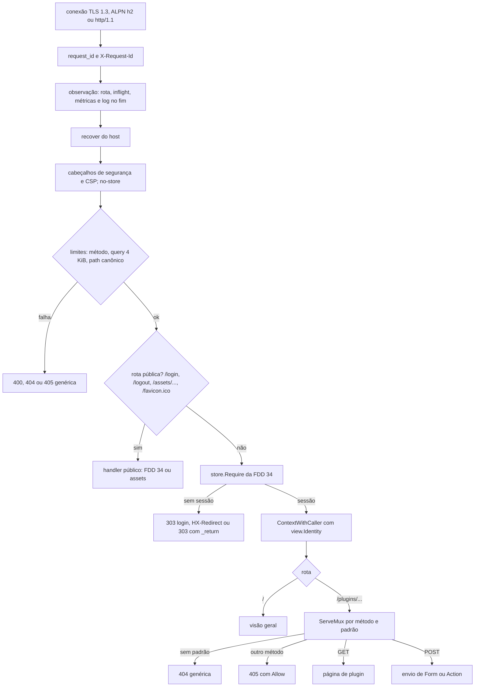
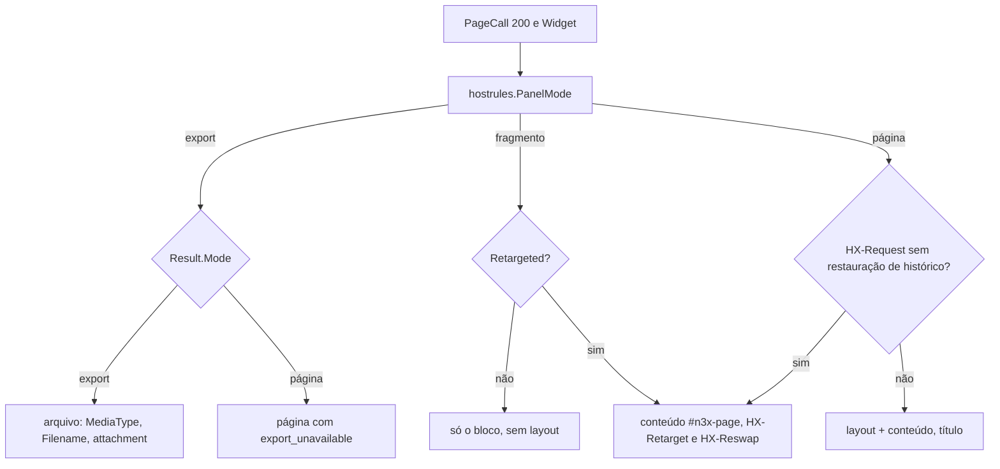
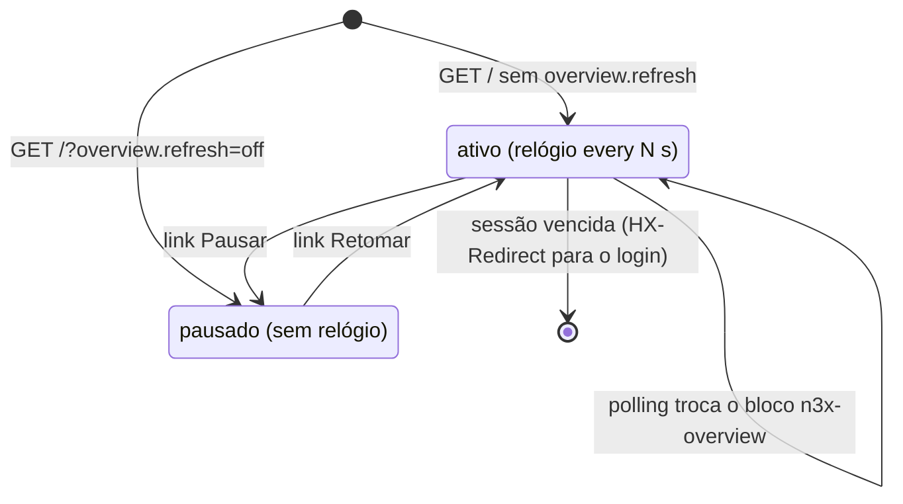

### FDD: Painel: layout, visão geral, slots de plugin e acessibilidade (CTL-06)

Versão: 1.0
Data: 2026-10-21
Responsável: Guilherme Giusti

---

### 1. Contexto e motivação técnica

**Problema técnico.** O painel em `17444` é a moldura comum de tudo que o operador vê, mas quase todo o conteúdo vem dos plugins (FR-008, FR-011, FR-013). As FDDs anteriores fecharam as peças em volta e deixaram para esta FDD o servidor que as junta:

- o renderizador de widgets, o tema e as classes do esqueleto do host (FDDs 10 e 11), com a regra de modo, os cabeçalhos htmx de resposta, a folha com hash e a configuração do htmx compatível com a CSP (L-38)
- a sessão, o login, o CSRF e o aviso de uso único (FDD 34), entregues como `http.Handler` e middleware `net/http` que alguém precisa montar no Echo v5, com cabeçalhos e CSP
- o catálogo, o estado, o menu, os cartões, os banners e as chamadas protegidas `Page`, `Action` e `Card` (FDD 32), que alguém precisa rotear de forma exata por padrão e método, sem que o roteador real case diferente do roteador do kit (FDD 12)
- as regras puras `hostrules.PanelMode` e `hostrules.FlashAllowed`, que o host real precisa usar no lugar de reescrever (FDD 12, P-04 dela e pedido da FDD 32)
- os pontos de encaixe `boot.Server`, `Config.TLSConfig()` e `panel.refresh_interval` (FDD 30, P-09 dela)
- a verificação de acessibilidade WCAG 2.1 AA com axe, que as FDDs 10 e 11 atribuíram à CI do controller, nas telas do host, na galeria do SDK e no login

Esta entrevista achou cinco problemas novos:

- **`Referrer-Policy: no-referrer` quebra o login.** Pela especificação Fetch, um POST de mesma origem sob `no-referrer` sai com `Origin: null`, e a conferência de origem da FDD 34 recusaria todo envio. A política precisa ser `same-origin` (I-07).
- **Padrões que se cruzam derrubam o `net/http.ServeMux`.** A gramática da FDD 08 aceita `/s/{id}` e `/{x}/novo` no mesmo plugin; o `ServeMux` do Go 1.22 recusa esse par com panic no registro, tanto no kit (FDD 12) quanto aqui (I-09).
- **Cartão sem título.** `ctrl.CardEntry` tem só `ID`, `Role` e `Fn`; a grade da visão geral precisa de um nome acessível por cartão (I-08, P-01).
- **Aviso de uso único na visão geral.** `ui.Flash` é opaco e só o renderizador o desenha, dentro de uma `ui.Page` de plugin; a visão geral é uma página do host (H-21).
- **Panic do renderizador não é culpa do plugin.** A FDD 10 sugere contar o panic do renderizador em `n3x_controller_plugin_panics_total{kind="panel"}`, o que levaria o plugin a `falho` por um defeito do SDK (I-10).

**Encaixe no HLD.** Esta FDD especifica o componente "Painel (`host/panel`)" do HLD do `n3x-controller` ("Componentes e responsabilidades"), o "Fluxo de requisição: painel", o "Painel: mapa de telas" de "Interfaces públicas", as linhas de CSP, cabeçalhos e CSRF de "Segurança" e as métricas `panel_*` de "Observabilidade". O pacote é `host/internal/panel`, seguindo a regra da FDD 30 de manter só `host` como API estável (I-01). Na ordem de montagem do contrato 11 da FDD 30 (31, 34, 32, 33, 35), o painel nasce por último, depois de `ph.Start` e de `session.NewLogin`, com a assinatura da FDD 34: `panel.New(deps, ph, store, login)` (I-11).

**Recorte com as FDDs vizinhas**
- FDD 10 e FDD 11 (SDK): widgets, renderizador, folha de estilo, `uitest.Lint` e `uitest.Gallery`; aqui só se hospeda e se serve
- FDD 12 (SDK): `hostrules` e as suítes `hostconformance`; aqui o harness do host real completa `Page` e `Submit`
- FDD 30: schema do `n3x.yaml`, `boot`, sinais, saída e abertura das portas; aqui se implementa `boot.Server` para `listen.panel`
- FDD 32: catálogo, estado, `Menu`, `Cards`, `Banners`, `Page`, `Action` e `Card` com contenção (papel, estado, prazo, `recover`, zumbis, contador de panics)
- FDD 34: `Require`, `View`, `CheckOrigin`, `SafeNext`, `ServeLogin`, `ServeLogout`, cookies, CSRF e a própria página de login (templ dela, H-12 dela); aqui se montam as rotas, os cabeçalhos e a CSP e se roda o axe
- FDD 45: telas e cartões do core (inventário, configs, divergência, fluxo, usuários); aqui é o esqueleto e os slots
- FDD 51: medição do p95 com 500 sidecars

**Atores.** Root e usuário de leitura (navegador com ou sem htmx, teclado, leitor de tela), plugins que registram páginas, ações e cartões (pela FDD 32), host de plugins (FDD 32), sessão (FDD 34), renderizador do SDK (FDDs 10 e 11), `host.Run` (FDD 30, abre a porta e trata sinais), Prometheus e coletor de logs, CI do controller (axe, navegador, golden) e atacante na rede (XSS refletido por plugin, CSRF, clickjacking, enumeração de rotas, DoS por polling).

**Limites.**
- Não autentica, não cria sessão e não confere token CSRF por conta própria: usa a `View` da FDD 34
- Não chama plugin direto: toda chamada passa por `Host.Page`, `Host.Action` e `Host.Card` (FDD 32)
- Não gera HTML de plugin: o conteúdo dos slots e dos cartões vem só do `ui.Renderer`; o host escreve em templ apenas o layout, a visão geral, os banners e as páginas de erro
- Não serve JavaScript além do htmx embutido, nem CSS além da folha do SDK; não carrega nada de outro domínio
- Não lê arquivo nem variável de ambiente; recebe a config pronta em `boot.Deps` (FDD 30)
- Não trata sinais nem abre o listener: `host.Run` entrega o `net.Listener` ao `Serve` (FDD 30)

**Suposições**
- Go 1.26 ou superior, sem cgo; `net/http.ServeMux` com padrões por método e curingas (Go 1.22 ou superior)
- Echo v5 (`github.com/labstack/echo/v5`) e templ (`github.com/a-h/templ`) nas versões do `go.mod` do `host/` (versão aprovada em 2026-10-22, H-01); os arquivos `*_templ.go` gerados são versionados, para o builder compilar sem a CLI do templ (FDD 21, `GOPROXY=off`)
- htmx 2.0.4 vendorizado no repositório, conferido por SHA-256 (patch aprovado em 2026-10-22, H-02)
- Navegadores alvo: as duas últimas versões estáveis de Chrome, Edge, Firefox e Safari (FDD 10)
- O host de plugins já subiu: `Catalog()` não é nulo quando `panel.New` é chamado
- Poucos operadores ao mesmo tempo: até 10 abas abertas com polling (FDD 11, hipótese para a FDD 51)

**Restrições**
- Echo v5 + templ + htmx, sem SPA, sem build de frontend e sem JavaScript externo (FR-008, HLD do `n3x-controller`)
- Nenhum plugin escreve HTML; templ só no host e o contrato de plugin não expõe o Echo (ADR-018 do `n3x-sdk`)
- CSP `default-src 'self'` sem script nem estilo inline (HLD), acrescida de `form-action`, `base-uri` e `frame-ancestors` (FDD 11, I-10 dela)
- Polling de 5 s (`panel.refresh_interval`, de 1 s a 60 s) com respostas parciais em HTML; SSE fica para o futuro (ADR-008 do `n3x-controller`)
- Cartão com prazo de 1 s, sem travar os outros (ADR-008, ADR-018)
- Papel mínimo por rota com 403 no servidor (FR-008, HLD)
- Nenhuma tela do host altera config de sidecar nem gere usuários (FR-007, FR-008, ADR-003 do `n3x-plugin-core`)
- WCAG 2.1 AA com verificação automatizada por axe (PRD, HLD)
- Nunca entram em log, métrica ou erro: cookie, token CSRF, corpo, valores da query, path real, texto de célula ou de cartão (HLD, LGPD)
- Documentação e textos em pt-BR; identificadores, classes, rótulos e nomes de evento em inglês

**Rastreabilidade**
- PRD 1.5: FR-008 (inteiro: painel em Echo v5 + templ + htmx, visão geral, telas de plugin no menu com o mesmo visual, atualizações parciais com polling de 5 s, sessão expirada volta à mesma página, 403 com mensagem clara também no servidor, banner por plugin degradado ou falho), FR-011 (telas de plugin no menu; autenticação e permissão antes do plugin; panic em tela vira 500), FR-013 (páginas e cartões em widgets; nenhum plugin escreve HTML); requisitos não funcionais de desempenho (painel p95 < 300 ms com 500 sidecars), segurança do painel (CSP restrita, nenhum JavaScript externo, CSRF em toda ação) e acessibilidade (WCAG 2.1 AA, todo campo e botão rotulado); critérios de aceite "painel passa numa verificação automatizada de acessibilidade, sem violações de nível WCAG AA", "plugin novo aparece com uma página e um cartão em widgets", "usuário de leitura recebe 403 na lista de usuários" e "nenhuma tela permite alterar config de sidecar nem gerir usuários"
- HLD do `n3x-controller`: "Componentes e responsabilidades" (`host/panel`), "Fluxo de requisição: painel", "Interfaces públicas" (painel e mapa de telas), "Segurança" (autorização e proteção de dados), "Observabilidade" e riscos "Panic ou travamento em tela" e "Meta de 500 sidecars"
- HLD do `n3x-sdk`: "Catálogo de widgets da v1" e "Página no painel"
- ADRs: ADR-008 do `n3x-controller` (polling e cartões); ADR-018 (widgets, nenhum plugin escreve HTML) e ADR-022 (métricas) do `n3x-sdk`; ADR-009 do `n3x-plugin-core` (banner de degradado com motivo)
- FDDs aplicadas: 01 (`plugin.ID`, `RoutePrefix`), 06 (`telemetry.NewRequestID`, `ContextWithRequestID`, `NewLogHandler`), 08 (`PageEntry`, `CardEntry`, `InMenu`, gramática de path, `Role.Meets`, `ContextWithCaller`, `ErrNotFound`, `ErrBadRequest`, `ErrNilWidget`, `CardTimeout`, P-09 e I-04 dela), 10 (`Renderer`, modos, IDs, `Stylesheet`, `StylesheetName`, `CardContainerID`, `uitest`, P-04 dela), 11 (`Refresh`, `RefreshHeader`, `ModeExport`, `Request.Path`, `Request.Flash`, `ReadSubmission`, `Finish`, `MaxSubmitBytes`, métricas e eventos propostos, P-08 dela), 12 (`hostrules.PanelMode`, `FlashAllowed`, `HandlerStatus`, `RunPanel`, `RunCalls`, P-04 dela), 13 (cartão `negacoes`, páginas e `Action` de exemplo), 30 (`boot.Server`, `boot.Deps`, `TLSConfig()`, `listen.panel`, `panel.refresh_interval`, ordem de montagem, P-09 dela), 32 (contratos 4, 6, 7, 11 e 12; H-09 e H-21 dela), 33 (clone do TLS com ALPN próprio), 34 (contratos 2, 4, 5 e 6; H-12 e H-22 dela)
- Lacunas do README:
  - **L-38 fechada aqui:** o htmx 2.0.4 sobe com `<meta name="htmx-config">` contendo `includeIndicatorStyles: false`, `allowEval: false`, `allowScriptTags: false`, `historyCacheSize: 0`, `refreshOnHistoryMiss: true`, `selfRequestsOnly: true` e `defaultFocusScroll: false`; com isso o htmx não injeta `<style>`, não avalia código e não guarda páginas no `localStorage`, e a CSP `style-src 'self'` e `script-src 'self'` passa sem violação (contrato 5) (valores aprovados em 2026-10-22, H-02)
  - **L-22 aplicada:** a folha do SDK (`ui.Stylesheet`, nome por hash) é o único CSS; o layout em templ usa só as classes `n3x-*` do SDK; as classes que faltam ao esqueleto viram pedido à FDD 10 (contrato 10)
- Decisões da clarificação (responsável, 2026-10-22):
  - Cartão sem título próprio na v1: a visão geral agrupa os cartões por plugin, com o ID do plugin como título do grupo (I-08, P-01); o campo `Title` do `ctrl.CardEntry` fica como evolução por adição no SDK
  - Hipóteses menores aprovadas em bloco: cabeçalhos de segurança do contrato 4 (inclusive `Referrer-Policy: same-origin`), HSTS de 1 ano sem `includeSubDomains`, sem compressão de HTML, htmx 2.0.4 com `htmx-config` restritivo, `X-Request-Id` do cliente ignorado, ordem dos middlewares com `request_id` e observação por fora do recover (difere do HLD, que lista o recover primeiro), roteamento exato e path não canônico em 404, 256 conexões e 64 cartões por visão geral, aviso de uso único ausente quando a ação redireciona para a visão geral (H-21), CI de acessibilidade com Playwright, axe e Node 22, galeria só com a tag `n3x_dev`, 3 métricas novas do painel
  - Consequência da decisão da CTL-05: com o core fora de `ok`, as sessões de leitura são cortadas (não seguem até expirar); corrigido o fluxo do modo de emergência
- Pontos em aberto de FDDs anteriores fechados aqui:
  - P-04 da FDD 12: plugin `falho` em runtime responde 503 com página genérica; `falho` na subida não tem rota (404); ordem de cartões, menu e banners com o core primeiro e os demais por ID (H-12, pedido de função em `hostrules`); métricas e eventos do painel propostos pela FDD 11 confirmados com os nomes do contrato 13
  - P-09 da FDD 12: a ordem escolhida difere da do kit, então vira função de `hostrules` (pedido às FDDs 12 e 32)
  - P-09 da FDD 30: o painel usa o clone de `TLSConfig()` com `NextProtos = ["h2", "http/1.1"]`
  - P-04 da FDD 10 e P-08 da FDD 11: todos os itens atendidos nos contratos 3 a 8, 10 e 15
  - P-09 e I-04 da FDD 08: rótulo `route` com o padrão registrado (`{nome}`); menu a partir de `InMenu`; cartões em paralelo com 1 s e "indisponível"; páginas de erro por status
  - H-09 e H-21 da FDD 32 confirmados (plugin `falho` some do menu e da visão geral; ordem com a regra nova de `hostrules`)
  - H-22 da FDD 34 confirmado: adaptador `net/http` para o Echo (contrato 2)
- Pedidos atendidos:
  - FDD 08: rótulo `route` com `{nome}`; menu e cartões; páginas de erro 400, 403, 404, 500, 503 e 504; query bruta limitada a 4 KiB com 400
  - FDD 10: fragmento só com `HX-Target` começando com `n3x-p-`; `HX-Retarget` e `HX-Reswap` com `Retargeted`; renderização antes de qualquer cabeçalho; folha com hash e cache imutável; classes do esqueleto; htmx 2.0.x com `htmx-config` (L-38); axe na galeria nos dois temas; métricas `n3x_controller_panel_render_failures_total` e `n3x_controller_panel_render_notices_total`; `HX-History-Restore-Request` com a página inteira; `HeadingBase` e `CardContainerID` nos cartões
  - FDD 11: rotas POST na ordem das checagens com 413, 415 e 405; `ModeExport` antes do fragmento; cabeçalhos da exportação e 422 para exportação grande; `no-store` nas páginas; CSP com `form-action`, `base-uri` e `frame-ancestors`; `historyCacheSize` 0; polling da visão geral com o mesmo cabeçalho; métricas e eventos propostos; rótulo `method` decidido; axe e teclado nas 14 páginas novas da galeria
  - FDD 12 (P-04): 503 de plugin `falho`, ordem de cartões e menu, métricas e eventos do painel
  - FDD 30: `boot.Server`; `TLSConfig()` clonado com ALPN próprio; `panel.refresh_interval` de 1 s a 60 s; ordem de montagem
  - FDD 32: roteamento exato por padrão e método; 503 para plugin `falho` em runtime; uso de `Menu`, `Cards`, `Banners`, `Page`, `Action` e `Card`; `PanelMode` e `FlashAllowed`; `Page` e `Submit` completos no harness
  - FDD 33: mesmo padrão de clone do TLS, com ALPN próprio
  - FDD 34: `/login` e `/logout` fora do `Require`, com cabeçalhos e CSP; `Require` em tudo menos `/login`, `/logout` e `/assets/...`; `ContextWithCaller(view.Identity())`; `View.CSRFToken()` no `ui.Request`; ordem da FDD 11 com `CheckOrigin` e `View.CheckCSRF`; `SetFlash` e `TakeFlash`; banner de `Notices()`; botão "Sair" como POST com `_csrf`; axe em `/login`; adaptador `net/http` para o Echo

---

### 2. Objetivos técnicos

- **Roteamento exato e igual ao do kit.** Invariante: toda página e ação do catálogo responde só no padrão e no método registrados, com a mesma precedência do `net/http.ServeMux` que o kit usa (literal vence curinga); path não canônico responde 404 sem redirecionamento. Medida: os casos de `hostconformance.RunCalls` e `RunPanel` passam no harness do host real sem nenhum pulo que cite a FDD 35; tabela de 30 vetores de path (barra no fim, `//`, `..`, `%2F`, maiúsculas, curinga vazio, método errado) com o status esperado.
- **Papel aplicado no servidor.** Invariante: nenhuma `PageFunc`, `ActionFunc` ou `CardFunc` roda para um chamador cujo papel não atende o da entrada. Medida: usuário de leitura recebe 403 com "Esta página exige o papel root." numa página de root chamada direto pela URL, e 403 com "Esta ação exige o papel root." numa ação de root; espião da função com 0 chamadas.
- **Isolamento de falha por plugin.** Medida: panic numa página de plugin dá 500 com a página genérica e a requisição seguinte a outra rota responde 200; cartão que não volta mostra "indisponível" depois de 1 s e a visão geral com 4 cartões rápidos e 1 lento responde em até 1,2 s, com os 4 rápidos renderizados; plugin `falho` em runtime dá 503 nas páginas e some do menu e da visão geral.
- **Nada de outro domínio, nada inline.** Medida: em todas as páginas da CI de navegador, 0 violações de CSP (eventos `securitypolicyviolation` e console), 0 requisições a outra origem, exatamente 1 arquivo JavaScript carregado (o htmx) e 1 folha de estilo; busca nos golden do layout sem `<script` fora da tag do htmx, sem ` style=`, sem ` on` seguido de letras e `=`.
- **Acessível no nível WCAG 2.1 AA.** Medida: o axe (tags `wcag2a`, `wcag2aa`, `wcag21a` e `wcag21aa`) não acha violações em `/login` (4 estados), `/` (6 estados), nas 8 páginas de erro, em todas as páginas de `uitest.Gallery()` dentro do layout real e nas telas do core quando a FDD 45 existir, nos temas claro e escuro; navegação só com teclado cobre o pulo para o conteúdo, o menu, "Sair", a pausa do polling e a confirmação por `<details>`.
- **Polling que não atrapalha.** Invariante: o polling nunca rouba o foco, nunca é anunciado pelo leitor de tela, nunca consome o aviso de uso único e nunca renova a inatividade; todo bloco com polling, inclusive a visão geral, tem o link "Pausar" (WCAG 2.2.2). Medida: teste de navegador com o foco no link "Pausar" mantém o foco nele depois de 3 trocas; polling de 40 min sem outro uso leva ao login em 30 min.
- **Custo do host baixo no caminho da página.** Medida (hipótese, H-26): a parte do host (middlewares, roteamento, sessão, layout) custa até 1 ms em p99 e até 40 alocações por página, sem contar a `PageFunc` e o renderizador (`BenchmarkPanelPage` com uma página de 1 `Stat`); layout sozinho até 0,3 ms.
- **Segredo nenhum fora do lugar.** Medida: varredura com canário como senha, com os IDs de sessão e tokens emitidos e com valores de query e de célula marcados: 0 ocorrências em logs, métricas e erros; o token só aparece nos campos `_csrf` do HTML.

---

### 3. Escopo e exclusões

**Incluído**
- Servidor HTTPS em `listen.panel` (padrão `17444`) que implementa `boot.Server`: TLS 1.3 sobre o clone de `TLSConfig()` com ALPN `h2` e `http/1.1`, prazos HTTP, teto de conexões e desligamento gracioso
- Cadeia de middlewares no Echo v5: `request_id`, observação (métricas e log), recover do host, cabeçalhos de segurança e CSP, limites, sessão (`Require` da FDD 34 pelo adaptador), chamador (`ContextWithCaller`) e roteador
- Mapa de rotas do host (`/`, `/login`, `/logout`, `/assets/...`, `/favicon.ico`) e despacho dos slots `/plugins/<namespace>/<nome>/...` por um `net/http.ServeMux` com padrões por método, montado do `Catalog`
- Página de plugin: query, chamada `Host.Page`, modo por `hostrules.PanelMode`, `ui.Request` com token, papel, intervalo, path e aviso (`View.TakeFlash`), renderização antes dos cabeçalhos, layout ou fragmento, `HX-Retarget` e `HX-Reswap`
- Envio de `Form` e `Action` (POST): ordem das checagens da FDD 11 com `CheckOrigin` e `View.CheckCSRF`, `Host.Action`, `Submission.Finish`, `View.SetFlash` e 303
- Exportação (`ModeExport`): cabeçalhos do arquivo, 422 para recorte grande, `panel_export`
- Visão geral `/`: cartões de todos os plugins (inclusive o core) em paralelo com 1 s, estado vazio, cartão indisponível, banners por plugin fora de `ok`, aviso do modo de emergência, polling próprio com pausa
- Layout base em templ: cabeçalho com usuário, papel e "Sair", menu (ordem e agrupamento), área de conteúdo, avisos da sessão, rodapé, título da página
- Páginas de erro genéricas por status (400, 403, 404, 405, 413, 415, 422, 500, 503, 504), em página e em resposta a htmx
- Assets embutidos em `/assets/...`: folha do SDK, htmx e ícone, nomes com hash, cache imutável e gzip pré-calculado
- Métricas `n3x_controller_panel_*` e eventos de log com `component=panel`
- Harness do host real: `Page` (fragmento, polling, exportação, roteador real) e `Submit` completos no `pluginstest`
- Verificação de acessibilidade na CI do controller: axe com Playwright, galeria do SDK no modo de desenvolvimento, temas claro e escuro, testes de teclado e de CSP

**Excluído**
- Login, logout, sessão, cookies, token CSRF, bloqueio e a própria página de login: FDD 34 (CTL-05); aqui só se montam as rotas e se aplicam cabeçalhos, CSP e axe
- Catálogo de widgets, renderizador, folha de estilo e `uitest`: FDDs 10 (SDK-10) e 11 (SDK-11)
- Registro de rotas e cartões, checagem de prefixo, estado e contenção das chamadas: FDDs 08 (SDK-08) e 32 (CTL-03)
- Telas e cartões do core (sidecars, configs, divergência, fluxo, usuários): FDD 45 (CORE-09)
- Servidor gRPC: FDD 33 (CTL-04); porta `17091`: FDD 30 (CTL-01)
- Medição do p95 com 500 sidecars: FDD 51 (CTL-07)
- Fora da v1 (aprovado em 2026-10-22): compressão de HTML, tema escolhido pelo usuário, indicador de carregamento, envio por htmx, SSE, título próprio de cartão (P-01), aviso de uso único na visão geral (H-21), página de ajuda do host

---

### 4. Fluxos detalhados e diagramas

**Fluxo principal: montagem (`panel.New`, FDD 30 contrato 11)**
1. `host.Run` chama `panel.New(deps, ph, store, login)` depois de `ph.Start`, `ph.StartBackground` e `session.NewLogin` (FDD 34).
2. Confere `ph.Catalog()` não nulo (senão `ErrNoCatalog`).
3. Monta os assets: lê `ui.Stylesheet()` e `ui.StylesheetName()`, o htmx e o ícone embutidos, confere o SHA-256 do htmx contra `HTMXSHA256`, calcula os nomes com hash e o gzip de cada um, uma vez.
4. Monta o `ServeMux` dos slots: para cada `Catalog.Pages()` registra `GET <padrão>` e para cada `Catalog.Actions()` registra `POST <padrão>` (padrão da raiz do plugin vira `<prefixo>{$}`), sob `recover`; conflito de padrões vira `ErrRouteConflict` com os dois padrões (I-09).
5. Monta o Echo: middlewares na ordem do contrato 2, rotas do host, `/plugins/*` para o despacho dos slots, `HTTPErrorHandler` com as páginas de erro.
6. Monta o `http.Server` com os prazos do contrato 1, `MaxHeaderBytes` de 16 KiB e `ErrorLog` ligado ao log em `debug` com amostragem.
7. Clona `deps.Config.TLSConfig()` e acrescenta `NextProtos = ["h2", "http/1.1"]` (TLS 1.3 mínimo já vem do clone).
8. Registra as métricas em `deps.Registry`; nome repetido é erro.
9. Loga `panel_server_ready` com porta, ALPN, intervalo de atualização, número de páginas, ações e cartões, nomes dos assets e versão do htmx.
10. Erro em qualquer passo: `panel.New` devolve erro e a FDD 30 sai com 8.

**Fluxo principal: requisição a uma página de plugin**
1. `request_id` novo (`telemetry.NewRequestID`), posto no `ctx` e no cabeçalho `X-Request-Id`.
2. Observação: resolve o rótulo `route` e o `plugin` pelo `ServeMux` (sem chamar o handler), soma `n3x_controller_panel_inflight`; ao fim, mede e loga.
3. Recover do host (panic do host ou do renderizador vira 500 genérica e `n3x_controller_panel_host_panics_total`).
4. Cabeçalhos de segurança e `Cache-Control: no-store` (contrato 4).
5. Limites: método fora de `GET`, `HEAD` e `POST` dá 405; query bruta acima de 4 KiB dá 400; path não canônico em `/plugins/` dá 404.
6. Sessão: `store.Require` (FDD 34) pelo adaptador; sem sessão, 303 para o login, `HX-Redirect` no htmx ou 303 com `_return` no POST.
7. Chamador: `ctrl.ContextWithCaller(ctx, view.Identity())`.
8. Despacho: o `ServeMux` acha o padrão `GET`; sem padrão, 404 genérica; padrão só de outro método, 405 com `Allow`.
9. Papel: `caller.Role.Meets(entrada.Role)`; senão 403 genérica com "Esta página exige o papel root." e `panel_forbidden`, sem chamar o host de plugins.
10. Query: `url.ParseQuery(r.URL.RawQuery)` (malformada dá 400) e `ui.NewQuery(curingas, valores)` com os curingas de `r.PathValue` (fora dos limites dá 400).
11. Modo: `hostrules.PanelMode(q, hx, hxTarget)`, com `hx` igual a `HX-Request: true` e sem `HX-History-Restore-Request: true`.
12. Chamada: `ph.Page(ctx, pg, caller, q)` com o `ctx` da requisição limitado por `runtime.plugin_call_timeout` (o mesmo prazo cobre a função e a renderização).
13. Status diferente de 200: página genérica do status (403, 400, 404, 500, 503, 504); 503 cita o plugin e mostra o banner dele.
14. Pedido ao renderizador: `ui.Request{Mode, Target, Query, Plugin, CSRFToken: view.CSRFToken(), Root, RefreshInterval: panel.refresh_interval, Path: r.URL.EscapedPath()}` e, se `view.TakeFlash(mode, hx, refresh, r.URL.Path)` devolver um aviso, `Request.Flash`.
15. Renderiza num buffer do pool antes de escrever qualquer cabeçalho; erro mapeado no contrato 6.
16. Resposta:
    - `ModeExport` com `Result.Mode == ModeExport`: arquivo (contrato 8)
    - `ModeFragment` sem `Retargeted`: só o bloco, sem layout
    - requisição htmx que terminou em `ModePage` (alvo inexistente com `Retargeted`, ou alvo que não é bloco): só o conteúdo `#n3x-page`, com `HX-Retarget: #n3x-page` e `HX-Reswap: outerHTML`
    - sem htmx (ou restauração de histórico): o conteúdo dentro do layout, com `<title>` igual a `Result.Title` mais " | N3X"
17. Avisos de dados (`Result.Notices`): `page_render_notice` (no máximo 1 por minuto por plugin e tipo) e `n3x_controller_panel_render_notices_total{plugin,kind}`.
18. Uma única escrita do corpo; `panel_request` em `debug` com rota, método, status, duração, modo e bytes.

**Fluxo principal: envio de `Form` ou `Action` (POST, ordem das FDDs 11 e 34)**
1. Passos 1 a 7 da página (o `Require` já trata o POST sem sessão com o `_return`).
2. Despacho: o `ServeMux` acha o padrão `POST`; padrão só de página dá 405 com `Allow: GET, HEAD`.
3. `Content-Type` diferente de `application/x-www-form-urlencoded` (parâmetros como `charset` aceitos): 415.
4. Corpo lido com `http.MaxBytesReader` de `ui.MaxSubmitBytes` (64 KiB); acima: 413.
5. `url.ParseQuery(corpo)`; malformado: 400.
6. `ui.ReadSubmission(plugin, curingas, corpo)`; erro: 400 (`bad_form`).
7. `session.CheckOrigin(r)`; falso: 403 "O formulário expirou. Volte à página e tente de novo." com `reason=origin`.
8. `view.CheckCSRF(sub.CSRF())`; falso: 403 com a mesma mensagem e `reason=csrf`.
9. Papel: `caller.Role.Meets(entrada.Role)`; senão 403 "Esta ação exige o papel root." (ou "leitura") com `reason=forbidden`.
10. `ph.Action(ctx, a, caller, sub.Input())`; status diferente de 200: página genérica (400, 404, 500, 503, 504).
11. `loc, f := sub.Finish(call.Reply)`; se `!f.IsZero()`, `view.SetFlash(f)`.
12. `303 See Other`, `Location: loc`, `Cache-Control: no-store`, corpo vazio; `panel_action` e `n3x_controller_panel_actions_total{plugin,route,result}`.

**Fluxo principal: visão geral `/`**
1. Passos 1 a 7 da página; papel mínimo leitura.
2. `cards := ph.Cards(role)` (filtrados por papel e estado; ordem do contrato 9); acima de `MaxOverviewCards` (64), os excedentes não são chamados e sai `panel_overview_truncated`.
3. Para cada cartão, numa goroutine: `ph.Card(ctx, c, caller)` (prazo de 1 s, FDD 32) e, com widget, `renderer.Render` em `ModeCard` com `Plugin`, `Card` e `HeadingBase: 3` num buffer próprio; erro de renderização vira cartão indisponível, `ph.CardRenderFailed(c)` e `page_render_failed` com `mode=card`.
4. Espera todas as goroutines (cada uma limitada pelo prazo do cartão; resultado tardio já descartado pela FDD 32).
5. `banners := ph.Banners()`; com o core fora de `ok`, o aviso do modo de emergência entra antes dos banners.
6. Monta o bloco `#n3x-overview` (contrato 9): barra de atualização com "Pausar", banners, grupos por plugin com os cartões, estado vazio quando não há cartão, elemento relógio.
7. `HX-Request` com `HX-Target: n3x-overview`: devolve só o bloco; senão, a página inteira com layout e título "Visão geral | N3X".
8. `?overview.refresh=off`: o bloco sai sem relógio, com "Atualização automática pausada." e "Retomar".

**Fluxo principal: asset `/assets/<nome>`**
1. Público: fora do `Require`; só `GET` e `HEAD`.
2. Nome exato do conjunto embutido; outro nome dá 404 (texto curto, sem layout).
3. `Content-Type` do asset, `Cache-Control: public, max-age=31536000, immutable`, `X-Content-Type-Options: nosniff`; com `Accept-Encoding` contendo `gzip`, corpo gzip pré-calculado e `Content-Encoding: gzip` com `Vary: Accept-Encoding`.

**Fluxos alternativos e exceções**
- **Plugin `falho` em runtime:** `Host.Page` e `Host.Action` devolvem 503 sem chamar; página genérica "O plugin <id> está indisponível no momento." com o banner dele; o item some do menu e os cartões somem da visão geral
- **Plugin `falho` na subida:** sem entradas no catálogo; as rotas dele dão 404 genérica; o banner explica o motivo
- **Cartão lento, com erro, panic ou widget nulo:** "Cartão <id> indisponível agora." no lugar dele; os outros seguem; a FDD 32 conta e loga
- **Cartão com árvore inválida:** indisponível, `CardRenderFailed` (pedido à FDD 32), `page_render_failed` com `mode=card` e `n3x_controller_panel_render_failures_total{reason="invalid_tree"}`
- **Nenhum cartão visível:** estado vazio "Nenhum plugin registrou cartões para o seu papel." (`n3x-empty`)
- **Core fora de `ok` (modo de emergência):** banner "Modo de emergência: o plugin core está <estado>. Só o root pode entrar no painel até ele voltar a ok." em todas as páginas, antes dos banners por plugin; as sessões de leitura abertas são cortadas na transição do core (FDD 34, H-13 revista em 2026-10-22), e quem foi cortado vê esse aviso na página de login; com o core `falho`, as telas do core dão 503 e os cartões do core somem
- **Bloco de fragmento que sumiu:** `Retargeted`; `HX-Retarget: #n3x-page` e `HX-Reswap: outerHTML` com o conteúdo da página
- **Polling com a sessão vencida:** o `Require` responde 200 com `HX-Redirect` (FDD 34); o observador conta `n3x_controller_panel_refresh_total{result="expired"}`
- **Polling com erro 4xx ou 5xx:** o htmx 2 não troca; os dados anteriores ficam; `refresh_total{result="error"}`
- **Restauração de histórico:** com `historyCacheSize: 0` e `refreshOnHistoryMiss: true`, o htmx recarrega a URL inteira; se mesmo assim vier `HX-History-Restore-Request: true`, a resposta é a página inteira com layout
- **Exportação indisponível:** `Result.Mode == ModePage` com `export_unavailable`; responde a página normal com o aviso de dados
- **Exportação acima de 16 MiB:** 422 "Recorte grande demais para exportar; use os filtros."
- **Árvore inválida, saída grande demais, pedido inválido do host:** 500 genérica, `page_render_failed`; pedido inválido também `panel_internal_error`
- **Prazo estourado (função ou renderização):** 504 genérica
- **Cliente desconectou no meio:** nada é escrito; status `499` só nas métricas e no log `debug`
- **Panic do renderizador ou do layout:** 500 genérica, `panel_host_panic` com stack amostrado e `n3x_controller_panel_host_panics_total{where}`; não conta no contador de panics do plugin (I-10)
- **Aviso de uso único com destino `/`:** o 303 vai para a visão geral, mas o aviso não é desenhado nela na v1 e expira em 60 s (H-21)
- **Desligamento:** `Shutdown(ctx)` para de aceitar conexões e espera as requisições em curso até o prazo; o host de plugins já responde 503 (FDD 32); `Close()` corta o resto

**Diagramas**

Cadeia de middlewares e despacho:



Sequência de uma página de plugin e do polling de um bloco:

```mermaid
sequenceDiagram
    participant B as navegador (htmx)
    participant P as painel (esta FDD)
    participant S as sessão (FDD 34)
    participant H as host de plugins (FDD 32)
    participant R as ui.Renderer (FDDs 10 e 11)
    B->>P: GET /plugins/n3x/example/negacoes
    P->>S: Require (cookie)
    S-->>P: View
    P->>P: ContextWithCaller; papel; ui.NewQuery; PanelMode = página
    P->>H: Page(ctx 10 s, entrada, caller, q)
    H-->>P: PageCall{200, Widget}
    P->>S: TakeFlash(página, sem htmx, sem refresh, path)
    P->>R: Render(ModePage, CSRFToken, Root, RefreshInterval 5 s, Path, Flash)
    R-->>P: HTML do conteúdo e Result
    P-->>B: 200, layout + conteúdo, CSP, no-store
    loop a cada 5 s
        B->>P: GET ? (HX-Request, HX-Target n3x-p-resumo, N3X-Refresh 1)
        P->>S: Require (não renova a inatividade)
        P->>H: Page(ctx, entrada, caller, q)
        P->>R: Render(ModeFragment, Target n3x-p-resumo)
        R-->>P: só o bloco
        P-->>B: 200, fragmento; o htmx troca o bloco
    end
```

Escolha da resposta pelo painel:



Estados do bloco da visão geral:



---

### 5. Contratos públicos (assinaturas, endpoints, headers, exemplos)

Os contratos 1, 3, 14 e 15 são internos ao módulo `github.com/giustech/n3x-controller/host` (pacote `host/internal/panel`, H-03): estáveis para as FDDs 30, 32, 34 e 45, sem garantia de semver para fora. Os contratos 2 e 4 a 13 são públicos para o navegador, o operador, o autor de plugin (pelo que ele vê na tela) e quem lê logs e métricas.

**Contrato 1: `panel.New` e o servidor (`boot.Server`)**
- Tipo: sdk (API Go interna)
- Assinatura/Rota:
  ```go
  package panel // github.com/giustech/n3x-controller/host/internal/panel

  const (
      Name               = "panel"
      MaxRawQuery        = 4 << 10          // query string bruta (FDD 08)
      MaxHeaderBytes     = 16 << 10
      MaxConns           = 256              // conexões simultâneas (H-08)
      MaxOverviewCards   = 64               // cartões chamados por visão geral (H-14)
      ReadHeaderTimeout  = 10 * time.Second
      ReadTimeout        = 30 * time.Second
      IdleTimeout        = 120 * time.Second
      WriteTimeoutMargin = 30 * time.Second // WriteTimeout = plugin_call_timeout + margem (H-08)
      OverviewID         = "n3x-overview"
      OverviewPauseKey   = "overview.refresh"
      HTMXVersion        = "2.0.4"          // H-02
      AssetCacheControl  = "public, max-age=31536000, immutable"
  )

  // HTMXSHA256 é o SHA-256 do htmx.min.js vendorizado; conferido no New e na CI.
  var HTMXSHA256 = "<64 hex do arquivo vendorizado>"

  // Plugins é o que o painel usa do host de plugins (FDD 32); *plugins.Host implementa.
  type Plugins interface {
      Catalog() *plugins.Catalog
      Menu(role ctrl.Role) []plugins.MenuItem
      Cards(role ctrl.Role) []plugins.Card
      Banners() []plugins.Banner
      CoreState() ctrl.StateInfo
      Page(ctx context.Context, p plugins.Page, caller ctrl.Identity, q ui.Query) plugins.PageCall
      Action(ctx context.Context, a plugins.Action, caller ctrl.Identity, in ui.Query) plugins.ActionCall
      Card(ctx context.Context, c plugins.Card, caller ctrl.Identity) plugins.CardCall
      CardRenderFailed(c plugins.Card) // pedido à FDD 32
  }

  // Sessions e LoginHandlers são o que o painel usa da FDD 34; *session.Store e *session.Login implementam.
  type Sessions interface {
      Require(next http.Handler) http.Handler
  }
  type LoginHandlers interface {
      ServeLogin(w http.ResponseWriter, r *http.Request)
      ServeLogout(w http.ResponseWriter, r *http.Request)
  }

  type Server struct{ /* Echo, ServeMux dos slots, http.Server, tls.Config, assets, métricas */ }

  var _ boot.Server = (*Server)(nil)

  func New(deps boot.Deps, ph Plugins, store Sessions, login LoginHandlers) (*Server, error)
  func NewWithOptions(o Options) (*Server, error) // testes e harness

  type Options struct {
      Deps            boot.Deps
      Plugins         Plugins
      Sessions        Sessions
      Login           LoginHandlers
      TLS             *tls.Config            // nil = clone de TLSConfig() com o ALPN do painel
      RefreshInterval time.Duration          // 0 = File.Panel.RefreshInterval
      CallTimeout     time.Duration          // 0 = File.Runtime.PluginCallTimeout
      Version         string                 // rodapé; "" = versão do host (FDD 30)
      Observe         func(PageEvent)        // só harness: árvore e conteúdo do slot antes do layout
  }

  type PageEvent struct {
      Route  string    // padrão registrado
      Tree   ui.Widget // nil quando a chamada falhou
      Result ui.Result
      Slot   []byte    // conteúdo do renderizador (cópia), sem layout
  }

  func (s *Server) Name() string                       // "panel"
  func (s *Server) Serve(ln net.Listener) error        // TLS sobre ln; nil depois de Shutdown ou Close
  func (s *Server) Shutdown(ctx context.Context) error // gracioso até o prazo do ctx
  func (s *Server) Close() error                       // forçado
  func (s *Server) Handler() http.Handler              // sem TLS; testes e harness

  var (
      ErrNoCatalog     = errors.New("panel: host de plugins sem catálogo")
      ErrRouteConflict = errors.New("panel: padrões de rota em conflito")
      ErrAssets        = errors.New("panel: asset embutido inválido")
  )
  ```
- Método: n/a (chamada local)
- Semântica:
  - **`New`** equivale a `NewWithOptions` com `RefreshInterval = File.Panel.RefreshInterval` (1 s a 60 s, FDD 30), `CallTimeout = File.Runtime.PluginCallTimeout`, `TLS = nil`, log `deps.Log.With("component", "panel")` e registro `deps.Registry`
  - **TLS (P-09 da FDD 30):** `cfg := deps.Config.TLSConfig()` (clone, TLS 1.3 mínimo, par já lido); `cfg.NextProtos = []string{"h2", "http/1.1"}`; `ClientAuth = NoClientCert`; o painel nunca altera o original (mesmo padrão da FDD 33)
  - **`Serve(ln)`:** embrulha `ln` num contador de conexões com teto `MaxConns` (o `Accept` espera vaga, sem fechar conexão existente) e em `tls.NewListener(ln, cfg)`; chama `http.Server.Serve`; `http.ErrServerClosed` vira `nil`; HTTP/2 sai pelo ALPN
  - **Prazos HTTP (H-08):** `ReadHeaderTimeout` 10 s (cobre o handshake TLS), `ReadTimeout` 30 s, `WriteTimeout` = `plugin_call_timeout` + 30 s, `IdleTimeout` 120 s, `MaxHeaderBytes` 16 KiB
  - **`Shutdown(ctx)`:** `http.Server.Shutdown(ctx)`; conexões ociosas fecham na hora; requisições em curso terminam até o prazo; o polling recebe erro de rede e o htmx mantém os dados anteriores
  - **Erros de montagem** (saída 8 pela FDD 30): `ErrNoCatalog`, `ErrRouteConflict` (com os dois padrões no texto), `ErrAssets` (hash do htmx diferente do registrado), registro de métrica recusado
  - **`Observe`** só existe para o harness (contrato 14); em produção é nulo e não custa nada

**Exemplo de requisição**
```go
// host/internal/boot (FDD 30), depois de ph.Start e session.NewLogin (FDD 34)
panelSrv, err := panel.New(deps, ph, store, login)
if err != nil { /* saída 8 */ }
ln, err := net.Listen("tcp", fmt.Sprintf(":%d", deps.Config.File.Listen.Panel)) // FDD 30
go func() { errc <- panelSrv.Serve(ln) }()
```

**Exemplo de resposta**
```json
{
  "server": "*panel.Server",
  "log": "{\"ts\":\"2026-10-21T14:00:01Z\",\"level\":\"info\",\"component\":\"panel\",\"msg\":\"panel_server_ready\",\"port\":17444,\"alpn\":\"h2,http/1.1\",\"refresh_interval\":\"5s\",\"pages\":9,\"actions\":1,\"cards\":5,\"stylesheet\":\"n3x-ui.4f2a9c01be73.css\",\"htmx\":\"htmx-2.0.4.9c1d2e3f4a5b.min.js\",\"max_conns\":256}"
}
```

---

**Contrato 2: mapa de rotas do host e cadeia de middlewares**
- Tipo: endpoint (HTTPS em `listen.panel`)
- Assinatura/Rota:

| Rota | Métodos | Sessão | Papel | Dono | Resposta |
| --- | --- | --- | --- | --- | --- |
| `/login` | `GET`, `HEAD`, `POST` | não (fora do `Require`) | público | FDD 34 (`login.ServeLogin`) | página de login, 303, 429 |
| `/logout` | `POST` (outros: 405 da FDD 34) | não (fora do `Require`) | sessão, conferida pela FDD 34 | FDD 34 (`login.ServeLogout`) | 303 |
| `/assets/<nome>` | `GET`, `HEAD` | não | público | esta FDD (contrato 11) | asset ou 404 |
| `/favicon.ico` | `GET`, `HEAD` | não | público | esta FDD | 308 para o ícone com hash |
| `/` | `GET`, `HEAD` | sim | leitura | esta FDD (contrato 9) | visão geral |
| `/plugins/<namespace>/<nome>/...` | `GET`, `HEAD`, `POST` | sim | da entrada do catálogo | plugin, pela FDD 32 (contratos 3, 6, 7 e 8) | página, fragmento, arquivo ou 303 |
| qualquer outra | qualquer | sim | n/a | esta FDD | 404 genérica |
| `/plugins/n3x/gallery/{name}` (só com a tag `n3x_dev`) | `GET`, `HEAD` | sim | leitura | esta FDD (contrato 15) | página da galeria do SDK |

- Método: `GET`, `HEAD`, `POST`; outros métodos dão 405 com `Allow` (com sessão) ou 303 para o login (sem sessão, regra da FDD 34)
- Semântica de status/headers:
  - **Ordem dos middlewares (do mais externo):** (1) `request_id`; (2) observação; (3) recover do host; (4) cabeçalhos de segurança; (5) limites; (6) sessão; (7) chamador; (8) roteador. A observação fica por fora do recover para medir o 500 de um panic; o HLD lista recover antes do `request_id`, o que impediria a página de erro de mostrar o código (H-04)
  - **Sessão global com exceções exatas:** o `Require` é um middleware global do Echo com um filtro que pula só `/login` e `/logout` (path exato) e `/assets/` e `/favicon.ico` (só `GET` e `HEAD`); assim rota desconhecida sem sessão vai ao login, sem revelar quais rotas existem
  - **Adaptador `net/http` para o Echo (H-22 da FDD 34):** `echo.WrapMiddleware(store.Require)` e `echo.WrapHandler(http.HandlerFunc(login.ServeLogin))`; o adaptador troca o `*http.Request` do contexto do Echo pelo que o `Require` repassa, para a `View` chegar aos handlers; conferido por teste (`session.FromContext` no handler depois do adaptador)
  - **Chamador:** com a `View`, `ctx = ctrl.ContextWithCaller(ctx, view.Identity())`; o `Caller` de qualquer camada anterior é sobrescrito (FDD 08)
  - **`X-Request-Id`:** sempre um novo, gerado pelo painel; `X-Request-Id` vindo do cliente é ignorado (aprovado em 2026-10-22, H-05); o mesmo valor vai em todo log e na página de erro
  - **HEAD:** mesmo caminho do `GET`, sem corpo (o `net/http` descarta)

**Exemplo de requisição**
```text
GET /plugins/n3x/core/sidecars HTTP/2
Host: n3x.exemplo.com.br:17444
```
(sem cookie de sessão)

**Exemplo de resposta**
```text
HTTP/2 303
Location: /login?next=%2Fplugins%2Fn3x%2Fcore%2Fsidecars
Cache-Control: no-store
X-Request-Id: 5d0b8c1e-2f4a-4b7e-9c3d-1a2b3c4d5e6f
Content-Security-Policy: default-src 'self'; script-src 'self'; style-src 'self'; img-src 'self'; font-src 'self'; connect-src 'self'; object-src 'none'; base-uri 'none'; form-action 'self'; frame-ancestors 'none'
```
```json
{ "GET /foo sem sessão": "303 para /login?next=%2Ffoo", "GET /foo com sessão": "404 genérica", "DELETE / com sessão": "405, Allow: GET, HEAD", "GET /assets/n3x-ui.4f2a9c01be73.css sem sessão": "200" }
```

---

**Contrato 3: montagem dos slots de plugin e roteamento exato**
- Tipo: endpoint (regra de montagem a partir do `Catalog` da FDD 32)
- Assinatura/Rota: `ServeMux` interno com um padrão por entrada: `GET <Pattern>` para cada `Catalog.Pages()` e `POST <Pattern>` para cada `Catalog.Actions()`
- Método: `GET` e `HEAD` (páginas), `POST` (ações)
- Semântica de status/headers:
  - **Padrão:** o `Pattern` montado pela FDD 08 (`id.RoutePrefix()` mais o path sem a barra inicial) entra como está; o da raiz do plugin (`/plugins/n3x/example/`) entra como `/plugins/n3x/example/{$}`, para casar só com a própria raiz e não com a subárvore
  - **Precedência:** a do `net/http.ServeMux` do Go 1.22, a mesma do kit (FDD 12): literal vence curinga (`/s/novo` antes de `/s/{id}`); curinga casa um segmento inteiro e não vazio; sem curinga de resto (a gramática da FDD 08 recusa)
  - **Comparação exata:** sensível a maiúsculas; `/plugins/n3x/example/negacoes/` (barra no fim) não casa com `/negacoes`; `/plugins/n3x/example` (sem a barra) não casa com a raiz
  - **Path não canônico:** antes do `ServeMux`, um path em `/plugins/` com `//`, segmento `.` ou `..`, ou diferente de `path.Clean` dá 404 genérica, sem o redirecionamento 301 do `ServeMux` (H-06)
  - **404 e 405:** sem padrão que case, 404 genérica; padrão de outro método, 405 genérica com `Allow` (`GET, HEAD`, `POST` ou os dois); o status e o `Allow` vêm do `ServeMux` e o corpo é a página genérica deste painel
  - **Curingas:** `r.PathValue(nome)` para cada `{nome}` do padrão; os valores chegam decodificados a `ui.NewQuery` (até 256 bytes cada, FDD 08)
  - **Query:** `RawQuery` acima de 4 KiB dá 400 (FDD 08); `url.ParseQuery` com erro dá 400; `ui.ErrInvalidQuery` dá 400
  - **Papel por rota:** o painel confere `caller.Role.Meets(entrada.Role)` antes de chamar (403 genérica, `panel_forbidden`); o host de plugins confere de novo (defesa em profundidade). Papel padrão: o declarado no registro, que é leitura ou root em `Page` e leitura ou root em `Action` (zero vale root, FDD 11)
  - **Conflito:** se o `ServeMux` recusar um par de padrões (panic no registro), `panel.New` devolve `ErrRouteConflict`; pedido à FDD 08 para o `Registrar` recusar o par antes (regra `ambiguous_route`, I-09)
  - **Rótulo `route`:** o `Pattern` registrado com `{nome}` (FDD 08, H-28 e I-04 dela); a raiz do plugin aparece como `/plugins/n3x/example/`; sem padrão, `unknown`

**Exemplo de requisição** (catálogo com as entradas da FDD 13)
```text
GET  /plugins/n3x/example/              -> GET /plugins/n3x/example/{$} (se registrada)
GET  /plugins/n3x/example/negacoes      -> GET /plugins/n3x/example/negacoes
GET  /plugins/n3x/example/negacoes/pedidos
POST /plugins/n3x/example/negacoes/zerar
GET  /plugins/n3x/example/negacoes/zerar
GET  /plugins/n3x/example/negacoes/
GET  /plugins/n3x/example/Negacoes
GET  /plugins/n3x/example//negacoes
```

**Exemplo de resposta**
```json
{
  "GET /plugins/n3x/example/negacoes": { "status": 200, "route": "/plugins/n3x/example/negacoes" },
  "GET /plugins/n3x/example/negacoes/pedidos": { "status": 200, "route": "/plugins/n3x/example/negacoes/{servico}", "q.Param(\"servico\")": "pedidos" },
  "POST /plugins/n3x/example/negacoes/zerar": { "status": 303, "route": "/plugins/n3x/example/negacoes/zerar" },
  "GET /plugins/n3x/example/negacoes/zerar": { "status": 405, "Allow": "POST" },
  "GET /plugins/n3x/example/negacoes/": { "status": 404, "route": "unknown" },
  "GET /plugins/n3x/example/Negacoes": { "status": 404, "route": "unknown" },
  "GET /plugins/n3x/example//negacoes": { "status": 404, "route": "unknown", "redirecionamento": false }
}
```

---

**Contrato 4: cabeçalhos de segurança, CSP e cache**
- Tipo: endpoint (cabeçalhos HTTP de toda resposta do painel)
- Assinatura/Rota: toda resposta, inclusive erros, redirecionamentos, assets, `/login` e `/logout`
- Método: todos
- Semântica de status/headers (valores exatos, H-07):

| Cabeçalho | Valor | Motivo |
| --- | --- | --- |
| `Content-Security-Policy` | `default-src 'self'; script-src 'self'; style-src 'self'; img-src 'self'; font-src 'self'; connect-src 'self'; object-src 'none'; base-uri 'none'; form-action 'self'; frame-ancestors 'none'` | HLD; `form-action`, `base-uri` e `frame-ancestors` não herdam o `default-src` (I-10 da FDD 11) |
| `X-Frame-Options` | `DENY` | HLD; navegadores sem `frame-ancestors` |
| `X-Content-Type-Options` | `nosniff` | arquivos exportados e assets |
| `Referrer-Policy` | `same-origin` | HLD; `no-referrer` faria o POST de mesma origem sair com `Origin: null` e quebraria o `CheckOrigin` da FDD 34 (I-07) |
| `Strict-Transport-Security` | `max-age=31536000` | painel só em TLS; sem `includeSubDomains` (aprovado em 2026-10-22; vale também no desenvolvimento com o dev-cert em localhost) |
| `Cross-Origin-Opener-Policy` | `same-origin` | isola a janela |
| `Cross-Origin-Resource-Policy` | `same-origin` | assets e exportações só para o próprio painel |
| `Permissions-Policy` | `camera=(), microphone=(), geolocation=(), payment=(), usb=()` | nenhum recurso de dispositivo |
| `Cache-Control` | `no-store` em página, fragmento, erro, exportação, login e 303; `public, max-age=31536000, immutable` só em asset com hash | FDD 11 (token e dados pessoais fora do cache) |
| `X-Request-Id` | valor do `request_id` | correlação com o log |

  - **Sem compressão de HTML** (aprovado em 2026-10-22, H-09): página, fragmento e exportação saem sem `Content-Encoding`, o que elimina o BREACH mesmo além do token mascarado da FDD 34; só os assets estáticos saem em gzip
  - **`Content-Type`:** `text/html; charset=utf-8` em página, fragmento e erro; o da exportação vem de `Result.MediaType`; o dos assets, da tabela do contrato 11
  - Os cabeçalhos são escritos antes do handler; o handler só acrescenta (`HX-*`, `Location`, `Allow`, `Content-Disposition`) e nunca troca a CSP

**Exemplo de requisição**
```text
GET /plugins/n3x/example/negacoes HTTP/2
Host: n3x.exemplo.com.br:17444
Cookie: n3x_session=<id da sessão>
```

**Exemplo de resposta**
```text
HTTP/2 200
Content-Type: text/html; charset=utf-8
Cache-Control: no-store
Content-Security-Policy: default-src 'self'; script-src 'self'; style-src 'self'; img-src 'self'; font-src 'self'; connect-src 'self'; object-src 'none'; base-uri 'none'; form-action 'self'; frame-ancestors 'none'
X-Frame-Options: DENY
X-Content-Type-Options: nosniff
Referrer-Policy: same-origin
Strict-Transport-Security: max-age=31536000
Cross-Origin-Opener-Policy: same-origin
Cross-Origin-Resource-Policy: same-origin
Permissions-Policy: camera=(), microphone=(), geolocation=(), payment=(), usb=()
X-Request-Id: 9e8d7c6b-5a4f-4e3d-8c2b-1a0f9e8d7c6b
```

---

**Contrato 5: htmx (configuração, cabeçalhos lidos e devolvidos, modos)**
- Tipo: endpoint (contrato entre o painel e o htmx no navegador)
- Assinatura/Rota:
  ```html
  <meta name="htmx-config" content='{"includeIndicatorStyles":false,"allowEval":false,"allowScriptTags":false,"historyCacheSize":0,"refreshOnHistoryMiss":true,"selfRequestsOnly":true,"defaultFocusScroll":false}'>
  <script src="/assets/htmx-2.0.4.9c1d2e3f4a5b.min.js" defer></script>
  ```
- Método: `GET` (o htmx só faz `GET` na v1; envios são POST comuns, FDD 11)
- Semântica de status/headers:
  - **L-38 fechada:** `includeIndicatorStyles: false` impede o `<style>` injetado; `allowEval: false` desliga `hx-on`, `js:` e `eval`; `allowScriptTags: false` não executa `<script>` de conteúdo trocado; `historyCacheSize: 0` não grava página no `localStorage` (token e dados pessoais, I-11 da FDD 11); `refreshOnHistoryMiss: true` faz o voltar do navegador recarregar a URL inteira; `defaultFocusScroll: false` não rola a tela no polling (valores aprovados em 2026-10-22, H-02)
  - **Cabeçalhos lidos:** `HX-Request` (só `true` vale), `HX-Target` (sem `#`), `HX-History-Restore-Request`, `HX-Current-URL` (pela FDD 34, no `HX-Redirect`) e `N3X-Refresh` (`ui.RefreshHeader`, valor `1`)
  - **Modo de página de plugin:** `hostrules.PanelMode(q, hx, hxTarget)`, com `hx = HX-Request == "true" && HX-History-Restore-Request != "true"`: chave `<id>.export` válida dá `ModeExport`; senão `HX-Target` começando com `n3x-p-` dá `ModeFragment`; senão `ModePage` (FDDs 10, 11 e 12)
  - **Modo da visão geral:** `HX-Request: true` com `HX-Target: n3x-overview` dá só o bloco; qualquer outro caso, a página inteira
  - **Cabeçalhos devolvidos:** `HX-Retarget: #n3x-page` e `HX-Reswap: outerHTML` quando uma requisição htmx termina em `ModePage` (inclusive `Retargeted`); `HX-Redirect` só pela FDD 34 (sessão vencida); nenhum `HX-Trigger`, `HX-Push-Url` nem `HX-Refresh`
  - **Layout:** requisição htmx (fora da restauração de histórico) nunca recebe o layout; sem htmx, sempre recebe
  - **Polling:** o painel não conta a requisição com `N3X-Refresh: 1` como uso da sessão (a FDD 34 aplica), não entrega aviso de uso único (`FlashAllowed`) e soma em `n3x_controller_panel_refresh_total`
  - **Foco:** o htmx 2 devolve o foco ao elemento com o mesmo `id` depois da troca; os links de pausa (`n3x-p-<id>-pause`, `n3x-overview-pause`) têm `id`; os de paginação, ordenação e abas ganham `id` estável por pedido à FDD 10 (H-17)
  - **Leitor de tela:** nenhum bloco com polling é `aria-live`; só o aviso de uso único tem `role="status"` (FDD 11)

**Exemplo de requisição**
```text
GET /plugins/n3x/example/negacoes?periodo=24h HTTP/2
HX-Request: true
HX-Target: n3x-p-resumo
HX-Current-URL: https://n3x.exemplo.com.br:17444/plugins/n3x/example/negacoes?periodo=24h
N3X-Refresh: 1
Cookie: n3x_session=<id da sessão>
```

**Exemplo de resposta**
```text
HTTP/2 200
Content-Type: text/html; charset=utf-8
Cache-Control: no-store

<div id="n3x-p-resumo" class="n3x-refresh">...bloco renderizado pelo SDK...</div>
```
```json
{
  "HX-Target n3x-p-sumiu (bloco não existe mais)": { "status": 200, "HX-Retarget": "#n3x-page", "HX-Reswap": "outerHTML", "corpo": "<div id=\"n3x-page\" ...>", "layout": false },
  "?servicos.export=csv com HX-Request": { "modo": "export" },
  "HX-History-Restore-Request: true": { "modo": "page", "layout": true }
}
```

---

**Contrato 6: página de plugin (GET) e mapeamento de status**
- Tipo: endpoint (`GET /plugins/<namespace>/<nome>/<path>`)
- Assinatura/Rota: padrão `GET` do catálogo (contrato 3)
- Método: `GET`, `HEAD`
- Semântica de status/headers:

| Situação | Status | Corpo | Log e métrica |
| --- | --- | --- | --- |
| Página renderizada | 200 | layout + conteúdo, ou fragmento | `panel_request` (`debug`) |
| Papel insuficiente | 403 | "Esta página exige o papel root." | `panel_forbidden`; `requests_total{status="403"}` |
| Query acima de 4 KiB, malformada ou fora dos limites | 400 | "Pedido inválido." | `panel_query_rejected` (1 por minuto) |
| `ctrl.ErrBadRequest` da `PageFunc` | 400 | "Pedido inválido." | o host de plugins não loga 400 (FDD 32) |
| `ctrl.ErrNotFound` ou rota sem padrão | 404 | "Página não encontrada." | nenhum |
| Plugin `falho` em runtime ou host parando | 503 | "O plugin <id> está indisponível no momento." e o banner dele | `requests_total{status="503"}` |
| Prazo estourado na função ou na renderização | 504 | "A página demorou demais para responder." | `page_failed` (FDD 32) ou `page_render_failed` |
| Erro, panic ou `(nil, nil)` da `PageFunc` | 500 | "Erro interno." com o código | `page_failed` e `plugin_panic` (FDD 32) |
| `ui.ErrInvalidTree` | 500 | "Erro interno." | `page_render_failed` (até 10 `{path, rule}`); `render_failures_total{reason="invalid_tree"}` |
| `ui.ErrOutputTooLarge` (página ou fragmento) | 500 | "Erro interno." | `render_failures_total{reason="output_too_large"}` |
| `ui.ErrInvalidRequest` (defeito do host) | 500 | "Erro interno." | `panel_internal_error`; `render_failures_total{reason="invalid_request"}` |
| Cliente desconectou | sem resposta | nada | status `499` só na métrica e no `debug` |

  - **Renderização antes dos cabeçalhos (FDD 10):** o `Render` escreve num buffer do pool; só com sucesso o painel escreve status, cabeçalhos e corpo, numa chamada; com erro, a página genérica ainda pode sair
  - **Prazo único:** o `ctx` da requisição ganha `runtime.plugin_call_timeout` antes de `Host.Page`; o renderizador usa o mesmo `ctx`, então função e renderização dividem os 10 s (aprovado em 2026-10-22, H-10)
  - **`ui.Request`:** `Mode` e `Target` de `PanelMode`; `Query` igual à da `PageFunc`; `Plugin` da entrada; `CSRFToken = view.CSRFToken()` (86 caracteres, mascarado a cada renderização, FDD 34); `Root = view.Identity().Role == ctrl.RoleRoot`; `RefreshInterval = panel.refresh_interval`; `Path = r.URL.EscapedPath()`; `Flash` de `view.TakeFlash(mode, hx, refresh, r.URL.Path)`, que aplica `hostrules.FlashAllowed` (página inteira, sem htmx, sem polling, mesmo path) e apaga o aviso entregue
  - **Título:** `<title>` = `Result.Title` + " | N3X"; páginas do host: "Visão geral | N3X", "Página não encontrada | N3X" e assim por diante
  - **Texto do erro do plugin:** nunca vai para a página; vai para o log da FDD 32

**Exemplo de requisição**
```text
GET /plugins/n3x/core/usuarios HTTP/2
Cookie: n3x_session=<sessão de ana, leitura>
```

**Exemplo de resposta**
```text
HTTP/2 403
Content-Type: text/html; charset=utf-8
Cache-Control: no-store
X-Request-Id: 0a1b2c3d-4e5f-4a6b-8c7d-9e0f1a2b3c4d
```
```html
<main id="n3x-main" class="n3x-main">
<div id="n3x-page" class="n3x-page n3x-error">
<h1 class="n3x-page__title">Acesso negado</h1>
<p class="n3x-text">Esta página exige o papel root.</p>
<p class="n3x-text"><a class="n3x-link" href="/">Voltar à visão geral</a></p>
<p class="n3x-text n3x-mono">Código para suporte: 0a1b2c3d-4e5f-4a6b-8c7d-9e0f1a2b3c4d</p>
</div>
</main>
```
```json
{ "log": "{\"ts\":\"2026-10-21T15:00:00Z\",\"level\":\"info\",\"component\":\"panel\",\"msg\":\"panel_forbidden\",\"request_id\":\"0a1b2c3d-4e5f-4a6b-8c7d-9e0f1a2b3c4d\",\"caller\":{\"role\":\"read\",\"user\":\"ana\"},\"route\":\"/plugins/n3x/core/usuarios\",\"method\":\"GET\",\"required\":\"root\",\"plugin_id\":\"n3x.core\"}" }
```

---

**Contrato 7: envio de `Form` e `Action` (POST)**
- Tipo: endpoint (`POST /plugins/<namespace>/<nome>/<path>`, contrato HTTP da FDD 11 implementado aqui)
- Assinatura/Rota: padrão `POST` do catálogo (`Catalog.Actions()`)
- Método: `POST`, `Content-Type: application/x-www-form-urlencoded`
- Semântica de status/headers (ordem das checagens: FDD 11 contrato 6 e FDD 34 contrato 5):

| Ordem | Checagem | Falha | `reason` em `panel_action_refused` |
| --- | --- | --- | --- |
| 1 | Sessão (`Require`) | 303 para `/login?next=<_return>` | `no_session` (contado pela observação) |
| 2 | Padrão `POST` existe | 405 com `Allow: GET, HEAD`, ou 404 | n/a |
| 3 | `Content-Type` urlencoded | 415 "Formato de envio não aceito." | `content_type` |
| 4 | Corpo até 64 KiB | 413 "Envio grande demais." | `body_too_large` |
| 5 | `url.ParseQuery` e `ui.ReadSubmission` | 400 "Pedido inválido." | `bad_form` |
| 6 | `session.CheckOrigin` | 403 "O formulário expirou. Volte à página e tente de novo." | `origin` |
| 7 | `view.CheckCSRF(sub.CSRF())` | 403, mesma mensagem, link para `_return` válido | `csrf` |
| 8 | `caller.Role.Meets(entrada.Role)` | 403 "Esta ação exige o papel root." (ou "leitura") | `forbidden` |
| 9 | `Host.Action` | 400, 404, 500, 503 ou 504 genérica | n/a (resultado em `panel_action`) |
| 10 | `sub.Finish(reply)` e `view.SetFlash(f)` | n/a | n/a |

  - **Sucesso ou `Rejected`:** `303 See Other`, `Location` de `Finish` (no prefixo do plugin ou `/`), `Cache-Control: no-store`, corpo vazio; o aviso fica na sessão por 60 s e sai na próxima página inteira do mesmo path (FDDs 11 e 34)
  - **Sem htmx:** nenhum envio usa htmx (FDD 11); o 303 é seguido pelo navegador
  - **Prazo:** `runtime.plugin_call_timeout` (10 s) só no handler; `n3x_controller_panel_action_duration_seconds` mede só o handler
  - **Resultado (`result`):** `done`, `rejected`, `csrf`, `forbidden`, `bad_request`, `not_found`, `timeout`, `error`, `panic`, mais `unavailable` (503) e `origin` (acréscimos desta FDD, H-13)
  - **Log:** `panel_action` (info) com `plugin_id`, `route`, `result`, `status`, `duration_ms`, `caller` e `request_id`; nunca corpo, campos, `_csrf`, `_return` com query nem mensagem do `Reply`

**Exemplo de requisição**
```text
POST /plugins/n3x/example/negacoes/zerar HTTP/2
Host: n3x.exemplo.com.br:17444
Content-Type: application/x-www-form-urlencoded
Origin: https://n3x.exemplo.com.br:17444
Sec-Fetch-Site: same-origin
Cookie: n3x_session=<sessão do root>

_csrf=<86 caracteres>&_return=%2Fplugins%2Fn3x%2Fexample%2Fnegacoes%3Fperiodo%3D24h
```

**Exemplo de resposta**
```text
HTTP/2 303
Location: /plugins/n3x/example/negacoes?periodo=24h
Cache-Control: no-store
```
```json
{
  "mesmo POST com sessão de leitura": { "status": 403, "corpo": "Esta ação exige o papel root.", "handler chamado": false },
  "mesmo POST sem _csrf": { "status": 403, "corpo": "O formulário expirou. Volte à página e tente de novo." },
  "log": "{\"level\":\"info\",\"component\":\"panel\",\"msg\":\"panel_action\",\"plugin_id\":\"n3x.example\",\"route\":\"/plugins/n3x/example/negacoes/zerar\",\"result\":\"done\",\"status\":303,\"duration_ms\":2,\"caller\":{\"role\":\"root\",\"user\":\"admin\"},\"request_id\":\"7c1e...\"}"
}
```

---

**Contrato 8: exportação (`ModeExport`)**
- Tipo: endpoint (rota da página com `<id>.export`, FDD 11 contrato 8)
- Assinatura/Rota: `GET <padrão da página>?<query>&<id>.export=<formato>`
- Método: `GET`
- Semântica de status/headers:
  - `ModeExport` vem de `PanelMode` antes de qualquer regra de fragmento; sessão, papel e prazo são os da página
  - **Arquivo** (`Result.Mode == ModeExport`): `200`, `Content-Type: <Result.MediaType>`, `Content-Disposition: attachment; filename="<Result.Filename>"`, `Cache-Control: no-store`, `X-Content-Type-Options: nosniff`, `Content-Length`; sem compressão
  - **Indisponível** (`Result.Mode == ModePage` com `export_unavailable`): a página normal, com layout
  - **`ui.ErrOutputTooLarge`:** 422 "Recorte grande demais para exportar; use os filtros."; `exports_total{result="too_large"}`
  - **Prazo:** 504; **outro erro:** 500
  - **Medição:** a exportação entra em `n3x_controller_panel_requests_total` e em `n3x_controller_panel_exports_total`, mas não em `n3x_controller_panel_duration_seconds` (FDD 11), para o p95 medir telas interativas
  - **Log:** `panel_export` (info) com `plugin_id`, `route`, `target`, `format`, `rows`, `bytes`, `duration_ms`, `caller` e `request_id`, paliativo de rastreio enquanto não há auditoria (FR-010 na v2); `panel_export_failed` (warn, 1 por minuto por alvo)

**Exemplo de requisição**
```text
GET /plugins/n3x/example/negacoes?servicos.sort=-negacoes&servicos.export=csv HTTP/2
Cookie: n3x_session=<id da sessão>
```

**Exemplo de resposta**
```text
HTTP/2 200
Content-Type: text/csv; charset=utf-8; header=present
Content-Disposition: attachment; filename="n3x-example-servicos.csv"
Cache-Control: no-store
X-Content-Type-Options: nosniff
Content-Length: 118
```
```json
{ "log": "{\"level\":\"info\",\"component\":\"panel\",\"msg\":\"panel_export\",\"plugin_id\":\"n3x.example\",\"route\":\"/plugins/n3x/example/negacoes\",\"target\":\"servicos\",\"format\":\"csv\",\"rows\":2,\"bytes\":118,\"duration_ms\":3,\"caller\":{\"role\":\"read\",\"user\":\"ana\"},\"request_id\":\"4b2f...\"}" }
```

---

**Contrato 9: visão geral `/`, cartões, banners e modo de emergência**
- Tipo: endpoint (`GET /`, página do host em templ)
- Assinatura/Rota: `GET /`, `GET /?overview.refresh=off`; polling `GET /` com `HX-Target: n3x-overview` e `N3X-Refresh: 1`
- Método: `GET`, `HEAD`
- Semântica de status/headers:
  - **Cartões:** os de `Host.Cards(role)` (cartões de todos os plugins que não estão `falho`, inclusive o core; cartão de root só para root); todos chamados em paralelo, cada um com o prazo de 1 s da FDD 32 (`ctrl.CardTimeout`); a página não espera além do mais lento dentro desse prazo; até 64 cartões chamados (H-14)
  - **Renderização do cartão:** `ui.Request{Mode: ModeCard, Plugin, Card, HeadingBase: 3}`; contêiner `<div id="<ui.CardContainerID(plugin, card)>" class="n3x-card">` com o HTML do cartão; IDs internos no escopo do cartão (FDD 10)
  - **Indisponível:** `CardCall.Reason` diferente de vazio, ou erro de renderização: `<div ... class="n3x-card n3x-card--unavailable"><p class="n3x-empty">Cartão <id> indisponível agora.</p></div>`, sem o motivo interno
  - **Agrupamento e ordem (H-12):** um grupo por plugin, `<section aria-labelledby="n3x-g-<namespace>-<nome>">` com `<h2>` igual ao ID do plugin (o cartão não tem título próprio, I-08 e P-01); grupos com o `n3x.core` primeiro e os demais por ID; dentro do grupo, a ordem de registro; a mesma regra vale para o menu e os banners, por uma função nova de `hostrules` (pedido às FDDs 12 e 32)
  - **Estado vazio:** sem cartão visível, `<p class="n3x-empty">Nenhum plugin registrou cartões para o seu papel.</p>`
  - **Banners:** um item por entrada de `Host.Banners()`, na mesma ordem, numa `<section class="n3x-banners" aria-label="Avisos dos plugins">` com uma lista; `degraded` em `n3x-tone-warning` com "<id> está degradado desde <hora>: <motivo>."; `failed` em `n3x-tone-danger` com "<id> está desligado desde <hora>: <motivo>. As telas e os cartões dele ficam fora do ar até o controller reiniciar."; hora por `ui.FormatTime` num `<time datetime>`; motivo escapado pelo templ (texto do plugin ou do host, até 200 caracteres, FDD 08)
  - **Modo de emergência:** com `Host.CoreState().State != ok`, primeiro item dos banners em `n3x-tone-danger`: "Modo de emergência: o plugin core está <degradado|desligado>. Só o root pode entrar no painel até ele voltar a ok." (FR-009; regra do login na FDD 34)
  - **Onde ficam os banners:** em todas as páginas, logo antes do conteúdo (`#n3x-page`); na visão geral, dentro do bloco `#n3x-overview`, para o polling atualizá-los
  - **Bloco com polling:** `<div id="n3x-overview" class="n3x-refresh">` com a barra "Atualização automática a cada <N>s." e o link `<a id="n3x-overview-pause" ... href="?overview.refresh=off" hx-get="?overview.refresh=off" hx-target="#n3x-overview" hx-swap="outerHTML" hx-push-url="true">Pausar<span class="n3x-sr-only"> a atualização da visão geral</span></a>`, banners, grupos e, por último, `<span class="n3x-refresh__tick" hx-get="?" hx-trigger="every <N>s" hx-target="#n3x-overview" hx-swap="outerHTML" hx-sync="this:drop" hx-headers='{"N3X-Refresh":"1"}'></span>`; mesmos atributos e regras do `Refresh` da FDD 11, com `N` = `panel.refresh_interval` em segundos
  - **Pausado:** sem relógio, "Atualização automática pausada." e "Retomar" (`href="?"`); outro valor de `overview.refresh` vale como ativo; outras chaves da query são ignoradas
  - **Aviso de uso único:** não é desenhado na visão geral na v1 (H-21)

**Exemplo de requisição**
```text
GET / HTTP/2
Cookie: n3x_session=<sessão de ana, leitura>
```
(core `degraded`; cartões `sidecars` do core e `negacoes` do exemplo, este último estourando o prazo)

**Exemplo de resposta** (trecho do conteúdo dentro do layout)
```html
<div id="n3x-page" class="n3x-page">
<h1 class="n3x-page__title">Visão geral</h1>
<div id="n3x-overview" class="n3x-refresh">
<p class="n3x-refresh__bar"><span class="n3x-refresh__status">Atualização automática a cada 5s.</span> <a id="n3x-overview-pause" class="n3x-link" href="?overview.refresh=off" hx-get="?overview.refresh=off" hx-target="#n3x-overview" hx-swap="outerHTML" hx-push-url="true">Pausar<span class="n3x-sr-only"> a atualização da visão geral</span></a></p>
<section class="n3x-banners" aria-label="Avisos dos plugins"><ul>
<li class="n3x-banner n3x-tone-danger">Modo de emergência: o plugin core está degradado. Só o root pode entrar no painel até ele voltar a ok.</li>
<li class="n3x-banner n3x-tone-warning">n3x.core está degradado desde <time datetime="2026-10-21T14:03:07Z">2026-10-21 14:03:07 UTC</time>: memória do core acima do teto; novas versões de config recusadas.</li>
</ul></section>
<section class="n3x-cards__group" aria-labelledby="n3x-g-n3x-core"><h2 id="n3x-g-n3x-core" class="n3x-cards__title">n3x.core</h2>
<div class="n3x-cards"><div id="n3x-c-n3x-core-sidecars" class="n3x-card">...cartão renderizado pelo SDK...</div></div></section>
<section class="n3x-cards__group" aria-labelledby="n3x-g-n3x-example"><h2 id="n3x-g-n3x-example" class="n3x-cards__title">n3x.example</h2>
<div class="n3x-cards"><div id="n3x-c-n3x-example-negacoes" class="n3x-card n3x-card--unavailable"><p class="n3x-empty">Cartão negacoes indisponível agora.</p></div></div></section>
<span class="n3x-refresh__tick" hx-get="?" hx-trigger="every 5s" hx-target="#n3x-overview" hx-swap="outerHTML" hx-sync="this:drop" hx-headers="{&quot;N3X-Refresh&quot;:&quot;1&quot;}"></span>
</div>
</div>
```

---

**Contrato 10: layout base (templ), menu e cabeçalho**
- Tipo: endpoint (estrutura HTML de toda página inteira com sessão)
- Assinatura/Rota: componente templ `Layout(LayoutData{Title, Identity, CSRFToken, Menu, Active, Banners, Emergency, Notices, Version, Slot})` em `host/internal/panel/layout.templ`
- Método: n/a
- Semântica:
  - **Estrutura:** `<!DOCTYPE html>`, `<html lang="pt-BR">`, `<head>` com `charset`, `viewport`, `htmx-config`, `<title>`, folha `/assets/<ui.StylesheetName()>`, ícone e o `<script src defer>` do htmx; `<body class="n3x-shell">` com, nesta ordem: link "Pular para o conteúdo" (`n3x-skip-link`, `href="#n3x-main"`), `<header class="n3x-header">`, `<nav id="n3x-nav" class="n3x-nav" aria-label="Menu principal">`, `<main id="n3x-main" class="n3x-main">` e `<footer class="n3x-footer">`
  - **Cabeçalho:** "N3X" como link para `/`; usuário e papel ("admin (root)" ou "ana (leitura)") em `n3x-user`; "Sair" como `<form method="post" action="/logout" class="n3x-logout">` com `<input type="hidden" name="_csrf" value="<view.CSRFToken()>" />` e `<button type="submit">Sair</button>` (FDD 34)
  - **Menu:** "Visão geral" (`/`) primeiro; depois um grupo por plugin com o rótulo do ID (`n3x-nav__group`) e uma lista dos itens de `Host.Menu(role)` (rótulo do `InMenu`, link para o `Pattern`), na ordem do contrato 9; `aria-current="page"` no item cujo padrão é igual ao path da requisição; plugin `falho` some (FDD 32); páginas com curinga nunca entram (FDD 08)
  - **Conteúdo:** avisos da sessão (`view.Notices()`, por exemplo a senha fraca do root, FDD 34) em `<section class="n3x-notice n3x-tone-warning" aria-label="Aviso da sessão">`; banners (contrato 9), salvo na visão geral; depois o slot (`#n3x-page` do renderizador ou da página do host)
  - **Rodapé:** "N3X controller <versão>" (`Options.Version`)
  - **Sem estado de cliente:** nenhum `<script>` além do htmx, nenhum atributo `style`, nenhum `on*`, nenhuma fonte baixada
  - **Classes:** só as `n3x-*` da folha do SDK; as que o layout usa e a FDD 10 ainda não lista (`n3x-header`, `n3x-header__brand`, `n3x-user`, `n3x-logout`, `n3x-nav__group`, `n3x-nav__item`, `n3x-footer`, `n3x-notice`, `n3x-banners`, `n3x-cards__group`, `n3x-cards__title`, `n3x-card--unavailable`) entram por pedido à FDD 10 (I-12)
  - **IDs do host:** `n3x-main`, `n3x-nav`, `n3x-overview`, `n3x-overview-pause`, `n3x-g-<namespace>-<nome>`; nunca colidem com `n3x-page`, `n3x-p-*`, `n3x-c-*` e `n3x-flash` do SDK, porque nenhum começa com esses prefixos e as partes do ID do plugin não têm `-` (FDDs 01 e 10)
  - **Página sem sessão** (404 de asset, erro antes da sessão): layout mínimo sem cabeçalho de usuário nem menu, com a mesma folha

**Exemplo de requisição**
```go
layout.Layout(layout.LayoutData{
    Title: "Negações", Identity: ctrl.Identity{Role: ctrl.RoleRead, User: "ana"}, CSRFToken: v.CSRFToken(),
    Menu: ph.Menu(ctrl.RoleRead), Active: "/plugins/n3x/example/negacoes", Banners: ph.Banners(),
    Version: "1.0.0", Slot: slot,
}).Render(ctx, buf)
```

**Exemplo de resposta**
```html
<!DOCTYPE html>
<html lang="pt-BR">
<head>
<meta charset="utf-8">
<meta name="viewport" content="width=device-width, initial-scale=1">
<meta name="htmx-config" content='{"includeIndicatorStyles":false,"allowEval":false,"allowScriptTags":false,"historyCacheSize":0,"refreshOnHistoryMiss":true,"selfRequestsOnly":true,"defaultFocusScroll":false}'>
<title>Negações | N3X</title>
<link rel="stylesheet" href="/assets/n3x-ui.4f2a9c01be73.css">
<link rel="icon" type="image/svg+xml" href="/assets/n3x-icon.1b2c3d4e5f60.svg">
<script src="/assets/htmx-2.0.4.9c1d2e3f4a5b.min.js" defer></script>
</head>
<body class="n3x-shell">
<a class="n3x-skip-link" href="#n3x-main">Pular para o conteúdo</a>
<header class="n3x-header"><a class="n3x-header__brand" href="/">N3X</a>
<p class="n3x-user">ana <span class="n3x-muted">(leitura)</span></p>
<form method="post" action="/logout" class="n3x-logout"><input type="hidden" name="_csrf" value="aZ3...(86 caracteres)" /><button type="submit">Sair</button></form></header>
<nav id="n3x-nav" class="n3x-nav" aria-label="Menu principal"><ul>
<li class="n3x-nav__item"><a href="/">Visão geral</a></li>
<li class="n3x-nav__group"><span>n3x.core</span><ul><li class="n3x-nav__item"><a href="/plugins/n3x/core/sidecars">Sidecars</a></li></ul></li>
<li class="n3x-nav__group"><span>n3x.example</span><ul><li class="n3x-nav__item"><a href="/plugins/n3x/example/negacoes" aria-current="page">Negações</a></li></ul></li>
</ul></nav>
<main id="n3x-main" class="n3x-main">
<div id="n3x-page" class="n3x-page">...conteúdo do renderizador...</div>
</main>
<footer class="n3x-footer"><p>N3X controller 1.0.0</p></footer>
</body>
</html>
```

---

**Contrato 11: assets embutidos (`/assets/...`)**
- Tipo: endpoint (`GET /assets/<nome>`, público)
- Assinatura/Rota:

| Asset | Nome publicado | Origem | `Content-Type` |
| --- | --- | --- | --- |
| Folha de estilo | `ui.StylesheetName()` (`n3x-ui.<12 hex>.css`) | `ui.Stylesheet()` do SDK (FDD 10) | `text/css; charset=utf-8` |
| htmx | `htmx-2.0.4.<12 hex>.min.js` | `host/internal/panel/assets/htmx.min.js` (vendorizado, `embed`) | `text/javascript; charset=utf-8` |
| Ícone | `n3x-icon.<12 hex>.svg` | `host/internal/panel/assets/n3x-icon.svg` (`embed`) | `image/svg+xml` |

- Método: `GET`, `HEAD`
- Semântica de status/headers:
  - **Nome com hash do conteúdo** (resposta ao ASSUNTO): os 12 hex são os primeiros do SHA-256 dos bytes; o nome muda com o conteúdo, então o cache pode ser imutável: `Cache-Control: public, max-age=31536000, immutable`
  - **Público:** fora do `Require` (HLD, mapa de telas); só os 3 nomes exatos; outro nome dá 404 com texto curto `text/plain` e `no-store`, sem layout e sem listar os nomes
  - **gzip:** calculado uma vez no `New`; enviado com `Content-Encoding: gzip` e `Vary: Accept-Encoding` quando o cliente aceita; asset estático não carrega segredo, então não há risco de BREACH
  - **htmx conferido:** o SHA-256 do arquivo vendorizado é igual a `HTMXSHA256` (teste e `New`); trocar a versão exige trocar a constante, o arquivo e a nota de versão juntos
  - **Nenhum outro JavaScript:** o conjunto embutido tem exatamente um `.js` (teste)
  - **`/favicon.ico`:** 308 para o ícone com hash, `Cache-Control: public, max-age=86400`

**Exemplo de requisição**
```text
GET /assets/n3x-ui.4f2a9c01be73.css HTTP/2
Accept-Encoding: gzip, br
```

**Exemplo de resposta**
```text
HTTP/2 200
Content-Type: text/css; charset=utf-8
Content-Encoding: gzip
Vary: Accept-Encoding
Cache-Control: public, max-age=31536000, immutable
X-Content-Type-Options: nosniff
Cross-Origin-Resource-Policy: same-origin
```
```json
{ "GET /assets/n3x-ui.000000000000.css": { "status": 404, "Cache-Control": "no-store" }, "GET /favicon.ico": { "status": 308, "Location": "/assets/n3x-icon.1b2c3d4e5f60.svg" } }
```

---

**Contrato 12: páginas de erro genéricas**
- Tipo: endpoint (corpo HTML de toda resposta de erro)
- Assinatura/Rota: `HTTPErrorHandler` do Echo e as respostas de erro dos contratos 3, 6, 7, 8 e 9
- Método: todos
- Semântica (resposta ao ASSUNTO: mensagem por status, sem detalhe interno):

| Status | Título | Mensagem |
| --- | --- | --- |
| 400 | Pedido inválido | "Pedido inválido. Confira o endereço e tente de novo." |
| 403 (página) | Acesso negado | "Esta página exige o papel root." (ou "leitura") |
| 403 (ação, papel) | Acesso negado | "Esta ação exige o papel root." (ou "leitura") |
| 403 (ação, CSRF ou origem) | Formulário expirado | "O formulário expirou. Volte à página e tente de novo." com link para o `_return` válido |
| 404 | Página não encontrada | "Página não encontrada." |
| 405 | Método não permitido | "Este endereço não aceita este tipo de pedido." (`Allow` no cabeçalho) |
| 413 | Envio grande demais | "Envio grande demais." |
| 415 | Formato não aceito | "Formato de envio não aceito." |
| 422 | Recorte grande demais | "Recorte grande demais para exportar; use os filtros." |
| 500 | Erro interno | "Erro interno. Se continuar, informe o código abaixo ao operador." |
| 503 | Plugin indisponível | "O plugin <id> está indisponível no momento." e o banner dele |
| 504 | Tempo esgotado | "A página demorou demais para responder. Tente de novo." |

  - Toda página de erro tem `<h1>`, o texto, o link "Voltar à visão geral" e "Código para suporte: <request_id>" em `n3x-mono`; nunca o texto do erro, stack, nome de arquivo, padrão interno ou valor da query
  - Com sessão, sai dentro do layout (menu e cabeçalho); sem sessão, no layout mínimo
  - Para requisição htmx, o mesmo status e um corpo só com o `#n3x-page` do erro; o htmx 2 não troca respostas 4xx e 5xx, então a tela fica como estava (o polling segue; o operador vê o erro ao navegar)

**Exemplo de requisição**
```text
GET /plugins/giustech/quota/limites HTTP/2
Cookie: n3x_session=<id da sessão>
```
(plugin `giustech.quota` virou `falho` por 5 panics em 60 s)

**Exemplo de resposta**
```text
HTTP/2 503
Content-Type: text/html; charset=utf-8
Cache-Control: no-store
```
```html
<div id="n3x-page" class="n3x-page n3x-error">
<h1 class="n3x-page__title">Plugin indisponível</h1>
<p class="n3x-text">O plugin giustech.quota está indisponível no momento.</p>
<section class="n3x-banners" aria-label="Avisos dos plugins"><ul><li class="n3x-banner n3x-tone-danger">giustech.quota está desligado desde <time datetime="2026-10-21T14:20:00Z">2026-10-21 14:20:00 UTC</time>: desligado pelo host: 5 panics em 60s. As telas e os cartões dele ficam fora do ar até o controller reiniciar.</li></ul></section>
<p class="n3x-text"><a class="n3x-link" href="/">Voltar à visão geral</a></p>
<p class="n3x-text n3x-mono">Código para suporte: 3f1c9a52-6b0e-4c6f-9d1a-0b7e2f4c8a11</p>
</div>
```

---

**Contrato 13: métricas e eventos de log do painel**
- Tipo: stream (Prometheus em `17091/metrics`; log JSON em stderr com `component=panel`)
- Assinatura/Rota:

| Métrica | Tipo | Rótulos | Significado |
| --- | --- | --- | --- |
| `n3x_controller_panel_requests_total` | counter | `route`, `method` (`GET` ou `POST`; `HEAD` conta como `GET`), `status` | toda resposta do painel (HLD, com `method` decidido aqui, I-05) |
| `n3x_controller_panel_duration_seconds` | histogram | `route` | tempo da requisição sem a exportação; inclui o polling (FDD 11); buckets `0,005`, `0,01`, `0,025`, `0,05`, `0,1`, `0,2`, `0,3`, `0,5`, `1`, `2`, `5`, `10` s (H-15) |
| `n3x_controller_panel_inflight` | gauge | (nenhum) | requisições em curso (novo) |
| `n3x_controller_panel_connections` | gauge | (nenhum) | conexões abertas, teto `MaxConns` (novo) |
| `n3x_controller_panel_host_panics_total` | counter | `where` (`handler`, `render`, `layout`) | panic no código do host ou do renderizador (novo, I-10) |
| `n3x_controller_panel_render_failures_total` | counter | `plugin`, `reason` (`invalid_tree`, `output_too_large`, `invalid_request`, `deadline`, `canceled`) | falha de renderização (FDD 10) |
| `n3x_controller_panel_render_notices_total` | counter | `plugin`, `kind` (12 avisos das FDDs 10 e 11) | avisos de dados |
| `n3x_controller_panel_actions_total` | counter | `plugin`, `route`, `result` (contrato 7) | envios (FDD 11) |
| `n3x_controller_panel_action_duration_seconds` | histogram | `plugin`, `route` | só o handler (FDD 11) |
| `n3x_controller_panel_exports_total` | counter | `plugin`, `format`, `result` (`ok`, `unavailable`, `too_large`, `timeout`, `error`) | exportações (FDD 11) |
| `n3x_controller_panel_export_duration_seconds` | histogram | `plugin`, `format` | exportações (FDD 11) |
| `n3x_controller_panel_refresh_total` | counter | `plugin` (ID, ou `host` na visão geral), `result` (`ok`, `expired`, `error`) | requisições com `N3X-Refresh` (FDD 11) |

  - Do host de plugins (FDD 32), lidas mas não emitidas aqui: `n3x_controller_plugin_panics_total{plugin,kind="panel"}`, `n3x_controller_card_duration_seconds`, `n3x_controller_card_failures_total`, `n3x_controller_plugin_state`
  - **Cardinalidade:** `route` só com padrões registrados, rotas fixas do host (`/`, `/login`, `/logout`, `/assets/{file}`, `/favicon.ico`) e `unknown`; `status` com os 14 valores do contrato 12 mais `200`, `303`, `308` e `499`; nenhum rótulo com path real, valor de curinga, usuário, IP, ID de tabela ou valor de campo
  - **Eventos de log** (campos de base `ts`, `level`, `component=panel`, `msg`, `request_id`; `caller` com `role` e `user` quando há sessão; `plugin_id` quando há):

| Evento (`msg`) | Nível | Campos | Amostragem |
| --- | --- | --- | --- |
| `panel_server_ready` | info | porta, ALPN, intervalo, contagens, assets, versão do htmx | uma vez |
| `panel_request` | debug | `method`, `route`, `status`, `duration_ms`, `bytes`, `mode` | todas, só em `debug` |
| `panel_forbidden` | info | `route`, `method`, `required` | 1 por segundo por usuário e rota |
| `panel_query_rejected` | info | `route`, `reason` (`too_long`, `malformed`, `limits`) | 1 por minuto por rota |
| `page_render_failed` | error | `route`, `mode`, `problems` (até 10 `{path, rule}`), `count`, `reason` | 1 por segundo por plugin |
| `page_render_notice` | warn | `route`, `kind`, `path`, `count` | 1 por minuto por plugin e tipo |
| `panel_action` | info | `route`, `result`, `status`, `duration_ms` | todas |
| `panel_action_refused` | warn | `route`, `reason` | 1 por segundo por `reason` e usuário |
| `panel_export` | info | `route`, `target`, `format`, `rows`, `bytes`, `duration_ms` | todas |
| `panel_export_failed` | warn | `route`, `target`, `format`, `reason` | 1 por minuto por alvo |
| `panel_overview_truncated` | warn | `cards`, `max` | 1 por minuto |
| `panel_host_panic` | error | `where`, `route`, `panic_type`, `panic` (só `error` e `string`, 256 bytes), `stack` (16 KiB) | stack 1 por segundo |
| `panel_internal_error` | error | `route`, `error` (texto do host, nunca do plugin) | 1 por segundo |

  - **Nunca entram:** cookie, token CSRF, corpo, valores da query, `_return` com query, path real, texto de célula, de cartão ou de mensagem de `Reply`, conteúdo exportado
  - O log de acesso de sucesso fica em `debug` porque o polling de 10 abas com 4 blocos gera cerca de 8 requisições por segundo (H-16)

**Exemplo de requisição**
```text
GET /metrics HTTP/1.1
Host: 127.0.0.1:17091
```

**Exemplo de resposta**
```text
n3x_controller_panel_requests_total{method="GET",route="/",status="200"} 1440
n3x_controller_panel_requests_total{method="GET",route="/plugins/n3x/example/negacoes",status="200"} 3021
n3x_controller_panel_requests_total{method="POST",route="/plugins/n3x/example/negacoes/zerar",status="303"} 1
n3x_controller_panel_requests_total{method="GET",route="/plugins/giustech/quota/limites",status="503"} 4
n3x_controller_panel_requests_total{method="GET",route="unknown",status="404"} 2
n3x_controller_panel_duration_seconds_bucket{route="/",le="0.3"} 1431
n3x_controller_panel_refresh_total{plugin="host",result="ok"} 1380
n3x_controller_panel_refresh_total{plugin="n3x.example",result="expired"} 1
n3x_controller_panel_render_failures_total{plugin="giustech.quota",reason="invalid_tree"} 1
n3x_controller_panel_exports_total{plugin="n3x.example",format="csv",result="ok"} 3
```

---

**Contrato 14: harness do host real (`pluginstest`), `Page` e `Submit` completos**
- Tipo: sdk (API Go de teste no `n3x-controller`; completa o contrato 11 da FDD 32 e o 11 da FDD 34)
- Assinatura/Rota:
  ```go
  // host/internal/plugins/pluginstest, acréscimos desta FDD
  // O harness monta panel.NewWithOptions com o host de plugins, o session.Store e o session.Login
  // reais e chama Server.Handler().ServeHTTP em memória (sem TLS), com Observe ligado.
  func (r *runtime) Page(path string, opts ...hostconformance.CallOption) hostconformance.PageResult
  func (r *runtime) Submit(form hostconformance.FormRef, values url.Values, opts ...hostconformance.CallOption) hostconformance.SubmitResult
  ```
- Método: n/a
- Semântica:
  - **Sessão por identidade:** `As(Root(nome))` e `As(Read(nome))` abrem a sessão por `session.Login.Open` com um `Outcome` `ok` (sem bcrypt); `SessionExpired` manda sem cookie; `NoCSRF` tira o `_csrf`; `CSRF(valor)` troca o valor
  - **Cabeçalhos:** `Target(id)` manda `HX-Request` e `HX-Target: n3x-p-<id>`; `Polling(id)` acrescenta `N3X-Refresh: 1`; `PeerIP` vira o `RemoteAddr`
  - **Resultado:** status, cabeçalhos (`HXRedirect`, `Location`, `Allow`), corpo HTTP; `Tree`, `Render` e `Body` do slot vêm do `Observe` (conteúdo do renderizador sem layout, igual ao kit)
  - **Envio:** `Submit` lê `action` e os campos ocultos do HTML do slot, faz o `POST` real (com `Origin` igual ao host do harness e `Sec-Fetch-Site: same-origin`) e `Follow` faz o GET do `Location` como página inteira
  - **Relógio:** real, como no resto do harness; o caso "aviso some depois de 60 s" fica `Slow` e é pulado com `-short`
  - **Critério:** `hostconformance.RunPanel` (12 casos) e os casos de página e cartão de `RunCalls` passam no `pluginstest.Harness()` sem nenhum pulo que cite a FDD 35; com as FDDs 33 e 34, `hostconformance.Run` com `WithCore` passa os 79 casos fora de `-short`

**Exemplo de requisição**
```go
rt := pluginstest.Harness().Start(t, hostconformance.Setup{Plugins: []ctrl.Plugin{conformance.ScriptPlugin()}, RootName: "admin"})
res := rt.Page("/plugins/acme/script/p?t.export=csv", hostconformance.As(hostconformance.Read("ana")))
poll := rt.Page("/plugins/acme/script/p", hostconformance.Polling("r"), hostconformance.SessionExpired())
```

**Exemplo de resposta**
```text
--- PASS: TestConformidade (52.40s)
    PASS: 14 de ciclo de vida, 19 de chamadas, 12 de painel, 8 de API entre plugins, 12 de Env, 14 de CoreEnv
    pulados: 0 (fora de -short)
```

---

**Contrato 15: verificação de acessibilidade e de CSP na CI do controller**
- Tipo: sdk (job de CI e rota de desenvolvimento)
- Assinatura/Rota:
  - Rota `GET /plugins/n3x/gallery/{name}` e item de menu "Galeria (desenvolvimento)", só com a tag `n3x_dev` (`host/internal/panel/gallery_dev.go`), que renderizam cada `uitest.Gallery()` dentro do layout real com `Plugin = n3x.gallery`, `Path` da própria rota e o token da sessão, mantendo `Root` e `Flash` do `GalleryPage.Req` (H-20)
  - Job `panel-a11y` em `.github/workflows/ci.yml`: sobe `cmd/n3x-controller-dev` (tag `n3x_dev`, core da FDD 36, `dev/n3x.yaml`), roda Playwright com Chromium e `@axe-core/playwright` (versões fixadas em `ci/a11y/package-lock.json`, H-19)
- Método: n/a
- Semântica:
  - **Tags do axe:** `wcag2a`, `wcag2aa`, `wcag21a` e `wcag21aa`; qualquer violação reprova; nenhuma regra desligada sem nota no próprio arquivo de teste
  - **Páginas:** `/login` (normal, erro de credencial, modo de emergência, `?logout=1`); `/` (com cartões, sem cartões, cartão indisponível, banner `degraded`, banner `failed` e modo de emergência); as páginas de erro 400, 403, 404, 405, 422, 500, 503 e 504; todas as páginas de `uitest.Gallery()`, inclusive as 14 da FDD 11; as telas do core quando a FDD 45 existir
  - **Temas:** cada página nos esquemas `light` e `dark` (`colorScheme` do Playwright)
  - **CSP no navegador:** escuta `securitypolicyviolation` e mensagens de console; qualquer violação ou requisição para outra origem reprova; exatamente um `.js` e um `.css` carregados por página
  - **Teclado:** o primeiro Tab foca "Pular para o conteúdo" e o Enter leva o foco ao `<main>`; Tab alcança menu, "Sair" e "Pausar" na ordem do DOM; a confirmação por `<details>` abre e envia só com teclado; depois de 3 trocas do polling, o foco continua no link "Pausar"; foco visível em todos os controles (captura comparada ao golden)
  - **Largura:** em 320 px de largura, nenhuma página do host rola na horizontal (WCAG 1.4.10)
  - **Fora da CI de PR:** o job roda em todo PR que mexe em `host/internal/panel/`, `go.mod` do SDK ou `ci/a11y/`, e toda noite

**Exemplo de requisição**
```text
$ make a11y   # sobe o controller de desenvolvimento e roda ci/a11y/panel.spec.ts
```

**Exemplo de resposta**
```json
{
  "pages": 47,
  "themes": ["light", "dark"],
  "axe_violations": 0,
  "csp_violations": 0,
  "foreign_requests": 0,
  "keyboard_cases": 7,
  "result": "pass"
}
```

---

### 6. Erros, exceções e fallback

**Matriz de erros previstos e tratamentos**

| Condição | Tratamento | Observações |
| --- | --- | --- |
| Catálogo nulo na montagem | `ErrNoCatalog`; saída 8 | Defeito de ordem no `boot` |
| Par de padrões em conflito no `ServeMux` | `ErrRouteConflict` com os dois padrões; saída 8 | Pedido à FDD 08 para recusar antes (I-09) |
| htmx vendorizado com hash diferente | `ErrAssets`; saída 8 | Também pego pela CI |
| Métrica repetida no registro | erro do `prometheus`; saída 8 | |
| Bind ou `Serve` falha | erro de `Serve`; saída 6 pela FDD 30 | |
| Handshake TLS falha ou cliente com TLS 1.2 | conexão fechada; `http: TLS handshake error` em `debug`, amostrado | Sem resposta HTTP |
| Conexões acima de 256 | `Accept` espera vaga | `panel_connections` no teto |
| Método fora de `GET`, `HEAD`, `POST` | 405 | Sem sessão, 303 para o login (FDD 34) |
| Query bruta acima de 4 KiB, malformada ou fora dos limites | 400 | `panel_query_rejected` |
| Path não canônico em `/plugins/` | 404, sem redirecionamento | `route="unknown"` |
| Sem padrão | 404 | |
| Padrão de outro método | 405 com `Allow` | |
| Sem sessão | 303, `HX-Redirect` ou 303 com `_return` (FDD 34) | `refresh_total{result="expired"}` no polling |
| Papel insuficiente | 403 com mensagem clara, sem chamar | `panel_forbidden` |
| Plugin `falho` em runtime ou host parando | 503 com banner | Página e ação; cartão some |
| Plugin `falho` na subida | 404 nas rotas dele | Banner com o motivo |
| `PageFunc` ou `ActionFunc` com erro, panic, prazo | 400, 404, 500 ou 504 (`hostrules.HandlerStatus`, FDD 32) | Texto do erro só no log da FDD 32 |
| Árvore inválida | 500; cartão indisponível | `page_render_failed`, `render_failures_total` |
| Saída acima do limite | 500 (página), 422 (exportação) | |
| Prazo na renderização | 504 | `render_failures_total{reason="deadline"}` |
| Cliente desconectou | nada escrito | status `499` na métrica |
| Envio com `Content-Type`, tamanho, formulário, origem, CSRF ou papel inválidos | 415, 413, 400, 403, 403, 403 | `panel_action_refused` com o `reason` |
| Exportação indisponível | página com `export_unavailable` | `exports_total{result="unavailable"}` |
| Cartão lento, com erro, panic ou nulo | "indisponível"; os outros seguem | Métrica e log da FDD 32 |
| Mais de 64 cartões | os excedentes não são chamados | `panel_overview_truncated` |
| Panic no host, no layout ou no renderizador | 500 genérica | `panel_host_panic`; não conta para o `falho` do plugin |
| Asset desconhecido | 404 curta | Sem layout |
| `Shutdown` com requisições em curso | esperam até o prazo; depois `Close` | Polling mantém os dados anteriores |

- **Estratégias de resiliência:**
  - **Timeouts:** `runtime.plugin_call_timeout` (10 s) para página, ação e exportação, cobrindo função e renderização; 1 s por cartão (FDD 32); prazos HTTP do contrato 1; `Shutdown` com `runtime.shutdown_timeout` (FDD 30)
  - **Retries:** nenhum no servidor; o polling repete sozinho no próximo intervalo; envio nunca é repetido (FDD 11)
  - **Backoff:** o polling não acelera depois de erro (`hx-sync="this:drop"` impede sobreposição)
  - **Circuit breaker:** o `falho` em runtime da FDD 32 (5 panics em 60 s ou mais de 100 zumbis) é o disjuntor do painel: o plugin sai do menu, da visão geral e das rotas (503) sem afetar os outros
  - **Isolamento:** um cartão por goroutine com prazo próprio; buffers separados; a página só é escrita depois de renderizada
  - **Limites:** query de 4 KiB, cabeçalhos de 16 KiB, corpo de 64 KiB, 256 conexões, 64 cartões, saída de 8 MiB (página) e 16 MiB (exportação)
- **Política de fallback:** sem JavaScript, tudo funciona como navegação comum, menos o polling; cartão com problema vira "indisponível"; bloco que sumiu vira a página inteira; plugin `falho` vira 503 com banner; nunca há fallback que pule sessão, papel ou CSRF, que mostre detalhe interno ou que sirva HTML de plugin sem o renderizador.
- **Invariantes:**
  - Nenhuma função de plugin roda sem sessão válida e sem o papel da entrada
  - Toda resposta leva a CSP do contrato 4 e `X-Frame-Options: DENY`
  - Nenhuma página, fragmento ou erro sai com cache; só assets com hash saem com cache imutável
  - Nenhum byte de página é escrito antes de a renderização terminar sem erro
  - Nenhuma resposta htmx leva o layout; nenhuma resposta sem htmx sai sem o layout (salvo arquivo, 303 e asset)
  - Nenhum `<script>` além do htmx e nenhum CSS além da folha do SDK em qualquer página
  - Todo conteúdo de plugin passa pelo `ui.Renderer`; o templ só recebe texto escapado e o HTML do renderizador
  - O polling nunca consome o aviso de uso único e nunca renova a inatividade
  - O rótulo `route` nunca é o path real

---

### 7. Observabilidade

**Métricas**

- Do HLD: `n3x_controller_panel_requests_total{route,method,status}` (com `method` acrescentado, I-05) e `n3x_controller_panel_duration_seconds{route}`
- Confirmadas das FDDs 10 e 11 (P-04 da FDD 12): `n3x_controller_panel_render_failures_total{plugin,reason}`, `n3x_controller_panel_render_notices_total{plugin,kind}`, `n3x_controller_panel_actions_total{plugin,route,result}`, `n3x_controller_panel_action_duration_seconds{plugin,route}`, `n3x_controller_panel_exports_total{plugin,format,result}`, `n3x_controller_panel_export_duration_seconds{plugin,format}`, `n3x_controller_panel_refresh_total{plugin,result}`
- Novas (aprovadas em 2026-10-22, H-15; HLD a atualizar): `n3x_controller_panel_inflight`, `n3x_controller_panel_connections`, `n3x_controller_panel_host_panics_total{where}`
- Lidas da FDD 32: `n3x_controller_plugin_panics_total{plugin,kind="panel"}`, `n3x_controller_card_duration_seconds`, `n3x_controller_card_failures_total`, `n3x_controller_plugin_state`
- Cardinalidade: rotas limitadas ao catálogo (até 64 páginas e 32 ações por plugin) e às rotas fixas; nenhum rótulo com dado de usuário

**Logs**

- JSON em stderr pelo handler da FDD 06, `component=panel`, campos de base `ts`, `level`, `msg`, `request_id`, `caller` e `plugin_id`; os 13 eventos do contrato 13
- Proteção de dados: o usuário aparece só em `caller` (dado pessoal, LGPD, retenção do coletor); IP não é logado pelo painel (a FDD 34 loga no login); path real, query, corpo, cookie e token nunca entram
- Amostragem: sucesso em `debug`; recusas e falhas com os limites do contrato 13; `panel_action` e `panel_export` sem amostragem (paliativo do rastreio)

**Tracing**

- Sem tracing distribuído na v1 (ADR-009 do `n3x-sdk`); correlação pelo `request_id` gerado no painel, posto no `ctx` (`telemetry.ContextWithRequestID`), no cabeçalho `X-Request-Id`, em todo log do painel e da FDD 32 e na página de erro

**Dashboards e alertas**

- `histogram_quantile(0.95, sum by (le) (rate(n3x_controller_panel_duration_seconds_bucket[5m]))) > 0.3` por 10 minutos (HLD)
- `sum(rate(n3x_controller_panel_requests_total{status=~"5.."}[5m])) / sum(rate(n3x_controller_panel_requests_total[5m])) > 0.05` por 10 minutos
- `rate(n3x_controller_panel_render_failures_total[5m]) > 0` por 10 minutos (tela de plugin quebrada; FDD 10)
- `increase(n3x_controller_panel_host_panics_total[10m]) > 0` (defeito do host ou do SDK)
- `sum by (plugin, route) (rate(n3x_controller_panel_actions_total{result=~"error|panic|timeout"}[5m])) > 0` (FDD 11)
- `n3x_controller_panel_connections >= 256` por 5 minutos (teto de conexões)
- Painel de referência (FDD 47): latência por rota, status por rota, polling por plugin e resultado, envios, exportações, avisos e falhas de renderização, conexões

---

### 8. Dependências e compatibilidade

| Componente | Versão mínima | Observações |
| --- | --- | --- |
| Go | 1.26 | `net/http.ServeMux` com método e curingas, `crypto/tls`, `embed`, `compress/gzip`, `crypto/sha256` |
| Echo | v5 (`github.com/labstack/echo/v5`, versão do `go.mod` do `host/`) | Roteador do host, middlewares, `WrapMiddleware`, `WrapHandler` e `HTTPErrorHandler` (H-01) |
| templ | a do `go.mod` do `host/` | Layout, visão geral, banners e erros; `*_templ.go` versionados; CI confere `templ generate` sem diferença |
| htmx | 2.0.4 vendorizado (H-02) | Só `hx-get`, `hx-target`, `hx-swap`, `hx-push-url`, `hx-trigger="every"`, `hx-sync`, `hx-headers` |
| `github.com/prometheus/client_golang` | a do `go.mod` do `host/` | Registro da FDD 30 |
| `n3x-sdk` `controller/ui`, `controller/ui/uitest`, `controller/hostrules`, `controller/` (`ctrl`), `telemetry/`, `plugin/` | versão do SDK do binário | Renderizador, folha, galeria, `PanelMode`, `FlashAllowed`, `Identity`, `ContextWithCaller`, `NewRequestID` |
| FDD 30 (`boot`, `config`) | consumida | `boot.Server`, `Deps`, `TLSConfig()`, `File.Listen.Panel`, `File.Panel.RefreshInterval`, `File.Runtime.PluginCallTimeout` |
| FDD 32 (`plugins.Host`) | consumida | Contratos 4, 6 e 7 dela; método novo `CardRenderFailed` (pedido) |
| FDD 34 (`session`) | consumida | `Require`, `View`, `CheckOrigin`, `ServeLogin`, `ServeLogout` |
| Plugin core | qualquer versão com cartões | Com o core mínimo `v0.1.0` (FDD 36), a visão geral fica no estado vazio |
| Playwright, Chromium e `@axe-core/playwright` | versões fixadas em `ci/a11y/package-lock.json` (H-19) | Só na CI; Node 22 no job; nada disso entra no binário |
| Navegadores | duas últimas versões de Chrome, Edge, Firefox e Safari | `SameSite=Strict`, `<details>`, `prefers-color-scheme`, CSP nível 2 |

**Garantias de compatibilidade**

- Rotas, cabeçalhos de segurança, nomes de cookie (FDD 34), cabeçalhos htmx, IDs do host, nomes de métrica, rótulos e eventos de log são estáveis na major do controller; valores novos de `result`, `reason`, `kind` e `where` só por adição em minor
- O HTML do layout e as classes são contrato interno entre host e SDK (FDD 10, contrato 12): mudam em patch ou minor, mantendo axe, CSP e golden
- Host e SDK andam juntos: o host é compilado com o SDK do binário, então renderizador, folha, `hostrules` e galeria são sempre da mesma versão
- Endurecer a CSP ou um cabeçalho é minor com nota; afrouxar exige revisão de segurança
- Trocar o patch do htmx dentro de 2.0.x é patch do controller com o hash novo; mudar de minor do htmx é minor com teste de navegador
- `Plugins`, `Sessions` e `LoginHandlers` são internas e podem crescer por método

---

### 9. Critérios de aceite técnicos

- **Montagem:** `panel.New` com catálogo, assets e métricas válidos devolve o servidor e loga `panel_server_ready`; sem catálogo, `ErrNoCatalog`; com dois padrões que se cruzam (`/s/{id}` e `/{x}/novo` no mesmo plugin, injetados no catálogo de teste), `ErrRouteConflict` citando os dois; com o htmx alterado em 1 byte, `ErrAssets`
- **TLS:** cliente com TLS 1.2 no máximo é recusado no handshake; ALPN `h2` e `http/1.1` negociados; o `tls.Config` da FDD 30 não muda depois do `New` (comparação dos campos)
- **Rotas públicas e sessão:** sem cookie, `/`, `/plugins/...` e `/foo` dão 303 para o login com `next`; `/login`, `/logout` e os 3 assets respondem sem sessão; `/login` e `/logout` levam a CSP e os cabeçalhos do contrato 4 (FDD 34)
- **Adaptador:** `session.FromContext` devolve a `View` dentro de um handler montado depois de `echo.WrapMiddleware(store.Require)`; `ctrl.Caller(ctx)` no handler de plugin é `{read, ana}` para a sessão de `ana`
- **Roteamento:** os 30 vetores de path do contrato 3 dão o status esperado; literal vence curinga (`/s/novo` antes de `/s/{id}`); `GET` numa rota só de ação dá 405 com `Allow: POST`; `POST` numa rota só de página dá 405 com `Allow: GET, HEAD`; path com `//` ou `..` dá 404 sem `Location`
- **Papel (critério do PRD):** usuário de leitura recebe 403 com "Esta página exige o papel root." em `/plugins/n3x/core/usuarios` (core com a rota de root, ou `ScriptPlugin` com uma página root) chamando a URL direto; espião com 0 chamadas; ação de root dá 403 com "Esta ação exige o papel root."
- **Plugin `falho`:** com o plugin em `falho` em runtime, as páginas dão 503 com o banner, o menu não tem os itens dele e a visão geral não tem os cartões dele; com `falho` na subida, as rotas dão 404 e o banner mostra "falhou na subida: <estágio> (<razão>)"
- **Panic (critério do PRD):** panic numa `PageFunc` dá 500 com a página genérica e o código de suporte; a requisição seguinte a outra rota dá 200; panic forçado no renderizador (gancho de teste) dá 500 e soma `panel_host_panics_total{where="render"}`, sem somar em `plugin_panics_total`
- **Cartões:** com 4 cartões rápidos e 1 que dorme 5 s, a visão geral responde em até 1,2 s, mostra os 4 e "Cartão <id> indisponível agora." no quinto; cartão de root não aparece para leitura; 65 cartões dão 64 chamados e `panel_overview_truncated`; cartão com árvore inválida aparece indisponível e soma `render_failures_total{reason="invalid_tree"}` e o `CardRenderFailed`
- **Ordem:** com plugins `acme.b`, `n3x.core` e `acme.a`, menu, banners e grupos de cartões saem na ordem `n3x.core`, `acme.a`, `acme.b`; dentro do plugin, a ordem de registro
- **Estado vazio e emergência:** sem cartões, sai o texto do estado vazio; com o core `degraded`, o aviso de emergência aparece antes dos banners em `/` e em uma página de plugin
- **Fragmento:** `HX-Request` com `HX-Target: n3x-p-servicos` devolve só o bloco, sem `<html>`, byte a byte igual ao trecho da página; alvo inexistente devolve o `#n3x-page` com `HX-Retarget: #n3x-page` e `HX-Reswap: outerHTML`; `HX-History-Restore-Request: true` devolve a página inteira com layout; `HX-Target: n3x-overview` em `/` devolve só o bloco
- **Polling:** o relógio da visão geral e o de um `Refresh` têm `every 5s` com o padrão e `every 2s` com `panel.refresh_interval: 2s`; com `N3X-Refresh: 1` o aviso de uso único não é consumido; `?overview.refresh=off` tira o relógio e mostra "Retomar"; `refresh_total{plugin="host",result="ok"}` soma 1 por polling
- **Envio:** os 10 passos do contrato 7 têm um teste cada, com o status, a mensagem e o `reason` da tabela; `Done` dá 303 e o aviso aparece na página seguinte do mesmo path e não aparece num fragmento; `Origin: https://mal.example` dá 403 mesmo com `_csrf` válido
- **Exportação:** CSV e JSON com os cabeçalhos do contrato 8; exportação acima de 16 MiB dá 422 com a mensagem; indisponível dá a página com o aviso; a exportação não aparece em `panel_duration_seconds`
- **Cabeçalhos:** todas as respostas dos testes HTTP (200, 303, 400, 403, 404, 405, 413, 415, 422, 500, 503, 504, assets) têm a CSP e o `X-Frame-Options` exatos do contrato 4; `Referrer-Policy: same-origin`; páginas com `no-store`; assets com `immutable`
- **CSP e JavaScript (critério do PRD):** na CI de navegador, 0 violações de CSP, 0 requisições a outra origem, exatamente um `.js` (htmx) e um `.css` por página; os golden do layout não têm `<script` fora da tag do htmx nem atributo `style`
- **htmx (L-38):** o `<meta name="htmx-config">` tem os 7 valores do contrato 5; com o htmx carregado, o DOM não tem `<style>` injetado (teste de navegador); `localStorage` sem chave `htmx-history-cache` depois de navegar por 5 páginas
- **Acessibilidade (critério do PRD):** o job `panel-a11y` passa com 0 violações em todas as páginas do contrato 15 (no mínimo 32: 4 de login, 6 da visão geral, 8 de erro e as 14 novas da galeria, mais as da FDD 10), nos dois temas; os 7 casos de teclado passam; em 320 px, nenhuma página do host rola na horizontal
- **Harness:** `hostconformance.RunPanel` (12 casos) e os casos de página e cartão de `RunCalls` passam no `pluginstest.Harness()` sem pulo que cite a FDD 35; com as FDDs 33 e 34 implementadas, os 79 casos passam fora de `-short`
- **Critério do PRD (plugin novo):** um plugin de teste com uma página `InMenu` e um cartão aparece no menu, na visão geral e na rota, sem mudar código do painel nem do core
- **Métricas e logs:** cada valor de `result`, `reason`, `kind` e `where` do contrato 13 aparece em teste; `route` nunca é o path real (teste com curinga `pedidos` e 404 de path aleatório); varredura com canário (senha, ID de sessão, token, valor de query e de célula) dá 0 ocorrências em logs, métricas e erros
- **Desempenho (hipótese, H-26):** `BenchmarkPanelPage` (página de 1 `Stat`, sessão válida, sem TLS) com a parte do host em até 1 ms em p99 e até 40 alocações; layout em até 0,3 ms; visão geral com 5 cartões instantâneos em até 5 ms em p95 no `httptest`; p95 com 500 sidecars medido pela FDD 51
- **Qualidade:** `go test -race ./host/internal/panel/...` sem falhas; cobertura de linhas de no mínimo 85% no pacote, sem contar os `*_templ.go` (hipótese); `templ generate` sem diferença na CI; `govulncheck` e `gosec` sem achados novos; teste que confirma que o binário sem a tag `n3x_dev` não tem a rota da galeria

---

### 10. Riscos e mitigação

### Comportamento padrão do htmx conflita com a CSP restrita

- **Probabilidade:** média
- **Impacto:** indicadores, trocas parciais ou o polling quebrados em produção, ou violações de CSP no console
- **Mitigação:**
    - `htmx-config` com indicadores, `eval` e scripts desligados (L-38) e versão fixada por hash
    - Teste de navegador que escuta `securitypolicyviolation` em todas as páginas e confere a ausência de `<style>` injetado
    - Só sete atributos htmx em uso, todos com valores fixos
- **Plano de contingência:** patch trocando o atributo problemático; no pior caso, navegação comum sem htmx, que já funciona (FDD 10)

### Painel acima de 300 ms em p95 com 500 sidecars

- **Probabilidade:** média
- **Impacto:** critério do PRD não fecha (FDD 51)
- **Mitigação:**
    - Fragmentos no polling, paginação no servidor (FDD 10) e só uma renderização por requisição
    - Cartões em paralelo com 1 s cada; exportação fora do histograma
    - Benchmarks da parte do host como portão de PR
- **Plano de contingência:** cache curto do resultado do cartão por plugin (FDD 08), menos cartões por padrão, intervalo maior em `panel.refresh_interval`

### Panic ou travamento em tela de plugin

- **Probabilidade:** média
- **Impacto:** tela quebrada, goroutines presas
- **Mitigação:**
    - Contenção, prazo e zumbis na FDD 32; recover do host para o resto
    - `falho` em runtime tira o plugin do painel com banner
- **Plano de contingência:** restart do controller; o plugin sobe de novo

### `Referrer-Policy` ou proxy reverso quebram a conferência de origem

- **Probabilidade:** média
- **Impacto:** todo envio e o login recebem 403
- **Mitigação:**
    - `same-origin` fixo, com teste de navegador que faz login e uma ação
    - Guia da FDD 47: o proxy reverso não reescreve `Origin` nem `Host`
- **Plano de contingência:** patch com a política ajustada; a conferência de origem é defesa extra (o CSRF continua)

### Padrões de rota que se cruzam derrubam o roteador

- **Probabilidade:** baixa
- **Impacto:** o controller não sobe com um plugin que registrou `/s/{id}` e `/{x}/novo`
- **Mitigação:**
    - Pedido à FDD 08 para recusar o par no `Registrar` (`ambiguous_route`), com o mesmo critério do `net/http`
    - `ErrRouteConflict` com os dois padrões na mensagem, sem panic
- **Plano de contingência:** o autor renomeia um dos padrões; a FDD 24 pode avisar no build

### Echo v5 imaturo ou com API diferente da esperada

- **Probabilidade:** média
- **Impacto:** retrabalho no adaptador e nos middlewares
- **Mitigação:**
    - Echo isolado em `router.go`; slots num `net/http.ServeMux` e sessão em `net/http` (FDD 34)
    - Teste do adaptador e da cadeia como portão
- **Plano de contingência:** Echo v4 ou só `net/http` por trás da mesma interface, com nota no PRD e no HLD

### Verificação de acessibilidade instável ou cara na CI

- **Probabilidade:** média
- **Impacto:** PRs bloqueados por falha intermitente ou critério do PRD sem prova
- **Mitigação:**
    - Versões fixadas no `package-lock.json`; um navegador (Chromium); páginas estáticas da galeria
    - `Lint` estrutural do SDK em todo teste Go (FDD 12), antes do navegador
- **Plano de contingência:** job noturno obrigatório para release e PR só com as páginas tocadas

### Foco perdido depois de uma troca parcial

- **Probabilidade:** média
- **Impacto:** leitor de tela e teclado voltam ao início da página depois de paginar ou ordenar (WCAG 2.4.3)
- **Mitigação:**
    - IDs estáveis nos links de pausa e pedido à FDD 10 para os de paginação, ordenação e abas (H-17)
    - Teste de teclado no polling e na paginação
- **Plano de contingência:** patch no renderizador com os IDs; no pior caso, links de paginação sem htmx

### Tema dividido entre SDK e host

- **Probabilidade:** média
- **Impacto:** telas do host com visual diferente das de plugin
- **Mitigação:**
    - Nenhum CSS no host; classes que faltam pedidas à FDD 10 (I-12)
    - Golden do layout e axe nos dois temas
- **Plano de contingência:** mover para o SDK, numa minor, o componente que divergir

### Expiração da sessão contra a WCAG 2.2.1

- **Probabilidade:** baixa
- **Impacto:** auditoria de acessibilidade aponta o prazo de 30 min sem aviso
- **Mitigação:**
    - O painel é só leitura e o login volta à mesma página (FR-008), sem perda de dado
    - Prazo configurável em `panel.session.idle_timeout` (FDD 30)
- **Plano de contingência:** aviso de expiração no layout numa minor, se a revisão pedir (P-07)
