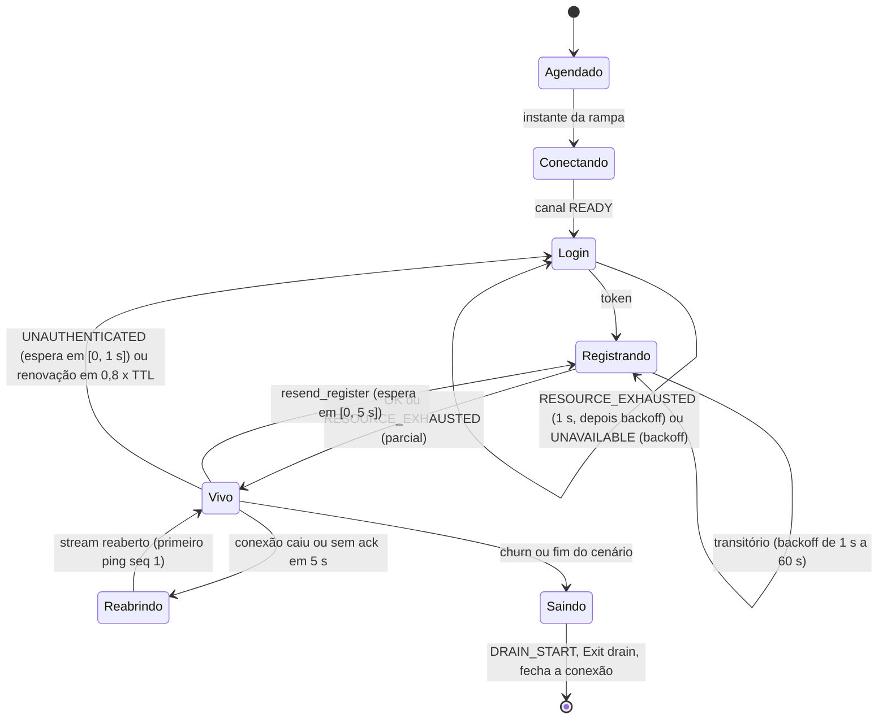
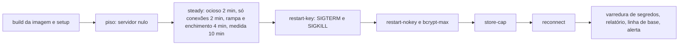

### FDD: Simulador de 500 sidecars e orçamento do controller (CTL-07)

Versão: 1.0
Data: 2026-10-21
Responsável: Guilherme Giusti

---

### 1. Contexto e motivação técnica

**Problema técnico.** O PRD 1.5 exige que o controller atenda 500 sidecars conectados com 1 vCPU e 512 MB, com o painel em p95 abaixo de 300 ms, e que os sidecars voltem ao painel em até 30 s depois de um restart (cerca de 10 s com `session.hmac_key`; sem ela, até cerca de 200 serviços). O HLD do `n3x-controller` divide esse total numa tabela de orçamento (host e runtime 60 MB e 0,05 vCPU; 500 conexões e streams 100 MB e 0,15 vCPU; core e dados 150 MB e 0,15 vCPU; folga 200 MB e 0,65 vCPU) que é hipótese até ser medida. As FDDs 30 a 43 deixaram dezenas de números à espera dessa medição: a razão de 80% do `GOMEMLIMIT` (P-08 da FDD 30), a fila e a concorrência de bcrypt e o teto de cerca de 200 serviços, que exige cerca de 2 vCPUs (P-04 e I-09 da FDD 31), o limiar de zumbis e o tempo de scrape (FDD 32), keepalive, buffers e memória por conexão (P-03 da FDD 33), até 5 bcrypt simultâneos (P-07 da FDD 34), `MaxConns`, prazos e `MaxOverviewCards` (P-06 da FDD 35), o p95 do `Login` (FDD 39), a razão entre heap real e estimativa do Store (FDD 41), a rajada de `Register` com o espalhamento (FDD 42) e o p99 do ack, o estado vivo e o p95 das telas (FDD 43). Subir 500 sidecars reais com Envoy é caro demais para a CI; um simulador leve, que fala o proto `Core` real, exercita o controller do mesmo jeito.

**Encaixe no HLD.** Esta FDD especifica o `test/load/` do `n3x-controller` (HLD do `n3x-controller`, estrutura do repositório e "Próximos passos": "escrever o simulador de 500 sidecars em `test/load/` e medir o orçamento") e a célula "500 sidecars simulados" da matriz de CI do HLD de plataforma (noturno, máquina dedicada, amd64). Ela não muda código de produção: mede o que as FDDs 30 a 45 constroem, devolve números que confirmam ou ajustam as constantes delas e fecha o marco M5 junto com a FDD 50.

```text
máquina dedicada n3x-perf (amd64, Linux, cgroup v2)
┌────────────────────────── núcleos 4 a 7 ──────────────────────────┐   ┌──────── núcleos 2 e 3, cota de 1 vCPU, 512 MiB ────────┐
│ n3x-load run (orquestrador, sem Envoy)                             │   │ container do controller (imagem real, rede do host)     │
│  ├─ sim: 500 sidecars simulados, 1 conexão TLS 1.3 cada ───────────┼──▶│  17443 gRPC: Login, Core/Register, Heartbeat, Event,    │
│  │   (Login, Register, Heartbeat, Event, Exit; proto Core v1)      │   │            Exit (host FDDs 31 a 33 + plugin core)        │
│  ├─ panel: 10 abas com sessão e polling htmx de 5 s ───────────────┼──▶│  17444 painel (FDDs 34 e 35 + telas do core, FDD 45)    │
│  └─ probe: cgroup a cada 1 s, /metrics a cada 5 s, pprof ──────────┼──▶│  17091 /ready, /metrics (FDD 30)                        │
└────────────────────────────────────────────────────────────────────┘   └──────────────────────────────────────────────────────────┘
        └──▶ report.json, summary.md e artefatos ──▶ portão noturno, comparação com a linha de base, issue de alerta
```

**Atores.** Simulador (500 clientes gRPC independentes, cada um com conexão, sessão, heartbeat e eventos próprios), controller com o plugin core (sistema medido), cliente de carga do painel (operadores com sessão fazendo polling), orquestrador `n3x-load run` (sobe o controller, injeta restarts, mede e decide), mantenedor (lê o relatório e aplica os ajustes nas FDDs donas) e CI noturna e de pré-release.

**Limites.** O simulador não tem Envoy, não carrega `.so` e não reaproveita o código do agente da FDD 42 (contrato 5 explica a paridade). Ele não é publicado: é ferramenta só de teste do repositório. Esta FDD não muda limites, filas nem constantes de outras FDDs: ela mede e, quando um número muda, registra o pedido para a FDD dona. Benchmark do sidecar é da FDD 50; restart de ponta a ponta com sidecars reais é da FDD 48.

**Suposições**
- As FDDs 30 a 45 estão implementadas na versão medida; as telas do core (FDD 45) existem com as rotas `/plugins/n3x/core/{sidecars,configs,fluxo,usuarios}` do HLD do core (os padrões de detalhe dependem da FDD 45, contrato 6)
- Os "MB" da tabela do HLD são lidos como MiB, porque as quatro parcelas somam 510 e o limite do container é 512 MiB (aprovado em 2026-10-22)
- Go 1.26 respeita a cota de CPU do cgroup no `GOMAXPROCS` padrão (FDD 30), então o controller roda com `GOMAXPROCS` 1 numa cota de 1 vCPU
- Existe um runner dedicado auto-hospedado `n3x-perf`, compartilhado com a FDD 50, sem outra carga durante a execução (runner dedicado confirmado pelo responsável em 2026-10-22, P-05)

**Restrições**
- Nada de Envoy, Kubernetes ou sidecar real na medição (ASSUNTO)
- O simulador respeita os limites do host: uma conexão por sidecar, no máximo 3 streams simultâneos por conexão (heartbeat, uma unária e o login), mensagens abaixo de 4 MiB (FDD 33)
- Nenhum segredo, token, hash ou chave entra em relatório, log ou artefato publicado (PRD, segurança)
- Resultado reproduzível: semente fixa, imagem fixada por digest, máquina descrita no relatório
- Documentação em pt-BR; identificadores em inglês

**Rastreabilidade**
- PRD 1.5: requisitos não funcionais de desempenho ("controller atende 500 sidecars conectados com 1 vCPU e 512 MB, painel em p95 menor que 300 ms"), de disponibilidade (volta ao painel em até 30 s, cerca de 10 s com `session.hmac_key`, até cerca de 200 serviços sem ela) e de segurança (nenhum segredo em log); FR-002, FR-005, FR-006, FR-008 e FR-016 como tráfego simulado; "Testes de carga e desempenho" (500 sidecars simulados à noite em máquina dedicada, antes de cada release, e validação exploratória do painel); critérios de aceite "controller com 500 sidecars simulados em 1 vCPU e 512 MB, painel em p95 menor que 300 ms" e "sidecar de volta ao painel em até 30 s"
- HLD do `n3x-controller`: "Orçamento do controller", "Técnicas aplicadas", "Meta de disponibilidade", riscos "Meta de 500 sidecars em 512 MB não fecha" e "Rajada de logins após restart"; HLD do `n3x-plugin-core`: "Considerações de escalabilidade" (150 MB e 0,15 vCPU, 50 pings por segundo); HLD de plataforma: "Matriz de CI"
- ADRs do `n3x-controller`: ADR-004 (bcrypt, fila, cache, bloqueio), ADR-006 (sessão do painel some no restart), ADR-008 (polling de 5 s); ADRs do `n3x-plugin-core`: ADR-004 (chave HMAC e rajada), ADR-005 (token), ADR-007 (proto `Core`, heartbeat de 10 s, 3 intervalos), ADR-009 (teto de 128 MiB), ADR-010 (métricas); ADRs do `n3x-sdk`: ADR-001 (instância única, escala vertical), ADR-009 (sem tracing, correlação por `request_id`), ADR-010 (metas do sistema divididas no HLD de cada repositório)
- Decisões da clarificação (responsável, 2026-10-22):
  - Runner dedicado e auto-hospedado `n3x-perf` (amd64, 8 núcleos físicos ou mais, 16 GiB, cgroup v2, kernel 5.19+) confirmado como requisito do marco M5
  - Hipóteses menores aprovadas em bloco: módulo aninhado `test/load`, "MB" do HLD lidos como MiB, portão G01 a G17 e regras R1 a R8, falha só com 2 de 2, M5 = 3 noites verdes mais 1 pré-release verde, linha de base de 7 noites, issues automáticas `load-controller` e `perf-infra`, prazos das suítes, perfil `reference` e as 10 abas
  - Consequência da decisão da CTL-05: no cenário `store-cap`, quando o core fica `degraded`, as sessões das abas de leitura (`leitura1` e `leitura2`) são cortadas e contam como relogin recusado; só as abas do root seguem, e a meta G14 (o root entra no painel) continua valendo
- Lacuna do README fechada aqui: L-24, parte do ajuste (regra de decisão da razão do `GOMEMLIMIT` e conferência da imagem distroless sob carga); a escolha da imagem e da razão inicial foi da FDD 30
- Pedidos atendidos: FDD 10 (parte do renderizador no p95), FDD 11 (carga do polling e da exportação), FDD 30 (P-08, razão do `GOMEMLIMIT`), FDD 31 (P-04 e I-09: calibrar `bcrypt_queue`, `bcrypt_wait` e `bcrypt_concurrency`, 50 bcrypt para 50 serviços), FDD 32 (custo da camada, P-05 do limiar de zumbis, tempo de scrape), FDD 33 (P-03: keepalive, buffers e folgas, custo da cadeia e memória por conexão), FDDs 34 e 40 (até 5 bcrypt simultâneos), FDD 35 (P-06: p95 com 10 abas, `MaxConns`, prazos e `MaxOverviewCards`), FDD 37 (gerar configs com `effconfig`), FDD 39 (p95 do `Login` e rajada sem chave), FDD 41 (razão heap e estimativa, orçamento), FDD 42 (rajada de `Register` com o espalhamento) e FDD 43 (p99 do ack, CPU e memória do core, rajada com e sem chave, p95 das telas, estado vivo, razão heap e estimativa)
- FDDs de que depende: 30, 31, 32, 33, 34, 35, 36, 37, 39, 40, 41, 42, 43 e 45; relacionadas: 38 (cliente gRPC imitado), 46 (imagem e alertas), 47 (guia), 48 (ponta a ponta) e 50 (mesma máquina e sessão S35)

---

### 2. Objetivos técnicos

- **Veredito objetivo do PRD.** Medida: o portão noturno responde "passa", "falha" ou "inconclusivo" para as 17 metas G01 a G17 do contrato 9, com o valor medido, a meta e a fonte de cada uma no `report.json`; o marco M5 fecha com 3 noites verdes seguidas e uma suíte `prerelease` verde (hipótese).
- **Orçamento conferido parcela por parcela.** Medida: o relatório traz, para cada linha da tabela do HLD, memória e CPU medidas no regime estável, pelo método de atribuição usado (perfil `pprof` ou diferença entre fases, contrato 7), e a recomendação de ajuste; a soma das parcelas fica dentro de 10% do total medido do container.
- **Restart medido de ponta a ponta.** Medida: tempo de cada um dos 500 sidecars desde o `/ready` 200 do controller novo até o `Register` aceito, com p50, p95 e máximo, nos restarts com e sem `session.hmac_key`, com SIGTERM e com SIGKILL; contagem exata de `Login` e de bcrypt em cada um.
- **Constantes das FDDs donas calibradas por regra escrita.** Medida: o relatório traz uma seção `recommendations` com o valor sugerido para `MemoryLimitRatio` (FDD 30), `bcrypt_concurrency`, `bcrypt_queue` e `bcrypt_wait` (FDD 31), `ZombieThreshold` (FDD 32), buffers e keepalive (FDD 33), `MaxConns` e `MaxOverviewCards` (FDD 35) e o limite publicado de serviços sem chave por vCPU (I-09 da FDD 31), cada um com a regra do contrato 9 que o produziu.
- **Simulador que não mascara o resultado.** Invariante: uma execução só vale se o simulador passou na própria saúde (atraso do agendador de ping p99 até 20 ms, CPU até 80% dos núcleos dele) e se o piso medido contra o servidor nulo (contrato 11) está abaixo de 5 ms no p99 do ack; senão o veredito é "inconclusivo" e não "passa".
- **Dados realistas.** Medida: o perfil `reference` reproduz a fixture F1 da FDD 41 (50 serviços com 10 instâncias, 2 manifestos de cerca de 96 KiB, configs de cerca de 16 KiB, até 200 eventos por instância); depois da fase de enchimento, `n3x_n3x_core_memory_bytes` fica entre 70% e 130% da estimativa do próprio perfil (conferência de que o dado chegou).
- **Nenhum segredo vaza sob carga.** Medida: 0 ocorrências dos segredos de serviço, das senhas do painel, da chave AES, da `hmac_key` e dos tokens emitidos nos logs do controller e nos artefatos, pela varredura do `secret/secrettest` (FDD 03).
- **Reproduzível e barato.** Medida: suíte `nightly` em até 60 min de relógio, `prerelease` em até 4 h, `smoke` de PR em até 10 min num runner comum; mesma semente gera os mesmos nomes, configs, manifestos e sequência de eventos (teste de golden do gerador).

---

### 3. Escopo e exclusões

**Incluído**
- Módulo Go aninhado `github.com/giustech/n3x-controller/test/load` (aprovado em 2026-10-22, H-01) com o comando `n3x-load` e os pacotes internos `sim`, `fixture`, `panel`, `probe`, `scenario`, `report` e `nullsrv`
- Simulador de N sidecars (padrão 500) em M serviços (padrão 50), cada um com conexão gRPC própria em TLS 1.3, IP de origem próprio no loopback, sessão, `Register`, stream de heartbeat, eventos com `id`, `Exit`, renovação e reação aos códigos de erro iguais às do agente (contrato 5)
- Geração de manifestos (`artifact`, FDD 22) e configs efetivas (`effconfig`, FDD 37) válidos, com schemas reais, em três perfis de tamanho (contrato 4)
- Credenciais de teste em lote pelo `n3x-controller credential new`, hashes do painel pelo `hash`, chave AES pelo `keygen` e `hmac_key` cifrada pelo `encrypt --plugin n3x.core`, e o `n3x.yaml` do controller do teste (contrato 3)
- Carga do painel: 10 abas de 3 operadores, login real com CSRF, páginas inteiras sem `HX-Request` e polling com `HX-Request`, `HX-Target` e `N3X-Refresh` tirados do próprio HTML, exportação ocasional (contrato 6)
- Cenários: ocioso, só conexões, regime estável com enchimento, restart com e sem chave (SIGTERM e SIGKILL), rajada com 5 bcrypt simultâneos, teto do Store, reconexão em massa; na pré-release, renovação de sessão, longa duração, capacidade até 1.000 sidecars, escala sem chave até 200 serviços, varredura da razão do `GOMEMLIMIT`, log em `debug`, registro grande e queda longa (contrato 2)
- Medição: cgroup v2 do container (CPU, memória, estrangulamento, OOM), `/metrics` do controller, perfil `pprof` quando a imagem oferece, latências do lado do cliente com HdrHistogram, logs do controller (contrato 7)
- Relatório `report.json` (formato 1), `summary.md` e artefatos; portão com metas numéricas; comparação com a linha de base; recomendações (contratos 8 e 9)
- Workflow de CI: `smoke` em PR, `nightly` na máquina dedicada, `prerelease` antes de cada release do controller e do core, `workflow_dispatch` para validação exploratória (contrato 10)
- Servidor nulo de calibração do simulador (contrato 11)
- Fechamento da L-24 (parte de ajuste) e respostas aos pontos P-08 da FDD 30, P-04 e I-09 da FDD 31, P-05 da FDD 32, P-03 da FDD 33, P-07 da FDD 34 e P-06 da FDD 35

**Excluído**
- Benchmark open-loop do sidecar, Envoy puro de referência e cruzamentos Envoy para Go: FDD 50 (SID-12)
- Restart de ponta a ponta com sidecars reais, rolling update e testes de limite (1.001ª conexão, 17º stream, mensagem grande): FDD 48 (SDK-16) e critérios das FDDs 33 e 38
- Limites, fila e contadores do servidor gRPC e do verificador em si: FDDs 33 (CTL-04) e 31 (CTL-02); esta FDD só mede e pede ajuste
- Teto de memória, descarte e degradado do core: FDD 41 (CORE-05); aqui só a medição sob carga
- Telas e cartões do core, registro único das métricas `n3x_n3x_core_*` e alertas de produção: FDD 45 (CORE-09)
- Micro-benchmarks com `-benchmem` de cada componente: cada FDD dona (32, 33, 35, 39, 41, 43)
- Teste de longa duração do sidecar (L-41): FDD 48 ou 50; aqui só a longa duração do controller na pré-release
- Mudança de qualquer constante de produção: fica como pedido à FDD dona, aplicado num patch dela

---

### 4. Fluxos detalhados e diagramas

**Fluxo principal: suíte `nightly` na máquina dedicada**
1. O workflow `load.yml` (contrato 10) roda às 03:30 UTC no runner `n3x-perf`, no grupo de concorrência `n3x-perf` (nunca junto com a FDD 50), com o commit da `main`.
2. Monta a imagem alvo `n3x-ci/controller-load:<sha>`: binário de `cmd/n3x-controller-dev` com a tag `n3x_dev` e o core real da versão do `go.mod`, sobre a imagem base `images/Dockerfile` do mesmo commit (H-02). Na suíte `prerelease`, o alvo é a imagem gerada pela `controller-builder` candidata com o core e o `n3x.example` (`examples/controller/Dockerfile` da FDD 46).
3. `n3x-load setup` gera o diretório de trabalho (contrato 3): chave AES, `hmac_key` cifrada, 50 credenciais de serviço de custo 12 pelo `credential new` (4 em paralelo, cerca de 15 s), hashes do root e de 2 usuários de leitura, certificado do `dev-cert` e o `controller.yaml`. O arquivo `credentials.json` fica com modo 0600 e é apagado no fim.
4. `n3x-load run --suite nightly` abre o servidor nulo, mede o piso do simulador (contrato 11) e, para cada cenário da suíte:
   1. sobe um container novo do controller com `--network host --cpus 1 --cpuset-cpus 2,3 --memory 512m --memory-swap 512m --read-only --tmpfs /tmp --user 17000:17000` e o `controller.yaml` do cenário (H-03)
   2. espera `/ready` 200 na `17091` (sonda a cada 100 ms, até 60 s); liga o `probe` (cgroup a cada 1 s, `/metrics` a cada 5 s, log do container em arquivo)
   3. executa as fases do cenário (contrato 2): rampa dos sidecars, enchimento, janela de medida, injeção de restart, espera da volta
   4. durante a janela de medida, coleta um perfil de CPU de 60 s e, ao fim de cada fase, um perfil de heap com `gc=1`, quando a imagem oferece `pprof` (contrato 7)
   5. para o simulador com `Exit` de todos, para o container com SIGTERM, guarda o log e confere `oom_kill`
   6. avalia as metas do cenário (contrato 9); meta dura que falha faz o cenário rodar de novo uma vez; falha só vale se repetir (2 de 2)
5. Varre o log do controller e os artefatos com os segredos do diretório de trabalho como agulhas (`secrettest.Leaks`).
6. Escreve `report.json` e `summary.md`, compara com a linha de base das últimas 7 noites verdes (contrato 9) e publica o artefato `controller-load-<sha>`.
7. Saída 0 (passa), 2 (meta falhou), 3 (inconclusivo) ou 4 (infraestrutura); o workflow abre ou atualiza a issue `load-controller` (falha ou regressão em 3 noites) ou `perf-infra` (inconclusivo em 2 noites).

**Fluxo do sidecar simulado (cada um dos 500, contrato 5)**
1. Começa num instante uniforme dentro da rampa (padrão 60 s), com semente fixa por índice.
2. Abre a própria `grpc.ClientConn` para `127.0.0.1:17443` com IP de origem `127.1.<i/256>.<i%256>`, TLS 1.3, `ServerName` `n3x-controller`, keepalive de 30 s com prazo de 10 s e `PermitWithoutStream`, backoff de 1 s a 60 s, multiplicador 1,6 e jitter de 20% (FDD 38).
3. `Login` com `WaitForReady` e prazo de 10 s, segredo do serviço, `x-request-id` próprio; guarda o token só em memória.
4. `Register` com `WaitForReady` e prazo de 5 s, com o manifesto e a config do perfil (contrato 4) e `heartbeat_interval` de 10 s. `RESOURCE_EXHAUSTED` vale como registro parcial (o heartbeat começa e há nova tentativa com backoff).
5. Abre o stream `Core/Heartbeat`; primeiro ping na abertura com `seq` 1; um ping a cada 10 s contados do envio anterior, no máximo um sem ack; sem ack em `min(10 s, 5 s)`, cancela e reabre com backoff de 1 s a 10 s.
6. Envia eventos na taxa do cenário com uma chamada em voo por sidecar; `ABORTED` (órfão) espera e tenta de novo, sem perder a ordem por nonce.
7. Reage como o agente: `resend_register` no ack gera um `Register` depois de espera uniforme em `[0, min(intervalo/2, 5 s)]`; `UNAUTHENTICATED` gera um novo `Login` depois de espera uniforme em `[0, 1 s]` e um `Register` da geração nova; `RESOURCE_EXHAUSTED` no `Login` espera cerca de 1 s e depois segue o backoff.
8. Na troca de pod (taxa `churn`), envia `DRAIN_START`, depois `Exit` com `reason` `drain` em até 1,5 s, fecha a conexão e é substituído por um sidecar novo do mesmo serviço com nome novo (que acerta o cache de credencial).
9. Grava os instantes de cada transição para o relatório (pronto, primeiro ack, `Register` aceito depois de cada restart).

**Fluxo do restart sem `session.hmac_key` (cenário `restart-nokey`)**
1. Regime estável com 500 sidecars; o orquestrador marca `t_stop` e manda SIGTERM ao container (variante: SIGKILL).
2. O controller corta os streams com `UNAVAILABLE` "controller parando" (FDD 33) e sai; os sidecars entram em reconexão com backoff.
3. O orquestrador inicia o container de novo, marca `t_ready` no primeiro `/ready` 200. Sem chave, o core gerou uma chave aleatória nova no `Start`.
4. Cada sidecar reconecta no próximo passo do backoff, reabre o heartbeat com o token antigo e recebe `UNAUTHENTICATED` (motivo `key` no `auth_failed`, FDD 39).
5. Novo `Login` depois de 0 a 1 s: o verificador deduplica por serviço (um líder por serviço), compara 50 bcrypt com 2 vagas, fila de 16 e espera de 5 s; o excedente recebe `RESOURCE_EXHAUSTED` "controller ocupado" e tenta de novo depois de cerca de 1 s (FDDs 31 e 39); os demais pods de cada serviço acertam o cache.
6. Com o token novo, `Register` da geração nova e heartbeat; o sidecar conta como "de volta" no `Register` aceito.
7. A medida termina quando os 500 voltaram ou em `t_ready + 60 s`; o relatório guarda `t_back` por sidecar, o número de bcrypt (`n3x_controller_bcrypt_duration_seconds_count`), de `Login` (`n3x_controller_logins_total` por `result`), o pico de `bcrypt_inflight` e `bcrypt_waiting` e o p95 do painel durante a rajada.

**Fluxos alternativos e exceções**
- **Restart com `session.hmac_key`:** o token continua válido; nenhum `Login`; o primeiro ack de cada stream reaberto traz `resend_register` e o `Register` sai com o espalhamento de até 5 s; meta de cerca de 10 s
- **Rajada com 5 bcrypt (`bcrypt-max`, segunda repetição do `restart-nokey`):** durante a rajada, o root e os 2 usuários de leitura fazem login em laço no painel (root: 1 vaga própria, FDD 34; leitura: 2 vagas do diretório, FDD 40); mede-se o estrangulamento do cgroup, o ack p99, o tempo do login do root e se algum sidecar caiu por falta de ping
- **Teto do Store (`store-cap`):** perfil `large` com config única por instância empurra o Store além de `memory_limit`; espera-se descarte, depois degradado, `Register` parcial (`RESOURCE_EXHAUSTED`) e só o root no painel; mede-se o pico de memória do container contra o `GOMEMLIMIT`
- **Reconexão em massa (`reconnect`):** o simulador fecha as 500 conexões ao mesmo tempo, sem restart do controller; mede-se a tempestade de handshakes TLS, `grpc_handshake_failures_total` e a volta (sem `Login`, sem `Register`)
- **Queda longa (`downtime-long`, pré-release):** controller parado por 60 s; com o backoff de até 60 s da FDD 38, mede-se quanto passa de 30 s depois do `/ready` (quantifica a inconsistência registrada na FDD 38)
- **Sessão do painel perdida no restart (ADR-006):** a aba recebe 303 para `/login` ou `HX-Redirect`; o cliente faz login de novo e conta `panel_relogins`; o p95 do painel com meta dura só vale no regime estável
- **Simulador saturado:** atraso do agendador acima de 20 ms no p99 ou CPU acima de 80% dos núcleos dele: veredito "inconclusivo", saída 3, nenhuma meta é marcada como falha
- **Imagem sem `pprof`** (suíte `prerelease` com a imagem do builder): atribuição por diferença entre fases; as metas que dependem de perfil (G06 na forma por pacote, parte do renderizador) saem como "medida por diferença" e o relatório diz o método
- **Controller não fica pronto em 60 s, sai sozinho ou some o cgroup:** saída 4 (infraestrutura) com o código de saída e as últimas 200 linhas do log, sem segredo
- **OOM kill:** meta G01 falha na hora; o relatório guarda `memory.events`, a última amostra de `memory.stat` e o último `/metrics`

**Diagramas**

Estados do sidecar simulado:



Sequência do restart sem chave:

```mermaid
sequenceDiagram
    participant O as n3x-load run
    participant C as controller (container)
    participant S as 500 sidecars simulados
    participant V as verificador (FDD 31)
    O->>C: SIGTERM (t_stop)
    C-->>S: streams cortados, UNAVAILABLE
    S->>S: backoff de reconexão (1; 1,6; 2,56 s...)
    O->>C: docker start; /ready 200 (t_ready)
    S->>C: Heartbeat com token antigo
    C-->>S: UNAUTHENTICATED (motivo key)
    S->>S: espera uniforme em [0, 1 s]
    S->>C: Login (500 chamadas)
    C->>V: Verify: 50 líderes, 450 seguidoras ou acertos de cache
    V-->>C: 2 bcrypt por vez, fila de 16, excedente busy
    C-->>S: token ou RESOURCE_EXHAUSTED (tenta em cerca de 1 s)
    S->>C: Register da geração nova
    C-->>S: OK (t_back do sidecar)
    O->>O: todos de volta ou t_ready + 60 s; métricas e veredito
```

Ordem da suíte `nightly` (cerca de 45 min, H-21):



---

### 5. Contratos públicos (assinaturas, endpoints, headers, exemplos)

O simulador não é publicado e não tem compromisso de compatibilidade fora do repositório. Os contratos abaixo existem para a CI, para o mantenedor e para as FDDs que leem o relatório; mudam em PR do próprio `n3x-controller`, com o `format` do relatório subindo quando um campo some ou muda de sentido.

**Contrato 1: comando `n3x-load`**
- Tipo: CLI (`test/load/cmd/n3x-load`, executado com `go run ./cmd/n3x-load` dentro de `test/load/` ou como binário do job)
- Assinatura/Rota:
  ```text
  n3x-load setup   --image <ref> | --binary <arquivo>  --out <dir>
                   [--services 50] [--readers 2] [--cost 12] [--seed 1]
  n3x-load run     --suite smoke|nightly|prerelease|<arquivo.yaml>  --work <dir>  --out <dir>
                   [--image <ref> | --binary <arquivo>] [--scenario <nome>[,<nome>...]] [--repeat 1]
                   [--controller-cpus 1] [--controller-memory 512Mi] [--controller-cpuset 2,3]
                   [--sim-cpuset 4-7] [--baseline <dir>|gh:<workflow>] [--seed 1] [--keep] [--hold]
  n3x-load sim     --target 127.0.0.1:17443 --ca <pem> [--server-name n3x-controller] --credentials <arquivo>
                   [--sidecars 500] [--services 50] [--profile reference] [--heartbeat-interval 10s]
                   [--ramp 60s] [--duration 10m] [--events-per-s 20] [--registers-per-s 5]
                   [--churn-per-s 0.25] [--source-ips 127.1.0.0/16] [--seed 1] [--report <arquivo>]
                   [--metrics-listen 127.0.0.1:17999]
  n3x-load panel   --target https://127.0.0.1:17444 --ca <pem> --users <arquivo> [--tabs 10]
                   [--duration 10m] [--routes <arquivo>] [--export-every 5m] [--report <arquivo>]
  n3x-load compare --report <arquivo> --baseline <dir>|gh:<workflow> [--nights 7] [--format text|json]
  n3x-load nullsrv --listen 127.0.0.1:18443 --cert <pem> --key <pem>
  ```
- Método: processo; logs JSON em stderr; o que é pedido (relatório, resumo) em arquivo
- Semântica:
  - **`setup`:** contrato 3. Nunca imprime segredo; stdout traz só o caminho do diretório e as contagens
  - **`run`:** orquestra os cenários (contrato 2), com o controller em container (padrão) ou binário local (`--binary`, só para desenvolvimento; sem cgroup próprio, o veredito de recursos sai "inconclusivo"). `--hold` deixa o simulador e o painel rodando depois da medida até SIGINT, para a validação exploratória do painel pedida pelo PRD
  - **`sim` e `panel`:** as mesmas peças do `run`, sozinhas, contra um controller já de pé (desenvolvimento e exploração); `--report` grava só a parte do cliente
  - **`compare`:** contrato 9; `gh:<workflow>` baixa os relatórios das últimas noites verdes com `gh run download`
  - **`nullsrv`:** contrato 11
  - **Códigos de saída:** 0 passa; 1 uso (flag, arquivo, cenário desconhecido); 2 meta dura ou de orçamento falhou; 3 inconclusivo (simulador saturado, piso acima de 5 ms, máquina ruidosa, cgroup ausente); 4 infraestrutura (docker, imagem, controller não ficou pronto, saiu sozinho); 5 regressão encontrada pelo `compare` (só no `compare`); com várias causas, vale a de maior número entre 2, 3 e 4 na ordem 4, 3, 2 (infraestrutura antes de inconclusivo antes de falha)
  - **Determinismo:** `--seed` fixa nomes, endereços, configs, manifestos, instantes da rampa e sequência de eventos; o relatório guarda a semente

**Exemplo de requisição**
```text
$ n3x-load run --suite nightly --work /var/lib/n3x-perf/work --out ./out \
    --image n3x-ci/controller-load:4f2c9e1 --baseline gh:load.yml --seed 1
```

**Exemplo de resposta** (stderr, trecho, e código de saída)
```json
{"ts":"2026-10-22T03:41:07Z","level":"info","component":"loadrun","msg":"scenario_started","scenario":"restart-nokey","repeat":1,"sidecars":500,"services":50,"profile":"reference"}
{"ts":"2026-10-22T03:44:10Z","level":"info","component":"loadrun","msg":"fleet_back","scenario":"restart-nokey","back":500,"t_back_p50_s":9.8,"t_back_p95_s":17.4,"t_back_max_s":21.6,"bcrypt":50,"logins_ok":500}
{"ts":"2026-10-22T04:16:52Z","level":"info","component":"loadrun","msg":"report_written","verdict":"pass","gates_failed":0,"regressions":0,"path":"out/report.json"}
```
```text
exit 0
```

---

**Contrato 2: cenários e suítes (`test/load/scenarios/*.yaml`)**
- Tipo: arquivo de configuração versionado (YAML lido com o `yamlconv` do SDK e decodificado de forma estrita, padrão da FDD 01)
- Assinatura/Rota: `format: 1`; um arquivo por cenário e um por suíte (`smoke.yaml`, `nightly.yaml`, `prerelease.yaml`)
- Método: lido pelo `run`
- Semântica:
  - **`controller`:** `hmac_key` (`true` ou `false`), `log_level`, `session_ttl`, `memory_limit`, `inventory_retention`, `grpc_login` (para a calibração), `resources_memory` (para a varredura do `GOMEMLIMIT`); os demais campos ficam no padrão da FDD 30
  - **`fleet`:** `sidecars`, `services`, `profile`, `heartbeat_interval`, `ramp`, `source_ips`
  - **`load`:** `events_per_s`, `registers_per_s`, `churn_per_s`, `event_burst` (eventos por segundo na fase de enchimento)
  - **`panel`:** `tabs` e `users` (`nome:abas`)
  - **`phases`:** lista em ordem com `name`, `duration` ou `until` (`fleet_ready`, `fleet_back`, `store_degraded`), `measure` (se entra nas metas de regime) e `action` (`restart` com `signal` `SIGTERM` ou `SIGKILL` e `down`; `disconnect_all`; `fill`; `stop`); `timeout` por fase
  - **`gates`:** metas do contrato 9 avaliadas no cenário
  - **Contagens exatas:** nas fases com `action: restart`, o churn e os reenvios idempotentes de `registers_per_s` param do `t_stop` até o fim da fase, para G07 e G08 contarem exatamente um `Login` e um `Register` por sidecar; os eventos continuam
  - Campo desconhecido é erro de uso (saída 1)

| Cenário | Suíte | O que faz | Duração aproximada | Metas |
| --- | --- | --- | --- | --- |
| `null-floor` | todas | 500 sidecars contra o servidor nulo, 2 min | 3 min | G17 |
| `steady` | nightly, prerelease | ocioso 2 min (parcela 1), só conexões e `Login` 2 min (memória por conexão), rampa e enchimento até cerca de 200 eventos por instância, medida de 10 min com o painel de 10 abas, exportação a cada 5 min, churn e eventos de referência | 18 min | G01 a G06, G09 a G13, G15, G16 |
| `restart-key` | nightly, prerelease | 2 restarts com chave (SIGTERM com 3 s parado, SIGKILL com 3 s parado) | 4 min | G01, G05, G07, G10, G11 |
| `restart-nokey` | nightly, prerelease | 2 restarts sem chave; o segundo é o `bcrypt-max` (root e leitura em laço no painel durante a rajada) | 6 min | G01, G05, G08, G11 |
| `store-cap` | nightly, prerelease | perfil `large`, config única por instância, até `store_degraded` e mais 3 min | 7 min | G01, G11, G14 |
| `reconnect` | nightly, prerelease | `disconnect_all` no simulador, sem restart | 3 min | G01, G05, G11 |
| `smoke` | smoke (PR) | 50 sidecars, 5 serviços, perfil `small`, 1 restart com chave, painel de 2 abas, contra o binário de desenvolvimento num runner comum | 5 min | funcionais de G07, G11 e G12; sem metas de recurso |
| `renewal` | prerelease | `session_ttl: 5m`, 12 min: cada sidecar renova duas vezes (troca de stream e `Register` por geração) | 13 min | G05, G11 |
| `soak` | prerelease | regime de referência por 60 min | 62 min | G01, G05, G11; deriva de heap abaixo de 5% por hora e goroutines estáveis em mais ou menos 2% |
| `capacity` | prerelease | de 500 a 1.000 sidecars em passos de 100, 3 min cada | 20 min | informativa: joelho (maior N com G02, G04 e G05 dentro) |
| `scale-nokey` | prerelease | 500 sidecars em 200 serviços, restart sem chave | 6 min | informativa: serviços de volta em 30 s, vazão de bcrypt |
| `gomemlimit-sweep` | prerelease | `store-cap` com razões 0,7, 0,8 e 0,9 (por `resources_memory`) | 20 min | informativa: regra do contrato 9 |
| `debug-log` | prerelease | `steady` com `log_level: debug` | 12 min | informativa: custo do log de chamada (P-05 da FDD 33) |
| `large-register` | prerelease | `restart-key` com o perfil `large` (manifesto de 480 KiB e config de 512 KiB) | 6 min | G01, G10 |
| `downtime-long` | prerelease | restart sem chave com 60 s parado | 5 min | informativa: tempo de volta depois do `/ready` |
| `calibrate-bcrypt` | manual e prerelease | `restart-nokey` na grade `bcrypt_concurrency` 1 e 2 por `bcrypt_queue` 16 e 32, `bcrypt_wait` 5 s | 20 min | informativa: regra R2 do contrato 9 |

**Exemplo de requisição** (`scenarios/restart-nokey.yaml`)
```yaml
format: 1
name: restart-nokey
controller: { hmac_key: false, log_level: info }
fleet: { sidecars: 500, services: 50, profile: reference, heartbeat_interval: 10s, ramp: 60s, source_ips: 127.1.0.0/16 }
load: { events_per_s: 20, registers_per_s: 5, churn_per_s: 0.25 }
panel: { tabs: 10, users: ["admin:2", "leitura1:4", "leitura2:4"] }
phases:
  - { name: warmup, until: fleet_ready, timeout: 180s, measure: false }
  - { name: settle, duration: 60s, measure: false }
  - { name: restart, action: { kind: restart, signal: SIGTERM, down: 3s }, until: fleet_back, timeout: 60s }
  - { name: settle2, duration: 60s, measure: false }
  - { name: restart-bcrypt-max, action: { kind: restart, signal: SIGKILL, down: 3s, panel_login_loop: true }, until: fleet_back, timeout: 60s }
gates: [G01, G05, G08, G11]
```

**Exemplo de resposta** (`n3x-load run --scenario restart-nokey --suite x.yaml` com campo errado)
```text
erro: scenarios/restart-nokey.yaml: phases[2].action.sinal: campo desconhecido [unknown_field]
exit 1
```

---

**Contrato 3: `setup`, credenciais em lote e `n3x.yaml` do teste**
- Tipo: CLI e arquivos no diretório de trabalho (`--out`, modo 0700)
- Assinatura/Rota: arquivos `aes.key` (0400), `credentials.json` (0600), `panel-users.json` (0600), `tls/tls.crt` e `tls/tls.key`, `controller.yaml` e `controller-nokey.yaml`
- Método: o `setup` chama o próprio controller alvo (`docker run --rm <imagem> <subcomando>` ou o binário), sem reimplementar formato:
  - `keygen` gera `aes.key`; `keygen` de novo gera a `hmac_key` (base64 de 32 bytes, FDD 03), cifrada por `encrypt --key aes.key --plugin n3x.core`
  - `credential new svc-NNN` (sem `--key`), uma vez por serviço, 4 em paralelo; das duas linhas de stdout, `secret_hash` vai ao `controller.yaml` e `secret` vai ao `credentials.json`
  - `hash --cost 12` para o root `admin` e os usuários `leitura1` e `leitura2` (senhas aleatórias de 24 caracteres)
  - `dev-cert --out tls` (SANs `localhost`, `127.0.0.1`, `::1`, `n3x-controller`)
- Semântica:
  - Nomes de serviço `svc-001` a `svc-NNN` (gramática do `service`, FDD 30); custo 12 obrigatório nas metas (o custo real é o que a rajada mede); `--cost` menor só para desenvolvimento, e o relatório marca `cost_reduced` e não aplica G08
  - `controller.yaml` usa os padrões da FDD 30 (limites, `grpc.login`, `panel`, `runtime`), `runtime.log_level: info`, sem `resources` (vale o cgroup), sem `grpc.trusted_proxies`; `controller-nokey.yaml` é igual sem `session.hmac_key`
  - Os arquivos que o controller lê são gravados pelos próprios subcomandos dentro do container, logo têm dono 17000; o diretório é montado só leitura em `/etc/n3x` e o `controller.yaml` usa caminhos relativos a ele (FDD 30)
  - `credentials.json` e `panel-users.json` nunca vão para o artefato; o `run` apaga o diretório de trabalho no fim, salvo `--keep`; os valores servem de agulha para a varredura de segredos
  - O `setup` falha com saída 4 se algum subcomando falhar, mostrando o subcomando e o código, nunca a saída dele

**Exemplo de requisição**
```text
$ n3x-load setup --image n3x-ci/controller-load:4f2c9e1 --out /var/lib/n3x-perf/work --services 50 --readers 2
```

**Exemplo de resposta** (stdout, `credentials.json` com valores trocados por marcadores e trecho do `controller.yaml`)
```text
/var/lib/n3x-perf/work services=50 readers=2 cost=12 duration=14.8s
```
```json
{ "format": 1, "seed": 1, "cost": 12, "services": [ { "name": "svc-001", "secret": "<43 caracteres base64url>" }, { "name": "svc-002", "secret": "<43 caracteres base64url>" } ] }
```
```yaml
version: 1
tls: { cert_file: tls/tls.crt, key_file: tls/tls.key }
keys: { aes_file: aes.key }
root: { user: admin, password_hash: "$2a$12$<53 caracteres>" }
services:
  svc-001: { secret_hash: "$2a$12$<53 caracteres>" }
  svc-002: { secret_hash: "$2a$12$<53 caracteres>" }
runtime: { log_level: info }
plugins:
  n3x.core:
    session: { hmac_key: "ENC[v1:<envelope>]" }
    users:
      - { name: leitura1, password_hash: "$2a$12$<53 caracteres>" }
      - { name: leitura2, password_hash: "$2a$12$<53 caracteres>" }
```

---

**Contrato 4: perfis de dados e gerador de registros (`internal/fixture`)**
- Tipo: sdk interno (API Go do módulo de teste)
- Assinatura/Rota:
  ```go
  package fixture // github.com/giustech/n3x-controller/test/load/internal/fixture

  type Profile struct {
      Name              string // small, reference, large
      PluginsPerSidecar int    // além do core
      Manifests         int    // manifestos distintos na frota
      ManifestBytes     int    // alvo do manifesto codificado
      ConfigBytes       int    // alvo da config efetiva canônica
      DivergentServices float64 // fração de serviços com 2 hashes de config
      UniquePerInstance bool    // config única por instância (store-cap)
  }

  var Small, Reference, Large Profile

  type Fleet struct{ /* serviços, instâncias, manifestos e configs pré-montados */ }

  func Build(p Profile, services, sidecars int, seed uint64) (*Fleet, error)
  func (f *Fleet) Register(i int) *corev1.RegisterRequest // reaproveitado, pronto para enviar
  func (f *Fleet) Identity(i int) (service, instance, address string)
  func (f *Fleet) Replace(i int) // churn: nome novo no mesmo serviço
  func (f *Fleet) Event(i int, seq uint64, kind corev1.EventKind) *corev1.EventRequest
  func (f *Fleet) EstimatedStoreBytes(eventsPerInstance int) int64 // pela fórmula da FDD 41
  ```
- Método: chamada local, uma vez por cenário (a montagem fica fora da medida)
- Semântica:
  - **Manifestos:** `artifact.Encode` (FDD 22) com `format: 1`, `kind: sidecar`, alvo `envoy-1.40`, arquitetura do processo, o core, o `n3x.example` e plugins sintéticos `loadtest.p01` a `loadtest.pNN` (namespace `loadtest`, só de teste), cada um com o schema da metade de proxy gerado por `plugin.SchemaOf[C]()` de structs sintéticas com campos de texto, número, lista e segredo; o tamanho é ajustado pelas descrições (`desc`) até o alvo
  - **Configs:** `effconfig.Build` (FDD 37) com o objeto `sidecar` da lista do contrato 1 dela, `controller.secret` como `ENC[...]` sintético (impressão digital determinística), plugins com fase, ordem, política e config normalizada; segredos marcados `sealed` com `SecretMark` coerente, para passar no `CheckMasked` do controller; o hash vem do próprio `Build`, nunca é calculado à parte
  - **Divergência:** 10% dos serviços têm 2 hashes de config entre as instâncias (`reference`), para exercitar a divergência da FDD 44 e o cache de manifestos da FDD 43
  - **Eventos:** `id` = `<nonce de 8 bytes em 16 hex>:<seq em 16 hex>` (33 caracteres, formato da FDD 42), nonce novo por processo simulado; mistura (hipótese) 60% `PANIC` com `suppressed` de 0 a 5, 15% `BREAKER_OPEN`, 5% `PLUGIN_DISABLED`, 5% `CONFIG_ERROR`, 5% `SECRET_IN_CLEAR` e 10% `DRAIN_START` (este só na troca de pod); `detail` fixo do formato da FDD 18 (`hook=on_request_headers`, `reason=panics`); 1% dos envios repete um `id` já aceito (exercita a deduplicação)
  - **Identidade:** instância `svc-NNN-<6 hex>-<5 alfanuméricos>` (forma de nome de pod), endereço `10.<a>.<b>.<c>:17000`, `envoy_version` `1.40.1`
  - **Golden:** com a semente 1, os hashes de config e manifesto de `Reference` são fixos em `testdata/fixture_golden.json`; mudança no gerador exige atualizar o golden no mesmo PR

| Perfil | Plugins além do core | Manifestos | Manifesto | Config efetiva | Hashes por serviço | Origem |
| --- | --- | --- | --- | --- | --- | --- |
| `small` | 1 (`n3x.example`) | 1 | cerca de 8 KiB | cerca de 2 KiB | 1 | smoke |
| `reference` | 7 (`n3x.example` e 6 sintéticos, 2 com segredo) | 2 (90% e 10% da frota) | cerca de 96 KiB | cerca de 16 KiB | 1, ou 2 em 10% dos serviços | fixture F1 da FDD 41; `Register` de 64 KiB e 32 KiB da FDD 43 fica entre `small` e `reference` |
| `large` | 30 sintéticos | 1 por serviço | cerca de 480 KiB (`artifact.MaxManifestSize`) | cerca de 512 KiB (`effconfig.MaxSize`), única por instância no `store-cap` | 1 por instância | tetos das FDDs 22 e 37 |

**Exemplo de requisição**
```go
f, _ := fixture.Build(fixture.Reference, 50, 500, 1)
req := f.Register(0)
fmt.Println(req.Identity.Service, req.Identity.Instance, len(req.Manifest), len(req.Config), req.ConfigHash)
```

**Exemplo de resposta**
```text
svc-001 svc-001-7d9f8b-xk2lp 98113 16402 sha256:9b1f0c2e6a7d4b3c8e5f1a0d2c4b6e8f0a1c3e5b7d9f1a2c4e6b8d0f2a4c6e8a
```

---

**Contrato 5: comportamento do sidecar simulado e paridade com o agente**
- Tipo: protocolo (cliente do proto `n3x.plugins.n3x.core.v1`, FDD 36, com os stubs `corev1` do `n3x-plugin-core`)
- Assinatura/Rota: `/n3x.plugins.n3x.core.v1.Login/Login`, `/n3x.plugins.n3x.core.v1.Core/Register`, `/n3x.plugins.n3x.core.v1.Core/Heartbeat`, `/n3x.plugins.n3x.core.v1.Core/Event`, `/n3x.plugins.n3x.core.v1.Core/Exit`
- Método: unárias e um stream bidirecional por sidecar
- Semântica de status/headers:
  - **Metadados:** `authorization: Bearer <token>` em toda chamada a `Core` (nunca no `Login`); `x-request-id: sim-<índice>-<contador>` em todas (correlação com o log do controller, ADR-009 do SDK)
  - **Por que não reaproveitar o agente (FDD 42):** o agente roda dentro do `.so` sobre `proxy.CoreEnv`, fila de eventos e tarefas supervisionadas do runtime; rodá-lo 500 vezes exigiria o kit de testes da FDD 07, feito para relógio falso e um plugin por teste. O simulador é um cliente mínimo sobre os stubs, e a paridade é garantida por teste (abaixo) e pela comparação com sidecars reais pedida à FDD 48 (H-04)
  - **Teste de paridade `TestAgentParity`:** compara as constantes do simulador com as exportadas pelo core: `session.RetryBase`, `RetryMax`, `RetryMultiplier`, `RetryJitter`, `RejectSpread`, `RenewFraction`, `RenewJitter` (FDD 39), `registrar.MaxResendSpread`, `ResendMinGap`, `ProtocolWait` (FDD 42), `heartbeat.MaxAckTimeout`, `ReopenBase`, `ReopenMax` (FDD 42) e `corev1.Version()` (FDD 36); diferença reprova o PR

| Situação | Agente real (FDDs 38, 39 e 42) | Simulador |
| --- | --- | --- |
| Conexão | uma por processo, TLS 1.3, keepalive 30 s com prazo de 10 s, backoff de 1 s a 60 s, 1,6, jitter 20% | igual, uma por sidecar, com IP de origem próprio |
| `Login` | `WaitForReady`, 10 s; primeiro login na hora | igual |
| Recusa `UNAUTHENTICATED` | novo login em `[0, 1 s]`; 3 recusas de token recém-emitido levam ao backoff completo | igual |
| `RESOURCE_EXHAUSTED` no `Login` | primeira espera de cerca de 1 s, depois backoff | igual |
| Renovação | `0,8 x L x (1 +- 0,1)` | igual (`L` do `expires_at` da resposta, que é o mesmo `exp` do token) |
| `Register` | um por geração de sessão; `resend_register` com espera em `[0, min(I/2, 5 s)]`; `ResendMinGap` 30 s; `RESOURCE_EXHAUSTED` parcial | igual; mais os reenvios idempotentes da taxa `registers_per_s` (H-09) |
| Heartbeat | um stream, abre depois do primeiro registro aceito ou parcial, ping na abertura, um a cada `I`, ack em `min(I, 5 s)`, reabertura de 1 s a 10 s | igual |
| Eventos | `Buffered`, uma chamada em voo do core, `ABORTED` segura o item | uma chamada em voo por sidecar, fila local de até 512 itens, `ABORTED` segura o item |
| `Exit` | no `stop`, prazo de 1,5 s, `reason` `drain` ou `sigterm` | no churn e no fim do cenário, prazo de 1,5 s, `drain` |
| Streams por conexão | heartbeat mais uma unária por vez | no máximo 3 (heartbeat, uma unária, `Login` na renovação) |

**Exemplo de requisição** (primeira mensagem de um sidecar, em texto do protobuf)
```text
/n3x.plugins.n3x.core.v1.Login/Login  x-request-id: sim-17-1
service: "svc-002"  instance: "svc-002-3c1a9e-q8w2r"  secret: "<segredo do serviço>"
```

**Exemplo de resposta**
```text
token: "<token v1, até 422 bytes>"  expires_at { seconds: 1792641600 }
```

---

**Contrato 6: carga do painel (`internal/panel`)**
- Tipo: cliente HTTP/2 sobre TLS 1.3 contra a `17444`
- Assinatura/Rota: `GET /login`, `POST /login`, `GET /`, `GET /plugins/n3x/core/sidecars`, detalhe de instância, `GET /plugins/n3x/core/configs`, `GET /plugins/n3x/core/fluxo`, `GET /plugins/n3x/core/usuarios` (root), exportação `?<tabela>.export=csv`
- Método: GET e POST
- Semântica de status/headers:
  - **Operadores e abas (aprovado em 2026-10-22, H-11):** 3 navegadores com cookie próprio: `admin` com 2 abas, `leitura1` e `leitura2` com 4 cada (10 abas, a premissa da FDD 35); uma conexão HTTP/2 por navegador
  - **Login:** `GET /login` lê `_csrf` do formulário e o cookie `n3x_login`; `POST /login` urlencoded com `user`, `password`, `_csrf`, `Origin: https://<host>` e `Sec-Fetch-Site: same-origin` (FDD 34); 303 com `n3x_session`
  - **Página inteira:** sem `HX-Request`, com `Sec-Fetch-Site: same-origin`; o cliente lê o HTML e acha os elementos relógio (`hx-get`, `hx-trigger="every Ns"`, `hx-target`, `hx-sync="this:drop"`, `hx-headers` com `N3X-Refresh`), inclusive o `#n3x-overview` da visão geral (FDDs 11 e 35)
  - **Polling:** cada relógio vira um temporizador próprio; a requisição leva `HX-Request: true`, `HX-Target: <alvo sem #>`, `HX-Current-URL` e `N3X-Refresh: 1`; com uma requisição do mesmo relógio em voo, o disparo é descartado (como o `drop` do htmx) e a latência registrada desse ciclo vai do instante planejado até a resposta seguinte (evita a omissão coordenada)
  - **Navegação:** a cada 60 s cada aba vai à próxima página da própria lista; distribuição das abas (hipótese): 4 na visão geral, 3 na lista de sidecars (páginas 1 a 10 e filtros por estado), 2 no detalhe de uma instância sorteada, 1 em configs e fluxo alternados; uma aba do root exporta a tabela de sidecars em CSV a cada 5 min
  - **Rotas:** lidas de `routes.yaml`; o padrão do detalhe é o que a FDD 45 fixar (até lá, o cliente segue o primeiro link da tabela de sidecars)
  - **Respostas esperadas:** 200 (página e fragmento), 303 (login, logout), `HX-Redirect` ou 303 para `/login` depois de um restart (relogin automático, contado); qualquer 4xx fora disso, 500, 503 ou 504 conta como erro (meta G11)
  - **Medida:** tempo do início planejado até o último byte do corpo, por rota e por modo (`page`, `fragment`, `export`), em HdrHistogram; a exportação fica fora do p95 (a FDD 35 também a tira de `panel_duration_seconds`)

**Exemplo de requisição** (polling do bloco de resumo da lista de sidecars)
```text
GET /plugins/n3x/core/sidecars?estado=connected HTTP/2
Host: 127.0.0.1:17444
Cookie: n3x_session=<43 caracteres>
HX-Request: true
HX-Target: n3x-p-resumo
HX-Current-URL: https://127.0.0.1:17444/plugins/n3x/core/sidecars?estado=connected
N3X-Refresh: 1
```

**Exemplo de resposta**
```text
HTTP/2 200
content-type: text/html; charset=utf-8
cache-control: no-store

<section id="n3x-p-resumo" class="n3x-section">...<span class="n3x-refresh__tick" hx-get="?estado=connected" hx-trigger="every 5s" hx-target="#n3x-p-resumo" hx-swap="outerHTML" hx-sync="this:drop" hx-headers="{&quot;N3X-Refresh&quot;:&quot;1&quot;}"></span></section>
```

---

**Contrato 7: medição (`internal/probe`) e atribuição por parcela**
- Tipo: leitura de arquivos do cgroup v2, `GET /metrics` e `GET /debug/pprof/*` da `17091`
- Assinatura/Rota: `/sys/fs/cgroup/<caminho do container>/{cpu.stat,memory.current,memory.peak,memory.stat,memory.events,pids.current}`; `http://127.0.0.1:17091/metrics`; `http://127.0.0.1:17091/debug/pprof/profile?seconds=60` e `/debug/pprof/heap?gc=1` (só na imagem com `n3x_dev`, pedido à FDD 30)
- Método: leitura a cada 1 s (cgroup), scrape a cada 5 s com a duração medida, perfis no fim das fases
- Semântica:
  - **CPU do container:** derivada de `usage_usec` por janela de 1 s, 10 s e da fase; estrangulamento por `nr_throttled` e `throttled_usec`; o relatório traz média, p95 das janelas de 10 s e máximo
  - **Memória do container:** `memory.current` (média e máximo das amostras), `memory.peak` (o container é novo em cada cenário), `anon` e `file` de `memory.stat`, `oom_kill` de `memory.events`; a meta de memória de trabalho usa `anon`
  - **Runtime Go (do `/metrics`):** `go_gc_heap_live_bytes`, `go_memory_classes_*`, `go_cpu_classes_gc_total_cpu_seconds_total` e `go_gc_gomemlimit_bytes` (coletor de `runtime/metrics`, pedido à FDD 30), `go_goroutines`, `go_memstats_heap_inuse_bytes`, `process_resident_memory_bytes`, `n3x_controller_go_memory_limit_bytes`
  - **Atribuição por perfil (preferida):** CPU e heap classificados pelo quadro mais próximo da folha que pertence a uma categoria: `runtime` (GC, escalonador), `conexoes` (`google.golang.org/grpc`, `golang.org/x/net/http2`, `crypto/tls`, `net`), `cadeia_grpc` (`host/internal/grpcsrv`, FDD 33), `camada_plugin` (`host/internal/plugins`, FDD 32), `core` (`github.com/giustech/n3x-plugin-core/...`, com `controller/store/memory`, `controller/inventory`, `controller/auth` separados), `credencial` (`host/internal/credential` e `golang.org/x/crypto/bcrypt`), `painel` (`host/internal/panel`, `n3x-sdk/controller/ui`, `html/template`), `host` (resto de `n3x-controller/host`), `outros`; o relatório traz `flat` e `cum` por categoria
  - **Atribuição por diferença (reserva, imagem sem `pprof`):** parcela 1 = fase ociosa; conexões = fase "só conexões" menos a ociosa; core e streams = regime menos "só conexões", separados pelo `go_memory_classes_heap_stacks_bytes` e pelo Store estimado; o método vai no relatório
  - **Parcelas do HLD:** 1 host e runtime = `runtime` (exceto GC causado pelas demais), `host`, `cadeia_grpc` e `camada_plugin` em ocioso; 2 conexões e streams = `conexoes` mais as pilhas dos streams; 3 core e dados = `core`; 4 folga = o resto até o limite (`credencial`, `painel`, picos)
  - **Razão heap e estimativa (FDD 41):** heap vivo atribuído a `controller/store/memory` (perfil com `gc=1`) dividido por `n3x_n3x_core_memory_bytes`, com o inventário cheio; sem perfil, a variação de `go_gc_heap_live_bytes` entre "inventário recém-registrado" e "inventário cheio" dividida pela variação de `n3x_n3x_core_memory_bytes`
  - **Estado vivo (FDD 43):** heap atribuído a `controller/inventory` (streams, conflitos, órfãos, cache de manifestos), `controller/auth` (índice de sessões, FDD 39) e `host/internal/credential` (FDD 31), fora do `memory_limit`
  - **Memória por conexão (FDD 33):** variação de `anon` e de heap vivo entre a fase ociosa e a "só conexões", dividida por 500
  - **Scrape (FDD 32):** duração e bytes de cada `GET /metrics`; p99 da fase
  - **Lado do cliente:** ack do heartbeat por sidecar (envio do ping até o ack), `Login`, `Register`, `Event` e `Exit` por código, atraso do agendador do simulador, tempo de volta por sidecar, latência do painel; HdrHistogram de 1 µs a 60 s com 3 dígitos significativos
  - **Métricas do controller lidas:** `n3x_controller_grpc_calls_total`, `n3x_controller_grpc_duration_seconds`, `n3x_controller_grpc_connections`, `n3x_controller_grpc_streams`, `n3x_controller_grpc_limit_rejections_total`, `n3x_controller_grpc_handshake_failures_total`, `n3x_controller_bcrypt_inflight`, `n3x_controller_bcrypt_waiting`, `n3x_controller_bcrypt_duration_seconds`, `n3x_controller_bcrypt_wait_seconds`, `n3x_controller_bcrypt_shared_total`, `n3x_controller_credential_cache_hits_total`, `n3x_controller_logins_total`, `n3x_controller_panel_duration_seconds`, `n3x_controller_panel_requests_total`, `n3x_controller_panel_connections`, `n3x_controller_panel_inflight`, `n3x_controller_panel_root_bcrypt_inflight`, `n3x_controller_card_duration_seconds`, `n3x_controller_plugin_zombies`, `n3x_controller_plugin_inflight`, `n3x_controller_plugin_state`, `n3x_n3x_core_memory_bytes`, `n3x_n3x_core_memory_limit_bytes`, `n3x_n3x_core_store_bytes`, `n3x_n3x_core_store_discards_total`, `n3x_n3x_core_store_rejections_total`, `n3x_n3x_core_degraded`, `n3x_n3x_core_sidecars`, `n3x_n3x_core_heartbeat_lag_seconds`, `n3x_n3x_core_heartbeat_ack_seconds`, `n3x_n3x_core_heartbeat_streams`, `n3x_n3x_core_registers_total`, `n3x_n3x_core_events_total`, `n3x_n3x_core_events_rejected_total`, `n3x_n3x_core_identity_conflicts`, `n3x_n3x_core_logins_total`, `n3x_n3x_core_token_rejections_total`, `n3x_n3x_core_session_index_entries`, `n3x_n3x_core_user_checks_total`

**Exemplo de requisição**
```text
GET /debug/pprof/heap?gc=1 HTTP/1.1
Host: 127.0.0.1:17091
```

**Exemplo de resposta** (trecho do `report.json` gerado a partir das leituras; valores ilustrativos)
```json
{
  "attribution": "pprof",
  "budget": [
    { "parcel": "host_runtime", "memory_mib": 41.2, "budget_mib": 60, "cpu_vcpu": 0.021, "budget_vcpu": 0.05, "status": "ok" },
    { "parcel": "connections_streams", "memory_mib": 73.9, "budget_mib": 100, "cpu_vcpu": 0.094, "budget_vcpu": 0.15, "status": "ok" },
    { "parcel": "core_data", "memory_mib": 96.4, "budget_mib": 150, "cpu_vcpu": 0.038, "budget_vcpu": 0.15, "status": "ok" },
    { "parcel": "headroom", "memory_mib": 300.5, "budget_mib": 200, "cpu_vcpu": 0.847, "budget_vcpu": 0.65, "status": "ok" }
  ],
  "per_connection_kib": 151.3,
  "store_heap_ratio": 1.07,
  "live_state_mib": 9.8
}
```

---

**Contrato 8: relatório (`report.json`, `summary.md` e artefatos)**
- Tipo: arquivo JSON versionado (`format: 1`) e Markdown gerado dele
- Assinatura/Rota: `out/report.json`, `out/summary.md`, `out/artifacts/<cenário>-<repetição>/{cgroup.csv, metrics/*.prom, pprof/*.pb.gz, controller.log.gz, sim.json, panel.json}`
- Método: escrito pelo `run`; publicado como artefato `controller-load-<sha>` com retenção de 90 dias
- Semântica:
  - **Topo:** `format`, `suite`, `verdict` (`pass`, `fail`, `inconclusive`, `infra_error`), `started_at`, `duration_s`, `seed`, `commit` (controller, core e SDK), `image` (referência e digest), `machine` (modelo da CPU, núcleos, SMT, governador, kernel, Docker, cgroup), `controller` (`gomaxprocs`, `gomemlimit_bytes`, `memory_limit_source` e `ratio` lidos do log `go_runtime` da FDD 30)
  - **`scenarios[]`:** nome, repetição, fases com início e fim, `fleet` (sidecars, serviços, perfil), `resources` (CPU média, p95 e máximo em vCPU; estrangulamento; memória média, máxima, `peak`, `anon`; `oom_kill`), `go` (heap vivo, GC em % da CPU, goroutines), `budget` (contrato 7), `heartbeat` (ack do cliente p50, p99 e máximo; ack do servidor p99; atraso p99; `ack_timeouts`), `rpc` (por método: contagem por código, p50, p95 e p99 do cliente e do servidor), `restart` (`t_stop`, `t_ready`, `t_back` p50, p95 e máximo, de volta, `logins` por `result`, `bcrypt`, pico de `bcrypt_inflight` e `bcrypt_waiting`, `registers_per_s` de pico), `panel` (p50, p95 e p99 por rota e modo, do cliente e do servidor, erros, relogins, conexões máximas), `store` (estimativa, razão, descartes, degradado), `live_state_mib`, `per_connection_kib`, `scrape` (p99 em ms e bytes), `zombies_max`, `logs` (linhas por segundo, bytes por segundo, `leaks`), `sim_health` (atraso do agendador p99, CPU, piso), `gates[]` (ID, valor, meta, resultado, fonte)
  - **`recommendations[]`:** constante, FDD dona, valor atual, valor sugerido, regra (R1 a R8 do contrato 9), evidência
  - **`regressions[]`:** métrica, valor, mediana da linha de base, variação, noites seguidas
  - **Sem dado sensível:** nenhum segredo, token, hash, nome de usuário do painel além de `admin`, IP real ou valor de config; os logs do controller vão compactados só depois da varredura sem achado; com achado, o log não é publicado e o relatório traz só arquivo, linha e tipo da agulha
  - **Evolução:** campo novo não muda o `format`; campo que some ou muda de sentido sobe o `format`, e o `compare` não compara formatos diferentes

**Exemplo de requisição**
```text
$ jq '.scenarios[] | select(.name=="restart-key") | .restart' out/report.json
```

**Exemplo de resposta** (valores ilustrativos)
```json
{
  "signal": "SIGTERM",
  "down_s": 3.0,
  "t_ready_s": 1.9,
  "back": 500,
  "t_back_p50_s": 5.1,
  "t_back_p95_s": 8.7,
  "t_back_max_s": 10.4,
  "logins": { "ok": 0 },
  "bcrypt": 0,
  "registers_peak_per_s": 118,
  "register_server_p95_ms": 14.2
}
```

---

**Contrato 9: metas, portão, regras de calibração e linha de base**
- Tipo: regras avaliadas pelo `run` e pelo `compare` (`internal/report`)
- Assinatura/Rota: tabela de metas G01 a G17 (dura ou de orçamento) e regras R1 a R8 (recomendação)
- Método: avaliação no fim de cada cenário; comparação depois da suíte
- Semântica:
  - **Meta dura:** número do PRD ou de garantia de outra FDD, sem tolerância; falha reprova a suíte
  - **Meta de orçamento:** parcela do HLD com tolerância de 10% (ruído); falha reprova e dispara a revisão do orçamento (contingência do HLD)
  - **Ruído:** cenário com meta falhando roda de novo uma vez; só falha com 2 de 2; um cenário que passa e falha alternado por 3 noites abre a issue com o rótulo `flaky` (aprovado em 2026-10-22, H-17)
  - **Inconclusivo:** G17 falha, cgroup ilegível, CPU do sistema nos núcleos do simulador acima de 80% ou pressão de CPU (`/proc/pressure/cpu`, `some avg10`) acima de 10% nos núcleos do controller vinda de fora dele

| Meta | Medida | Valor | Tipo | Cenários | Fonte |
| --- | --- | --- | --- | --- | --- |
| G01 | pico de memória do container e OOM | `memory.peak` < 512 MiB e `oom_kill` = 0 | dura | todos | PRD |
| G02 | CPU do container no regime | média até 0,35 vCPU (parcelas 1 a 3) e p95 das janelas de 10 s até 0,6 vCPU | orçamento | `steady` | HLD do controller (H-12) |
| G03 | memória de trabalho no regime | `anon` média até 310 MiB (512 menos a folga de 200) | orçamento | `steady` | HLD do controller |
| G04 | painel com 10 abas | p95 do cliente < 300 ms no conjunto das rotas interativas e em cada rota com pelo menos 200 amostras; p95 do servidor por rota < 300 ms | dura | `steady` | PRD |
| G05 | ack do heartbeat | p99 do cliente < 50 ms e p99 de `heartbeat_ack_seconds` < 50 ms no regime; máximo < 1 s e 0 `ack_timeouts` em todos os cenários | dura | `steady`, restarts, `reconnect` | HLD do core; E1 da FDD 42 |
| G06 | core e dados | memória até 150 MiB e CPU até 0,15 vCPU | orçamento | `steady` | HLD do core; ASSUNTO |
| G07 | restart com chave | 500 de volta; máximo até 30 s e p95 até 12 s depois do `/ready`; 0 `Login`; um `Register` aceito por sidecar | dura (máximo), orçamento (p95) | `restart-key` | PRD; FDD 39 |
| G08 | restart sem chave, 50 serviços | 500 de volta em até 30 s depois do `/ready`; exatamente 50 bcrypt de serviço; `logins_total{result="ok"}` com 500 a mais; pico de `bcrypt_inflight` até `bcrypt_concurrency`; login do root no `bcrypt-max` em até 3,5 s | dura | `restart-nokey` | PRD; FDDs 31, 34 e 39 |
| G09 | `Login` no regime (acerto de cache) | p95 do servidor < 300 ms | dura | `steady` | FDD 39 |
| G10 | `Register` | p95 do servidor < 20 ms no regime e < 100 ms no pico da rajada; 0 `registers_total{result="timeout"}` | orçamento | `steady`, `restart-key`, `large-register` | FDD 43 (H-13) |
| G11 | erros inesperados | 0 códigos `INVALID_ARGUMENT`, `PERMISSION_DENIED`, `DATA_LOSS`, `INTERNAL`, `FAILED_PRECONDITION` e `UNIMPLEMENTED`; 0 respostas 5xx do painel; 0 `identity_conflicts`; 0 `grpc_limit_rejections_total`; 0 `grpc_handshake_failures_total`; 0 `GOAWAY` por excesso de ping; pico de `plugin_zombies` até 10; core nunca `failed` | dura | todos | FDDs 32, 33, 42 e 43 |
| G12 | segredos e volume de log | 0 achados na varredura; até 20 linhas por segundo em `info` no regime | dura (achados), orçamento (volume) | todos | PRD; FDD 33 (H-14) |
| G13 | razão heap e estimativa do Store | entre 0,8 e 1,25 com o inventário cheio | dura | `steady` | FDD 41 |
| G14 | `GOMEMLIMIT` sob o teto do Store | `go_gc_gomemlimit_bytes` = 80% do limite; G01 vale; GC até 25% da CPU na média de cada minuto; o root entra no painel | dura | `store-cap` | FDD 30 (H-15) |
| G15 | scrape de `/metrics` | p99 até 20 ms e corpo até 1 MiB | orçamento | `steady` | FDD 32 |
| G16 | memória por conexão | até 200 KiB (100 MiB por 500) | orçamento | `steady` | HLD do controller; FDD 33 |
| G17 | saúde do simulador | atraso do agendador p99 até 20 ms, CPU até 80% dos núcleos dele, piso do ack contra o servidor nulo p99 até 5 ms | condição de validade | todos | esta FDD |

| Regra | Constante (FDD dona) | Decisão |
| --- | --- | --- |
| R1 | `MemoryLimitRatio` (FDD 30) | fica 0,8 se, no `store-cap` e no `large-register`, `memory.peak` até 95% do limite e 0 OOM, e se, no `steady`, GC até 5% da CPU e heap vivo até 50% do `GOMEMLIMIT`; pico acima de 95%: sugere a menor razão da varredura que passa; GC acima de 5% com pico abaixo de 85%: sugere a maior razão da varredura que mantém o pico até 95% |
| R2 | `bcrypt_concurrency`, `bcrypt_queue`, `bcrypt_wait` (FDD 31) | na grade do `calibrate-bcrypt`, a combinação com menor `t_back` máximo; empate fica com a menor concorrência; restrição `bcrypt_queue` até vazão medida vezes `bcrypt_wait` e `bcrypt_wait` menor que `runtime.plugin_call_timeout` e que o prazo de 10 s do login no cliente |
| R3 | limite publicado de serviços sem chave (I-09 da FDD 31; PRD e ADR-004 do core) | `floor(vazão de bcrypt por segundo x (30 s - t_back máximo do restart com chave))` por vCPU, conferido no `scale-nokey` |
| R4 | `ZombieThreshold` (FDD 32) | fica 100 se o pico de zumbis em todos os cenários for até 10; senão sugere 10 vezes o pico |
| R5 | buffers e keepalive do servidor gRPC (FDD 33) | memória por conexão acima de 200 KiB: sugere `ReadBufferSize` e `WriteBufferSize` de 16 KiB e mede de novo; `GOAWAY` por excesso de ping maior que 0: revê `KeepaliveMinTime`; folgas (`StreamHeadroom`, `ConnectionHeadroom`) ficam se o pico de `grpc_connections` no `reconnect` for até `max_connections` |
| R6 | `MaxConns`, prazos HTTP e `MaxOverviewCards` (FDD 35) | `MaxConns` fica 256 se o pico de `panel_connections` for até 25% dele; prazos ficam se o p99,9 da página estiver abaixo de 10% do `WriteTimeout`; `MaxOverviewCards` fica 64 se o p95 da visão geral estiver abaixo de 150 ms (metade da meta) |
| R7 | orçamento do HLD | parcela acima do orçamento passa a valer o medido vezes 1,2, arredondado para 10 MiB e 0,05 vCPU; folga resultante abaixo de 100 MiB ou 0,4 vCPU: recomenda 1 GB ou 2 vCPUs (contingência do HLD) |
| R8 | calibração do Store (FDD 41) | razão fora de 0,8 a 1,25: sugere multiplicar as constantes da fórmula pela razão medida, por tipo (`store_bytes{kind}`), no patch do core |

  - **Linha de base:** mediana das últimas 7 noites verdes da `main` com o mesmo `format`, a mesma máquina e a mesma suíte; regressão quando a métrica piora mais de 15% (CPU, memória, bcrypt) ou mais de 25% (latências) em 3 noites seguidas; com menos de 5 noites verdes, só registra; a regressão não reprova a noite, abre a issue `load-controller`
  - **Fechamento do M5:** 3 noites `nightly` verdes seguidas e uma `prerelease` verde no mesmo commit candidato (H-18)

**Exemplo de requisição**
```text
$ n3x-load compare --report out/report.json --baseline gh:load.yml --nights 7 --format text
```

**Exemplo de resposta**
```text
linha de base: 7 noites (2026-10-14 a 2026-10-21), máquina n3x-perf-01, format 1
steady.resources.cpu_avg_vcpu     0,296  mediana 0,251  +17,9%  (3ª noite seguida)  REGRESSÃO
steady.panel.p95_ms                118    mediana 112    +5,4%
restart-nokey.restart.t_back_max_s 21,6   mediana 20,9   +3,3%
1 regressão; issue load-controller atualizada
exit 5
```

---

**Contrato 10: workflow de CI (`.github/workflows/load.yml`) e máquina dedicada**
- Tipo: workflow do GitHub Actions no `n3x-controller`
- Assinatura/Rota: jobs `smoke`, `nightly`, `prerelease` e `explore`
- Método: gatilhos do GitHub
- Semântica:
  - **`smoke`:** em PR que muda `test/load/**`, `host/internal/grpcsrv/**`, `host/internal/credential/**`, `host/internal/panel/**`, `go.mod` ou `go.sum`; runner `ubuntu-24.04`; binário de desenvolvimento local, cenário `smoke`, mais `TestAgentParity` e o golden do gerador; até 10 min; sem metas de recurso (runner compartilhado é ruidoso)
  - **`nightly`:** `schedule` às 03:30 UTC, depois do benchmark da FDD 50 no mesmo runner (`runs-on: [self-hosted, n3x-perf]`, `concurrency: n3x-perf`); `timeout-minutes: 90`; suíte `nightly`; alerta por issue
  - **`prerelease`:** antes de cada tag de release do `n3x-controller` e em `repository_dispatch` `core-release-candidate` enviado pelo release do `n3x-plugin-core` (H-19); suíte `prerelease` contra a imagem da `controller-builder` candidata; até 4 h; tag só sai com a suíte verde
  - **`explore`:** `workflow_dispatch` com entradas `suite`, `scenario`, `image`, `sidecars`, `services` e `hold_minutes` (validação exploratória do painel do PRD, até 120 min de `--hold`)
  - **Máquina (confirmada pelo responsável em 2026-10-22, P-05):** amd64, pelo menos 8 núcleos físicos, SMT desligado, governador `performance`, 16 GiB de RAM, Linux com cgroup v2 e kernel 5.19 ou mais novo (`memory.peak`), Docker 24 ou mais novo, sem swap; núcleos 0 e 1 para o sistema e o Docker, 2 e 3 para o controller (cota de 1 vCPU), 4 a 7 para o simulador (`taskset`, `GOMAXPROCS=4`)
  - **Alertas:** `n3xci alert` da FDD 46 com os rótulos `load-controller` (falha, regressão) e `perf-infra` (inconclusivo ou infraestrutura em 2 noites); fecha depois de 3 execuções verdes da mesma chave

**Exemplo de requisição** (trecho do workflow)
```yaml
on:
  schedule: [{ cron: "30 3 * * *" }]
  workflow_dispatch:
    inputs: { suite: { default: nightly }, hold_minutes: { default: "0" } }
jobs:
  nightly:
    runs-on: [self-hosted, n3x-perf]
    concurrency: n3x-perf
    timeout-minutes: 90
    steps:
      - uses: actions/checkout@<sha>
      - run: make -C test/load image IMAGE=n3x-ci/controller-load:${{ github.sha }}
      - run: cd test/load && go run ./cmd/n3x-load setup --image n3x-ci/controller-load:${{ github.sha }} --out $RUNNER_TEMP/work
      - run: cd test/load && go run ./cmd/n3x-load run --suite nightly --work $RUNNER_TEMP/work --out out --baseline gh:load.yml
      - if: always()
        uses: actions/upload-artifact@<sha>
        with: { name: "controller-load-${{ github.sha }}", path: test/load/out, retention-days: 90 }
```

**Exemplo de resposta** (`summary.md` no resumo do job, trecho)
```text
## Controller com 500 sidecars: PASSA (nightly, 4f2c9e1, n3x-perf-01)
| Meta | Medido | Meta | Resultado |
| G02 CPU no regime | 0,251 vCPU | até 0,35 | ok |
| G04 painel p95 | 112 ms | < 300 | ok |
| G07 restart com chave, máximo | 10,4 s | até 30 | ok |
| G08 restart sem chave, máximo | 21,6 s | até 30 | ok |
Recomendações: nenhuma mudança (R1 a R8 dentro).
```

---

**Contrato 11: servidor nulo de calibração (`internal/nullsrv`)**
- Tipo: servidor gRPC de teste que implementa `Login` e `Core` sem lógica
- Assinatura/Rota: `n3x-load nullsrv --listen 127.0.0.1:18443`; os mesmos 5 métodos do contrato 5
- Método: o `run` abre o servidor nulo nos núcleos do controller, com a mesma cota de 1 vCPU, e roda o cenário `null-floor`
- Semântica:
  - `Login` devolve um token fixo de 400 bytes e `expires_at` em 1 h; `Register`, `Event` e `Exit` devolvem vazio na hora; `Heartbeat` devolve um ack por ping com o mesmo `seq` e `resend_register` falso
  - O piso medido (ack p99 do cliente) é o custo do próprio simulador, do TLS e do loopback; acima de 5 ms, a máquina ou o simulador não servem para medir a meta de 50 ms (G17)
  - Também roda no `smoke`, como teste de fumaça do simulador sem o controller

**Exemplo de requisição**
```text
$ n3x-load sim --target 127.0.0.1:18443 --ca tls/tls.crt --credentials credentials.json --sidecars 500 --duration 2m --report floor.json
```

**Exemplo de resposta** (`floor.json`, trecho, valores ilustrativos)
```json
{ "ack_p50_ms": 0.21, "ack_p99_ms": 0.94, "sched_lag_p99_ms": 1.8, "sim_cpu_percent": 12.4, "valid": true }
```

---

### 6. Erros, exceções e fallback

**Matriz de erros previstos e tratamentos**

| Condição | Tratamento | Observações |
| --- | --- | --- |
| Flag, cenário ou arquivo inválido | saída 1 com o caminho do campo e a regra | Antes de subir qualquer container |
| `setup`: subcomando do controller falha | saída 4 com o subcomando e o código, sem a saída dele | A saída pode conter segredo |
| Controller não fica pronto em 60 s ou sai sozinho | saída 4; código de saída do container e últimas 200 linhas do log, depois da varredura | Pode ser regressão do produto; a issue `perf-infra` cita o código `N3X-C00x` |
| cgroup v2 ausente ou caminho do container não achado | veredito `inconclusive`, saída 3 | Não há medida de recurso confiável |
| OOM kill do controller | G01 falha na hora; o cenário para; guarda `memory.events`, `memory.stat` e o último `/metrics` | Não repete: OOM não é ruído |
| Simulador saturado ou piso acima de 5 ms (G17) | veredito `inconclusive`, saída 3; nenhuma meta é marcada como falha | Issue `perf-infra` depois de 2 noites |
| Código esperado durante restart (`UNAVAILABLE`, `UNAUTHENTICATED` sem chave, `RESOURCE_EXHAUSTED` busy) | conta por código no relatório; não é erro | Faz parte do fluxo do contrato 5 |
| Código inesperado (`INVALID_ARGUMENT`, `PERMISSION_DENIED`, `DATA_LOSS`, `INTERNAL`, `FAILED_PRECONDITION`, `UNIMPLEMENTED`) | G11 falha; log `sim_unexpected_code` amostrado (1 por segundo por código) com método, `request_id` e a mensagem de status | O `request_id` acha a linha no log do controller |
| `RESOURCE_EXHAUSTED` no `Register` fora do `store-cap` | G11 falha (o core não deveria estar perto do teto) | No `store-cap` é esperado |
| Painel com 4xx inesperado, 5xx ou corpo sem o bloco pedido | G11 falha; log `panel_unexpected_status` com rota e status | 303 e `HX-Redirect` depois de restart são relogin, não erro |
| Sidecar não volta até o fim da fase | G07 ou G08 falham com a lista dos 10 primeiros sidecars (serviço e índice) e o último código de cada | Sem nome de instância real; os nomes são sintéticos |
| Varredura acha segredo | G12 falha; o log não é publicado; relatório traz arquivo, linha e tipo da agulha | Nunca o valor |
| Perfil `pprof` indisponível | atribuição por diferença; campo `attribution: "differential"` | Esperado na imagem do builder |
| Linha de base indisponível (`gh` sem acesso, menos de 5 noites) | `compare` sai 0 com aviso `baseline_unavailable` | A noite vale pelas metas |
| Erro interno do `n3x-load` (panic) | saída 4 com a pilha só no log do job | Não publica relatório parcial como verde |

**Estratégias de resiliência**
- **Timeouts:** cada fase tem `timeout`; o `run` inteiro tem o teto do job (90 min no `nightly`); cada chamada do simulador segue os prazos do agente (10 s no `Login`, 5 s nas outras unárias, sem teto no stream); requisições do painel com 30 s
- **Retries:** os do próprio protocolo (contrato 5); no nível da suíte, uma repetição por cenário que falha meta (ruído); infraestrutura não repete
- **Backoff:** igual ao do agente, com as constantes conferidas por `TestAgentParity`
- **Circuit breaker:** não há; um cenário com saída 4 encerra a suíte, porque os seguintes usariam a mesma infraestrutura quebrada

**Política de fallback:** nenhuma meta passa por falta de dado: medida ausente vira `inconclusive` da meta, e a suíte com meta inconclusiva não fecha o M5. Atribuição por perfil cai para diferença, nunca para "sem atribuição".

**Invariantes**
- O controller medido é sempre um container novo por cenário, com a mesma cota, a mesma imagem por digest e a mesma semente
- O simulador nunca abre mais de uma conexão por sidecar nem mais de 3 streams simultâneos por conexão
- Nenhum segredo, token, chave, hash ou senha sai do processo do `n3x-load` para relatório, log ou artefato
- O veredito `pass` exige todas as metas do cenário avaliadas e G17 válida
- O simulador não altera o comportamento do controller além do tráfego do protocolo: sem flags especiais, sem rotas de teste além do `pprof` da imagem `n3x_dev`

---

### 7. Observabilidade

**Métricas**
- **Do controller (consumidas):** a lista do contrato 7, com as do HLD (`n3x_controller_grpc_calls_total`, `n3x_controller_grpc_duration_seconds`, `n3x_controller_grpc_connections`, `n3x_controller_grpc_streams`, `n3x_controller_bcrypt_inflight`, `n3x_controller_credential_cache_hits_total`, `n3x_controller_panel_duration_seconds`, `n3x_n3x_core_memory_bytes`, `n3x_n3x_core_sidecars{state}`, `n3x_n3x_core_heartbeat_lag_seconds`) e as novas das FDDs 30 a 43; guardadas em `artifacts/<cenário>/metrics/*.prom` (um arquivo por scrape de fase)
- **Do runtime Go:** `go_gc_heap_live_bytes`, `go_memory_classes_*`, `go_cpu_classes_gc_total_cpu_seconds_total`, `go_gc_gomemlimit_bytes`, `go_goroutines`, `process_resident_memory_bytes`, guardadas com o relatório
- **Do simulador (opcionais, `--metrics-listen`, para a exploração):** prefixo `loadsim_` (sem `n3x_`, para não parecer um plugin): `loadsim_sidecars{state}`, `loadsim_rpc_total{method,code}`, `loadsim_rpc_seconds{method}`, `loadsim_ack_seconds`, `loadsim_sched_lag_seconds`, `loadsim_back_seconds`, `loadsim_events_total{result}`, `loadsim_panel_seconds{route,mode}`, `loadsim_panel_total{route,status}`; rótulos sem nome de instância
- **Do cgroup:** `cgroup.csv` com uma linha por segundo (`t`, `cpu_usage_usec`, `nr_throttled`, `throttled_usec`, `memory_current`, `anon`, `file`, `pids`)

**Logs**
- `n3x-load` em JSON em stderr, campos `ts`, `level`, `component` (`loadrun`, `loadsim`, `loadpanel`, `probe`), `msg`, `scenario`, `phase`; eventos: `suite_started`, `scenario_started`, `phase_started`, `controller_started`, `controller_ready`, `restart_injected`, `controller_stopped`, `fleet_ready`, `fleet_back`, `sim_unexpected_code` (amostrado), `panel_unexpected_status` (amostrado), `sim_unhealthy`, `gate_passed`, `gate_failed`, `inconclusive`, `leak_found` (só arquivo, linha e tipo), `recommendation`, `regression`, `report_written`
- Identidade do sidecar simulado só por `sidecar_service` e índice; `request_id` com o prefixo `sim-`
- Logs do controller guardados inteiros (compactados) depois da varredura; o volume por segundo em `info` entra na meta G12
- Proteção: o `n3x-load` nunca loga segredo, token, senha, hash, cookie, `_csrf` nem corpo de resposta do painel

**Tracing**
- Sem tracing distribuído (ADR-009 do `n3x-sdk`). Correlação por `x-request-id` com prefixo `sim-<índice>-<contador>`, que aparece no `request_id` dos logs do controller (L-13); o painel recebe o `X-Request-Id` de volta (FDD 35) e o cliente guarda os das requisições com erro

**Dashboards e alertas**
- `summary.md` no resumo do job, com as metas, as recomendações e as regressões
- Issue `load-controller` para meta que falha (2 de 2) ou regressão em 3 noites; `perf-infra` para inconclusivo ou infraestrutura em 2 noites; `flaky` para alternância por 3 noites; todas fechadas depois de 3 execuções verdes da mesma chave (`n3xci alert`, FDD 46)
- Com `--hold` e `--metrics-listen`, o mantenedor pode ligar um Prometheus local e o painel de referência da FDD 47 enquanto a frota simulada fica de pé

---

### 8. Dependências e compatibilidade

| Componente | Versão mínima | Observações |
| --- | --- | --- |
| Go | 1.26 | `GOMAXPROCS` pela cota do cgroup; `runtime/metrics` para GC e memória |
| `google.golang.org/grpc` | a do `go.mod` do controller (1.67 ou mais, H-18 da FDD 33) | Cliente com keepalive e backoff da FDD 38 |
| `github.com/giustech/n3x-plugin-core` | a do `go.mod` do controller | Stubs `corev1`, `effconfig` (FDD 37) e constantes públicas de `agent/session`, `agent/registrar` e `agent/heartbeat` (só no `TestAgentParity`) |
| `github.com/giustech/n3x-sdk` | a do `go.mod` do controller | `plugin` (`SchemaOf`), `artifact` (`Encode`), `yamlconv`, `secret/secrettest` (`Leaks`) |
| `github.com/HdrHistogram/hdrhistogram-go` | v1.1.2 (hipótese) | Histogramas do cliente |
| `github.com/prometheus/common/expfmt` | a do `go.mod` do controller | Leitura do `/metrics` |
| `golang.org/x/net/html` | a do grafo | Leitura do HTML do painel (relógios, `_csrf`, links) |
| Docker e Linux | Docker 24, kernel 5.19 com cgroup v2 | `memory.peak`; sem ele, o máximo das amostras de 1 s com aviso |
| Imagem alvo | `n3x-ci/controller-load:<sha>` (`n3x_dev`, com `pprof`) ou a da `controller-builder` | FDDs 30 e 46 |
| FDDs 30 a 45 | implementadas | Sistema medido; rotas do painel da FDD 45 |

**Garantias de compatibilidade**
- `test/load` é módulo aninhado sem tag e sem semver; não entra no grafo do módulo principal do controller (H-01)
- O simulador fala só a major 1 do proto do core e envia `proto_version = corev1.Version()`; um minor novo do proto entra no simulador no mesmo PR que atualiza a dependência
- O relatório evolui por adição; o `compare` só compara relatórios do mesmo `format`, da mesma suíte e da mesma máquina
- `TestAgentParity` mantém o simulador igual ao agente: mudança de constante no core reprova o `smoke` até o simulador acompanhar
- As metas G01 a G17 mudam só com PR que cita a FDD dona; a mudança de uma constante de produção é patch da FDD dona, nunca do simulador

---

### 9. Critérios de aceite técnicos

Do simulador (verificados no PR, sem máquina dedicada):
- `smoke`: 50 sidecars em 5 serviços contra o binário de desenvolvimento fazem `Login`, `Register`, heartbeat, eventos e `Exit`; 50 de volta depois de 1 restart com chave; 0 códigos inesperados; relatório válido contra o schema do `format` 1; até 10 min
- `TestAgentParity` passa com as constantes do core da versão do `go.mod`
- Golden do gerador: com a semente 1, `fixture.Reference` produz os hashes de `testdata/fixture_golden.json`; todo `Register` gerado passa por `effconfig.VerifyHash`, `effconfig.Decode`, `artifact.Decode` e `CheckMasked` num teste local com os pacotes do core
- Perfis no tamanho: manifesto e config de `reference` dentro de 10% de 96 KiB e 16 KiB; `large` abaixo de `artifact.MaxManifestSize` e `effconfig.MaxSize`, com `proto.Size` do `Register` abaixo de 1 MiB
- Servidor nulo: 500 sidecars contra o `nullsrv` num runner comum com ack p99 do cliente abaixo de 20 ms (no runner dedicado, abaixo de 5 ms)
- Paridade de reação: em teste com um `Core` falso, `resend_register` gera um `Register` em até 5 s; `UNAUTHENTICATED` gera um `Login` em até 1 s e um `Register`; `RESOURCE_EXHAUSTED` no `Login` repete em 0,8 s a 1,2 s; ack ausente fecha e reabre o stream em até 5 s mais o backoff
- Painel: contra o host real com `pluginstest` (FDD 32), o cliente faz login com CSRF, acha os relógios da visão geral e de uma página com `Refresh`, manda `HX-Request`, `HX-Target` e `N3X-Refresh` corretos e refaz o login depois de um restart
- Varredura: um log de teste com um segredo plantado reprova G12 e o relatório não contém o valor
- Inconclusivo: com o simulador limitado a 1 núcleo e 500 sidecars, o atraso do agendador passa de 20 ms e o veredito é `inconclusive` com saída 3
- `compare`: com 7 relatórios sintéticos, uma piora de 16% em CPU por 3 noites gera regressão e saída 5; por 2 noites, não

Do controller (verificados na máquina dedicada; fecham o M5):
- G01 a G17 da tabela do contrato 9 com os valores ali escritos, na suíte `nightly`, por 3 noites seguidas, e na `prerelease` no commit candidato
- Em particular: 500 sidecars simulados em 1 vCPU e 512 MiB com o painel em p95 abaixo de 300 ms (G01, G04); ack p99 abaixo de 50 ms (G05); core até 150 MiB e 0,15 vCPU (G06); restart com chave com todos de volta em até 30 s e p95 até 12 s (G07); sem chave com 50 serviços em até 30 s e exatamente 50 bcrypt (G08)
- O relatório da `prerelease` traz as recomendações R1 a R8 preenchidas, inclusive R3 (limite publicado de serviços sem chave por vCPU) e R1 (razão do `GOMEMLIMIT`), anexadas às notas da release

---

### 10. Riscos e mitigação

### Meta de 500 sidecars em 512 MB não fecha

- **Probabilidade:** média
- **Impacto:** critério do PRD não fecha; OOM em produção ou painel lento
- **Mitigação:**
    - Medição noturna com atribuição por parcela, que aponta qual componente estourou
    - Regras R5 a R8 sugerem o ajuste na FDD dona (buffers do gRPC, calibração do Store, razão do `GOMEMLIMIT`)
    - `store-cap` e `large-register` medem o pior caso de memória antes do usuário
- **Plano de contingência:** regra R7: rever o orçamento com base na medição e recomendar 1 GB no guia (FDD 47) e no PRD, como prevê o HLD

### Rajada de logins sem chave satura a CPU e passa de 30 s

- **Probabilidade:** média
- **Impacto:** sidecars demoram a voltar; painel lento durante a rajada; I-09 da FDD 31 confirmado
- **Mitigação:**
    - G08 com 50 serviços como meta dura; `scale-nokey` mede o limite real e R3 o publica por vCPU
    - Calibração de `bcrypt_concurrency`, `bcrypt_queue` e `bcrypt_wait` pela regra R2
    - `bcrypt-max` confere que o root entra e que nenhum sidecar cai por falta de ping com 5 bcrypt simultâneos
- **Plano de contingência:** documentar `session.hmac_key` como obrigatória acima do limite R3; recomendar vCPUs junto com `bcrypt_concurrency` (FDDs 31 e 47)

### Simulador vira gargalo e mascara o resultado

- **Probabilidade:** média
- **Impacto:** latências do cliente infladas (falha falsa) ou carga menor que a pedida (aprovação falsa)
- **Mitigação:**
    - Núcleos separados para o simulador e o controller; G17 com atraso do agendador, CPU do simulador e piso do servidor nulo
    - Agendamento por instante planejado e latência medida a partir dele (sem omissão coordenada)
    - Contagem de mensagens enviadas contra a taxa pedida; diferença acima de 2% invalida a fase
- **Plano de contingência:** rodar o simulador em outra máquina da mesma rede (o `sim` aceita `--target` remoto), com o piso medido de novo

### Dados simulados pequenos demais subestimam a memória do core

- **Probabilidade:** média
- **Impacto:** orçamento aprovado com folga que não existe em produção
- **Mitigação:**
    - Perfil `reference` derivado da fixture F1 da FDD 41 e dos tamanhos da FDD 43; `large` nos tetos das FDDs 22 e 37
    - Conferência de que o dado chegou: `n3x_n3x_core_memory_bytes` entre 70% e 130% da estimativa do perfil
    - Divergência, eventos repetidos, churn e enchimento até cerca de 200 eventos por instância
- **Plano de contingência:** perfil novo com os tamanhos medidos em produção (guia da FDD 47 pede ao operador o `n3x_n3x_core_effective_config_bytes` e o tamanho do manifesto)

### Simulador diverge do agente real

- **Probabilidade:** média
- **Impacto:** tempo de volta medido diferente do real (o espalhamento ou o backoff do agente mudou e o simulador não)
- **Mitigação:**
    - `TestAgentParity` sobre as constantes exportadas do core, no `smoke` de todo PR
    - Comparação pedida à FDD 48: o mesmo restart com 10 sidecars reais e 10 simulados, com tempo de volta dentro de 20%
- **Plano de contingência:** trocar a peça divergente do simulador pelo pacote do agente correspondente, se ele ficar utilizável fora do `.so`

### Ruído da máquina gera falso positivo no portão

- **Probabilidade:** média
- **Impacto:** issues falsas e perda de confiança no portão
- **Mitigação:**
    - Máquina dedicada sem SMT, governador fixo, núcleos isolados, grupo de concorrência com a FDD 50
    - Repetição do cenário que falha (2 de 2) e regressão só em 3 noites seguidas
    - Pressão de CPU de fora do controller torna a noite inconclusiva, não reprovada
- **Plano de contingência:** suíte com 3 repetições e mediana (a `prerelease` já roda assim) também no `nightly`, se a taxa de alternância passar de 1 noite em 10

### Painel lento com `GOMAXPROCS` 1 durante bcrypt

- **Probabilidade:** média
- **Impacto:** com 1 vCPU, duas comparações bcrypt e o painel disputam o mesmo processador lógico; login do root lento na rajada
- **Mitigação:**
    - `bcrypt-max` mede o login do root e o p95 do painel durante a rajada
    - R2 pode sugerir `bcrypt_concurrency` 1 em 1 vCPU se a vazão for a mesma e o painel melhorar
- **Plano de contingência:** recomendar 2 vCPUs no guia para quem não configura `session.hmac_key`

### Rota `pprof` ausente na imagem real

- **Probabilidade:** alta (é decisão: só a imagem de desenvolvimento tem)
- **Impacto:** na `prerelease`, a atribuição por parcela é por diferença, menos precisa
- **Mitigação:**
    - Noite com a imagem `n3x_dev` e perfil; pré-release com as duas imagens e a mesma semente, para comparar os totais
    - Totais do container (G01 a G03) não dependem de perfil
- **Plano de contingência:** se a diferença entre as duas imagens passar de 10% nos totais, investigar antes do release

### Máquina dedicada indisponível

- **Probabilidade:** baixa
- **Impacto:** noites sem medida; M5 não fecha
- **Mitigação:**
    - Issue `perf-infra` depois de 2 noites; o `explore` pode rodar em outra máquina descrita no relatório
- **Plano de contingência:** máquina de nuvem dedicada (bare metal) com a mesma descrição, e linha de base nova, porque o `compare` não mistura máquinas
